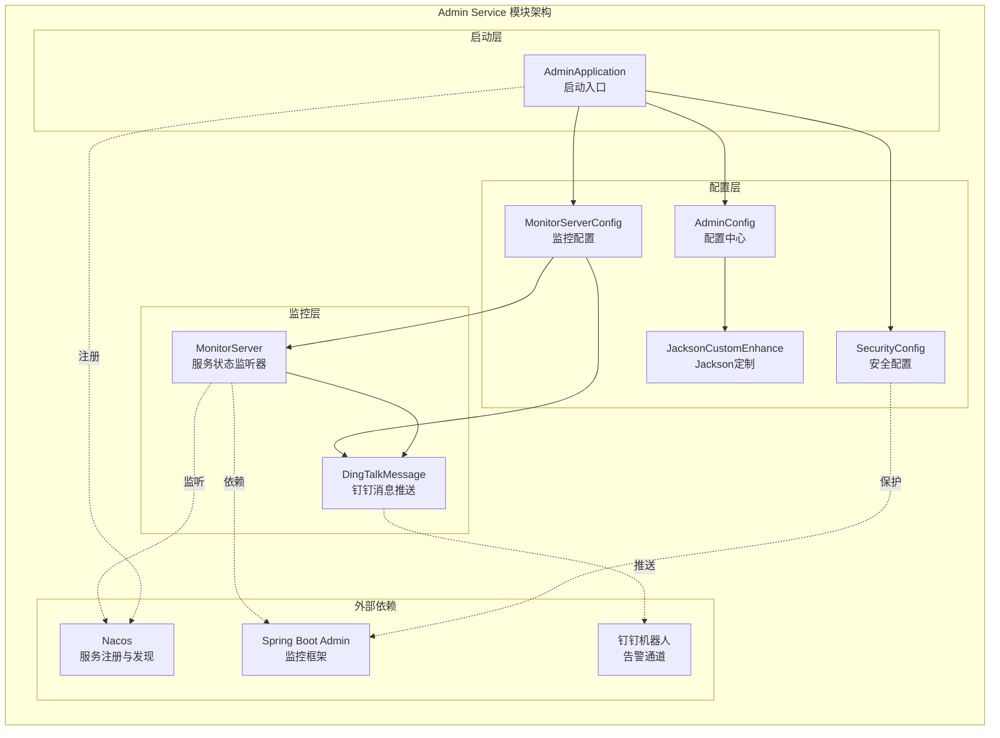
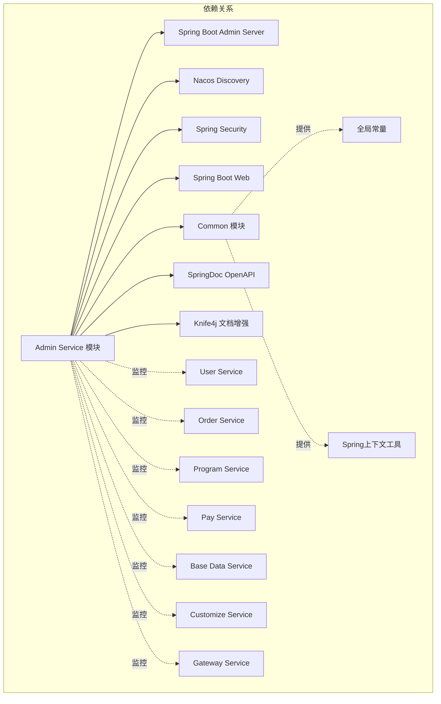
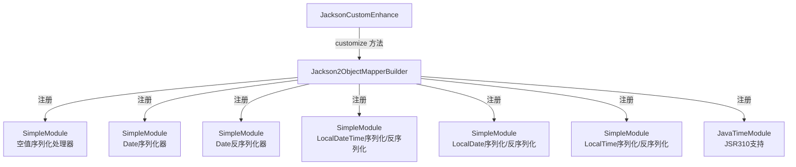
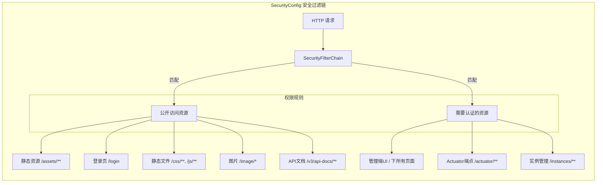
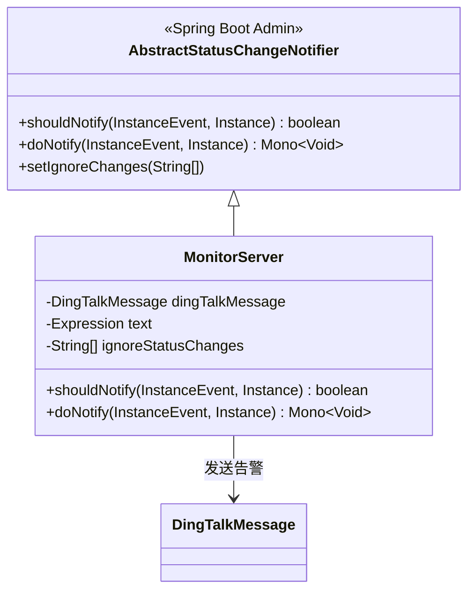
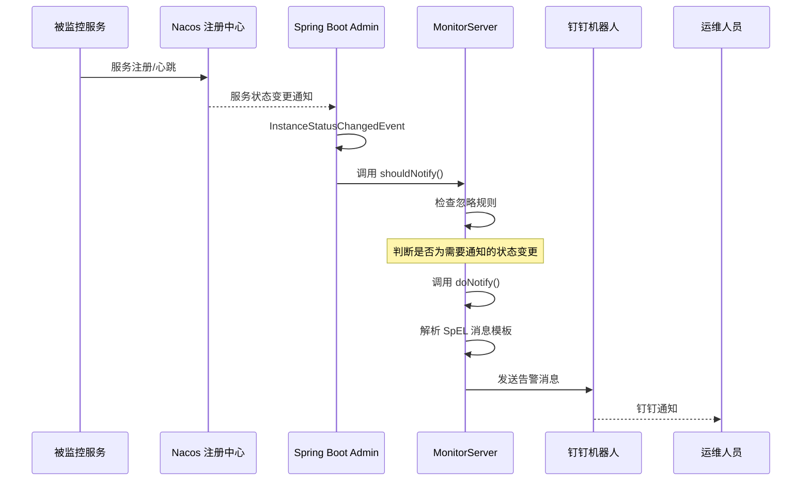
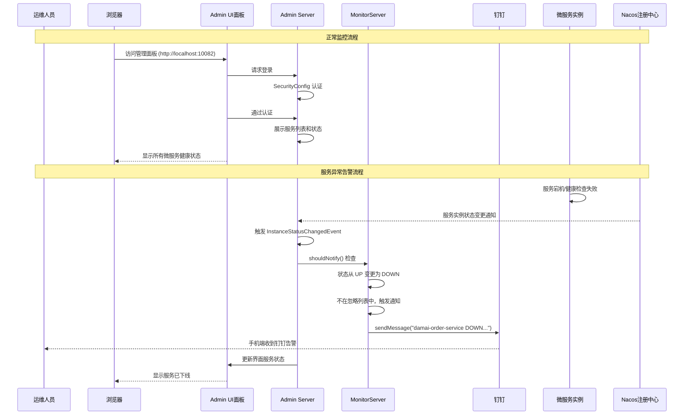
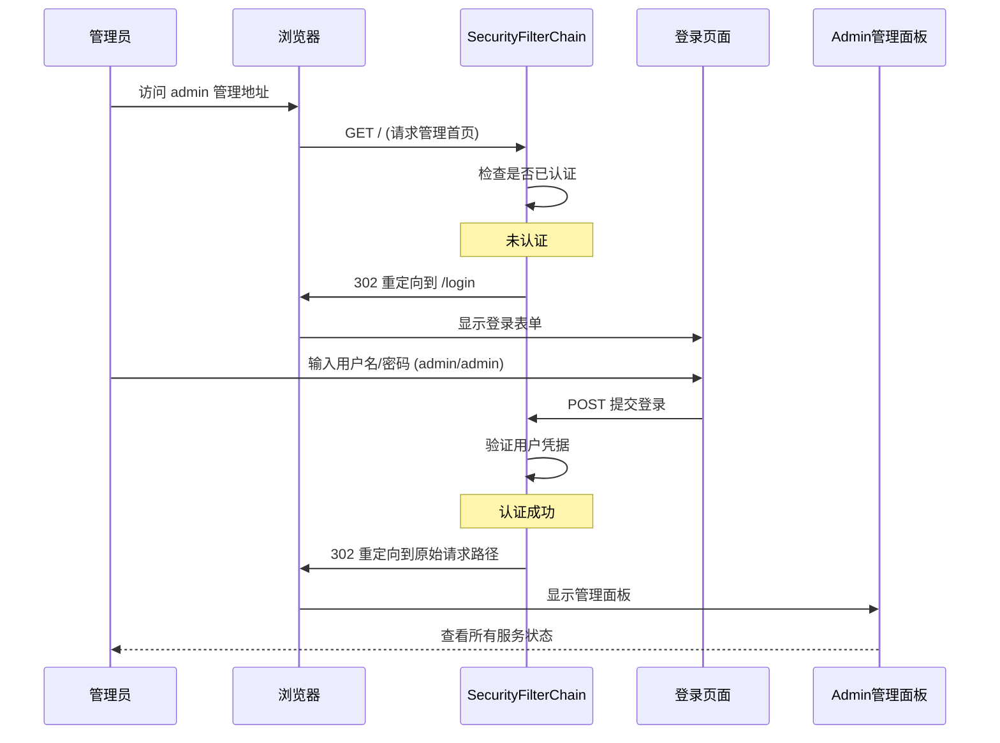
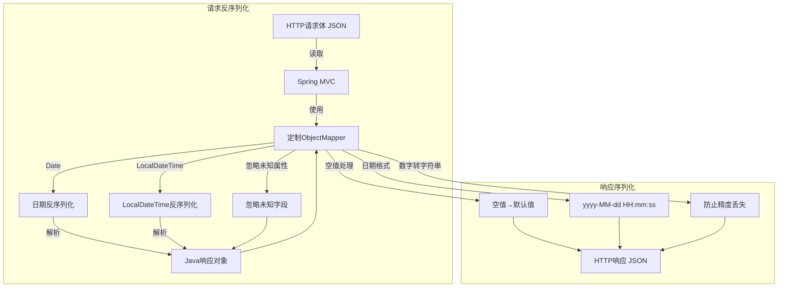

# Admin Service 模块 - 微服务监控管理中心

## 1. 模块简介

Admin Service 模块是大麦系统的**微服务监控管理中心**，基于 Spring Boot Admin 构建，提供对所有注册到 Nacos 的微服务实例的实时监控、状态管理和告警通知能力。该模块是整个系统运维监控的核心入口。

### 1.1 核心功能

| 功能分类 | 核心类 | 说明 |
|---------|--------|------|
| **服务监控** | `MonitorServer` | 基于 Spring Boot Admin 实现服务实例状态变更监听 |
| **告警通知** | `DingTalkMessage` | 通过钉钉机器人发送服务状态变更通知 |
| **权限控制** | `SecurityConfig` | 管理端登录认证和安全访问控制 |
| **API 文档** | `AdminConfig` | Swagger/OpenAPI 文档配置 |
| **JSON 序列化** | `JacksonCustomEnhance` | Jackson 全局序列化/反序列化定制 |
| **应用入口** | `AdminApplication` | 服务启动入口 |

### 1.2 模块架构图



### 1.3 模块依赖关系



## 2. 核心组件详解

### 2.1 AdminApplication（应用启动入口）

**作用**：微服务监控中心的 Spring Boot 应用入口类。

```java
@EnableAdminServer
@EnableDiscoveryClient
@SpringBootApplication(exclude = DaMaiCommonAutoConfig.class)
public class AdminApplication {
    public static void main(String[] args) {
        System.setProperty("nacos.logging.default.config.enabled","false");
        SpringApplication.run(AdminApplication.class, args);
    }
}
```

**关键注解说明**：

| 注解 | 作用 |
|------|------|
| `@EnableAdminServer` | 启用 Spring Boot Admin Server 功能，开启服务监控管理面板 |
| `@EnableDiscoveryClient` | 启用服务发现功能，从 Nacos 发现所有微服务实例 |
| `@SpringBootApplication(exclude = DaMaiCommonAutoConfig.class)` | 排除 Common 模块的自动配置，避免与自身 Jackson 配置冲突 |

**启动配置**：
- 关闭 Nacos 的默认日志配置（`nacos.logging.default.config.enabled=false`）
- 服务端口：`10082`（配置于 `application.yml`）
- 应用名称：`${prefix.distinction.name:damai}-admin-service`

### 2.2 AdminConfig（配置中心）

**作用**：提供 Admin Service 模块的通用 Bean 配置，包括 Jackson 定制和 API 文档配置。

```java
public class AdminConfig {
    
    @Primary
    @Bean
    public Jackson2ObjectMapperBuilderCustomizer jacksonCustomEnhance(){
        return new JacksonCustomEnhance();
    }
    
    @Bean
    public OpenAPI customOpenApi() {
        return new OpenAPI()
                .info(new Info()
                        .title("前端使用")
                        .version("1.0")
                        .description("项目学习")
                        .contact(new Contact()
                                .name("阿星不是程序员")
                        ));
    }
}
```

**注册的 Bean**：

| Bean 名称 | 类型 | 说明 |
|-----------|------|------|
| `jacksonCustomEnhance` | `Jackson2ObjectMapperBuilderCustomizer` | Jackson 全局序列化/反序列化定制器（`@Primary` 优先） |
| `customOpenApi` | `OpenAPI` | Swagger/OpenAPI 3.0 文档信息配置 |

**API 文档信息**：
- 标题：前端使用
- 版本：1.0
- 描述：项目学习
- 联系人：阿星不是程序员

### 2.3 JacksonCustomEnhance（Jackson 全局定制器）

**作用**：实现 `Jackson2ObjectMapperBuilderCustomizer` 和 `Ordered` 接口，对 Spring Boot 全局 Jackson ObjectMapper 进行统一配置。

**配置项汇总**：

| 配置类别 | 配置项 | 值/行为 |
|---------|--------|---------|
| **序列化包含** | `serializationInclusion` | `Include.ALWAYS`（所有字段参与序列化） |
| **JSON 解析** | `ALLOW_SINGLE_QUOTES` | 允许单引号 |
| **JSON 解析** | `ALLOW_UNQUOTED_FIELD_NAMES` | 允许未加引号的字段名 |
| **JSON 解析** | `ALLOW_UNESCAPED_CONTROL_CHARS` | 允许未转义的控制字符 |
| **JSON 生成** | `WRITE_NUMBERS_AS_STRINGS` | 数字以字符串形式写入 |
| **反序列化** | `FAIL_ON_UNKNOWN_PROPERTIES` | 忽略未知属性 |
| **时区** | `timeZone` | 使用系统默认时区 |

**日期格式化配置**：

| Java 类型 | 序列化格式 | 反序列化格式 |
|-----------|-----------|-------------|
| `java.util.Date` | `yyyy-MM-dd HH:mm:ss` | 支持多种格式（时间戳、`yyyy-MM`、`yyyy-MM-dd`、`yyyy-MM-dd HH:mm`、`yyyy-MM-dd HH:mm:ss`、`yyyy/MM/dd HH:mm:ss`） |
| `java.time.LocalDateTime` | `yyyy-MM-dd HH:mm:ss` | `yyyy-MM-dd HH:mm:ss` |
| `java.time.LocalDate` | `yyyy-MM-dd` | `yyyy-MM-dd` |
| `java.time.LocalTime` | `HH:mm:ss` | `HH:mm:ss` |

**自定义序列化模块加载**：



**执行优先级**：`Ordered.getOrder() = 1`，确保该定制器优先于其他定制器执行。

### 2.4 SecurityConfig（安全配置）

**作用**：基于 Spring Security 配置 Admin 管理端的登录认证和访问权限控制。

**认证方式**：基于表单登录（Form Login），默认用户凭据配置在 `application.yml`：

```yaml
spring:
  security:
    user:
      name: admin
      password: admin
```

**安全规则配置**：



**CSRF 保护的例外路径**：

| 路径模式 | 说明 |
|---------|------|
| `/instances` | 服务实例注册接口 |
| `/actuator/**` | Spring Boot Actuator 端点 |
| `/v3/api-docs/**` | OpenAPI 文档接口 |
| 带 ContextPath 的对应路径 | 适配 Admin Server 的上下文路径 |

**登录成功处理器**：
- 使用 `SavedRequestAwareAuthenticationSuccessHandler`
- 登录成功后重定向到原始请求路径
- 默认跳转到 Admin 管理首页

### 2.5 MonitorServerConfig（监控配置类）

**作用**：装配监控相关的 Bean，包括钉钉消息发送器和服务状态监听器。

```java
@Configuration
public class MonitorServerConfig {
    
    @Value("${dingtalk.token:}")
    private String token;
    
    @Bean
    public DingTalkMessage dingTalkMessage(){
        return new DingTalkMessage(token);
    }
    
    @Bean
    public MonitorServer monitorServer(DingTalkMessage dingTalkMessage, InstanceRepository repository){
        return new MonitorServer(dingTalkMessage, repository);
    }
}
```

**配置项**：

| 配置键 | 默认值 | 说明 |
|--------|--------|------|
| `dingtalk.token` | `""`（空字符串） | 钉钉机器人 Webhook 地址，为空时不发送通知 |

**Bean 依赖关系**：

```
DingTalkMessage(token) ← MonitorServerConfig
       ↓
MonitorServer(DingTalkMessage, InstanceRepository) ← MonitorServerConfig
       ↓
InstanceRepository ← Spring Boot Admin 框架自动注入
```

### 2.6 MonitorServer（服务状态监听器）

**作用**：继承 Spring Boot Admin 的 `AbstractStatusChangeNotifier`，实现服务实例状态变更的监听和告警通知。

**类继承关系**：



**状态变更忽略规则**：

配置了 `ignoreStatusChanges` 数组，以下状态变更不触发告警：

| 变更路径 | 说明 |
|---------|------|
| `UNKNOWN:UP` | 未知 → 上线（服务启动时的正常状态切换） |
| `DOWN:UP` | 下线 → 上线（服务恢复） |
| `OFFLINE:UP` | 离线 → 上线（服务重新连接） |

**告警触发条件**：
- 事件类型为 `InstanceStatusChangedEvent`
- 状态变更不在忽略列表中
- 支持通配符匹配（`*:UP` 表示任何状态变更为 UP 都不触发）

**通知消息模板**：

```
#{instance.registration.name} (#{instance.id}) status changed from #{fromStatus} to #{toStatus}  #{instance.registration.healthUrl}
```

基于 Spring Expression Language (SpEL) 解析，最终消息示例：

```
damai-user-service (123456) status changed from UP to DOWN  http://192.168.1.100:8080/actuator/health
```

**通知流程**：



### 2.7 DingTalkMessage（钉钉消息推送）

**作用**：通过钉钉自定义机器人 Webhook 发送文本消息，实现服务告警的通知渠道。

**消息格式**：

```json
{
  "msgtype": "text",
  "text": {
    "content": "消息内容"
  }
}
```

**核心方法**：

| 方法 | 说明 |
|------|------|
| `sendMessage(String message)` | 发送文本消息到钉钉，如果 token 为空则跳过 |
| `createMessage(String message)` | 构建钉钉消息请求体（内部方法） |

**发送流程**：

```
sendMessage(message)
  → token为空？ → 是 → 跳过（不发送）
  → 否 → 构建 HttpEntity 消息体
  → 调用 RestTemplate.postForEntity(token, entity, Void.class)
  → 发送完成
```

**技术实现**：
- 使用 `RestTemplate` 发送 HTTP POST 请求
- 请求头设置 `Content-Type: application/json`
- 消息体使用 FastJson2 序列化

## 3. 数据流与交互

### 3.1 服务监控告警全流程



### 3.2 安全访问流程



### 3.3 Jackson 序列化/反序列化流程



## 4. 项目结构与配置

### 4.1 项目结构

```
damai-admin-service/
├── pom.xml                                              # Maven 依赖配置
└── src/main/
    ├── java/com/damai/
    │   ├── AdminApplication.java                        # 应用启动入口
    │   └── config/
    │       ├── AdminConfig.java                         # 配置中心（Jackson + OpenAPI）
    │       ├── JacksonCustomEnhance.java                # Jackson 全局定制器
    │       ├── MonitorServerConfig.java                 # 监控配置装配
    │       └── SecurityConfig.java                      # 安全权限配置
    └── resources/
        ├── application.yml                              # 应用主配置
        ├── log4j2.xml                                   # Log4j2 日志配置
        └── META-INF/spring/
            └── ...                                      # Spring 自动配置元数据
```

### 4.2 核心配置说明

**`application.yml` 关键配置**：

```yaml
# 服务端口
server:
  port: 10082

# 应用名称
spring:
  application:
    name: damai-admin-service
  boot:
    admin:
      ui:
        title: 服务监控中心
        brand: <span>服务监控中心</span>
  cloud:
    nacos:
      discovery:
        server-addr: 127.0.0.1:8848   # Nacos 注册中心地址

# 管理端登录凭据
spring:
  security:
    user:
      name: admin
      password: admin

# 钉钉告警（可选）
# dingtalk:
#   token: https://oapi.dingtalk.com/robot/send?access_token=xxx

# Actuator 端点暴露
management:
  endpoints:
    web:
      exposure:
        include: '*'

# Swagger 文档
springdoc:
  swagger-ui:
    path: /swagger-ui.html
  api-docs:
    path: /v3/api-docs
  group-configs:
    - group: 'default'
      packages-to-scan: com.damai.controller
```

### 4.3 Maven 依赖

**pom.xml 核心依赖**：

| 依赖 | 作用 |
|------|------|
| `spring-boot-starter-web` | Web 服务基础能力 |
| `spring-boot-starter-validation` | 参数校验支持 |
| `spring-cloud-starter-alibaba-nacos-discovery` | Nacos 服务注册与发现 |
| `spring-boot-starter-actuator` | 健康检查与监控端点 |
| `spring-boot-admin-starter-server` | **Spring Boot Admin Server 核心依赖** |
| `spring-boot-starter-security` | **管理端安全认证** |
| `damai-common` | 大麦系统基础公共框架（排除自动配置） |
| `jackson-datatype-jsr310` | Java 8 日期类型支持 |
| `springdoc-openapi-starter-webmvc-ui` | OpenAPI 3.0 文档 |
| `knife4j-openapi3-jakarta-spring-boot-starter` | Knife4j 文档增强 UI |

## 5. 与其他模块的集成

### 5.1 被监控的服务

Admin Service 通过 Nacos 注册中心发现并监控以下所有微服务：

| 服务名称 | 说明 | 对应模块 |
|---------|------|---------|
| `damai-gateway-service` | API 网关服务 | [Gateway Service](Gateway Service.md) |
| `damai-base-data-service` | 基础数据服务 | [Base Data Service](Base Data Service.md) |
| `damai-customize-service` | 定制化服务 | [Customize Service](Customize Service.md) |
| `damai-user-service` | 用户服务 | [User Service](User Service.md) |
| `damai-order-service` | 订单服务 | [Order Service](Order Service.md) |
| `damai-pay-service` | 支付服务 | [Pay Service](Pay Service.md) |
| `damai-program-service` | 节目服务 | [Program Service](Program Service.md) |

### 5.2 依赖的框架模块

| 模块 | 说明 | 参考文档 |
|------|------|---------|
| **Common** | 提供常量、Spring 工具、日期工具等通用能力 | [damai-common.md](damai-common.md) |
| **Spring Cloud Framework** | 提供服务发现客户端、Actuator 端点集成 | [Spring Cloud Framework.md](Spring Cloud Framework.md) |

## 6. 运维指南

### 6.1 启动与访问

1. **启动服务**：
   ```bash
   cd damai-server/damai-admin-service
   mvn spring-boot:run
   ```

2. **访问管理面板**：
   - 地址：`http://localhost:10082`
   - 用户名：`admin`
   - 密码：`admin`

3. **查看 API 文档**：
   - Swagger UI：`http://localhost:10082/swagger-ui.html`
   - Knife4j UI：`http://localhost:10082/doc.html`

### 6.2 配置钉钉告警

在 `application.yml` 中取消注释并配置钉钉机器人 Webhook：

```yaml
dingtalk:
  token: https://oapi.dingtalk.com/robot/send?access_token=你的机器人Token
```

### 6.3 查看服务健康状态

Admin UI 面板提供以下功能：
- **概览视图**：所有服务实例的运行状态一览
- **详情视图**：单个服务的实例列表、健康端点、JVM 信息、线程信息
- **日志视图**：实时日志流查看
- **环境视图**：Spring 环境配置信息

### 6.4 安全建议

- 生产环境务必修改默认密码（`admin/admin`）
- 建议集成 LDAP 或 OAuth2 进行统一认证
- 可通过 `Nginx` 反向代理配置 HTTPS 和 IP 白名单
