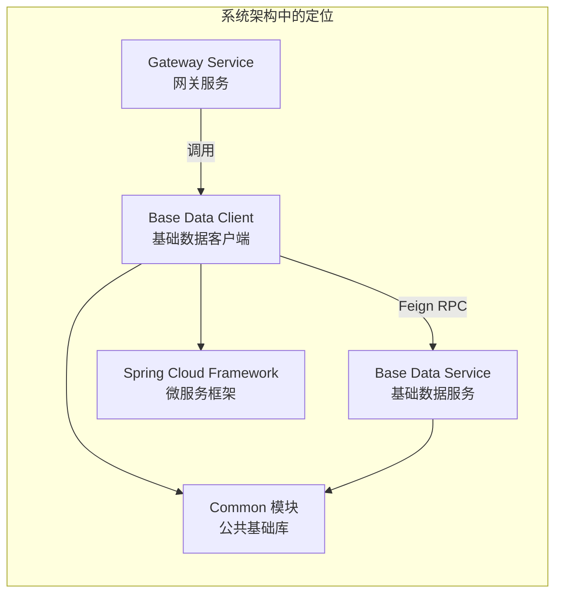
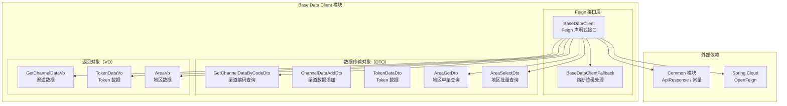
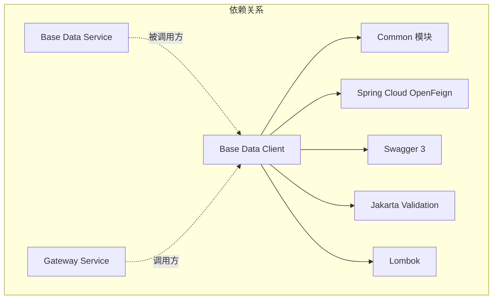
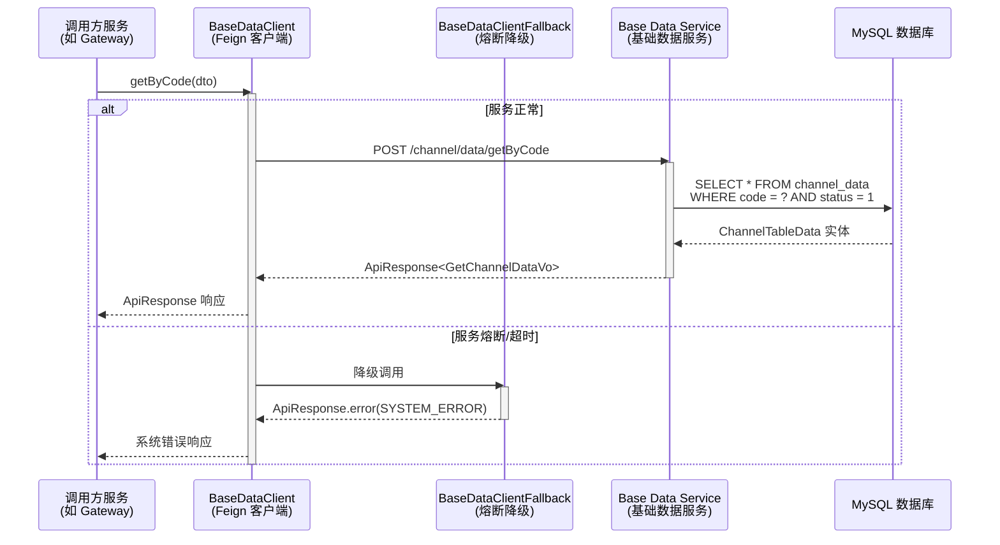
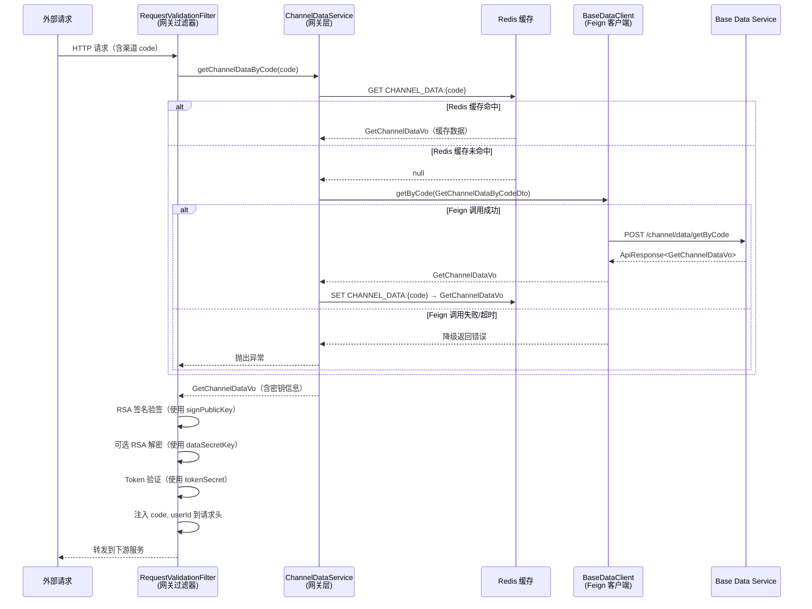
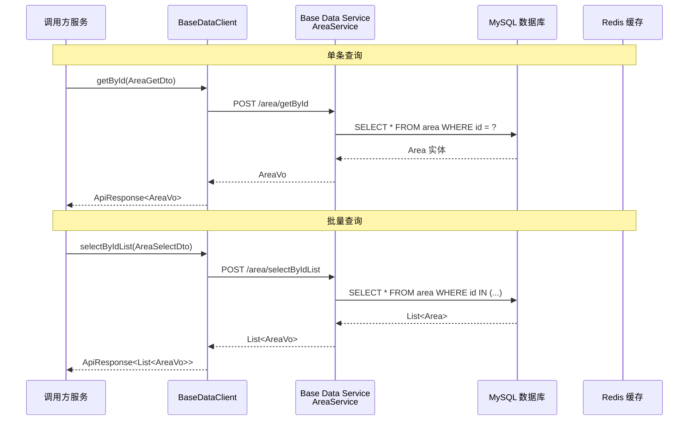
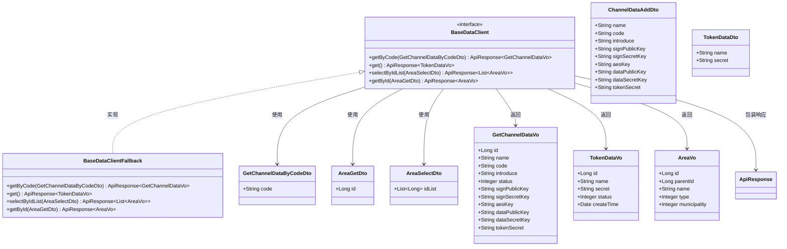
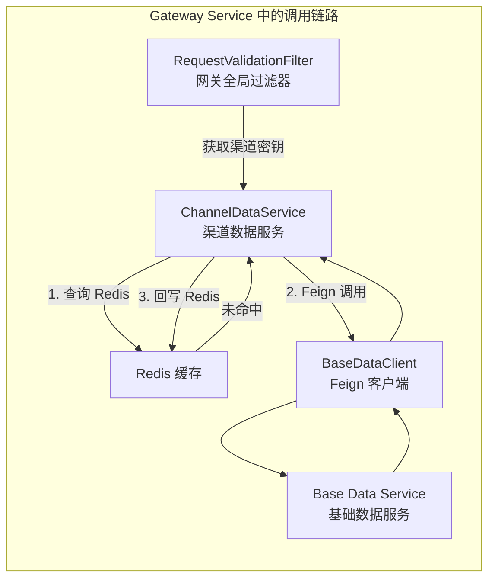

# Base Data Client 模块 - 基础数据客户端

## 1. 模块简介

Base Data Client 模块是大麦系统中**基础数据服务（Base Data Service）的 Feign 客户端模块**，位于 `damai-server-client/damai-base-data-client`。该模块通过声明式 Feign 接口为其他微服务提供与基础数据服务进行 RPC 通信的能力，涵盖**渠道数据查询**、**Token 数据查询**和**地区数据查询**三大核心功能。

### 1.1 核心功能

| 功能分类 | 说明 |
|---------|------|
| **渠道数据查询** | 根据渠道编码（code）查询渠道配置信息（签名密钥、加密密钥等） |
| **Token 数据查询** | 获取 Token 相关配置数据 |
| **地区数据查询** | 按 ID 或 ID 集合查询地区信息（省/市/区县） |

### 1.2 模块定位



## 2. 架构设计

### 2.1 模块架构图



### 2.2 模块依赖关系



### 2.3 内部依赖关系

Base Data Client 模块依赖的 Common 模块组件：

| 组件类 | 用途 |
|-------|------|
| `ApiResponse` | 统一响应体封装 |
| `Constant.SPRING_INJECT_PREFIX_DISTINCTION_NAME` | Feign 客户端服务名注入前缀 |

## 3. 核心组件详解

### 3.1 BaseDataClient（Feign 客户端接口）

**作用**：定义与基础数据服务通信的 REST API 接口，使用 Spring Cloud OpenFeign 声明式 HTTP 客户端。

```java
@Component
@FeignClient(value = SPRING_INJECT_PREFIX_DISTINCTION_NAME+"-"+"base-data-service", fallback = BaseDataClientFallback.class)
public interface BaseDataClient {
    // 根据code查询渠道数据
    @PostMapping("/channel/data/getByCode")
    ApiResponse<GetChannelDataVo> getByCode(GetChannelDataByCodeDto dto);
    
    // 查询token数据
    @PostMapping(value = "/get")
    ApiResponse<TokenDataVo> get();
    
    // 根据id集合查询地区列表
    @PostMapping(value = "/area/selectByIdList")
    ApiResponse<List<AreaVo>> selectByIdList(AreaSelectDto dto);
    
    // 根据id查询地区
    @PostMapping(value = "/area/getById")
    ApiResponse<AreaVo> getById(AreaGetDto dto);
}
```

**关键特性**：

| 属性 | 值 | 说明 |
|------|-----|------|
| `value` | `"${prefix.distinction.name:damai}-base-data-service"` | 服务名，默认 `damai-base-data-service` |
| `fallback` | `BaseDataClientFallback.class` | 熔断降级处理类 |
| 基础路径 | 无 | 各接口路径不同 |

**暴露的 API 端点**：

| HTTP 方法 | 路径 | 请求参数 | 响应类型 | 功能描述 |
|-----------|------|---------|---------|---------|
| POST | `/channel/data/getByCode` | `GetChannelDataByCodeDto` | `ApiResponse<GetChannelDataVo>` | 根据编码查询渠道配置数据 |
| POST | `/get` | 无 | `ApiResponse<TokenDataVo>` | 获取 Token 配置数据 |
| POST | `/area/selectByIdList` | `AreaSelectDto` | `ApiResponse<List<AreaVo>>` | 根据 ID 集合批量查询地区 |
| POST | `/area/getById` | `AreaGetDto` | `ApiResponse<AreaVo>` | 根据 ID 查询单个地区 |

### 3.2 BaseDataClientFallback（熔断降级处理）

**作用**：当 Base Data Service 不可用或调用超时时，提供降级响应，返回系统错误信息。

```java
@Component
public class BaseDataClientFallback implements BaseDataClient {
    @Override
    public ApiResponse<GetChannelDataVo> getByCode(GetChannelDataByCodeDto dto) {
        return ApiResponse.error(BaseCode.SYSTEM_ERROR);
    }
    
    @Override
    public ApiResponse<TokenDataVo> get() {
        return ApiResponse.error(BaseCode.SYSTEM_ERROR);
    }
    
    @Override
    public ApiResponse<List<AreaVo>> selectByIdList(AreaSelectDto dto) {
        return ApiResponse.error(BaseCode.SYSTEM_ERROR);
    }
    
    @Override
    public ApiResponse<AreaVo> getById(AreaGetDto dto) {
        return ApiResponse.error(BaseCode.SYSTEM_ERROR);
    }
}
```

**降级策略**：
- 所有接口统一返回 `ApiResponse.error(BaseCode.SYSTEM_ERROR)`
- 调用方需根据 `ApiResponse` 的 `code` 判断是否成功

### 3.3 数据传输对象（DTO）

#### GetChannelDataByCodeDto（渠道编码查询参数）

| 字段 | 类型 | 约束 | 说明 |
|------|------|------|------|
| `code` | String | `@NotBlank` | 渠道编码（唯一标识） |

#### ChannelDataAddDto（渠道数据添加参数）

| 字段 | 类型 | 约束 | 说明 |
|------|------|------|------|
| `name` | String | `@NotBlank` | 渠道名称 |
| `code` | String | `@NotBlank` | 渠道编码 |
| `introduce` | String | 可选 | 渠道介绍 |
| `signPublicKey` | String | `@NotBlank` | RSA 签名公钥 |
| `signSecretKey` | String | `@NotBlank` | RSA 签名私钥 |
| `aesKey` | String | 可选 | AES 加密密钥 |
| `dataPublicKey` | String | 可选 | RSA 参数加密公钥 |
| `dataSecretKey` | String | 可选 | RSA 参数加密私钥 |
| `tokenSecret` | String | `@NotBlank` | Token 签名密钥 |

> **注意**：`ChannelDataAddDto` 在 Base Data Client 模块中定义，但当前 Feign 接口中未暴露添加渠道的 API。该 DTO 由 Base Data Service 的 `ChannelDataController.add()` 接口直接使用。

#### TokenDataDto（Token 数据参数）

| 字段 | 类型 | 约束 | 说明 |
|------|------|------|------|
| `name` | String | `@NotBlank` | Token 名称 |
| `secret` | String | `@NotBlank` | Token 秘钥 |

#### AreaGetDto（地区单条查询参数）

| 字段 | 类型 | 约束 | 说明 |
|------|------|------|------|
| `id` | Long | `@NotNull` | 地区 ID |

#### AreaSelectDto（地区批量查询参数）

| 字段 | 类型 | 约束 | 说明 |
|------|------|------|------|
| `idList` | List\<Long\> | `@NotNull` | 地区 ID 集合 |

### 3.4 返回对象（VO）

#### GetChannelDataVo（渠道数据返回）

| 字段 | 类型 | 说明 |
|------|------|------|
| `id` | Long | 渠道 ID |
| `name` | String | 渠道名称 |
| `code` | String | 渠道编码 |
| `introduce` | String | 渠道介绍 |
| `status` | Integer | 状态（1：正常，0：禁用） |
| `signPublicKey` | String | RSA 签名公钥 |
| `signSecretKey` | String | RSA 签名私钥 |
| `aesKey` | String | AES 加密密钥 |
| `dataPublicKey` | String | RSA 参数加密公钥 |
| `dataSecretKey` | String | RSA 参数加密私钥 |
| `tokenSecret` | String | Token 签名密钥 |

#### TokenDataVo（Token 数据返回）

| 字段 | 类型 | 说明 |
|------|------|------|
| `id` | Long | Token ID |
| `name` | String | Token 名称 |
| `secret` | String | Token 秘钥 |
| `status` | Integer | 状态（1：正常，0：禁用） |
| `createTime` | Date | 创建时间 |

#### AreaVo（地区数据返回）

| 字段 | 类型 | 说明 |
|------|------|------|
| `id` | Long | 区域 ID |
| `parentId` | Long | 父级区域 ID |
| `name` | String | 区域名称 |
| `type` | Integer | 区域类型（1：省，2：区，3：县） |
| `municipality` | Integer | 是否直辖市（1：是，0：否） |

## 4. 数据流与交互

### 4.1 渠道数据查询流程



### 4.2 网关层渠道数据获取完整流程

Gateway Service 是 `BaseDataClient` 的核心调用方，其 `ChannelDataService` 封装了**两级缓存 + Feign 调用**的完整获取逻辑：



### 4.3 地区数据查询流程



### 4.4 数据模型关系



## 5. 与外部模块的交互

### 5.1 调用方：Gateway Service（网关服务）

Gateway Service 通过 `ChannelDataService` 封装了对 `BaseDataClient` 的调用，实现了**两级缓存架构**：



### 5.2 被调用方：Base Data Service（基础数据服务）

Base Data Service 提供了 Feign 客户端对应的服务端实现：

| Feign 客户端方法 | 服务端 Controller | 服务端 Service |
|-----------------|------------------|---------------|
| `getByCode()` | `ChannelDataController.getByCode()` | `ChannelDataService.getByCode()` |
| `get()` | 暂无对应实现 | 暂无 |
| `selectByIdList()` | `AreaController.selectByIdList()` | `AreaService.selectByIdList()` |
| `getById()` | `AreaController.getById()` | `AreaService.getById()` |

> **注意**：`BaseDataClient.get()` 端点对应的服务端实现有待确认，当前 Base Data Service 的 `TestController` 或其他控制器尚未发现对应 `/get` 端点的实现。

## 6. 项目结构

```
damai-server-client/damai-base-data-client/
├── pom.xml                                      # 模块配置（无额外依赖，继承 damai-server-client）
└── src/main/java/com/damai/
    ├── client/
    │   ├── BaseDataClient.java                  # Feign 声明式客户端接口
    │   └── BaseDataClientFallback.java          # Feign 熔断降级处理
    ├── dto/
    │   ├── AreaGetDto.java                      # 地区单条查询参数
    │   ├── AreaSelectDto.java                   # 地区批量查询参数
    │   ├── ChannelDataAddDto.java               # 渠道数据添加参数
    │   ├── GetChannelDataByCodeDto.java         # 渠道编码查询参数
    │   └── TokenDataDto.java                    # Token 数据参数
    └── vo/
        ├── AreaVo.java                          # 地区数据返回
        ├── GetChannelDataVo.java                # 渠道数据返回
        └── TokenDataVo.java                     # Token 数据返回
```

## 7. 配置说明

Base Data Client 模块的配置主要依赖父模块 `damai-server-client`，自身无额外配置项。

### 7.1 Feign 服务名配置

```yaml
# application.yml / bootstrap.yml
# 服务名前缀（可选，默认 damai）
prefix:
  distinction:
    name: damai

# 完整的服务名: damai-base-data-service
```

Feign 客户端通过 `Constant.SPRING_INJECT_PREFIX_DISTINCTION_NAME`（值为 `"${prefix.distinction.name:damai}"`）动态注入服务名前缀，最终服务名为 `{prefix}-base-data-service`。

### 7.2 相关 Nacos 配置

```yaml
# Base Data Service 的 Nacos 配置
spring:
  application:
    name: ${prefix.distinction.name:damai}-base-data-service
  cloud:
    nacos:
      discovery:
        server-addr: ${nacos.address:127.0.0.1:8848}
```

## 8. 与其他 Client 模块的对比

Base Data Client 是大麦系统中多个 Feign Client 模块之一。下表列出与其他 Client 模块的对比：

| Client 模块 | 对应服务 | 核心功能 | API 数量 |
|------------|---------|---------|---------|
| **Base Data Client** | 基础数据服务 | 渠道数据、地区数据、Token 数据 | 4 |
| Customize Client | 定制服务 | 规则管理、广播调用 | - |
| Job Client | 任务服务 | 任务管理、任务执行 | - |
| Order Client | 订单服务 | 订单查询、支付、退款 | - |
| Pay Client | 支付服务 | 支付账单 | - |
| Program Client | 节目服务 | 节目管理、座位管理 | - |
| User Client | 用户服务 | 用户注册、登录、认证 | - |

## 9. 常见问题与使用指南

### 9.1 如何添加新接口

1. 在 `BaseDataClient` 接口中添加新的 `@PostMapping` 方法
2. 在 `BaseDataClientFallback` 中实现对应的降级逻辑
3. 在 Base Data Service 中创建对应的 Controller 和 Service 实现

### 9.2 熔断降级说明

当 Base Data Service 不可用时，`BaseDataClientFallback` 会返回 `ApiResponse.error(BaseCode.SYSTEM_ERROR)`。调用方需要：

```java
ApiResponse<GetChannelDataVo> response = baseDataClient.getByCode(dto);
if (Objects.equals(response.getCode(), BaseCode.SUCCESS.getCode())) {
    // 正常处理
    return response.getData();
} else {
    // 降级处理或抛出异常
    throw new DaMaiFrameException(BaseCode.SYSTEM_ERROR);
}
```

### 9.3 超时处理建议

建议在 Feign 配置中设置合理的超时时间：

```yaml
feign:
  client:
    config:
      damai-base-data-service:
        connect-timeout: 5000
        read-timeout: 10000
```

## 10. 相关文档

- [Common 模块](damai-common.md) - 提供 ApiResponse、常量等基础支持
- [Spring Cloud Framework](Spring Cloud Framework.md) - 提供 Feign 客户端、负载均衡等微服务基础设施
- [Redis Tool Framework](Redis Tool Framework.md) - 缓存工具，用于渠道数据的 Redis 缓存
- [Gateway Service 文档] - 网关服务，BaseDataClient 的主要调用方
