# Base Data Service 模块 - 基础数据服务

## 1. 模块简介

Base Data Service 模块是大麦系统中的**基础数据微服务**，位于 `damai-server/damai-base-data-service`，运行在 **6083 端口**。该模块作为大麦系统的数据基础设施层，提供两大核心数据管理功能：**地区（区域）数据管理**和**渠道数据管理**，为其他微服务（如 Gateway Service、Program Service、Order Service 等）提供统一的基础数据查询与维护能力。

### 1.1 核心功能

| 功能分类 | 说明 |
|---------|------|
| **地区数据管理** | 提供省/市/区县等地区数据的查询能力，包含城市列表、热门城市、当前城市、按 ID 查询等 |
| **渠道数据管理** | 提供渠道（如 PC 端、移动端、第三方渠道）配置数据的管理能力，包含渠道添加、按编码查询等 |
| **测试功能** | 提供线程上下文传递（ThreadLocal/InheritableThreadLocal/TransmittableThreadLocal）的测试接口 |

### 1.2 模块定位

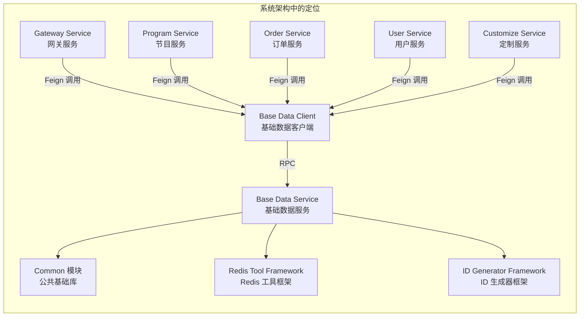

## 2. 架构设计

### 2.1 模块架构图

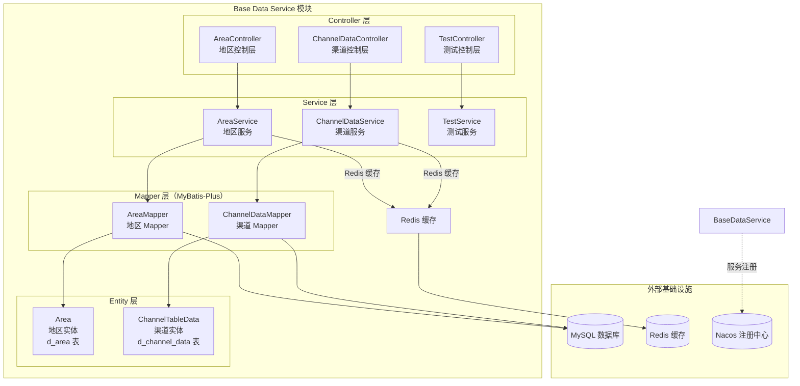

### 2.2 模块依赖关系

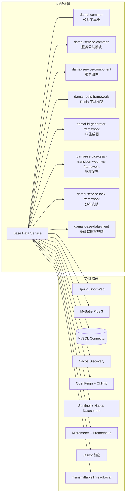

### 2.3 数据库表结构

#### d_area（地区表）

| 字段名 | 类型 | 说明 |
|-------|------|------|
| `id` | bigint (PK, AUTO) | 区域 ID |
| `parent_id` | bigint | 父级区域 ID |
| `name` | varchar | 区域名称 |
| `type` | int | 区域类型（1：省，2：区，3：县） |
| `municipality` | int | 是否直辖市（1：是，0：否） |
| ... | ... | 继承 `BaseTableData` 的通用字段 |

#### d_channel_data（渠道数据表）

| 字段名 | 类型 | 说明 |
|-------|------|------|
| `id` | bigint (PK) | 渠道 ID（由 ID 生成器生成） |
| `name` | varchar | 渠道名称 |
| `code` | varchar | 渠道编码（唯一标识） |
| `introduce` | varchar | 渠道介绍 |
| `sign_public_key` | varchar | RSA 签名公钥 |
| `sign_secret_key` | varchar | RSA 签名私钥 |
| `aes_key` | varchar | AES 加密密钥 |
| `data_public_key` | varchar | RSA 参数加密公钥 |
| `data_secret_key` | varchar | RSA 参数加密私钥 |
| `token_secret` | varchar | Token 签名密钥 |
| `status` | int | 状态（1：正常，0：禁用，逻辑删除） |
| ... | ... | 继承 `BaseTableData` 的通用字段 |

## 3. 核心组件详解

### 3.1 BaseDataApplication（启动类）

**作用**：Spring Boot 应用启动入口，配置 MyBatis-Plus 包扫描、事务管理、服务注册发现和 Feign 客户端。

```java
@MapperScan({"com.damai.mapper"})
@EnableTransactionManagement
@EnableDiscoveryClient
@EnableFeignClients
@SpringBootApplication
public class BaseDataApplication {
    public static void main(String[] args) {
        System.setProperty("nacos.logging.default.config.enabled","false");
        SpringApplication.run(BaseDataApplication.class, args);
    }
}
```

**关键注解说明**：

| 注解 | 作用 |
|------|------|
| `@MapperScan` | 扫描 `com.damai.mapper` 包下的 MyBatis-Plus Mapper 接口 |
| `@EnableTransactionManagement` | 启用声明式事务管理 |
| `@EnableDiscoveryClient` | 启用 Nacos 服务注册与发现 |
| `@EnableFeignClients` | 启用 OpenFeign 客户端（用于服务间调用） |

### 3.2 AreaController（地区控制层）

**作用**：提供地区数据的 RESTful API，供前端和其他微服务调用。

**请求路径**：`/area`

**暴露的 API**：

| HTTP 方法 | 路径 | 请求参数 | 响应类型 | 功能描述 |
|-----------|------|---------|---------|---------|
| POST | `/selectCityData` | 无 | `ApiResponse<List<AreaVo>>` | 查询直辖市和省会城市数据 |
| POST | `/selectByIdList` | `AreaSelectDto` | `ApiResponse<List<AreaVo>>` | 根据 ID 集合批量查询地区 |
| POST | `/getById` | `AreaGetDto` | `ApiResponse<AreaVo>` | 根据 ID 查询单个地区 |
| POST | `/current` | 无 | `ApiResponse<AreaVo>` | 获取当前城市（硬编码 ID=2） |
| POST | `/hot` | 无 | `ApiResponse<List<AreaVo>>` | 获取热门城市列表 |

### 3.3 AreaService（地区服务层）

**作用**：地区数据的业务逻辑层，封装了**Redis 缓存 + 数据库查询**的二级数据获取策略。

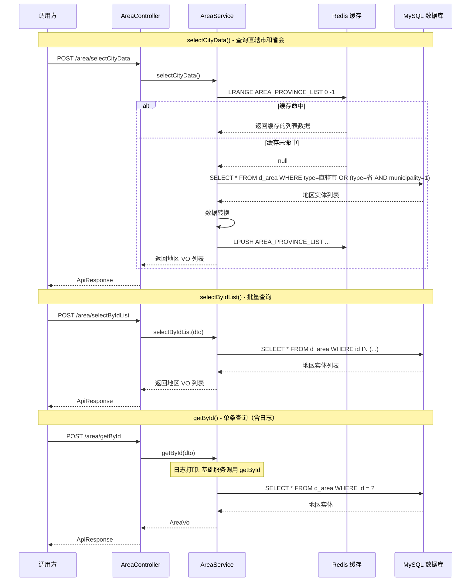

**缓存策略**：

| 缓存 Key | 说明 | 缓存内容 |
|---------|------|---------|
| `AREA_PROVINCE_LIST` | 直辖市和省会城市列表 | `List<AreaVo>`（Redis List 结构） |

**关键业务方法**：

| 方法 | 描述 |
|------|------|
| `selectCityData()` | 查询所有直辖市 + 省会城市，优先从 Redis 缓存获取，缓存未命中则查库并回写缓存 |
| `selectByIdList(AreaSelectDto)` | 根据 ID 集合批量查询地区数据（直接查库，无缓存） |
| `getById(AreaGetDto)` | 根据 ID 查询单个地区数据（直接查库，含日志记录） |
| `current()` | 获取当前城市（硬编码 ID=2，用于默认定位） |
| `hot()` | 获取热门城市列表（硬编码城市名称） |

### 3.4 ChannelDataController（渠道控制层）

**作用**：提供渠道数据的 RESTful API，供管理后台和网关服务调用。

**请求路径**：`/channel/data`

**暴露的 API**：

| HTTP 方法 | 路径 | 请求参数 | 响应类型 | 功能描述 |
|-----------|------|---------|---------|---------|
| POST | `/getByCode` | `GetChannelDataByCodeDto` | `ApiResponse<GetChannelDataVo>` | 根据编码查询渠道配置（含密钥信息） |
| POST | `/add` | `ChannelDataAddDto` | `ApiResponse<Boolean>` | 添加新渠道（生成 ID、写入 DB 和 Redis） |

### 3.5 ChannelDataService（渠道服务层）

**作用**：渠道数据的业务逻辑层，提供渠道配置的查询和新增功能，使用 ID 生成器分配唯一 ID。

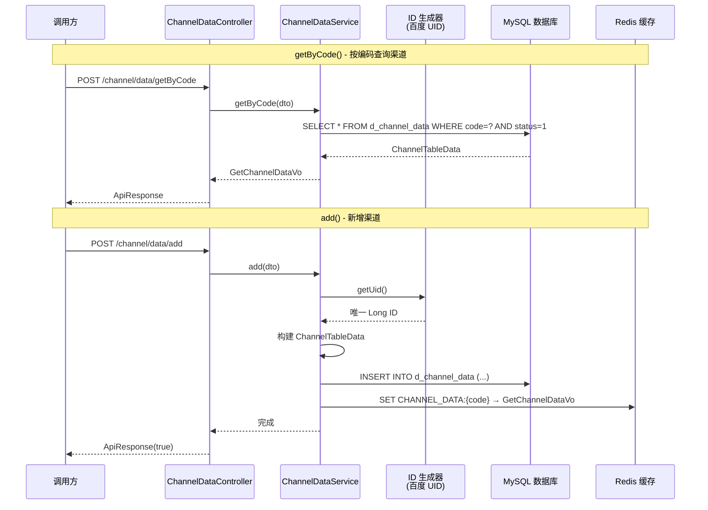

**关键业务方法**：

| 方法 | 描述 |
|------|------|
| `getByCode(GetChannelDataByCodeDto)` | 根据渠道编码查询渠道配置，仅返回状态为 "正常" 的渠道 |
| `add(ChannelDataAddDto)` | 新增渠道，使用 `UidGenerator` 生成唯一 ID，写入数据库后同步写入 Redis 缓存 |

**数据同步策略**：
- 新增渠道时，**同步写入** Redis 缓存（Key: `CHANNEL_DATA:{code}`）
- 查询时优先查库（当前实现未直接从 Redis 读取，但存在 Redis 回写逻辑供网关或其他服务直接读取）

### 3.6 TestController & TestService（测试功能）

**作用**：提供 ThreadLocal、InheritableThreadLocal、TransmittableThreadLocal 的测试接口，用于验证线程上下文传递机制。

**请求路径**：`/test`

**暴露的 API**：

| HTTP 方法 | 路径 | 功能描述 |
|-----------|------|---------|
| POST | `/testData` | 测试普通 ThreadLocal 在新线程中无法获取父线程值 |
| POST | `/testData2` | 测试 InheritableThreadLocal 在新线程中可获取值 |
| POST | `/testData3` | 测试 InheritableThreadLocal 在线程池中丢失值 |
| POST | `/testData4` | 测试 TransmittableThreadLocal + TtlRunnable 在线程池中传递值 |
| POST | `/testData5` | 测试 TransmittableThreadLocal + MDC 实现日志链路追踪 |

```mermaid
flowchart TB
    subgraph ThreadLocal测试场景
        direction TB
        
        subgraph testData-普通ThreadLocal
            TL1(主线程: tl.set traceId)
            TL2(new Thread: tl.get = null)
            TL1 -->|无法传递| TL2
        end
        
        subgraph testData2-InheritableThreadLocal
            ITL1(主线程: itl.set traceId)
            ITL2(new Thread: itl.get = traceId)
            ITL1 -->|可以传递| ITL2
        end
        
        subgraph testData3-线程池场景
            ITL3(主线程: itl.set traceId)
            ITL4(线程池: itl.get = null)
            ITL3 -->|线程池复用丢失| ITL4
        end
        
        subgraph testData4-TransmittableThreadLocal
            TTL1(主线程: ttl.set traceId)
            TTL2(线程池+TtlRunnable: ttl.get = traceId)
            TTL1 -->|Alibaba TTL 传递| TTL2
        end
        
        subgraph testData5-TTL加MDC日志链路
            TTL3(主线程: ttl2.set traceId)
            TTL4(beforeExecute: MDC.put)
            TTL5(子线程: log.info)
            TTL6(afterExecute: MDC.clear)
            TTL3 --> TTL4
            TTL4 --> TTL5
            TTL5 --> TTL6
        end
    end
```

### 3.7 实体与 Mapper

#### Area（地区实体）

```java
@Data
@TableName("d_area")
public class Area extends BaseTableData implements Serializable {
    private Long id;           // 区域 ID（自增主键）
    private Long parentId;     // 父级区域 ID
    private String name;       // 区域名称
    private Integer type;      // 类型（1:省 2:区 3:县）
    private Integer municipality; // 是否直辖市（1:是 0:否）
}
```

- 继承 `BaseTableData`，包含通用字段如 `create_time`、`update_time`、`status` 等
- `AreaMapper` 继承 `BaseMapper<Area>`，直接使用 MyBatis-Plus 通用 CRUD

#### ChannelTableData（渠道实体）

```java
@Data
@TableName("d_channel_data")
public class ChannelTableData extends BaseTableData implements Serializable {
    private Long id;              // 渠道 ID（UID 生成器生成）
    private String name;          // 渠道名称
    private String code;          // 渠道编码（唯一）
    private String introduce;     // 渠道介绍
    private String signPublicKey; // RSA 签名公钥
    private String signSecretKey; // RSA 签名私钥
    private String aesKey;        // AES 加密密钥
    private String dataPublicKey; // RSA 参数加密公钥
    private String dataSecretKey; // RSA 参数加密私钥
    private String tokenSecret;   // Token 签名密钥
}
```

- 继承 `BaseTableData`，包含通用字段
- `ChannelDataMapper` 继承 `BaseMapper<ChannelTableData>`

## 4. 数据流与交互

### 4.1 整体数据流

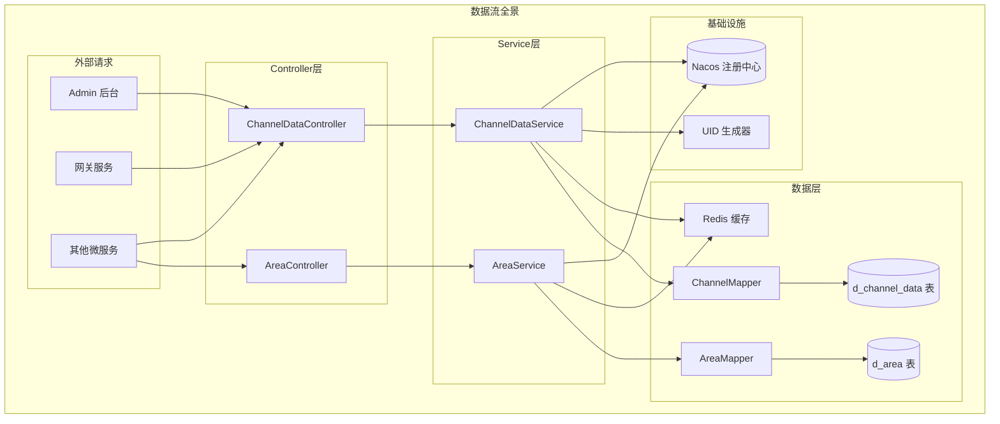

### 4.2 渠道数据管理流程

渠道数据是整个大麦系统的安全基础，每个渠道（PC 端、移动端、第三方等）拥有独立的加密密钥对，用于请求签名验证和数据加解密。

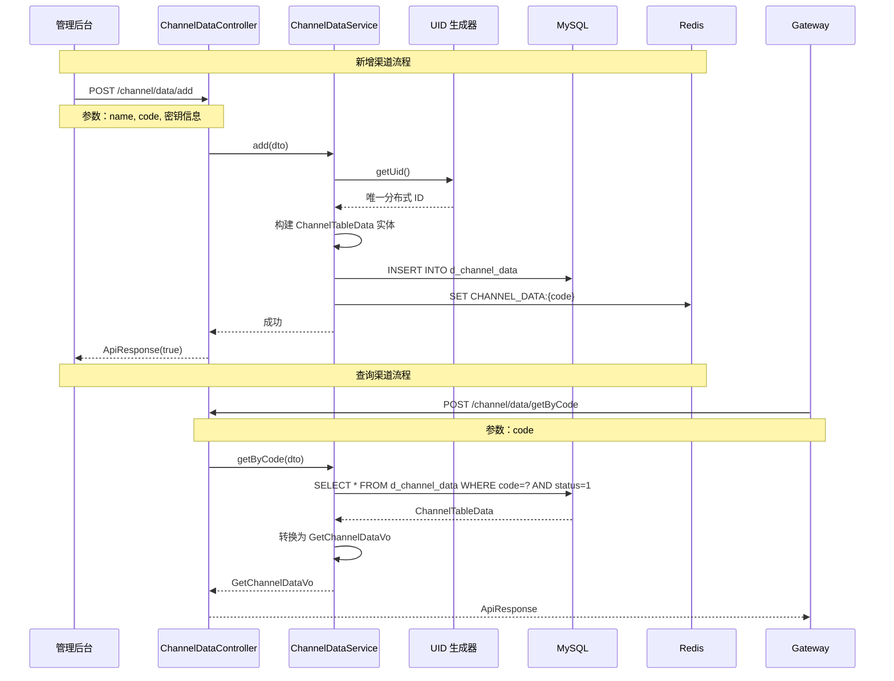

### 4.3 地区数据管理流程

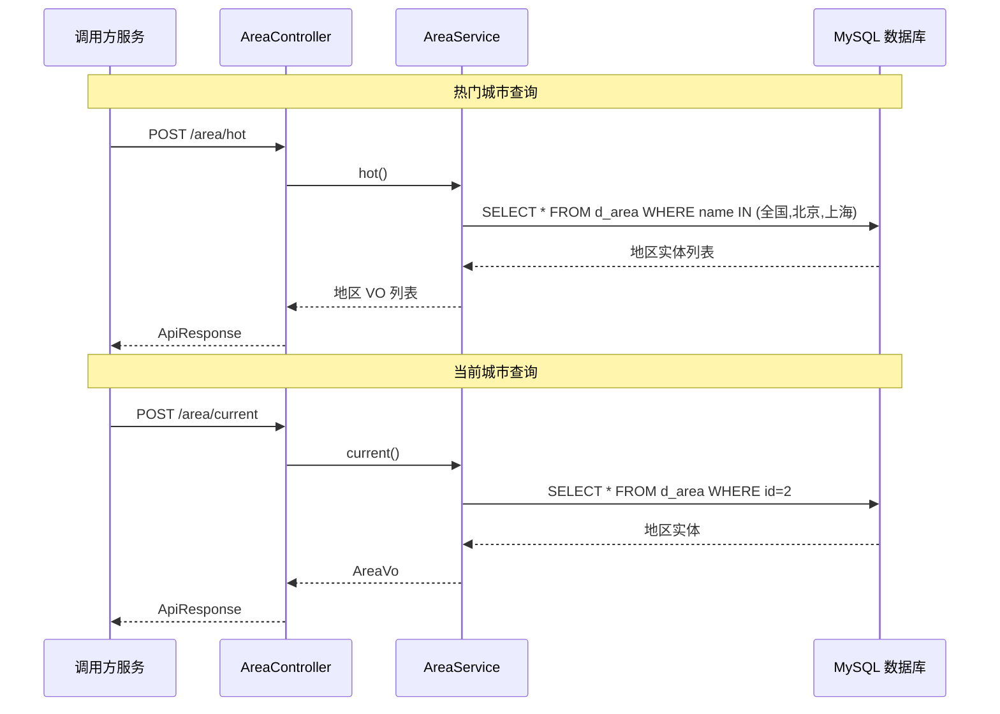

### 4.4 网关层集成流程

Gateway Service 是 Base Data Service 的核心客户端，其 `RequestValidationFilter` 在请求入口处通过 `ChannelDataService` 获取渠道密钥信息，完成签名验证和安全校验。

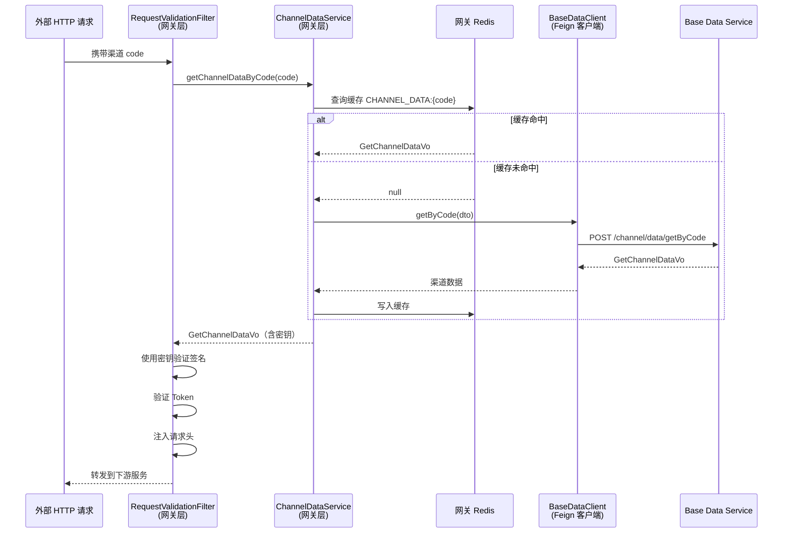

## 5. 与外部模块的交互

### 5.1 客户端模块：Base Data Client

Base Data Client 是 Base Data Service 的 **Feign 客户端模块**，为其他微服务提供声明式 RPC 调用接口。

| 客户端方法 | 服务端端点 | 服务端实现 |
|-----------|----------|-----------|
| `getByCode()` | `POST /channel/data/getByCode` | `ChannelDataController.getByCode()` |
| `selectByIdList()` | `POST /area/selectByIdList` | `AreaController.selectByIdList()` |
| `getById()` | `POST /area/getById` | `AreaController.getById()` |
| `get()` | `POST /get` | 暂未实现 |

> 详细说明请参考 [Base Data Client](Base%20Data%20Client.md)。

### 5.2 依赖的基础框架

| 框架模块 | 用途 |
|---------|------|
| [Common](damai-common.md) | 提供 `ApiResponse`、常量、工具类等公共组件 |
| [Redis Tool Framework](Redis%20Tool%20Framework.md) | 提供 `RedisCache` 缓存工具，用于地区列表和渠道数据的缓存 |
| [ID Generator Framework](ID%20Generator%20Framework.md) | 提供百度 UID 生成器，用于渠道数据的分布式 ID 生成 |
| [Spring Cloud Framework](Spring%20Cloud%20Framework.md) | 提供微服务公共配置（Swagger、Feign、MyBatis-Plus 等） |
| [Redisson Framework](Redisson%20Framework.md) | 提供分布式锁能力（依赖引入，当前模块未直接使用） |
| [Thread Pool Framework](Thread%20Pool%20Framework.md) | 提供线程池配置（依赖引入，当前模块未直接使用） |

### 5.3 Gateway Service 中的调用

Gateway Service 通过 `BaseDataClient` 调用 Base Data Service 获取渠道密钥信息，用于网关层的请求签名验证、Token 验证和数据加解密。

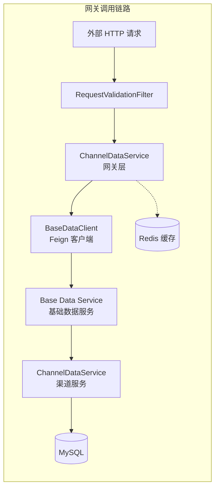

## 6. 配置说明

### 6.1 服务配置

```yaml
# 服务端口
server:
  port: 6083

# 应用名称
spring:
  application:
    name: ${prefix.distinction.name:damai}-base-data-service
  profiles:
    active: local
    
  # Redis 配置
  data:
    redis:
      database: 0
      host: 127.0.0.1
      port: 6379
      timeout: 3000
      
  # Nacos 注册中心
  cloud:
    nacos:
      discovery:
        server-addr: 127.0.0.1:8848
        username: nacos
        password: nacos

# MyBatis-Plus 配置
mybatis-plus:
  mapper-locations: classpath:mapper/*.xml
  global-config:
    db-config:
      logic-delete-field: status
      logic-delete-value: 0
      logic-not-delete-value: 1

# Feign 配置
feign:
  sentinel:
    enabled: false
  hystrix:
    enabled: true
  okhttp:
    enabled: true

# Swagger / Knife4j 配置
springdoc:
  swagger-ui:
    path: /swagger-ui.html
  api-docs:
    path: /v3/api-docs
  group-configs:
    - group: 'default'
      paths-to-match: '/**'
      packages-to-scan: com.damai.controller
      
knife4j:
  enable: true
  production: false
```

### 6.2 关键配置项说明

| 配置项 | 说明 |
|-------|------|
| `server.port=6083` | 服务端口 |
| `spring.application.name` | 服务注册名，默认 `damai-base-data-service` |
| `mybatis-plus.global-config.db-config.logic-delete-field=status` | 逻辑删除字段为 `status` |
| `feign.okhttp.enabled=true` | 启用 OkHttp 作为 Feign 的 HTTP 客户端 |
| `springdoc.packages-to-scan=com.damai.controller` | Swagger 扫描 Controller 包 |

## 7. 项目结构

```
damai-base-data-service/
├── pom.xml
└── src/
    ├── main/
    │   ├── java/com/damai/
    │   │   ├── BaseDataApplication.java          # 应用启动类
    │   │   ├── controller/
    │   │   │   ├── AreaController.java           # 地区 REST API
    │   │   │   ├── ChannelDataController.java    # 渠道 REST API
    │   │   │   └── TestController.java           # 测试 REST API
    │   │   ├── entity/
    │   │   │   ├── Area.java                     # 地区实体（d_area 表）
    │   │   │   └── ChannelTableData.java         # 渠道实体（d_channel_data 表）
    │   │   ├── mapper/
    │   │   │   ├── AreaMapper.java               # 地区 Mapper
    │   │   │   └── ChannelDataMapper.java        # 渠道 Mapper
    │   │   └── service/
    │   │       ├── AreaService.java              # 地区业务服务
    │   │       ├── ChannelDataService.java       # 渠道业务服务
    │   │       └── TestService.java              # 测试业务服务
    │   └── resources/
    │       ├── application.yml                   # 主配置文件
    │       ├── application-local.yml             # 本地环境配置
    │       ├── application-pro.yml               # 生产环境配置
    │       └── log4j2.xml                        # 日志配置
    └── test/
```

## 8. 关键设计要点

### 8.1 缓存策略

| 缓存 Key | 数据结构 | 缓存内容 | 更新策略 |
|---------|---------|---------|---------|
| `AREA_PROVINCE_LIST` | Redis List | 直辖市和省会城市列表 | 缓存未命中时查库并回写 |
| `CHANNEL_DATA:{code}` | Redis String | 渠道配置数据（含密钥） | 新增渠道时同步写入；查询时暂不主动更新缓存 |

### 8.2 分布式 ID 生成

渠道数据使用**百度 UID 生成器**（`UidGenerator`）生成分布式唯一 ID，确保在分布式环境下 ID 的唯一性和有序性。

### 8.3 线程上下文传递测试

`TestService` 提供了完整的 ThreadLocal 传递测试用例，验证了从普通线程到线程池场景下的上下文传递问题，为全链路追踪（如 MDC traceId 传递）提供了参考实现。

### 8.4 安全设计

渠道数据表存储了完整的加密密钥信息（RSA 公钥/私钥对、AES 密钥、Token 密钥），是系统的**安全基础设施**。这些密钥通过网关层的 `RequestValidationFilter` 被用于：
- 请求签名验证（使用 `signPublicKey`）
- 请求参数解密（使用 `dataSecretKey`）
- Token 签发与验证（使用 `tokenSecret`）

## 9. 常见问题

### 9.1 渠道数据未同步到 Redis？

新增渠道时，`ChannelDataService.add()` 方法会同步写入 Redis 缓存（Key: `CHANNEL_DATA:{code}`）。如果缓存未更新，请检查：
1. 数据库是否成功插入
2. Redis 连接是否正常
3. 缓存 Key 格式是否与网关层查询一致

### 9.2 地区数据缓存未命中？

`selectCityData()` 方法首次调用时，如果 Redis 中无 `AREA_PROVINCE_LIST` 数据，会自动从数据库查询并回写缓存。如果多次未命中，请检查：
1. Redis 连接状态
2. 数据库地区数据是否存在
3. Redis Key 是否被意外删除

### 9.3 Feign 调用超时？

默认 Feign 使用 OkHttp 客户端，超时时间由 `feign.okhttp` 配置控制。可通过 `application.yml` 调整：
```yaml
feign:
  okhttp:
    read-timeout: 5000
    connect-timeout: 2000
```
