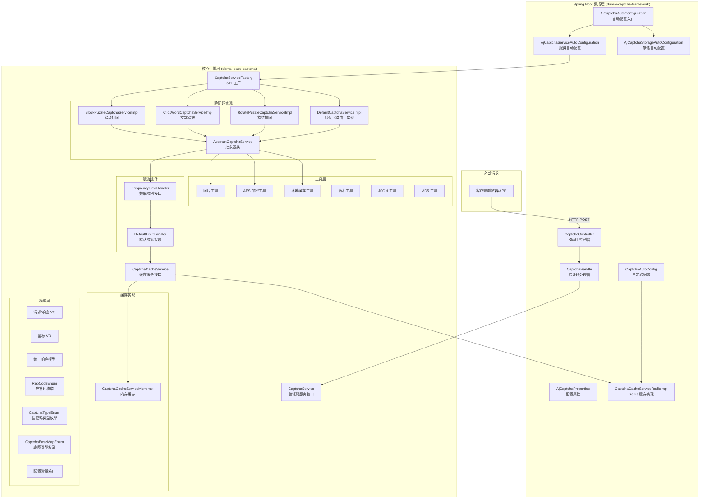
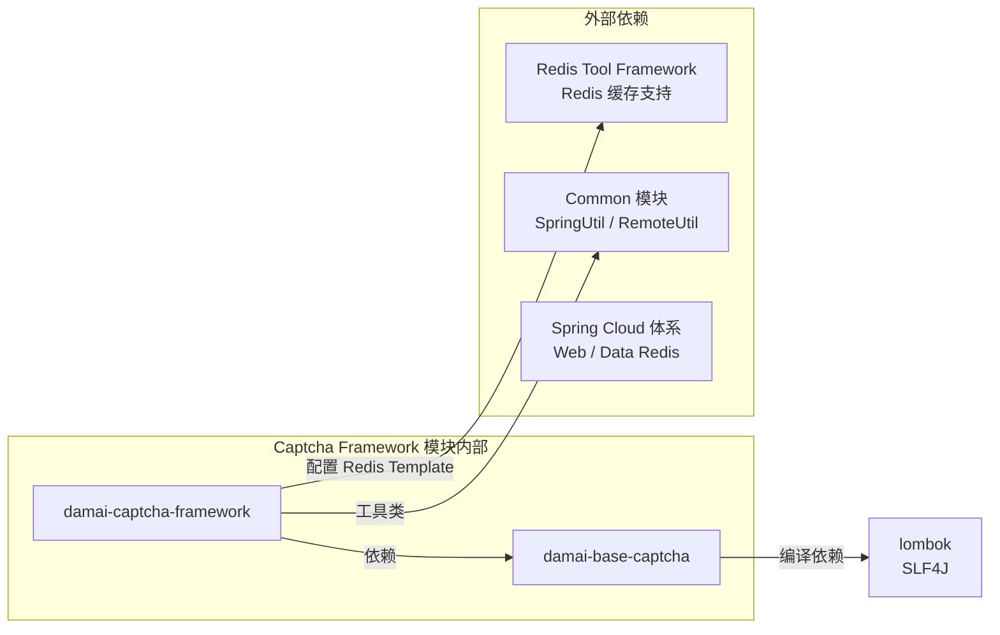
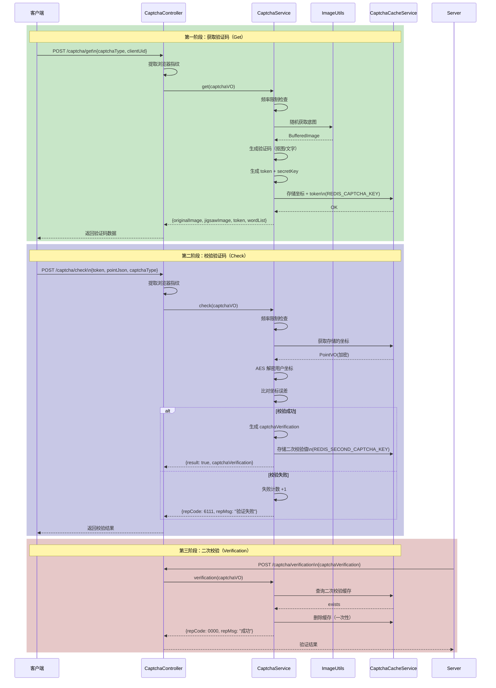
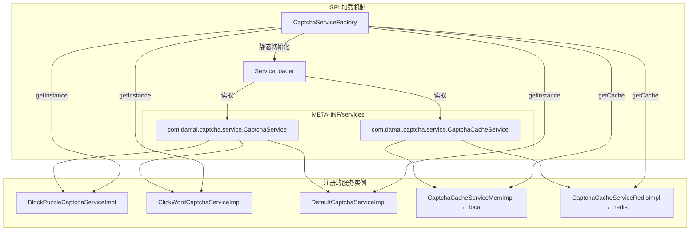
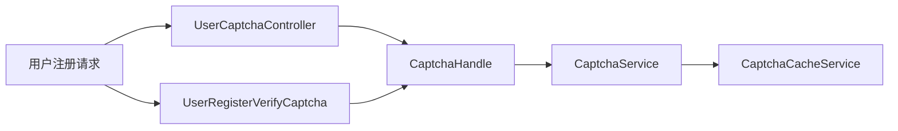

# 验证码框架（Captcha Framework）模块文档

## 1. 简介

验证码框架模块是基于 **AJ-Captcha**（安吉加加）行为验证码引擎构建的，为大麦高并发项目提供**人机身份验证**能力。该模块支持**滑块拼图**、**文字点选**、**旋转拼图**三种验证码形态，并采用 **Java SPI 机制**实现服务与缓存的可插拔扩展，同时内置了**接口频率限制**能力以抵御恶意攻击。

本模块分为两个子模块：
- **damai-base-captcha**：核心验证码逻辑（服务接口、实现、模型、工具类），不依赖 Spring 框架
- **damai-captcha-framework**：Spring Boot 集成层（自动配置、REST 控制器、Redis 缓存实现）

---

## 2. 架构概览

### 2.1 整体架构图



### 2.2 模块依赖关系



### 2.3 数据流图



---

## 3. 核心组件说明

### 3.1 服务接口层

#### 3.1.1 `CaptchaService` — 验证码服务顶级接口

定义验证码核心生命周期方法：

| 方法 | 用途 | 调用方 |
|------|------|--------|
| `init(Properties)` | 初始化配置（底图加载、字体加载、缓存初始化）、启动定时清理 | SPI 工厂初始化时 |
| `get(CaptchaVO)` | 生成验证码（获取底图、抠图、生成 token） | 前端请求 |
| `check(CaptchaVO)` | 前端校验坐标（解密、比对、生成二次校验凭证） | 前端请求 |
| `verification(CaptchaVO)` | 后端二次校验（验证 captchaVerification 有效性） | 后端服务调用 |
| `captchaType()` | 返回验证码类型标识（SPI 注册用） | SPI 工厂 |
| `destroy(Properties)` | 资源清理（JVM 关闭时清理历史数据） | 关闭钩子 |

#### 3.1.2 `CaptchaCacheService` — 缓存服务接口

定义缓存操作：

| 方法 | 说明 |
|------|------|
| `set(key, value, expire)` | 设置缓存（带过期时间） |
| `get(key)` | 获取缓存值 |
| `exists(key)` | 判断 key 是否存在（含过期检测） |
| `delete(key)` | 删除缓存 |
| `increment(key, val)` | 原子自增（限流使用） |
| `type()` | 缓存类型标识（SPI 注册用） |

### 3.2 核心实现类

#### 3.2.1 继承层级

```
CaptchaService（接口）
  └── AbstractCaptchaService（抽象基类）
        ├── BlockPuzzleCaptchaServiceImpl（滑块拼图）
        ├── ClickWordCaptchaServiceImpl（文字点选）
        ├── RotatePuzzleCaptchaServiceImpl（旋转拼图）
        └── DefaultCaptchaServiceImpl（默认路由）
```

#### 3.2.2 `AbstractCaptchaService` — 抽象基类

提供公共基础能力：
- **配置初始化**：水印文字、字体、缓存类型、AES 开关、频率限制开关
- **频率限制前置处理**：`get()`、`check()`、`verification()` 方法中先调用 `FrequencyLimitHandler`
- **失败计数**：`afterValidateFail()` 方法记录校验失败次数
- **AES 解密**：`decrypt()` 对前端加密坐标解密
- **图片转 Base64**：`base64StrToImage()`
- **水印字体加载**：`loadWaterMarkFont()` 从 classpath 加载字体，解决 Linux 无中文字体问题
- **Redis Key 定义**：
  - `REDIS_CAPTCHA_KEY` = `RUNNING:CAPTCHA:%s` — 存储验证码坐标
  - `REDIS_SECOND_CAPTCHA_KEY` = `RUNNING:CAPTCHA:second-%s` — 存储二次校验凭证

#### 3.2.3 `BlockPuzzleCaptchaServiceImpl` — 滑块拼图

- **类型标识**：`blockPuzzle`
- **生成逻辑**：
  1. 随机获取滑动底图
  2. 随机获取滑块模板图
  3. 在底图上随机位置抠图（高斯模糊处理）
  4. 可选添加干扰滑块（`captchaInterferenceOptions`：0/1/2）
  5. 生成 token 和 AES 密钥
  6. 坐标信息（PointVO）加密后存入缓存
- **校验逻辑**：
  1. 从缓存取出正确的坐标
  2. AES 解密前端提交的坐标
  3. 比对 X 坐标误差在 `slipOffset` 像素内，Y 坐标必须相等
  4. 校验成功生成 `captchaVerification`（AES 加密：`token + "---" + pointJson`）

#### 3.2.4 `ClickWordCaptchaServiceImpl` — 文字点选

- **类型标识**：`clickWord`
- **生成逻辑**：
  1. 从汉字词库随机选取 N 个字（默认 4 个）
  2. 在点选底图上随机位置绘制文字（随机颜色、随机旋转角度 -45°~45°）
  3. 其中随机 1 个字不参与校验（干扰项）
  4. 坐标信息列表存入缓存
- **校验逻辑**：
  1. 从缓存取出正确的坐标列表
  2. AES 解密前端提交的坐标列表
  3. 逐个比对每个字的 X/Y 坐标，误差在 `HAN_ZI_SIZE`（25px）内
  4. 校验成功生成 `captchaVerification`

#### 3.2.5 `RotatePuzzleCaptchaServiceImpl` — 旋转拼图

- **类型标识**：`rotatePuzzle`
- **当前状态**：继承了基类的骨架，`get()` 和 `check()` 方法中已获取旋转底图和旋转块图片资源，但核心旋转算法逻辑待实现（当前直接返回 `super.get()` / `super.check()`）

#### 3.2.6 `DefaultCaptchaServiceImpl` — 默认路由实现

- **类型标识**：`default`
- **职责**：作为路由器，根据 `CaptchaVO.captchaType` 将请求转发到具体的验证码类型实现
- **初始化**：初始化时遍历所有已注册的 CaptchaService，逐一调用其 `init()` 方法

### 3.3 工厂与 SPI 机制

#### 3.3.1 `CaptchaServiceFactory` — SPI 服务工厂



**SPI 注册文件**：
- `damai-base-captcha` 模块注册：`CaptchaCacheServiceMemImpl`（local 缓存）、`BlockPuzzleCaptchaServiceImpl`、`ClickWordCaptchaServiceImpl`、`DefaultCaptchaServiceImpl`
- `damai-captcha-framework` 模块注册：`CaptchaCacheServiceRedisImpl`（redis 缓存）

### 3.4 频率限制组件

#### 3.4.1 `FrequencyLimitHandler` 接口与 `DefaultLimitHandler` 实现

基于缓存的接口限流策略：

| 限制项 | 限制策略 | 默认值 |
|--------|----------|--------|
| **get 接口** | 1 分钟内不超过 120 次 | `captcha.req.get.minute.limit=120` |
| **check 接口** | 1 分钟内不超过 600 次 | `captcha.req.check.minute.limit=600` |
| **verify 接口** | 1 分钟内不超过 600 次 | `captcha.req.verify.minute.limit=600` |
| **失败锁定** | 1 分钟内 check 失败 5 次，锁定 5 分钟 | `captcha.req.get.lock.limit=5`，`captcha.req.get.lock.seconds=300` |

限流 KEY 格式：`AJ.CAPTCHA.REQ.LIMIT-{TYPE}-{clientUid}`

### 3.5 缓存实现

| 实现类 | 类型标识 | 适用场景 | 存储方式 |
|--------|----------|----------|----------|
| `CaptchaCacheServiceMemImpl` | `local` | 单节点部署 | 内存 `ConcurrentHashMap` + 定时清理 |
| `CaptchaCacheServiceRedisImpl` | `redis` | 分布式部署 | Redis `StringRedisTemplate` |

#### 内存缓存 `CacheUtil` 特性：
- 容量阈值：`CACHE_MAX_NUMBER`（默认 1000），达到 2 倍阈值时自动清理
- 定时清理：`ScheduledExecutorService` 定期扫描过期 key
- 过期机制：key_suffix `_HoldTime` 存储过期时间戳

### 3.6 Spring Boot 集成层

#### 3.6.1 自动配置

| 配置类 | 功能 |
|--------|------|
| `AjCaptchaAutoConfiguration` | 总入口，启用配置属性、包扫描、导入子配置 |
| `AjCaptchaServiceAutoConfiguration` | 创建 `CaptchaService` Bean，将 `AjCaptchaProperties` 转换为 `Properties` 配置对象，初始化底图资源 |
| `AjCaptchaStorageAutoConfiguration` | 创建 `CaptchaCacheService` Bean（按配置的缓存类型） |
| `CaptchaAutoConfig` | 创建 `CaptchaHandle` Bean 和带 RedisTemplate 的缓存 Bean |
| `CaptchaEnvironment` | `EnvironmentPostProcessor` 允许 Bean 覆盖定义 |

#### 3.6.2 REST 控制器 `CaptchaController`

| 端点 | 方法 | 说明 |
|------|------|------|
| `POST /captcha/get` | 获取验证码 | 返回图片 Base64、token、wordList |
| `POST /captcha/check` | 校验验证码 | 返回校验结果 + captchaVerification |
| `POST /captcha/verification` | 二次校验 | 后端服务校验 captchaVerification |

**浏览器指纹**：`X-Forwarded-For`（代理 IP）+ `User-Agent` 作为客户端唯一标识。

#### 3.6.3 配置属性 `AjCaptchaProperties`

配置前缀 `aj.captcha`：

| 属性 | 默认值 | 说明 |
|------|--------|------|
| `type` | `DEFAULT` | 验证码类型（default/blockPuzzle/clickWord/rotatePuzzle） |
| `jigsaw` | `""` | 滑块底图路径（支持 classpath:） |
| `pic-click` | `""` | 点选底图路径（支持 classpath:） |
| `cache-type` | `local` | 缓存类型（local/redis） |
| `water-mark` | `"我的水印"` | 水印文字 |
| `water-font` | `"WenQuanZhengHei.ttf"` | 水印字体 |
| `slip-offset` | `"5"` | 滑动误差偏移量（像素） |
| `aes-status` | `true` | AES 坐标加密开关 |
| `interference-options` | `"0"` | 滑块干扰项（0/1/2） |
| `req-frequency-limit-enable` | `false` | 接口限流开关 |
| `req-get-minute-limit` | `100` | get 接口分钟限制 |
| `req-check-minute-limit` | `100` | check 接口分钟限制 |
| `req-verify-minute-limit` | `100` | verify 接口分钟限制 |
| `font-size` | `25` | 点选文字大小 |
| `click-word-count` | `4` | 点选文字个数 |

---

## 4. 模型与数据流

### 4.1 核心数据模型

#### `CaptchaVO` — 验证码数据传输对象

| 字段 | 阶段 | 说明 |
|------|------|------|
| `captchaType` | get/check | 验证码类型 |
| `token` | get/check | 验证码唯一标识 |
| `originalImageBase64` | get 响应 | 底图 Base64 |
| `jigsawImageBase64` | get 响应 | 滑块图 Base64 |
| `wordList` | get 响应 | 点选文字列表 |
| `secretKey` | get 响应 | AES 密钥 |
| `pointJson` | check 请求 | 用户点击坐标（AES 加密） |
| `captchaVerification` | check 响应 / verification 请求 | 二次校验凭证 |
| `clientUid` | 请求 | 客户端 UI 组件 ID |
| `browserInfo` | 请求 | 浏览器指纹（IP + UA） |

#### `PointVO` — 坐标值对象

| 字段 | 说明 |
|------|------|
| `x` | X 坐标 |
| `y` | Y 坐标 |
| `secretKey` | AES 加密密钥 |

#### `ResponseModel` — 统一响应

| 字段 | 说明 |
|------|------|
| `repCode` | 应答码（0000 成功，6110 失效，6111 坐标错误等） |
| `repMsg` | 应答消息 |
| `repData` | 应答数据 |

### 4.2 缓存 Key 设计

| Key 模式 | 用途 | 过期时间 |
|----------|------|----------|
| `RUNNING:CAPTCHA:{token}` | 存储验证码坐标信息 | 2 分钟 |
| `RUNNING:CAPTCHA:second-{captchaVerification}` | 存储二次校验凭证 | 3 分钟 |
| `AJ.CAPTCHA.REQ.LIMIT-{TYPE}-{clientUid}` | 接口频率计数 | 1 分钟 |
| `AJ.CAPTCHA.REQ.LIMIT-LOCK-{clientUid}` | 失败锁定标记 | 5 分钟 |

---

## 5. 与外部模块的集成

### 5.1 User Service 中的使用

在 **User Service** 模块中，`UserCaptchaController` 和 `UserRegisterVerifyCaptcha` 使用验证码框架完成用户注册时的行为验证：



### 5.2 Redis Tool Framework

验证码框架通过 `StringRedisTemplate` 集成 **Redis Tool Framework**（参见 [Redis Tool Framework](Redis Tool Framework.md)），实现分布式缓存。

---

## 6. 扩展指南

### 6.1 新增验证码类型

1. 实现 `CaptchaService` 接口（或继承 `AbstractCaptchaService`）
2. 实现 `captchaType()` 返回唯一类型标识
3. 在 `META-INF/services/com.damai.captcha.service.CaptchaService` 中注册
4. 在 `CaptchaTypeEnum` 中添加新枚举值

### 6.2 自定义缓存实现

1. 实现 `CaptchaCacheService` 接口
2. 实现 `type()` 返回唯一类型标识
3. 在 `META-INF/services/com.damai.captcha.service.CaptchaCacheService` 中注册
4. 在 `AjCaptchaProperties.StorageType` 中添加枚举值
5. 通过配置 `aj.captcha.cache-type` 切换

### 6.3 自定义限流策略

1. 实现 `FrequencyLimitHandler` 接口
2. 在 `AbstractCaptchaService` 的 `init()` 中替换 `limitHandler` 实例

---

## 7. 配置示例

```yaml
aj:
  captcha:
    type: blockPuzzle                # 验证码类型
    cache-type: redis                # 缓存类型
    jigsaw: classpath:images/jigsaw  # 自定义滑块底图路径
    pic-click: classpath:images/pic-click  # 自定义点选底图路径
    water-mark: "大麦"               # 水印文字
    slip-offset: "5"                 # 误差偏移量
    aes-status: true                 # AES 加密开关
    interference-options: "1"        # 干扰项级别
    req-frequency-limit-enable: true # 限流开关
    req-get-minute-limit: 120        # get 接口分钟限制
    req-check-minute-limit: 600      # check 接口分钟限制
    req-verify-minute-limit: 600     # verify 接口分钟限制
```

---

## 8. 相关文档

- [Redis Tool Framework](Redis Tool Framework.md) — 分布式缓存基础设施
- [Common 模块](Common.md) — 工具类（RemoteUtil、SpringUtil 等）
- [User Service](User Service.md) — 验证码在用户注册场景的使用
