# Customize Client 模块 - 定制化规则管理客户端

## 1. 模块简介

Customize Client 模块是大麦系统中**定制化服务（Customize Service）的 RPC 数据模型模块**，位于 `damai-server-client/damai-customize-client`。该模块定义了一系列 **DTO（数据传输对象）** 和 **VO（视图对象）**，用于与 Customize Service 进行数据交互，核心功能围绕 **API 限流规则管理** 展开，包括**普通规则（Rule）**、**深度规则（DepthRule）**、**广播调用（BroadcastCall）** 和 **API 调用记录查询（ApiData）** 四大功能域。

### 1.1 核心功能

| 功能分类 | 说明 |
|---------|------|
| **普通规则管理** | 基于统计时间和阈值的简单 API 限流规则（Rule）的添加、查询、更新、状态修改 |
| **深度规则管理** | 基于时间窗口的进阶版 API 限流规则（DepthRule）的管理，支持多个时间窗口嵌套 |
| **全部规则管理** | 将普通规则与多条深度规则组合为统一的规则集进行管理 |
| **广播调用** | 向指定的微服务发送广播请求（用于规则刷新、缓存更新等场景） |
| **API 调用记录查询** | 分页查询被限流的 API 调用记录，支持按时间范围、IP、URL 等条件筛选 |

### 1.2 模块定位

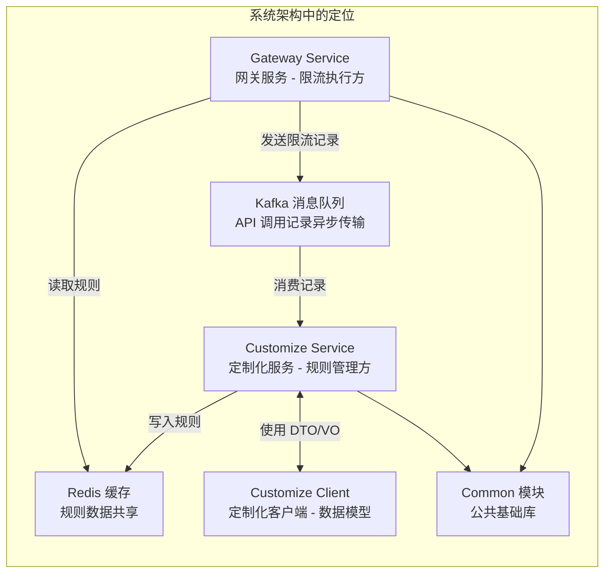

### 1.3 与 Gateway Service 的关系

Customize Client 与 Gateway Service 之间存在紧密的协作关系，共同构成了系统的 **API 限流体系**：

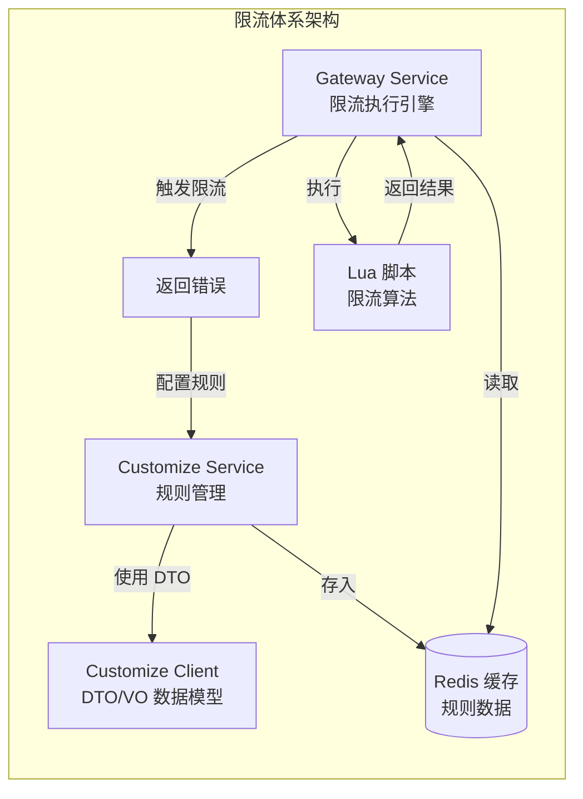

## 2. 架构设计

### 2.1 模块架构图

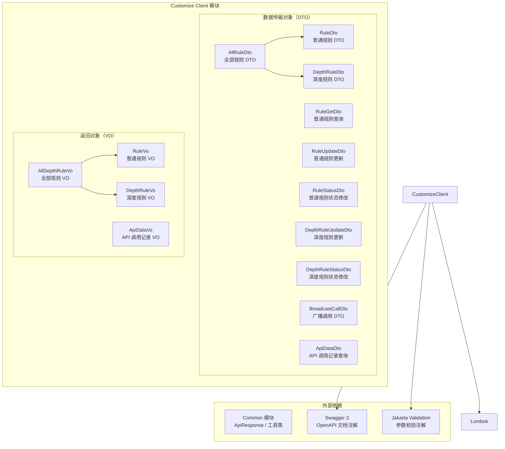

### 2.2 模块依赖关系

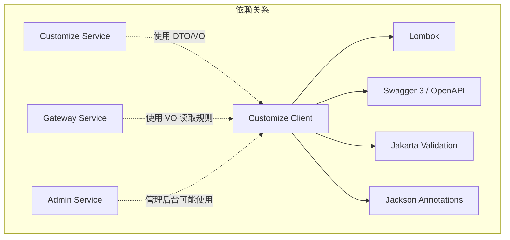

> **注意**：不同于其他 Client 模块（如 `Base Data Client`），Customize Client **不包含 Feign 客户端接口声明**。它纯粹作为**数据模型库（DTO/VO）** 被 Customize Service 使用（服务端接收参数和返回响应），同时其 VO 类也被 Gateway Service 引用（从 Redis 读取规则数据时反序列化使用）。

### 2.3 规则类型体系

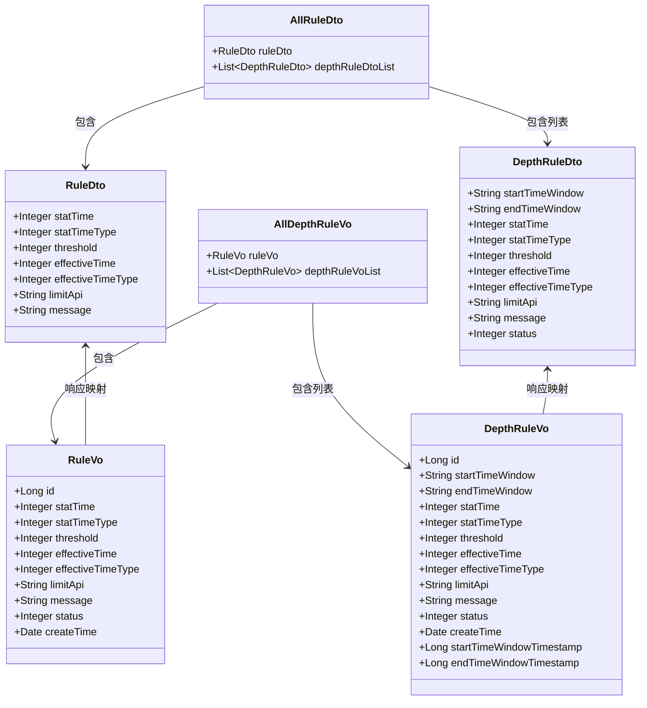

## 3. 核心组件详解

### 3.1 普通规则（Rule）

普通规则是最基础的 API 限流规则，基于**统计时间 + 阈值**的模式进行限流判断。

#### 3.1.1 RuleDto（普通规则参数）

**作用**：用于创建/添加普通规则的请求参数。

| 字段 | 类型 | 约束 | 说明 |
|------|------|------|------|
| `statTime` | Integer | `@NotNull` | 统计时间，单位由 `statTimeType` 决定 |
| `statTimeType` | Integer | `@NotNull` | 统计时间类型：1=秒，2=分钟 |
| `threshold` | Integer | `@NotNull` | 阈值，超过此数量则触发限流 |
| `effectiveTime` | Integer | `@NotNull` | 规则生效限制时间（触发限流后的封禁时长） |
| `effectiveTimeType` | Integer | `@NotNull` | 生效时间类型：1=秒，2=分钟 |
| `limitApi` | String | 可选 | 限制的 API 路径（为空则对所有 API 生效） |
| `message` | String | 可选 | 触发限流时的提示信息 |

**限流逻辑示例**：`statTime=10, statTimeType=1, threshold=100, effectiveTime=30, effectiveTimeType=1` → 在 10 秒内超过 100 次调用，则限流 30 秒。

#### 3.1.2 RuleGetDto（普通规则查询）

**作用**：根据 ID 查询普通规则的请求参数。

| 字段 | 类型 | 约束 | 说明 |
|------|------|------|------|
| `id` | Long | `@NotNull` | 普通规则 ID |

#### 3.1.3 RuleUpdateDto（普通规则更新）

**作用**：更新普通规则的请求参数，各字段均为可选（仅更新非空字段）。

| 字段 | 类型 | 约束 | 说明 |
|------|------|------|------|
| `id` | Long | `@NotNull` | 普通规则 ID（必填） |
| `statTime` | Integer | 可选 | 统计时间 |
| `statTimeType` | Integer | 可选 | 统计时间类型 |
| `threshold` | Integer | 可选 | 阈值 |
| `effectiveTime` | Integer | 可选 | 规则生效限制时间 |
| `effectiveTimeType` | Integer | 可选 | 生效限制时间类型 |
| `limitApi` | String | 可选 | 限制的 API 路径 |
| `message` | String | 可选 | 提示信息 |

#### 3.1.4 RuleStatusDto（普通规则状态修改）

**作用**：修改普通规则启用/禁用状态的请求参数。

| 字段 | 类型 | 约束 | 说明 |
|------|------|------|------|
| `id` | Long | `@NotNull` | 普通规则 ID |
| `status` | Integer | `@NotNull` | 状态：1=生效，0=禁用 |

#### 3.1.5 RuleVo（普通规则返回）

**作用**：普通规则的响应/视图对象。

| 字段 | 类型 | 说明 |
|------|------|------|
| `id` | Long | 规则 ID |
| `statTime` | Integer | 统计时间 |
| `statTimeType` | Integer | 统计时间类型 |
| `threshold` | Integer | 阈值 |
| `effectiveTime` | Integer | 规则生效限制时间 |
| `effectiveTimeType` | Integer | 生效限制时间类型 |
| `limitApi` | String | 限制的 API 路径 |
| `message` | String | 提示信息 |
| `status` | Integer | 状态：1=生效，0=禁用 |
| `createTime` | Date | 创建时间 |

### 3.2 深度规则（DepthRule）

深度规则是普通规则的进阶版，增加了**时间窗口（startTimeWindow / endTimeWindow）** 维度，支持在特定时间段内按不同阈值进行限流。

#### 3.2.1 DepthRuleDto（深度规则参数）

**作用**：用于创建/添加深度规则的请求参数。

| 字段 | 类型 | 约束 | 说明 |
|------|------|------|------|
| `startTimeWindow` | String | `@NotBlank` | 开始时间窗口，格式如 `HH:mm:ss` |
| `endTimeWindow` | String | `@NotBlank` | 结束时间窗口，格式如 `HH:mm:ss` |
| `statTime` | Integer | `@NotNull` | 统计时间 |
| `statTimeType` | Integer | `@NotNull` | 统计时间类型：1=秒，2=分钟 |
| `threshold` | Integer | `@NotNull` | 阈值 |
| `effectiveTime` | Integer | `@NotNull` | 规则生效限制时间 |
| `effectiveTimeType` | Integer | `@NotNull` | 生效限制时间类型：1=秒，2=分钟 |
| `limitApi` | String | 可选 | 限制的 API 路径 |
| `message` | String | 可选 | 提示信息 |
| `status` | Integer | 可选 | 状态：1=正常，0=失效 |

**深度规则特点**：
- **时间窗口限定**：规则仅在 `startTimeWindow ~ endTimeWindow` 时间段内生效（如 `10:00:00 ~ 12:00:00`）
- **多条规则组合**：可配置多个时间窗口，每个窗口有不同的限流阈值
- **与普通规则协同**：同时配置普通规则和深度规则时，按"深度规则"模式执行，取匹配时间窗口的规则进行限流

#### 3.2.2 DepthRuleUpdateDto（深度规则更新）

**作用**：更新深度规则的请求参数。

| 字段 | 类型 | 约束 | 说明 |
|------|------|------|------|
| `id` | Long | `@NotNull` | 深度规则 ID（必填） |
| `startTimeWindow` | String | 可选 | 开始时间窗口 |
| `endTimeWindow` | String | 可选 | 结束时间窗口 |
| `statTime` | Integer | 可选 | 统计时间 |
| `statTimeType` | Integer | 可选 | 统计时间类型 |
| `threshold` | Integer | 可选 | 阈值 |
| `effectiveTime` | Integer | 可选 | 规则生效限制时间 |
| `effectiveTimeType` | Integer | 可选 | 生效限制时间类型 |
| `limitApi` | String | 可选 | 限制的 API 路径 |
| `message` | String | 可选 | 提示信息 |
| `status` | Integer | 可选 | 状态：1=生效，0=禁用 |

#### 3.2.3 DepthRuleStatusDto（深度规则状态修改）

**作用**：修改深度规则启用/禁用状态的请求参数。

| 字段 | 类型 | 约束 | 说明 |
|------|------|------|------|
| `id` | Long | `@NotNull` | 深度规则 ID |
| `status` | Integer | `@NotNull` | 状态：1=生效，0=禁用 |

#### 3.2.4 DepthRuleVo（深度规则返回）

**作用**：深度规则的响应/视图对象。

| 字段 | 类型 | 说明 |
|------|------|------|
| `id` | Long | 规则 ID |
| `startTimeWindow` | String | 开始时间窗口（`HH:mm:ss`） |
| `endTimeWindow` | String | 结束时间窗口（`HH:mm:ss`） |
| `statTime` | Integer | 统计时间 |
| `statTimeType` | Integer | 统计时间类型 |
| `threshold` | Integer | 阈值 |
| `effectiveTime` | Integer | 规则生效限制时间 |
| `effectiveTimeType` | Integer | 生效限制时间类型 |
| `limitApi` | String | 限制的 API 路径 |
| `message` | String | 提示信息 |
| `status` | Integer | 状态：1=生效，0=禁用 |
| `createTime` | Date | 创建时间 |
| `startTimeWindowTimestamp` | Long | 开始时间窗口的时间戳（运行时计算，非持久化字段） |
| `endTimeWindowTimestamp` | Long | 结束时间窗口的时间戳（运行时计算，非持久化字段） |

> **注**：`startTimeWindowTimestamp` 和 `endTimeWindowTimestamp` 是运行时由 Gateway Service 的 `ApiRestrictService` 将时间字符串转为当天的时间戳（毫秒），用于 Lua 脚本中的时间窗口匹配判断。

### 3.3 全部规则（AllRule）

#### 3.3.1 AllRuleDto（全部规则参数）

**作用**：同时包含普通规则和多条深度规则的复合请求参数，用于一次性配置完整的规则集。

```java
@Data
@Schema(title="AllRuleDto", description ="全部规则")
public class AllRuleDto {
    @NotNull
    private RuleDto ruleDto;              // 必填：普通规则
    
    private List<DepthRuleDto> depthRuleDtoList;  // 可选：深度规则列表
}
```

#### 3.3.2 AllDepthRuleVo（全部规则返回）

**作用**：全部规则的复合响应对象。

| 字段 | 类型 | 说明 |
|------|------|------|
| `ruleVo` | RuleVo | 普通规则信息 |
| `depthRuleVoList` | List\<DepthRuleVo\> | 深度规则列表 |

### 3.4 广播调用（BroadcastCall）

#### 3.4.1 BroadcastCallDto（广播调用参数）

**作用**：向指定微服务广播发送消息的请求参数，用于规则变更后的缓存刷新通知。

| 字段 | 类型 | 约束 | 说明 |
|------|------|------|------|
| `serviceName` | String | `@NotBlank` | 目标服务名（如 `damai-gateway-service`） |
| `requestBody` | String | `@NotBlank` | 请求体内容（JSON 格式字符串） |

**使用场景**：
- 规则变更后，通过广播通知各服务实例刷新本地/Redis 缓存
- 强制清除限流统计数据
- 服务间的事件通知

### 3.5 API 调用记录（ApiData）

#### 3.5.1 ApiDataDto（API 调用记录查询参数）

**作用**：分页查询 API 被限流调用记录的请求参数。

| 字段 | 类型 | 约束 | 说明 |
|------|------|------|------|
| `pageNo` | Integer | `@NotNull` | 页码 |
| `pageSize` | Integer | `@NotNull` | 每页大小 |
| `startDate` | String | 可选 | 开始日期，格式 `yyyy-MM-dd HH:mm:ss` |
| `endDate` | String | 可选 | 结束日期，格式 `yyyy-MM-dd HH:mm:ss` |
| `apiAddress` | String | 可选 | API 请求的 IP 地址（筛选条件） |
| `apiUrl` | String | 可选 | API 路径（筛选条件） |

#### 3.5.2 ApiDataVo（API 调用记录返回）

**作用**：API 被限流调用记录的视图对象。

| 字段 | 类型 | 说明 |
|------|------|------|
| `id` | Long | 记录 ID |
| `headVersion` | String | 请求头版本号 |
| `apiAddress` | String | 请求 IP 地址 |
| `apiMethod` | String | HTTP 方法（GET/POST） |
| `apiBody` | String | 请求体内容 |
| `apiParams` | String | 请求参数 |
| `apiUrl` | String | API 路径 |
| `createTime` | Date | 创建/记录时间 |
| `status` | Integer | 触发限流的规则类型 |
| `callDayTime` | String | 按天统计时间（`yyyy-MM-dd`） |
| `callHourTime` | String | 按小时统计时间（`yyyy-MM-dd HH`） |
| `callMinuteTime` | String | 按分钟统计时间（`yyyy-MM-dd HH:mm`） |
| `callSecondTime` | String | 按秒统计时间（`yyyy-MM-dd HH:mm:ss`） |

> **注**：Gateway Service 的 `ApiRestrictService.saveApiData()` 方法在触发限流时，会通过 Kafka 发送 `ApiDataDto` 消息，Customize Service 的 `ApiDataMessageConsumer` 消费消息后入库。`callDayTime` / `callHourTime` / `callMinuteTime` / `callSecondTime` 字段用于不同粒度的统计查询。

## 4. 数据流与交互

### 4.1 规则配置完整流程

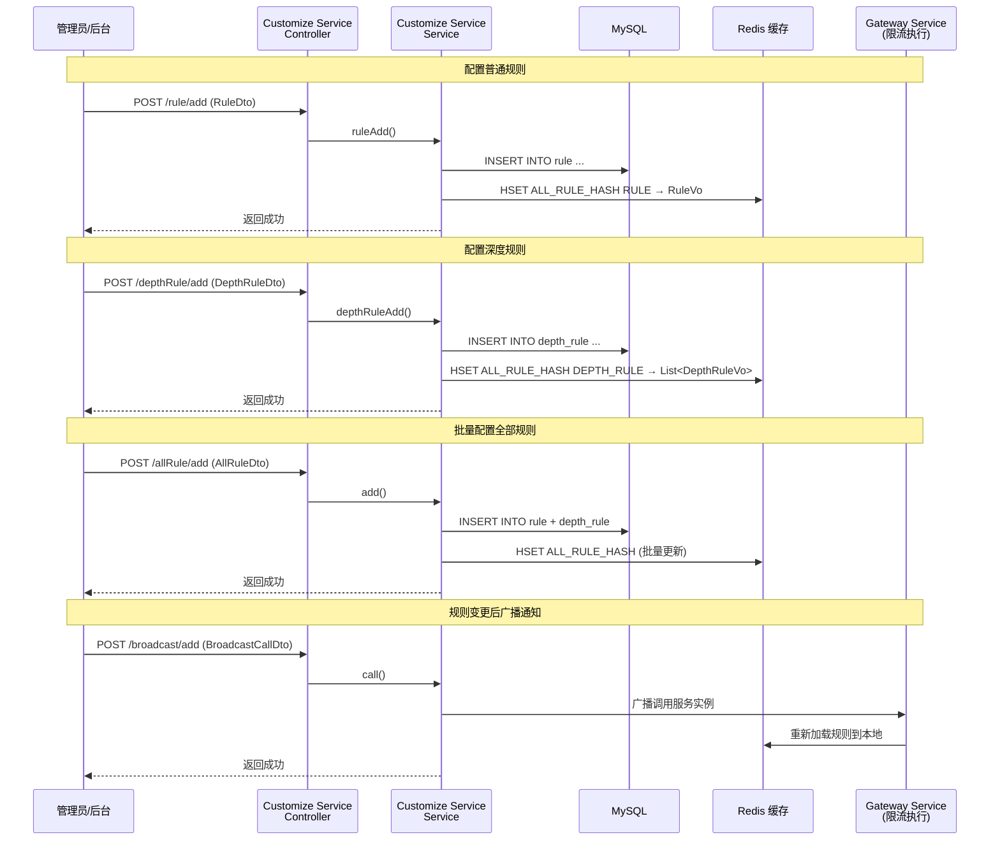

### 4.2 网关层限流执行流程

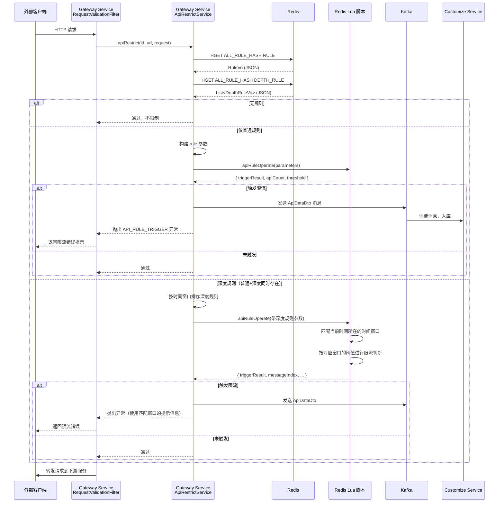

### 4.3 API 调用记录数据流

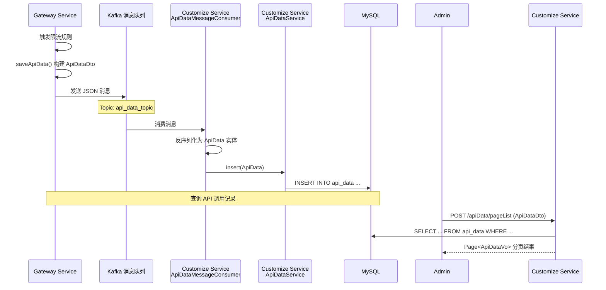

### 4.4 广播调用流程

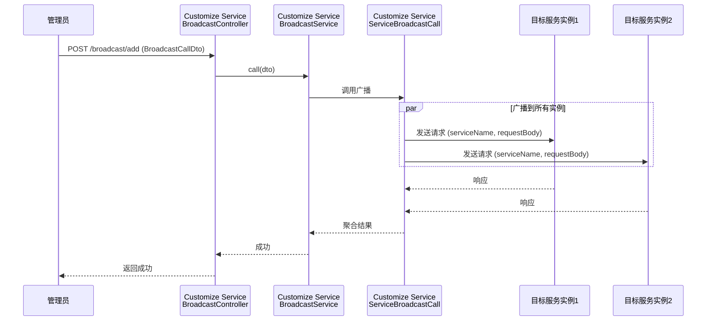

## 5. 限流规则模型详解

### 5.1 普通规则（Rule）工作原理

普通规则采用 **滑动时间窗口** 算法：

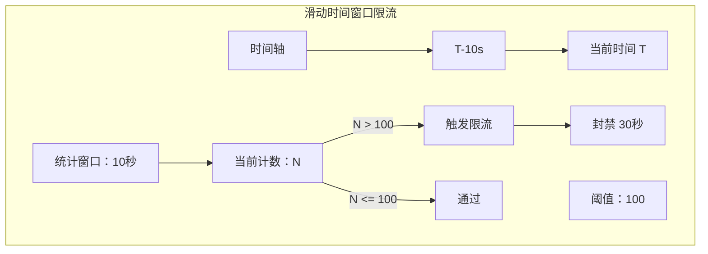

**关键参数**：
- `statTime` + `statTimeType`：定义滑动窗口大小（如 10 秒）
- `threshold`：窗口内允许的最大请求数
- `effectiveTime` + `effectiveTimeType`：触发限流后的封禁时长

### 5.2 深度规则（DepthRule）工作原理

深度规则在普通规则基础上增加**时间窗口匹配**，支持**不同时间段不同限流策略**：

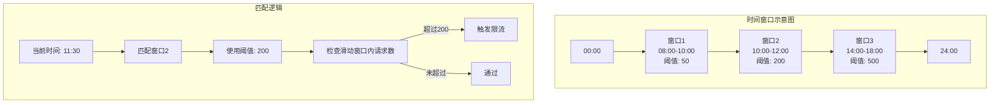

**匹配规则**：
1. 所有深度规则按 `startTimeWindow` 升序排序
2. 将时间窗口字符串（`HH:mm:ss`）转换为当天的时间戳
3. 在 Lua 脚本中通过二分法或遍历匹配当前时间所处的窗口
4. 使用匹配窗口的 `statTime`、`threshold`、`effectiveTime` 进行限流判断
5. 若没有匹配的时间窗口，则使用普通规则的阈值

### 5.3 限流模式枚举

系统包含三种限流模式，由 `ApiRuleType` 枚举定义：

| 模式 | 编码 | 说明 |
|------|------|------|
| `NO_RULE` | 0 | 无规则，不进行限流 |
| `RULE` | 1 | 普通规则模式，仅使用 Rule 进行限流 |
| `DEPTH_RULE` | 2 | 深度规则模式，Rule + DepthRule 组合限流 |

## 6. 项目结构

```
damai-server-client/damai-customize-client/
├── pom.xml                                      # 模块配置（继承 damai-server-client）
└── src/main/java/com/damai/
    ├── dto/
    │   ├── AllRuleDto.java                      # 全部规则 DTO（普通规则 + 深度规则列表）
    │   ├── ApiDataDto.java                      # API 调用记录查询参数
    │   ├── BroadcastCallDto.java                # 广播调用参数
    │   ├── DepthRuleDto.java                    # 深度规则参数
    │   ├── DepthRuleStatusDto.java              # 深度规则状态修改参数
    │   ├── DepthRuleUpdateDto.java              # 深度规则更新参数
    │   ├── RuleDto.java                         # 普通规则参数
    │   ├── RuleGetDto.java                      # 普通规则查询参数
    │   ├── RuleStatusDto.java                   # 普通规则状态修改参数
    │   └── RuleUpdateDto.java                   # 普通规则更新参数
    └── vo/
        ├── AllDepthRuleVo.java                  # 全部规则 VO
        ├── ApiDataVo.java                       # API 调用记录 VO
        ├── DepthRuleVo.java                     # 深度规则 VO
        └── RuleVo.java                          # 普通规则 VO
```

## 7. 与外部模块的交互

### 7.1 Customize Service（定制化服务）

Customize Service 是 Customize Client 数据模型的主要使用者，提供对应的 REST API 端点：

| 客户端 DTO/VO | 服务端 Controller | 服务端 Service | 说明 |
|--------------|------------------|---------------|------|
| `RuleDto` / `RuleVo` | `RuleController` | `RuleService` | 普通规则 CRUD |
| `RuleUpdateDto` | `RuleController.update()` | `RuleService.ruleUpdate()` | 更新普通规则 |
| `RuleStatusDto` | `RuleController.updateStatus()` | `RuleService.ruleUpdateStatus()` | 修改规则状态 |
| `RuleGetDto` / `RuleVo` | `RuleController.get()` | `RuleService.get()` | 查询普通规则 |
| `DepthRuleDto` / `DepthRuleVo` | `DepthRuleController` | `DepthRuleService` | 深度规则 CRUD |
| `DepthRuleUpdateDto` | `DepthRuleController.update()` | `DepthRuleService.depthRuleUpdate()` | 更新深度规则 |
| `DepthRuleStatusDto` | `DepthRuleController.updateStatus()` | `DepthRuleService.depthRuleUpdateStatus()` | 修改深度规则状态 |
| `AllRuleDto` / `AllDepthRuleVo` | `AllRuleController` | `AllRuleService` | 全部规则管理 |
| `BroadcastCallDto` | `BroadcastController.call()` | `BroadcastService` | 广播调用 |
| `ApiDataDto` / `ApiDataVo` | `ApiDataController.pageList()` | `ApiDataService` | API 调用记录分页查询 |

### 7.2 Gateway Service（网关服务）

Gateway Service 通过 Redis 间接使用 Customize Client 的 VO 对象：

| 客户端 VO | 网关服务使用方 | 用途 |
|-----------|--------------|------|
| `RuleVo` | `ApiRestrictService.apiRestrict()` | 从 Redis 读取普通规则，构建 Lua 脚本参数 |
| `DepthRuleVo` | `ApiRestrictService.apiRestrict()` | 从 Redis 读取深度规则列表，按时间窗口排序 |
| `ApiDataDto` | `ApiRestrictService.saveApiData()` | 触发限流时发送 Kafka 消息（消息体使用此类 JSON 序列化） |

### 7.3 Redis 数据共享

规则数据通过 Redis 在 Customize Service 和 Gateway Service 之间共享：

| Redis Key | 数据结构 | 值类型 | 说明 |
|-----------|---------|--------|------|
| `ALL_RULE_HASH` | Hash | Hash | 存储全部规则 |
| `ALL_RULE_HASH → RULE` | Hash Field | JSON (RuleVo) | 普通规则数据 |
| `ALL_RULE_HASH → DEPTH_RULE` | Hash Field | JSON (List<DepthRuleVo>) | 深度规则列表 |

### 7.4 Kafka 消息队列

API 调用记录通过 Kafka 异步传输：

| 组件 | 角色 | 说明 |
|------|------|------|
| Gateway Service | 生产者 | 触发限流时发送 `ApiDataDto` JSON 消息 |
| Customize Service | 消费者 | `ApiDataMessageConsumer` 消费消息并入数据库 |

## 8. 配置说明

Customize Client 模块自身不需要额外配置，它作为数据模型库被其他模块引用。

### 8.1 关联服务配置

#### Customize Service 配置
```yaml
# Customize Service 相关配置
spring:
  application:
    name: ${prefix.distinction.name:damai}-customize-service
  datasource:
    url: jdbc:mysql://localhost:3306/damai_customize?useUnicode=true&characterEncoding=utf-8
    username: root
    password: root
  redis:
    host: ${redis.host:127.0.0.1}
    port: ${redis.port:6379}
  kafka:
    bootstrap-servers: ${kafka.bootstrap-servers:127.0.0.1:9092}
    consumer:
      group-id: customize-service-group
```

#### Gateway Service 配置
```yaml
# Gateway Service 限流相关配置
gateway:
  api-restrict-paths: /api/**  # 需要进行限流的 API 路径模式
```

## 9. 与其他 Client 模块的对比

| 对比维度 | Base Data Client | Customize Client | Order Client | Program Client |
|---------|-----------------|-----------------|-------------|---------------|
| **模块类型** | Feign 客户端 | 数据模型库 | Feign 客户端 | Feign 客户端 |
| **包含 Feign 接口** | ✅ 是 | ❌ 否 | ✅ 是 | ✅ 是 |
| **包含 DTO** | ✅ 是 | ✅ 是 | ✅ 是 | ✅ 是 |
| **包含 VO** | ✅ 是 | ✅ 是 | ✅ 是 | ✅ 是 |
| **主要调用方** | Gateway Service | Customize Service / Gateway | 订单相关服务 | 节目相关服务 |
| **核心功能** | 渠道/Token/地区数据查询 | API 限流规则管理 | 订单 CRUD | 节目/场次/座位管理 |

> **注**：Customize Client 与其它 Client 模块最大的区别在于它**不直接声明 Feign 客户端接口**。它作为"纯数据模型"模块，DTO/VO 被 Customize Service 直接使用（作为 Controller 的请求体/响应体），VO 也被 Gateway Service 引用（用于反序列化 Redis 中的规则数据）。这种设计遵循了"数据模型与服务分离"的架构原则。
