# Customize Service 模块 - 定制化规则管理服务

## 1. 模块简介

Customize Service（定制化服务）是大麦系统中**API 限流规则的管理端服务**，位于 `damai-server/damai-customize-service`。该服务提供了一套完整的 **API 调用限流规则管理能力**，包括**普通规则（Rule）**、**深度规则（DepthRule）** 的增删改查，以及**全部规则（AllRule）** 的统一管理。同时，该服务还负责消费来自 Gateway Service 的 API 调用记录消息，并提供 API 调用记录的分页查询功能。

### 1.1 核心功能

| 功能分类 | 说明 |
|---------|------|
| **普通规则管理** | 基于统计时间和阈值的简单 API 限流规则的添加、修改、状态变更、查询 |
| **深度规则管理** | 基于时间窗口的进阶版 API 限流规则的管理，支持多个时间窗口嵌套 |
| **全部规则管理** | 将普通规则与多条深度规则组合为统一的规则集进行一次性配置 |
| **广播调用** | 向指定的微服务发送广播请求（用于规则刷新、缓存更新等场景） |
| **API 调用记录** | 消费 Kafka 消息异步记录被限流的 API 调用，支持分页查询 |

### 1.2 模块定位

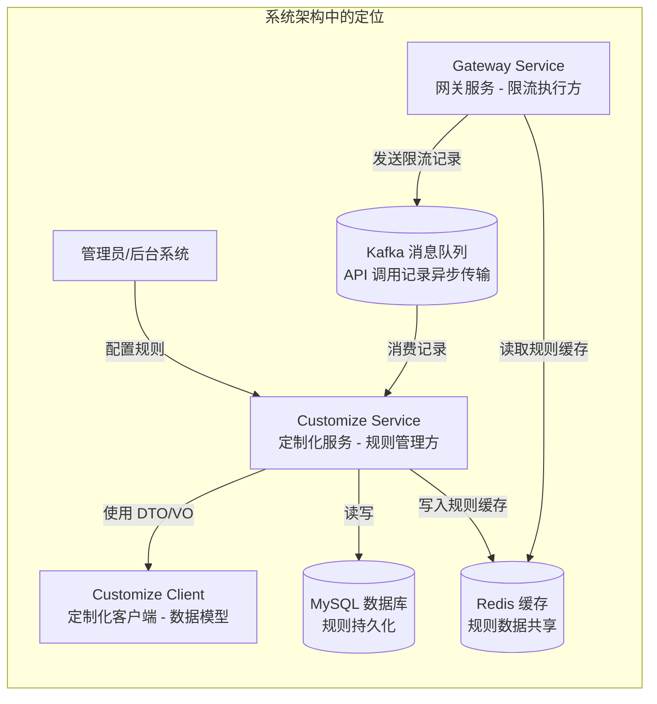

### 1.3 与 Gateway Service 的协作关系

Customize Service 与 Gateway Service 共同构成了系统的 **API 限流体系**：

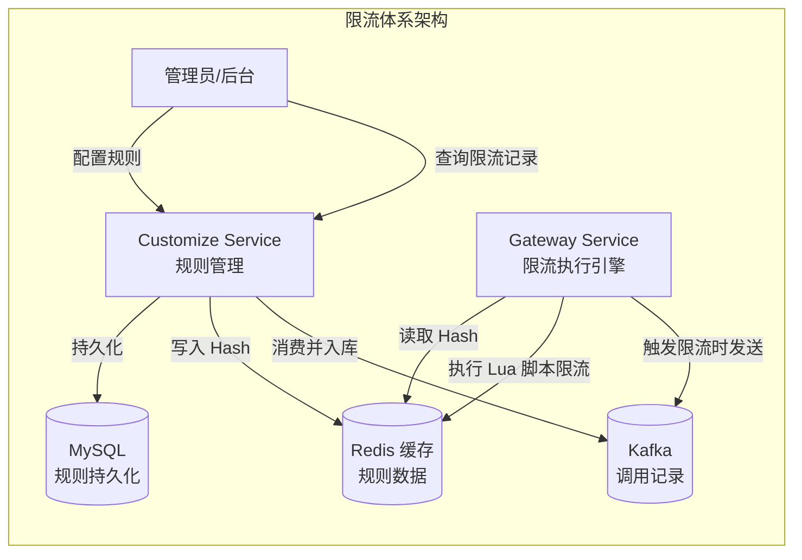

---

## 2. 技术架构

### 2.1 整体架构图

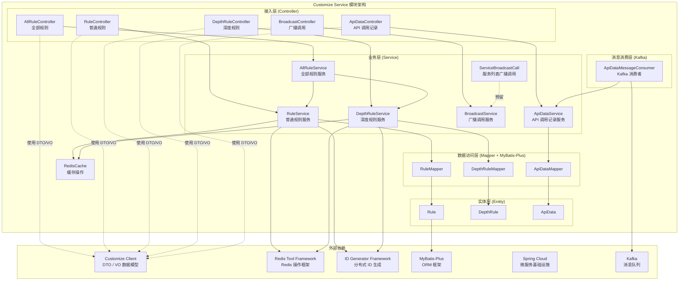

### 2.2 模块依赖关系

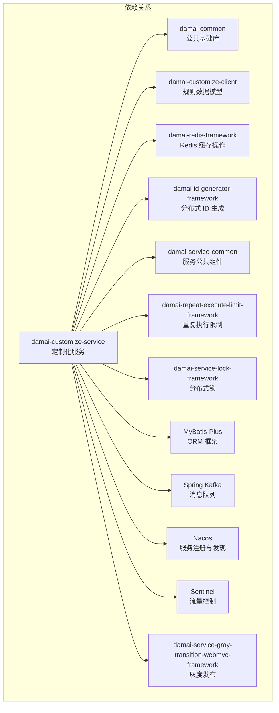

### 2.3 规则类型体系

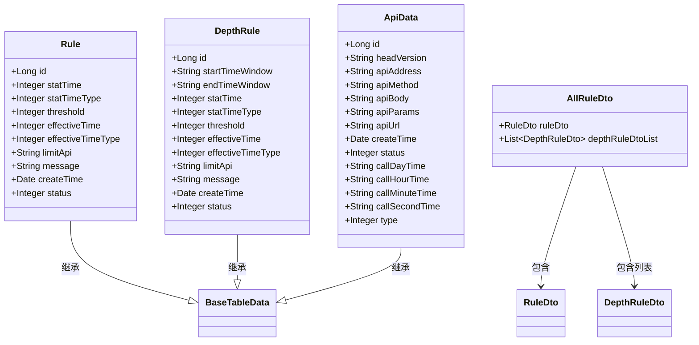

---

## 3. 核心组件详解

### 3.1 接入层（Controller）

#### 3.1.1 AllRuleController - 全部规则控制器

**路径**: `/allRule`

**功能**：提供全部规则（普通规则 + 深度规则组合）的统一管理接口。

| 接口 | 方法 | 说明 |
|------|------|------|
| `/allRule/add` | POST | 添加全部规则（同时处理普通规则和深度规则列表） |
| `/allRule/get` | POST | 查询全部规则（包含普通规则和深度规则列表） |

**请求示例**：
```json
// POST /allRule/add
{
    "ruleDto": {
        "statTime": 10,
        "statTimeType": 1,
        "threshold": 100,
        "effectiveTime": 30,
        "effectiveTimeType": 1,
        "limitApi": "/api/program/list",
        "message": "访问过于频繁，请稍后再试"
    },
    "depthRuleDtoList": [
        {
            "startTimeWindow": "10:00:00",
            "endTimeWindow": "12:00:00",
            "statTime": 5,
            "statTimeType": 1,
            "threshold": 50,
            "effectiveTime": 60,
            "effectiveTimeType": 1,
            "limitApi": "/api/program/detail",
            "message": "高峰时段限流"
        }
    ]
}
```

#### 3.1.2 RuleController - 普通规则控制器

**路径**: `/rule`

**功能**：提供普通规则的 CRUD 操作接口。

| 接口 | 方法 | 说明 |
|------|------|------|
| `/rule/add` | POST | 添加普通规则 |
| `/rule/update` | POST | 修改普通规则 |
| `/rule/updateStatus` | POST | 修改普通规则状态（启用/禁用） |
| `/rule/get` | POST | 查询普通规则详情 |

#### 3.1.3 DepthRuleController - 深度规则控制器

**路径**: `/depthRule`

**功能**：提供深度规则的 CRUD 操作接口。

| 接口 | 方法 | 说明 |
|------|------|------|
| `/depthRule/add` | POST | 添加深度规则 |
| `/depthRule/update` | POST | 修改深度规则 |
| `/depthRule/updateStatus` | POST | 修改深度规则状态（启用/禁用） |
| `/depthRule/get` | POST | 查询所有深度规则列表 |

#### 3.1.4 BroadcastController - 广播调用控制器

**路径**: `/broadcast`

**功能**：提供广播调用接口，用于向指定微服务发送广播请求。

| 接口 | 方法 | 说明 |
|------|------|------|
| `/broadcast/add` | POST | 发起广播调用 |

> **说明**：当前 `BroadcastService.call()` 方法为预留实现，尚未完成具体广播逻辑。完整的广播调用由 `ServiceBroadcastCall` 组件支持，该组件通过服务发现机制遍历服务实例并发送 HTTP 请求。

#### 3.1.5 ApiDataController - API 调用记录控制器

**路径**: `/apiData`

**功能**：提供 API 限流调用记录的分页查询接口。

| 接口 | 方法 | 说明 |
|------|------|------|
| `/apiData/pageList` | POST | 分页查询 API 调用记录 |

**查询参数**：
| 参数 | 类型 | 必填 | 说明 |
|------|------|------|------|
| `pageNo` | Integer | 是 | 页码 |
| `pageSize` | Integer | 是 | 每页大小 |
| `startDate` | String | 否 | 开始时间，格式 `yyyy-MM-dd HH:mm:ss` |
| `endDate` | String | 否 | 结束时间，格式 `yyyy-MM-dd HH:mm:ss` |
| `apiAddress` | String | 否 | API 请求 IP 地址（模糊匹配） |
| `apiUrl` | String | 否 | API 路径（模糊匹配） |

### 3.2 业务层（Service）

#### 3.2.1 AllRuleService - 全部规则服务

**类路径**: `com.damai.service.AllRuleService`

**核心职责**：
- 统一管理普通规则和深度规则的组合配置
- 校验深度规则的时间窗口是否存在冲突
- 批量处理全部规则的添加和查询

**核心方法**：

| 方法 | 作用 | 说明 |
|------|------|------|
| `add(AllRuleDto)` | 添加全部规则 | 先添加普通规则，再删除所有旧深度规则，最后逐一添加新深度规则。添加过程中会校验时间窗口交叉问题 |
| `get()` | 查询全部规则 | 返回包含普通规则和深度规则列表的复合 VO 对象 |
| `checkTime(...)` | 校验时间窗口 | 检查新增时间窗口与已有深度规则的时间窗口是否存在重叠 |

**时间窗口交叉校验逻辑**：

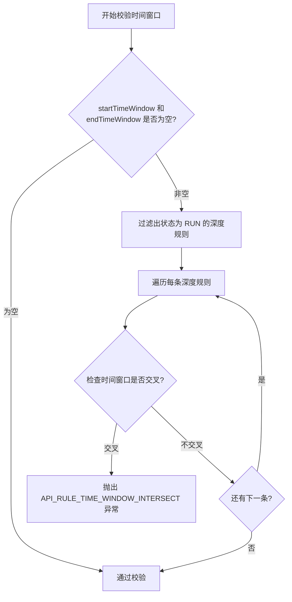

**时间窗口交叉判断规则**：
```
新增时间窗口: [A_start, A_end]
已有时间窗口: [B_start, B_end]

交叉条件: (A_start >= B_start AND A_start <= B_end) 
        OR (A_end >= B_start AND A_end <= B_end)
```

#### 3.2.2 RuleService - 普通规则服务

**类路径**: `com.damai.service.RuleService`

**核心职责**：
- 普通规则的 CRUD 操作
- 规则变更后同步更新 Redis 缓存
- 管理普通规则的"唯一性"（系统中只存在一条生效的普通规则）

**核心方法**：

| 方法 | 作用 | 说明 |
|------|------|------|
| `ruleAdd(RuleDto)` | 添加规则 | 先删除所有旧规则，再插入新规则，最后刷新缓存 |
| `add(RuleDto)` | 内部添加 | 删除所有旧规则 → 拷贝属性 → 生成 ID → 设置创建时间 → 插入数据库 |
| `ruleUpdate(RuleUpdateDto)` | 更新规则 | 更新数据库 → 刷新缓存 |
| `ruleUpdateStatus(RuleStatusDto)` | 更新状态 | 更新规则状态 → 刷新缓存 |
| `get(RuleGetDto)` | 查询规则 | 根据 ID 查询 |
| `get()` | 查询唯一规则 | 查询数据库中的唯一一条规则 |
| `saveAllRuleCache()` | 保存规则缓存 | 查询数据库中状态为 RUN 的普通规则和深度规则，写入 Redis Hash |

**规则缓存同步机制**：

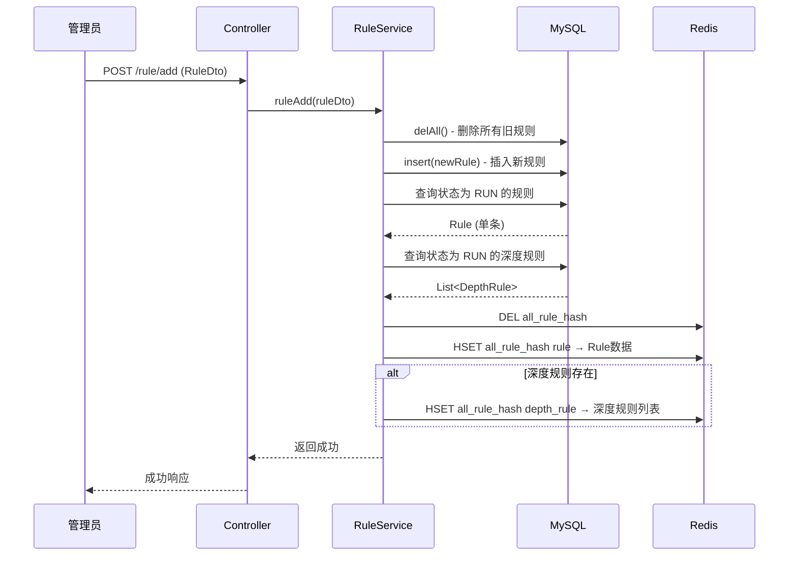

**Redis 缓存格式**：
```
Key: {prefix}-all_rule_hash   (例如: damai-all_rule_hash)
Type: Hash
Fields:
  - rule: Rule 实体 JSON（状态为 RUN 的普通规则）
  - depth_rule: List<DepthRule> JSON（状态为 RUN 的深度规则列表）
```

#### 3.2.3 DepthRuleService - 深度规则服务

**类路径**: `com.damai.service.DepthRuleService`

**核心职责**：
- 深度规则的 CRUD 操作
- 新增深度规则时校验时间窗口冲突
- 规则变更后同步刷新缓存

**核心方法**：

| 方法 | 作用 | 说明 |
|------|------|------|
| `depthRuleAdd(DepthRuleDto)` | 添加深度规则 | 校验时间窗口 → 插入数据库 → 刷新缓存 |
| `add(DepthRuleDto)` | 内部添加 | 拷贝属性 → 生成 ID → 设置创建时间 → 插入数据库 |
| `depthRuleUpdate(DepthRuleUpdateDto)` | 更新深度规则 | 更新数据库 → 刷新缓存 |
| `depthRuleUpdateStatus(DepthRuleStatusDto)` | 更新状态 | 更新状态 → 刷新缓存 |
| `selectList()` | 查询所有 | 查询全部深度规则列表 |
| `delAll()` | 删除所有 | 删除全部深度规则（配合全部规则管理使用） |
| `check(startTimeWindow, endTimeWindow)` | 校验时间窗口 | 检查即将添加的时间窗口是否与数据库中已有的深度规则存在交叉 |

#### 3.2.4 ApiDataService - API 调用记录服务

**类路径**: `com.damai.service.ApiDataService`

**核心职责**：
- 消费 Kafka 消息，保存被限流的 API 调用记录
- 提供 API 调用记录的分页查询

**核心方法**：

| 方法 | 作用 | 说明 |
|------|------|------|
| `saveApiData(ApiData)` | 保存调用记录 | 使用 `@RepeatExecuteLimit` 注解防止重复消费，先查询是否存在，不存在则插入 |
| `pageList(ApiDataDto)` | 分页查询 | 支持按 API 地址、URL、时间范围筛选，按创建时间倒序排列 |

**幂等性保护**：
- 使用 `@RepeatExecuteLimit` 注解（`RepeatExecuteLimitConstants.CONSUMER_API_DATA_MESSAGE`）防止 Kafka 消息重复消费
- 注解的 `keys` 参数为 `#apiData.id`，确保同一条记录不会被重复入库

#### 3.2.5 BroadcastService - 广播调用服务

**类路径**: `com.damai.service.BroadcastService`

**核心职责**：预留的广播调用服务，当前 `call()` 方法为空实现。

> **TODO**：未来实现将遍历所有目标服务实例，通过 HTTP 调用发送广播请求，用于规则变更后通知各服务实例刷新缓存。

#### 3.2.6 ServiceBroadcastCall - 服务列表广播调用

**类路径**: `com.damai.service.ServiceBroadcastCall`

**核心职责**：预留的服务列表广播调用组件，当前 `call(String serviceId)` 方法返回 `false`（空实现）。

> **设计意图**：该组件将用于通过服务发现（Nacos）获取指定服务的所有实例列表，然后向每个实例发送 HTTP 请求，实现缓存刷新、规则同步等广播操作。

### 3.3 消息消费层（Kafka）

#### 3.3.1 ApiDataMessageConsumer - API 调用记录消费者

**类路径**: `com.damai.kafka.ApiDataMessageConsumer`

**核心职责**：消费 Kafka 消息，异步保存 Gateway Service 发送的 API 限流调用记录。

**消费流程**：

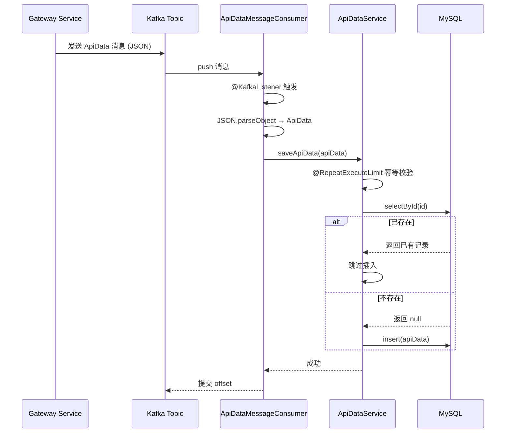

**Topic 命名规则**：
```
{prefix.distinction.name}-{spring.kafka.topic}
例如: damai-save_api_data
```

**配置说明**：
| 配置项 | 值 | 说明 |
|-------|-----|------|
| `group-id` | `api_data` | 消费者组 ID |
| `enable-auto-commit` | `true` | 自动提交 offset |
| `auto-offset-reset` | `latest` | 从最新偏移量开始消费 |

### 3.4 数据层（Entity & Mapper）

#### 3.4.1 实体类

| 实体 | 表名 | 说明 |
|-----|------|------|
| `Rule` | `d_rule` | 普通规则实体 |
| `DepthRule` | `d_depth_rule` | 深度规则实体 |
| `ApiData` | `d_api_data` | API 调用记录实体 |

**Rule 实体字段**：

| 字段 | 类型 | 说明 |
|------|------|------|
| `id` | Long | 主键 ID（分布式 ID 生成） |
| `statTime` | Integer | 统计时间长度 |
| `statTimeType` | Integer | 统计时间类型（1=秒，2=分钟） |
| `threshold` | Integer | 阈值（超过则触发限流） |
| `effectiveTime` | Integer | 规则生效限制时间（封禁时长） |
| `effectiveTimeType` | Integer | 生效限制时间类型（1=秒，2=分钟） |
| `limitApi` | String | 限制的 API 路径（为空则对所有 API 生效） |
| `message` | String | 触发限流时的提示信息 |
| `createTime` | Date | 创建时间 |
| `status` | Integer | 状态（继承自 BaseTableData） |

**DepthRule 实体额外字段**：

| 字段 | 类型 | 说明 |
|------|------|------|
| `startTimeWindow` | String | 开始时间窗口，格式 `HH:mm:ss` |
| `endTimeWindow` | String | 结束时间窗口，格式 `HH:mm:ss` |

**ApiData 实体字段**：

| 字段 | 类型 | 说明 |
|------|------|------|
| `id` | Long | 主键 ID |
| `headVersion` | String | 请求头版本号 |
| `apiAddress` | String | 客户端 IP 地址 |
| `apiMethod` | String | HTTP 方法（GET/POST） |
| `apiBody` | String | 请求体内容 |
| `apiParams` | String | 请求参数 |
| `apiUrl` | String | API 路径 |
| `createTime` | Date | 记录创建时间 |
| `status` | Integer | 状态（触发限流的规则类型标识） |
| `callDayTime` | String | 按天统计时间（`yyyy-MM-dd`） |
| `callHourTime` | String | 按小时统计时间（`yyyy-MM-dd HH`） |
| `callMinuteTime` | String | 按分钟统计时间（`yyyy-MM-dd HH:mm`） |
| `callSecondTime` | String | 按秒统计时间（`yyyy-MM-dd HH:mm:ss`） |
| `type` | Integer | 类型 |

#### 3.4.2 Mapper 接口

| Mapper | 自定义方法 | 说明 |
|--------|-----------|------|
| `RuleMapper` | `delAll()` | 删除所有普通规则 |
| `DepthRuleMapper` | `delAll()` | 删除所有深度规则 |
| `ApiDataMapper` | `pageList(page, apiDataDto)` | 分页查询+聚合统计 |

**ApiDataMapper XML 查询逻辑**：
- 按 `api_address`、`api_url`、`type` 分组聚合
- 使用 `count(1) as statistics` 统计各维度的调用次数
- 支持按时间范围、IP 地址、URL 路径筛选
- 结果按 `create_time` 倒序排列

### 3.5 启动类与配置

#### 3.5.1 CustomizeApplication

**类路径**: `com.damai.CustomizeApplication`

```java
@MapperScan({"com.damai.mapper"})
@EnableDiscoveryClient
@EnableFeignClients
@SpringBootApplication
public class CustomizeApplication { ... }
```

**关键注解**：
| 注解 | 作用 |
|------|------|
| `@MapperScan` | 扫描 MyBatis-Plus Mapper 接口 |
| `@EnableDiscoveryClient` | 启用 Nacos 服务注册与发现 |
| `@EnableFeignClients` | 启用 Feign 远程调用 |
| `@SpringBootApplication` | Spring Boot 启动入口 |

#### 3.5.2 核心配置

**服务端口**: `6084`

**服务名称**: `{prefix.distinction.name:damai}-customize-service`

**配置清单**：
| 配置项 | 说明 |
|-------|------|
| `spring.datasource` | MySQL 数据源配置（数据库名 `damai_customize`） |
| `spring.data.redis` | Redis 缓存配置 |
| `spring.cloud.nacos.discovery` | Nacos 服务注册与发现 |
| `spring.kafka` | Kafka 消息队列配置 |
| `mybatis-plus` | MyBatis-Plus ORM 配置 |
| `springdoc` / `knife4j` | OpenAPI 文档配置 |
| `feign` | Feign 远程调用配置（启用 OkHttp） |
| `management` | Actuator 监控配置 |
| `jasypt` | 配置文件加密 |

---

## 4. 数据流详解

### 4.1 规则配置完整流程

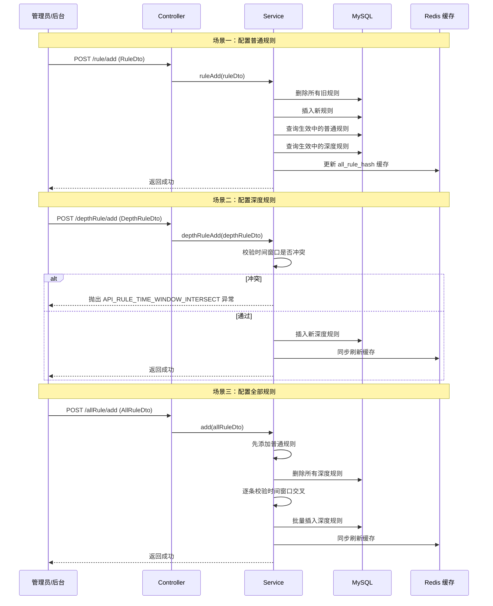

### 4.2 API 调用记录数据流

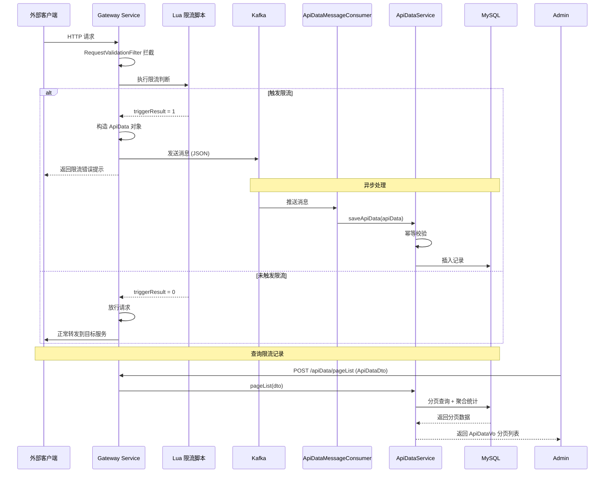

### 4.3 规则缓存同步机制

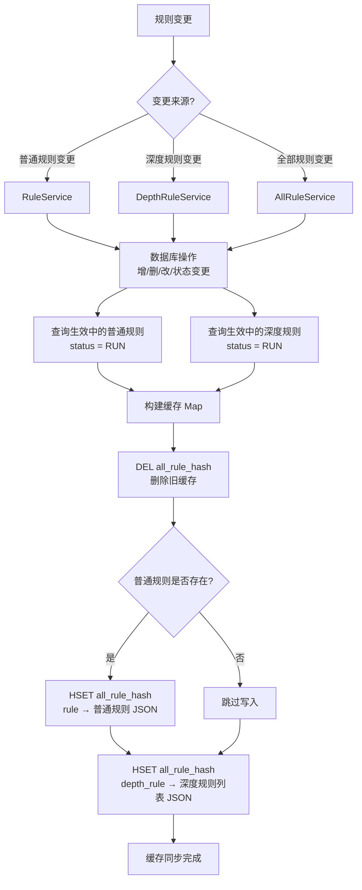

---

## 5. 与外部模块的交互

### 5.1 依赖的外部模块

| 模块 | 依赖说明 |
|------|---------|
| [Customize Client](Customize%20Client.md) | 使用 DTO/VO 数据模型与外部交互 |
| [Redis Tool Framework](Redis%20Tool%20Framework.md) | 使用 `RedisCache` 进行规则缓存操作 |
| [ID Generator Framework](ID%20Generator%20Framework.md) | 使用 `UidGenerator` 生成分布式 ID |
| Common 模块 | 使用公共工具类（`SpringUtil`、`StringUtil`、`DateUtils` 等） |
| Spring Cloud Framework | 服务注册发现、Feign 远程调用、灰度发布 |
| Redisson Framework | 分布式锁、重复执行限制 |

### 5.2 被依赖的模块

| 模块 | 依赖说明 |
|------|---------|
| [Gateway Service](Gateway%20Service.md) | Gateway Service 读取 Customize Service 写入的 Redis 规则缓存，执行限流判断 |

### 5.3 与其他服务的交互

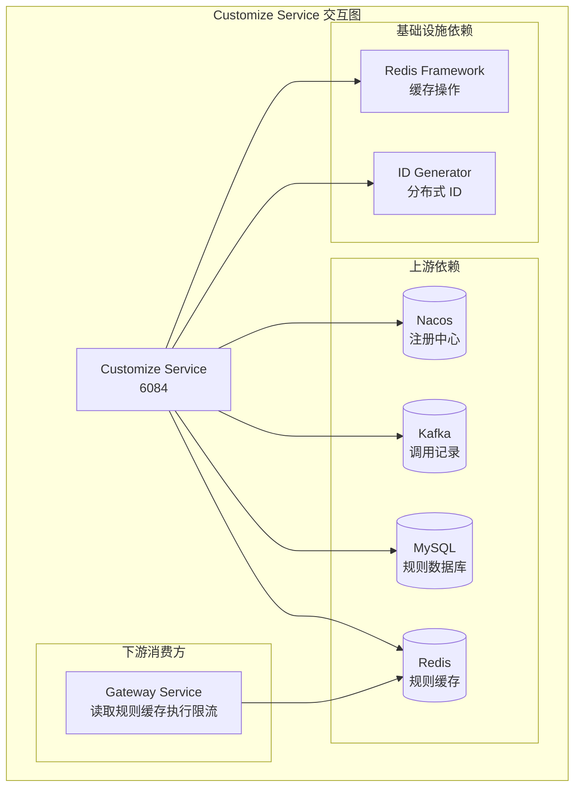

---

## 6. 配置说明

### 6.1 application.yml 核心配置

```yaml
server:
  port: 6084
  
spring:
  application:
    name: ${prefix.distinction.name:damai}-customize-service
  datasource:
    url: jdbc:mysql://127.0.0.1:3306/damai_customize?...
  data:
    redis:
      host: 127.0.0.1
      port: 6379
  cloud:
    nacos:
      discovery:
        server-addr: 127.0.0.1:8848
  kafka:
    bootstrap-servers: 127.0.0.1:9092
    consumer:
      group-id: api_data
      topic: save_api_data
```

### 6.2 多环境配置

| 配置文件 | 用途 |
|---------|------|
| `application.yml` | 通用配置 |
| `application-local.yml` | 本地开发环境（数据源等） |
| `application-pro.yml` | 生产环境 |

---

## 7. 数据库表结构

### 7.1 d_rule（普通规则表）

```sql
CREATE TABLE `d_rule` (
  `id` bigint(20) NOT NULL COMMENT '主键ID',
  `stat_time` int(11) DEFAULT NULL COMMENT '统计时间',
  `stat_time_type` int(11) DEFAULT NULL COMMENT '统计时间类型 1秒 2分钟',
  `threshold` int(11) DEFAULT NULL COMMENT '阈值',
  `effective_time` int(11) DEFAULT NULL COMMENT '规则生效限制时间',
  `effective_time_type` int(11) DEFAULT NULL COMMENT '生效限制时间类型 1秒 2分钟',
  `limit_api` varchar(255) DEFAULT NULL COMMENT '限制api',
  `message` varchar(255) DEFAULT NULL COMMENT '提示信息',
  `create_time` datetime DEFAULT NULL COMMENT '创建时间',
  `status` int(11) DEFAULT '1' COMMENT '状态 1生效 0失效',
  PRIMARY KEY (`id`)
) ENGINE=InnoDB DEFAULT CHARSET=utf8mb4 COMMENT='普通规则表';
```

### 7.2 d_depth_rule（深度规则表）

```sql
CREATE TABLE `d_depth_rule` (
  `id` bigint(20) NOT NULL COMMENT '主键ID',
  `start_time_window` varchar(20) DEFAULT NULL COMMENT '开始时间窗口',
  `end_time_window` varchar(20) DEFAULT NULL COMMENT '结束时间窗口',
  `stat_time` int(11) DEFAULT NULL COMMENT '统计时间',
  `stat_time_type` int(11) DEFAULT NULL COMMENT '统计时间类型 1秒 2分钟',
  `threshold` int(11) DEFAULT NULL COMMENT '阈值',
  `effective_time` int(11) DEFAULT NULL COMMENT '规则生效限制时间',
  `effective_time_type` int(11) DEFAULT NULL COMMENT '生效限制时间类型 1秒 2分钟',
  `limit_api` varchar(255) DEFAULT NULL COMMENT '限制api',
  `message` varchar(255) DEFAULT NULL COMMENT '提示信息',
  `create_time` datetime DEFAULT NULL COMMENT '创建时间',
  `status` int(11) DEFAULT '1' COMMENT '状态 1生效 0失效',
  PRIMARY KEY (`id`)
) ENGINE=InnoDB DEFAULT CHARSET=utf8mb4 COMMENT='深度规则表';
```

### 7.3 d_api_data（API 调用记录表）

```sql
CREATE TABLE `d_api_data` (
  `id` bigint(20) NOT NULL COMMENT '主键ID',
  `head_version` varchar(50) DEFAULT NULL COMMENT '请求头版本号',
  `api_address` varchar(50) DEFAULT NULL COMMENT '请求IP',
  `api_method` varchar(20) DEFAULT NULL COMMENT '请求方法',
  `api_body` text COMMENT '请求体',
  `api_params` text COMMENT '请求参数',
  `api_url` varchar(255) DEFAULT NULL COMMENT '请求路径',
  `create_time` datetime DEFAULT NULL COMMENT '创建时间',
  `status` int(11) DEFAULT NULL COMMENT '状态',
  `call_day_time` varchar(20) DEFAULT NULL COMMENT '按天统计时间',
  `call_hour_time` varchar(20) DEFAULT NULL COMMENT '按小时统计时间',
  `call_minute_time` varchar(20) DEFAULT NULL COMMENT '按分钟统计时间',
  `call_second_time` varchar(20) DEFAULT NULL COMMENT '按秒统计时间',
  `type` int(11) DEFAULT NULL COMMENT '类型',
  PRIMARY KEY (`id`),
  KEY `idx_api_url` (`api_url`),
  KEY `idx_create_time` (`create_time`)
) ENGINE=InnoDB DEFAULT CHARSET=utf8mb4 COMMENT='API调用记录表';
```

---

## 8. 相关文档

| 文档 | 说明 |
|------|------|
| [Customize Client](Customize%20Client.md) | 定制化客户端 - DTO/VO 数据模型定义 |
| [Gateway Service](Gateway%20Service.md) | 网关服务 - 限流执行方 |
| [Redis Tool Framework](Redis%20Tool%20Framework.md) | Redis 工具框架 - 缓存操作 |
| [ID Generator Framework](ID%20Generator%20Framework.md) | ID 生成器框架 - 分布式 ID |
| [Redisson Framework](Redisson%20Framework.md) | Redisson 分布式锁框架 |
