# Elasticsearch Framework 模块文档

## 1. 模块简介

**Elasticsearch Framework** 是大麦（Damai）高并发实战项目中用于封装 Elasticsearch 操作的基础框架模块。该模块基于 Spring Data Elasticsearch 和 Elasticsearch Low-Level REST Client，提供了一套简洁、统一的 API 来执行 ES 索引管理、文档增删改查、地理空间查询以及分页排序等操作。

通过该框架，业务服务（如 Program Service）无需直接处理复杂的 ES REST API 调用和 JSON 拼接，而是通过面向对象的 DTO 和工具类完成数据交互，大大降低了 Elasticsearch 的使用门槛。

---

## 2. 整体架构

### 2.1 模块依赖关系

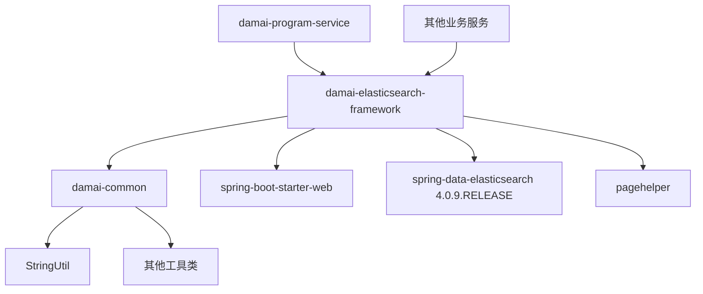

### 2.2 模块内部组件架构

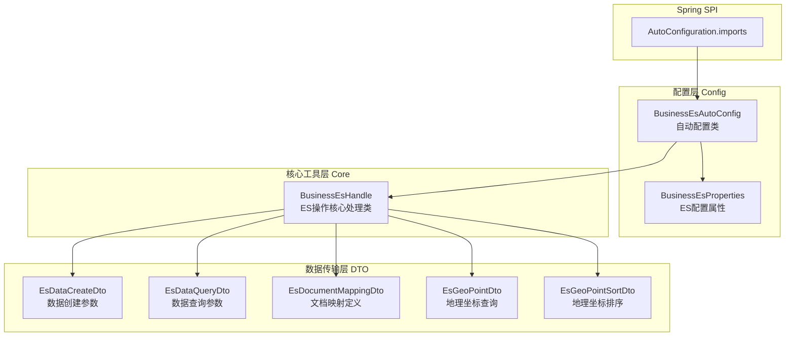

---

## 3. 核心组件详解

### 3.1 配置属性：`BusinessEsProperties`

| 属性名 | 类型 | 默认值 | 说明 |
|--------|------|--------|------|
| `elasticsearch.ip` | `String[]` | - | ES 集群地址列表，格式：`host:port`，如 `127.0.0.1:9200` |
| `elasticsearch.userName` | `String` | - | ES 认证用户名（可选） |
| `elasticsearch.passWord` | `String` | - | ES 认证密码（可选） |
| `elasticsearch.esSwitch` | `Boolean` | `true` | ES 功能总开关，关闭后所有操作跳过 |
| `elasticsearch.esTypeSwitch` | `Boolean` | `false` | 是否启用 ES 7.x 之前的 type 支持 |
| `elasticsearch.connectTimeOut` | `Integer` | `40000` | 连接超时时间（毫秒） |
| `elasticsearch.socketTimeOut` | `Integer` | `40000` | Socket 超时时间（毫秒） |
| `elasticsearch.connectionRequestTimeOut` | `Integer` | `40000` | 连接请求超时时间（毫秒） |
| `elasticsearch.maxConnectNum` | `Integer` | `400` | 最大连接线程数 |

配置前缀：`elasticsearch`

**示例配置（application.yml）：**
```yaml
elasticsearch:
  ip: 127.0.0.1:9200
  userName: elastic
  passWord: elastic
  esSwitch: true
  esTypeSwitch: false
  connectTimeOut: 40000
  socketTimeOut: 40000
  connectionRequestTimeOut: 40000
  maxConnectNum: 400
```

### 3.2 自动配置：`BusinessEsAutoConfig`

该配置类在 `elasticsearch.ip` 属性存在时自动生效（通过 `@ConditionalOnProperty` 控制），负责：

1. **创建 `RestClient` Bean（`businessEsRestClient`）**：基于配置的 ES 地址列表创建 HTTP 连接，支持用户名/密码认证、默认请求头（Content-Type: application/json）、超时设置和 IO 线程池配置。

2. **创建 `BusinessEsHandle` Bean**：注入 `RestClient` 和配置属性，供业务服务使用。

3. **注册为 Spring Boot AutoConfiguration**：通过 `META-INF/spring/org.springframework.boot.autoconfigure.AutoConfiguration.imports` 文件注册。

**RestClient 构建流程：**

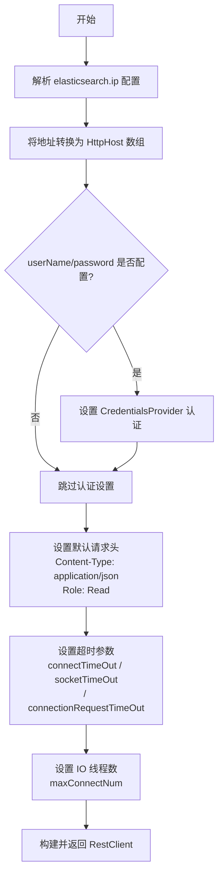

### 3.3 核心处理类：`BusinessEsHandle`

这是框架的核心类，封装了所有 ES 操作逻辑，通过 `RestClient`（Low-Level REST Client）直接发送 HTTP 请求到 ES 集群。

#### 3.3.1 索引管理

| 方法 | 说明 | HTTP 请求 |
|------|------|-----------|
| `createIndex(indexName, indexType, list)` | 创建索引及映射定义 | `PUT /{indexName}` |
| `checkIndex(indexName, indexType)` | 检查索引是否存在 | `GET /{indexName}/_mapping` |
| `deleteIndex(indexName)` | 删除索引 | `DELETE /{indexName}` |
| `deleteData(indexName)` | 清空索引数据（实际为删除索引） | `DELETE /{indexName}` |

**索引创建流程：**

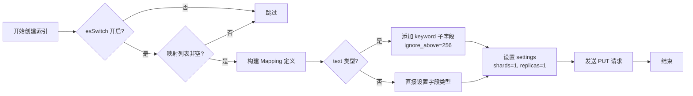

**映射定义说明：**
- 对于 `text` 类型的字段，会自动添加一个 `keyword` 子字段（`ignore_above: 256`），以支持精确匹配和聚合操作。
- 默认设置 1 个分片和 1 个副本。
- `esTypeSwitch` 控制是否兼容 ES 7.x 之前的 type 概念。

#### 3.3.2 文档操作

| 方法 | 说明 | HTTP 请求 |
|------|------|-----------|
| `add(indexName, indexType, params)` | 添加文档（自动生成 ID） | `POST /{indexName}/_doc` |
| `add(indexName, indexType, params, id)` | 添加/覆盖文档（指定 ID） | `POST /{indexName}/_doc/{id}` |
| `deleteByDocumentId(index, documentId)` | 按文档 ID 删除 | `DELETE /{index}/_doc/{documentId}` |

**文档添加流程：**


#### 3.3.3 查询操作

**查询方法体系：**

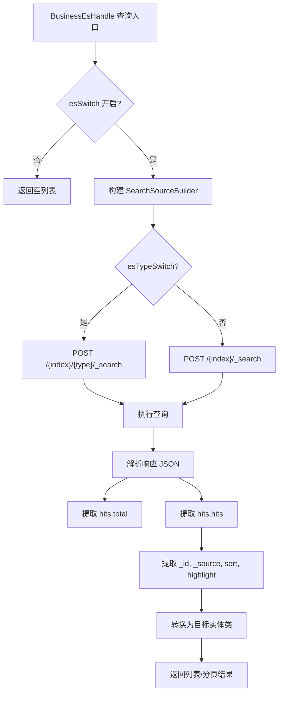

**提供的查询方法（重载）：**

| 方法签名 | 功能 |
|----------|------|
| `query(indexName, indexType, esDataQueryDtoList, clazz)` | 基础条件查询 |
| `query(indexName, indexType, esGeoPointDto, esDataQueryDtoList, clazz)` | 带地理坐标过滤的查询 |
| `query(indexName, indexType, esDataQueryDtoList, sortParam, sortOrder, clazz)` | 带排序的查询 |
| `query(indexName, indexType, esDataQueryDtoList, geoPointDtoSortParam, sortOrder, clazz)` | 带地理坐标排序的查询 |
| `query(...)` (完整参数) | 完整参数的查询（含 searchAfter 深度分页） |
| `queryPage(indexName, indexType, esDataQueryDtoList, pageNo, pageSize, clazz)` | 基础分页查询 |
| `queryPage(...)` (多种重载) | 带排序/地理过滤的分页查询 |
| `executeQuery(...)` | 底层查询执行方法（可直接传递 SearchSourceBuilder，支持高亮） |

**查询条件构建逻辑（`getSearchSourceBuilder`）：**

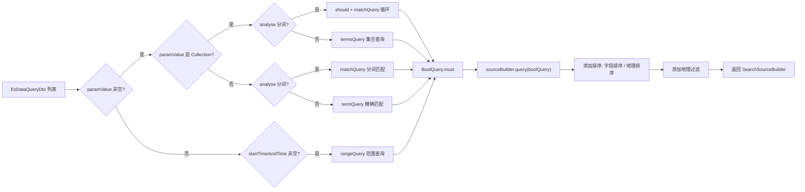

**支持的排序类型：**
- **普通字段排序**：通过 `FieldSortBuilder` 实现，支持任意可排序字段
- **地理坐标排序**：通过 `GeoDistanceSortBuilder` 实现，按距离排序
- **自定义排序**：业务服务可通过 `executeQuery` 方法直接传递 `SearchSourceBuilder` 实现复杂排序（如随机排序）

**响应解析流程（`executeQuery`）：**

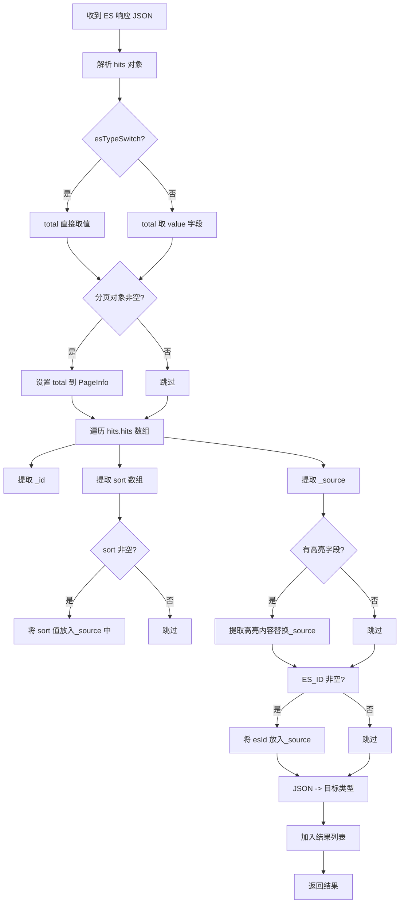

### 3.4 数据传输对象（DTO）

#### `EsDataCreateDto`（数据创建参数）

| 字段 | 类型 | 说明 |
|------|------|------|
| `paramName` | `String` | 字段名 |
| `paramValue` | `Object` | 字段值 |

#### `EsDataQueryDto`（查询参数）

| 字段 | 类型 | 说明 |
|------|------|------|
| `paramName` | `String` | 字段名 |
| `paramValue` | `Object` | 字段值 |
| `startTime` | `Date` | 时间范围开始（时间字段专用） |
| `endTime` | `Date` | 时间范围结束（时间字段专用） |
| `analyse` | `boolean` | 是否分词查询（默认 `false`，即精确匹配） |

#### `EsDocumentMappingDto`（文档映射定义）

| 字段 | 类型 | 说明 |
|------|------|------|
| `paramName` | `String` | 字段名 |
| `paramType` | `String` | ES 字段类型（如 `text`, `keyword`, `long`, `date` 等） |

#### `EsGeoPointDto`（地理坐标查询）

| 字段 | 类型 | 说明 |
|------|------|------|
| `paramName` | `String` | 字段名（存储地理坐标的字段） |
| `latitude` | `BigDecimal` | 纬度 |
| `longitude` | `BigDecimal` | 经度 |

#### `EsGeoPointSortDto`（地理坐标排序）

| 字段 | 类型 | 说明 |
|------|------|------|
| `paramName` | `String` | 字段名 |
| `latitude` | `BigDecimal` | 纬度 |
| `longitude` | `BigDecimal` | 经度 |

---

## 4. 业务集成示例（Program Service）

### 4.1 ProgramEs 类的依赖注入

```java
@Component
public class ProgramEs {
    
    @Autowired
    private BusinessEsHandle businessEsHandle;
    
    // ... 业务查询方法
}
```

### 4.2 索引命名规则

索引名称格式：`{应用前缀}-{索引名}`

例如 Program Service 中：
```java
// 索引名: damai-program (默认前缀)
SpringUtil.getPrefixDistinctionName() + "-" + ProgramDocumentParamName.INDEX_NAME
```

其中 `ProgramDocumentParamName.INDEX_NAME = "program"`，应用前缀默认为 `damai`。

### 4.3 业务查询方法详解

#### 首页列表查询（`selectHomeList`）

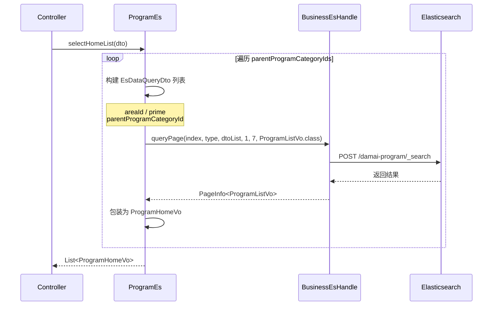

#### 推荐列表查询（`recommendList`）

使用 `executeQuery` 直接传递 `SearchSourceBuilder`，通过脚本排序实现随机推荐：

```java
Script script = new Script("Math.random()");
ScriptSortBuilder scriptSortBuilder = new ScriptSortBuilder(script, ScriptSortBuilder.ScriptSortType.NUMBER);
scriptSortBuilder.order(SortOrder.ASC);
searchSourceBuilder.sort(scriptSortBuilder);

businessEsHandle.executeQuery(index, type, list, null, ProgramListVo.class, searchSourceBuilder, null);
```

#### 分页列表查询（`selectPage`）

支持多种排序策略：

| 类型值 | 排序字段 | 排序方向 | 说明 |
|--------|----------|----------|------|
| 2 | `high_heat` | DESC | 按热度降序（推荐排序） |
| 3 | `showTime` | ASC | 按开场时间升序（最近开场） |
| 4 | `issueTime` | ASC | 按上架时间升序（最新上架） |
| default | - | - | 相关度排序（ES 默认 _score） |

#### 搜索查询（`search`）

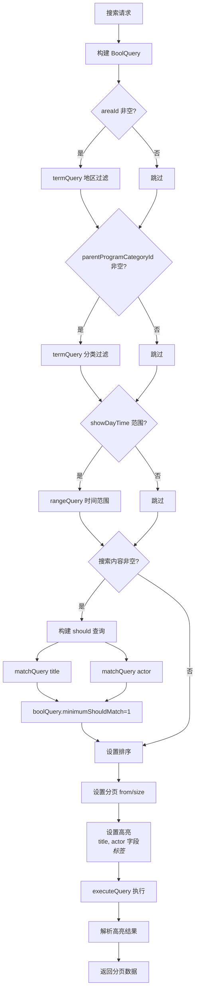

### 4.4 Program 索引字段映射

| 字段名 | ES 类型 | 说明 |
|--------|---------|------|
| `id` | long | 节目 ID |
| `programGroupId` | long | 节目组 ID |
| `prime` | int | 是否为精选 |
| `title` | text + keyword | 标题（支持分词搜索） |
| `actor` | text + keyword | 演员（支持分词搜索） |
| `place` | text + keyword | 场地 |
| `itemPicture` | keyword | 图片 URL |
| `areaId` | long | 地区 ID |
| `areaName` | keyword | 地区名称 |
| `programCategoryId` | long | 节目分类 ID |
| `programCategoryName` | keyword | 节目分类名称 |
| `parentProgramCategoryId` | long | 父节目分类 ID |
| `parentProgramCategoryName` | keyword | 父节目分类名称 |
| `high_heat` | long | 热度 |
| `issueTime` | date | 上架时间 |
| `showTime` | date | 开场时间 |
| `showDayTime` | date | 演出日期 |
| `showWeekTime` | keyword | 演出星期 |
| `minPrice` | decimal | 最低票价 |
| `maxPrice` | decimal | 最高票价 |

---

## 5. 数据流与交互流程

### 5.1 索引创建流程

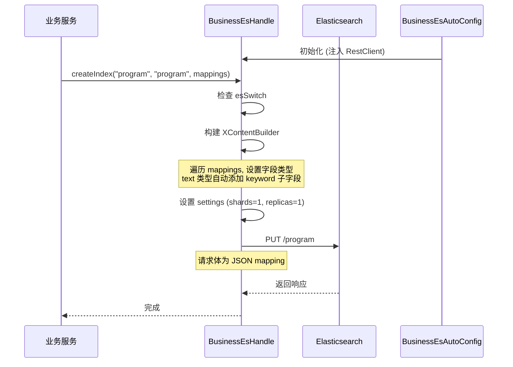

### 5.2 数据添加流程

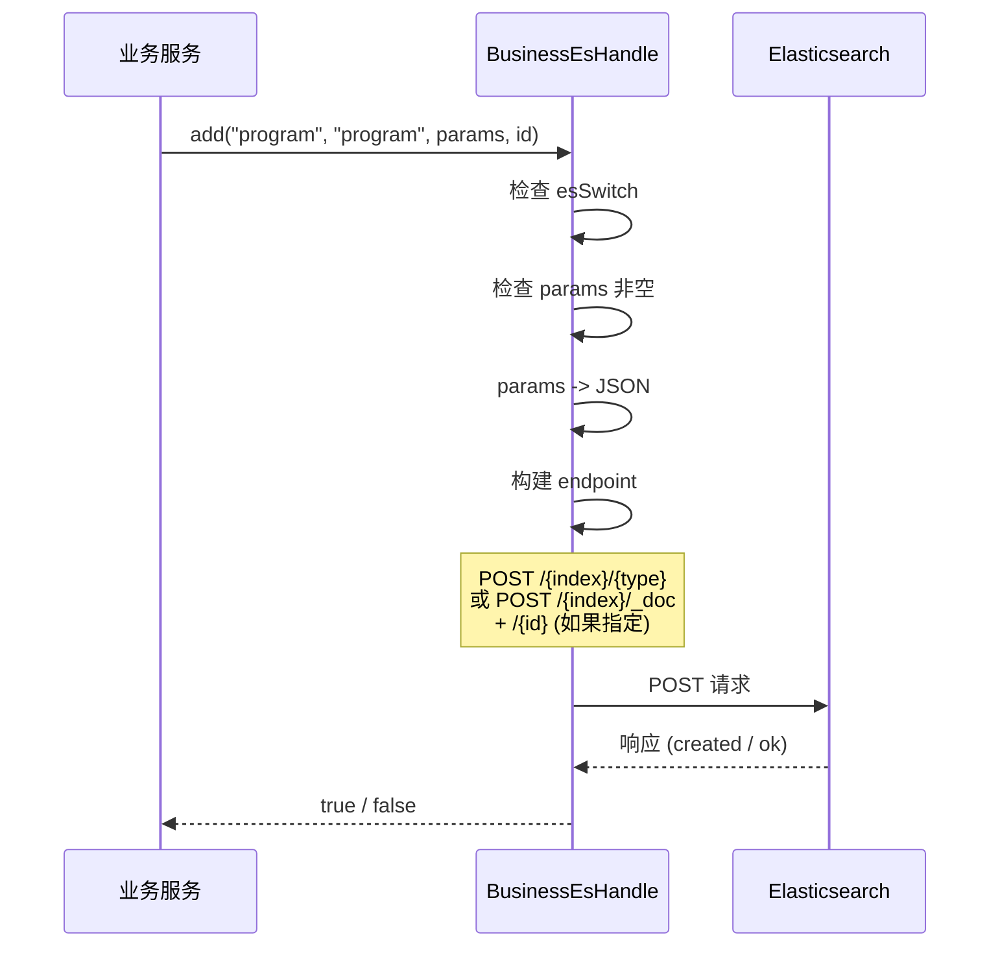

### 5.3 数据查询流程

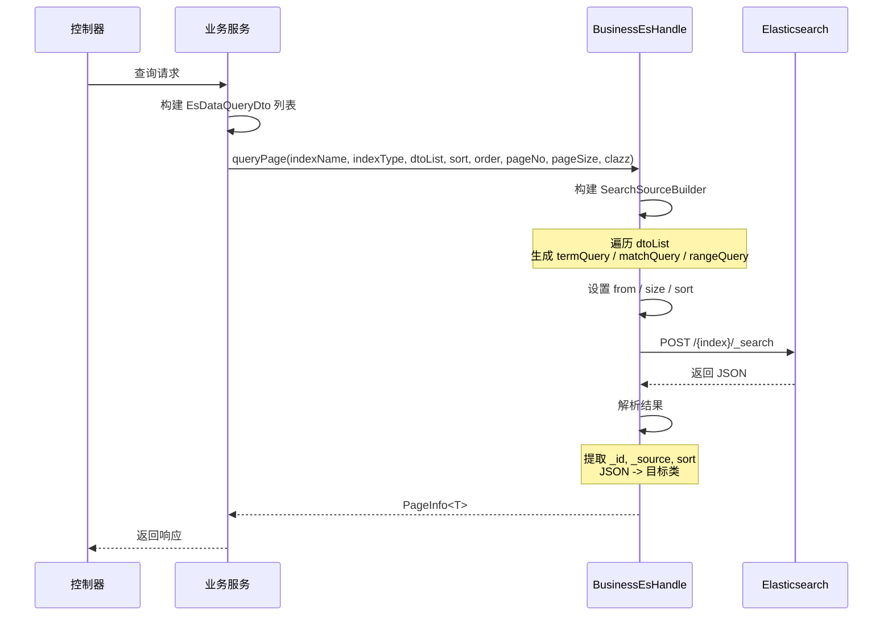

### 5.4 搜索高亮流程

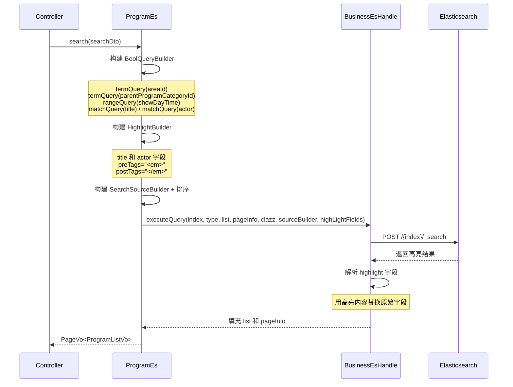

---

## 6. 与其他模块的关联

| 相关模块 | 关联说明 |
|----------|----------|
| [damai-common](Common.md) | 提供 `StringUtil` 工具类，用于字符串判空等基础操作 |
| [damai-program-service](Program%20Service.md) | 主要使用者，通过 `ProgramEs` 使用 ES 进行节目搜索和列表展示 |
| [damai-spring-cloud-framework](Spring%20Cloud%20Framework.md) | 提供 `SpringUtil.getPrefixDistinctionName()` 用于动态获取索引前缀 |
| [damai-redis-tool-framework](Redis%20Tool%20Framework.md) | 配合 Redis 缓存，形成"ES 搜索 + Redis 缓存"的多级数据查询方案 |
| [damai-thread-pool-framework](Thread%20Pool%20Framework.md) | 可配合异步线程池执行 ES 数据同步任务 |

---

## 7. 设计亮点与最佳实践

### 7.1 开关控制
- **`esSwitch` 全局开关**：方便在开发/测试环境关闭 ES 功能，不影响业务代码逻辑，所有操作方法都会先检查此开关
- **`esTypeSwitch` 类型兼容开关**：支持 ES 6.x 到 7.x+ 的平滑迁移，为 true 时使用 `{index}/{type}` 路径格式

### 7.2 查询构建模式
- 基于 `BoolQueryBuilder` 的 must 组合查询，支持精确匹配（termQuery）、分词匹配（matchQuery）、集合匹配（termsQuery）和时间范围查询（rangeQuery）
- 统一通过 `EsDataQueryDto` 传递参数，避免业务代码直接拼接 ES DSL
- 灵活的 `analyse` 标记控制是否分词查询

### 7.3 地理空间支持
- 内置 `GeoDistanceQueryBuilder` 用于地理坐标过滤（支持超远距离查询）
- 内置 `GeoDistanceSortBuilder` 用于按距离排序（支持米单位）
- 适用于 LBS（基于位置的服务）场景，如"附近演出"等

### 7.4 分页与排序
- 支持 `from + size` 传统分页
- 支持 `searchAfter` 深度分页（通过完整参数方法传递 `searchAfterSort` 数组）
- 多种排序策略：字段排序、地理距离排序、脚本排序（如随机排序）
- `trackTotalHits(true)` 确保精确的总记录数统计

### 7.5 高亮搜索
- 支持搜索结果高亮，`executeQuery` 方法自动解析 `highlight` 字段并替换到返回对象中
- 通过 `preTags` 和 `postTags` 自定义高亮标签

### 7.6 自动映射
- `text` 类型字段自动添加 `keyword` 子字段，兼顾分词搜索和精确匹配
- 返回结果中自动注入 `_id` 为 `esId` 字段，`sort` 值为 `sort` 字段，方便业务使用

---

## 8. 注意事项

1. **索引命名**：业务服务应使用唯一的索引名称前缀（通过 `SpringUtil.getPrefixDistinctionName()` 获取），避免多环境数据冲突
2. **分页限制**：`from + size` 分页在深度分页时性能会下降，建议限制最大分页深度或使用 `searchAfter`
3. **`esTypeSwitch`**：ES 7.x 已废弃 type 概念，新建项目建议关闭此开关（设为 `false`）
4. **text 类型字段**：自动添加的 `keyword` 子字段适用于精确匹配和聚合，但 `ignore_above=256` 表示超过 256 字符的文本会被忽略
5. **空值处理**：查询时 `paramValue` 为 `null` 的条件会被跳过，不会加入查询条件
6. **线程安全**：`RestClient` 是线程安全的，可以在多个线程间共享使用
7. **依赖版本**：当前使用 `spring-data-elasticsearch 4.0.9.RELEASE`，对应 ES 7.x 版本

---

## 9. 附录：核心 API 速查表

### 索引管理

```java
// 创建索引
void createIndex(String indexName, String indexType, List<EsDocumentMappingDto> list)

// 检查索引
boolean checkIndex(String indexName, String indexType)

// 删除索引
boolean deleteIndex(String indexName)

// 清空数据
void deleteData(String indexName)
```

### 文档操作

```java
// 添加文档（自动ID）
boolean add(String indexName, String indexType, Map<String,Object> params)

// 添加文档（指定ID）
boolean add(String indexName, String indexType, Map<String,Object> params, String id)

// 按文档ID删除
void deleteByDocumentId(String index, String documentId)
```

### 查询操作

```java
// 基础查询
List<T> query(String indexName, String indexType, List<EsDataQueryDto> list, Class<T> clazz)

// 带地理过滤查询
List<T> query(String indexName, String indexType, EsGeoPointDto geoPointDto, List<EsDataQueryDto> list, Class<T> clazz)

// 带排序查询
List<T> query(String indexName, String indexType, List<EsDataQueryDto> list, String sortParam, SortOrder sortOrder, Class<T> clazz)

// 基础分页查询
PageInfo<T> queryPage(String indexName, String indexType, List<EsDataQueryDto> list, Integer pageNo, Integer pageSize, Class<T> clazz)

// 带排序分页查询
PageInfo<T> queryPage(String indexName, String indexType, List<EsDataQueryDto> list, String sortParam, SortOrder sortOrder, Integer pageNo, Integer pageSize, Class<T> clazz)

// 底层执行查询（支持自定义 SearchSourceBuilder 和高亮）
void executeQuery(String indexName, String indexType, List<T> list, PageInfo<T> pageInfo, Class<T> clazz, SearchSourceBuilder sourceBuilder, List<String> highLightFieldNameList)
```
