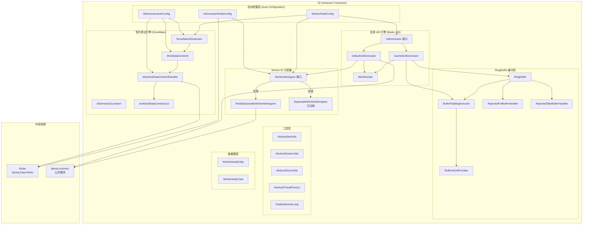
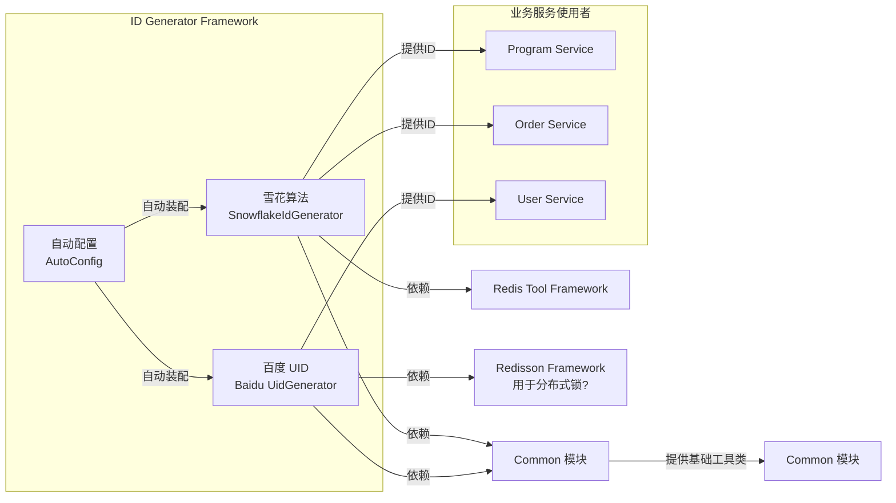
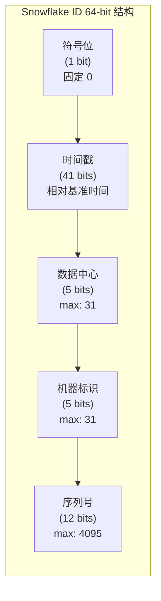
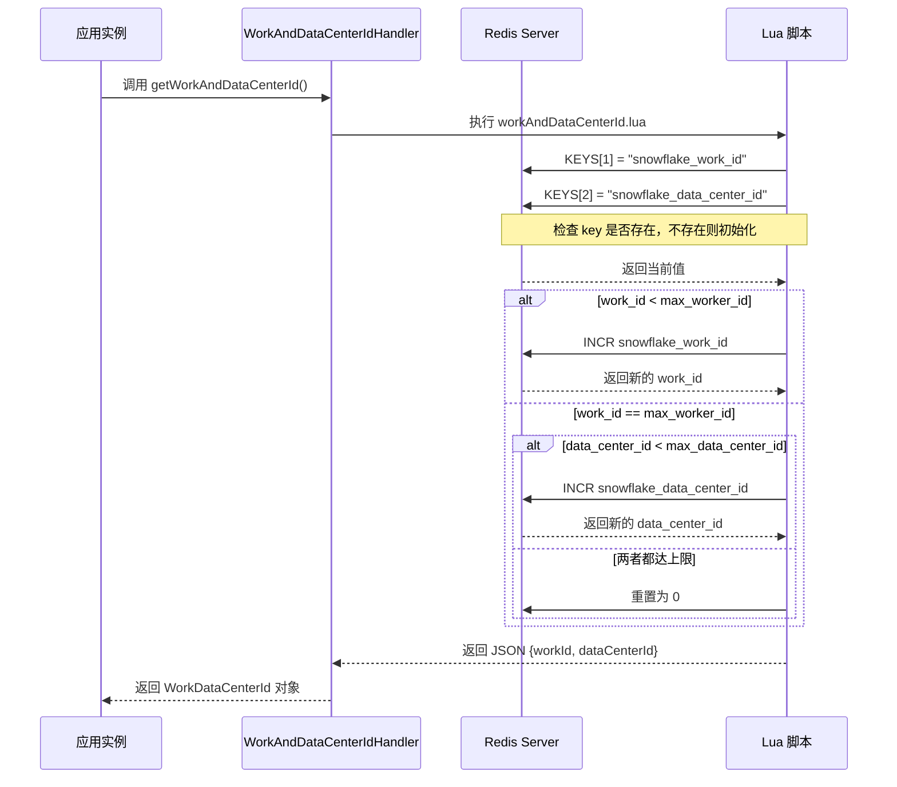
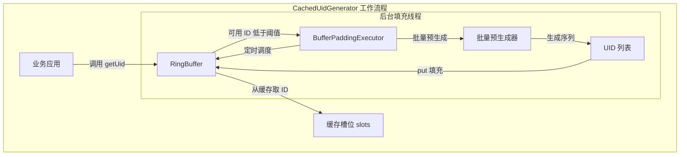
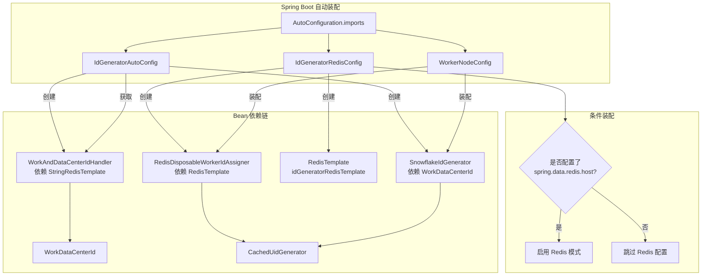
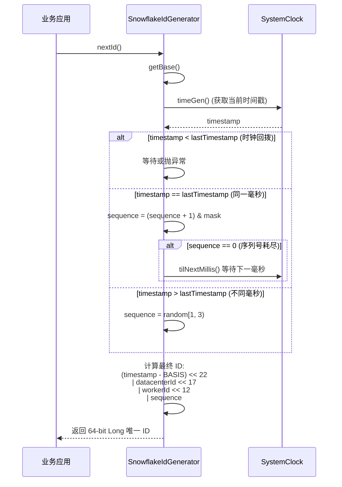
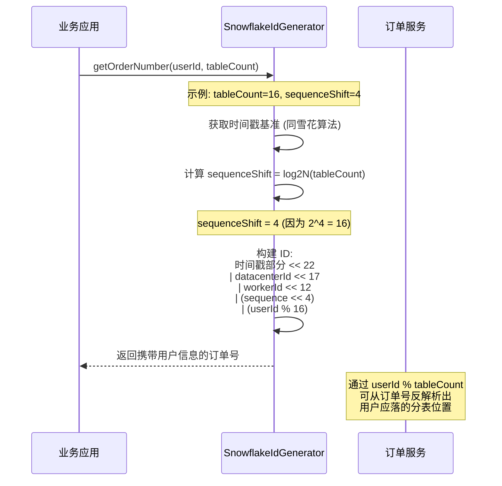
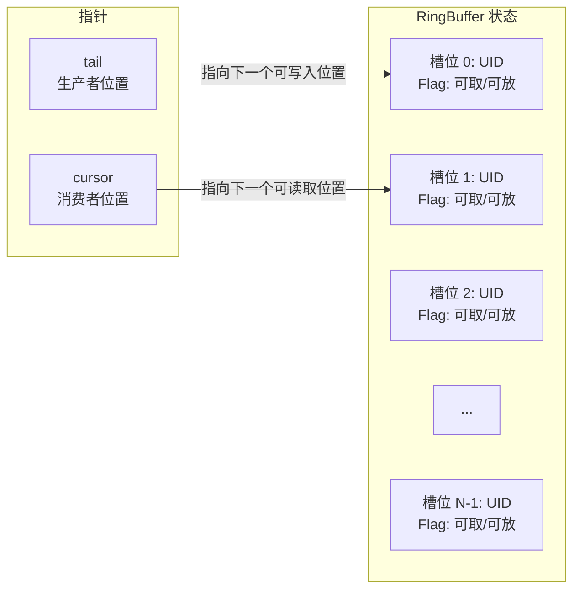

# ID 生成器框架（ID Generator Framework）

## 概述

ID 生成器框架是大麦（DaMai）高并发实战项目中用于**分布式唯一 ID 生成**的核心基础设施模块。该模块基于**百度开源 UID 生成器**（[uid-generator](https://github.com/baidu/uid-generator)）进行深度改造和适配，同时集成了**雪花算法（Snowflake）**实现，提供了两套独立的 ID 生成方案，以满足不同业务场景下的分布式 ID 需求。

### 核心特性

- **双引擎支持**：同时提供百度 UID 生成器（`DefaultUidGenerator` / `CachedUidGenerator`）和雪花算法（`SnowflakeIdGenerator`）两种 ID 生成策略
- **高性能缓存**：支持基于 RingBuffer 的预生成缓存模式，极大提升高并发下的 ID 获取性能
- **多种 Worker ID 分配策略**：支持基于 Redis 的自动分配和基于数据库（DB）的传统分配方式
- **分库分表基因法**：内置订单号生成方法，支持分库分表场景下的基因法 ID 生成（将用户 ID 编码到订单号中）
- **Spring Boot 自动装配**：基于 `AutoConfiguration.imports` 实现条件化自动配置，开箱即用
- **时钟回拨保护**：内置时钟回拨检测和处理机制，保证 ID 的唯一性和单调递增性

---

## 架构总览



---

## 模块依赖关系



> **依赖说明**：该模块依赖 `damai-common` 公共模块（提供基础工具类和异常定义），通过 `spring-boot-starter-data-redis` 集成 Redis。配置了 Redis 时自动启用基于 Redis 的 Worker ID 分配策略。

---

## 核心组件详解

### 1. 雪花算法引擎（Snowflake ID Generator）

#### 1.1 SnowflakeIdGenerator

**类路径**：`com.damai.toolkit.SnowflakeIdGenerator`

大麦自定义的雪花算法实现，是项目中主要的 ID 生成引擎。采用经典的 1-bit 符号位 + 41-bit 时间戳 + 5-bit 数据中心 + 5-bit 机器标识 + 12-bit 序列号的标准结构。

**ID 结构（64-bit Long）：**



**关键特性：**

- **基准时间**：`BASIS_TIME = 1288834974657L`（约 2010-11-04），可使用约 69 年
- **序列号随机初始化**：不同毫秒内序列号从 `[1, 3)` 随机数开始，避免 ID 可预测性
- **时钟回拨处理**：回拨 5ms 内通过自旋等待，超过 5ms 抛出异常
- **基因法支持**：`getOrderNumber(userId, tableCount)` 方法将用户 ID 模分表数嵌入序列号中，实现分库分表下的订单号基因法

**三种构造方式：**

| 构造方式 | 说明 |
|---------|------|
| `SnowflakeIdGenerator(WorkDataCenterId)` | 通过 Redis Lua 脚本自动分配 workId 和 dataCenterId（推荐） |
| `SnowflakeIdGenerator(InetAddress)` | 通过本机 MAC 地址 + 进程 PID 计算 workId/datacenterId |
| `SnowflakeIdGenerator(long workerId, long datacenterId)` | 手动指定 workId 和 dataCenterId |

#### 1.2 WorkAndDataCenterIdHandler

**类路径**：`com.damai.toolkit.WorkAndDataCenterIdHandler`

基于 **Redis Lua 脚本**实现分布式环境下的 Work ID 和 Data Center ID 自动分配器。通过原子化的 Lua 脚本保证多实例并发分配时 ID 的唯一性。

**工作流程：**



#### 1.3 WorkDataCenterId

**类路径**：`com.damai.toolkit.WorkDataCenterId`

简单的 POJO，包含 `workId` 和 `dataCenterId` 两个 Long 类型字段，用于承载从 Redis 获取的机器标识。

#### 1.4 IdGeneratorConstant

**类路径**：`com.damai.toolkit.IdGeneratorConstant`

雪花算法相关常量定义：

| 常量名 | 值 | 说明 |
|-------|-----|------|
| `WORKER_ID_BITS` | `5L` | 机器标识位数 |
| `DATA_CENTER_ID_BITS` | `5L` | 数据中心位数 |
| `MAX_WORKER_ID` | `31` | 最大机器标识（`-1L ^ (-1L << 5)`） |
| `MAX_DATA_CENTER_ID` | `31` | 最大数据中心标识 |

---

### 2. 百度 UID 生成器引擎

#### 2.1 UidGenerator 接口

**类路径**：`com.baidu.fsg.uid.UidGenerator`

百度 UID 生成器的核心接口，定义了三种 ID 获取方法：

| 方法 | 说明 |
|------|------|
| `getUid()` | 获取唯一 ID（原百度方法） |
| `getId()` | 获取 ID（委托给 SnowflakeIdGenerator） |
| `getOrderNumber(userId, tableCount)` | 获取订单号（基因法，委托给 SnowflakeIdGenerator） |
| `parseUid(long uid)` | 解析 ID 的组成部分 |

#### 2.2 DefaultUidGenerator

**类路径**：`com.baidu.fsg.uid.impl.DefaultUidGenerator`

百度 UID 生成器的默认实现，采用**秒级时间戳**方案。ID 结构如下：

| 段 | 默认位数 | 说明 |
|---|---------|------|
| 符号位 | 1 bit | 固定 0 |
| 时间戳（秒） | 28 bits | 相对纪元时间（2024-05-20）的秒数，约支持 8.7 年 |
| Worker ID | 22 bits | 最大约 420W 节点 |
| 序列号 | 13 bits | 同一秒内最多 8192 个 |

**时序特性：**

- 采用 `synchronized` 同步方法保证线程安全
- 时间戳回拨时直接抛出 `UidGenerateException`
- 通过 `WorkerIdAssigner` 接口获取 Worker ID

#### 2.3 CachedUidGenerator

**类路径**：`com.baidu.fsg.uid.impl.CachedUidGenerator`

在 `DefaultUidGenerator` 基础上增加 **RingBuffer 缓存**的高性能实现，是项目中实际使用的百度 UID 生成器。

**设计架构：**



**关键参数：**

| 参数 | 默认值 | 说明 |
|------|-------|------|
| `boostPower` | 3 | RingBuffer 大小放大倍数（`(maxSequence+1) << boostPower`） |
| `paddingFactor` | 50 | 触发填充的阈值百分比 |
| `scheduleInterval` | null | 定时填充间隔（秒），null 表示不使用定时填充 |

**RingBuffer 性能优化：**

- 使用数组（而非链表）存储 UID，利用 CPU 缓存行局部性
- 使用 `PaddedAtomicLong` 避免伪共享（False Sharing）问题
- 采用 CAS 原子操作实现无锁消费
- 提供拒绝策略接口（`RejectedPutBufferHandler`、`RejectedTakeBufferHandler`）

---

### 3. Worker ID 分配器

#### 3.1 WorkerIdAssigner 接口

**类路径**：`com.baidu.fsg.uid.worker.WorkerIdAssigner`

定义了 `assignWorkerId()` 方法，用于为 UID 生成器分配唯一的 Worker ID。

#### 3.2 RedisDisposableWorkerIdAssigner

**类路径**：`com.baidu.fsg.uid.config.RedisDisposableWorkerIdAssigner`

大麦项目实际使用的 Worker ID 分配器，基于 Redis 的 `INCR` 命令实现：

- 使用 Redis key `"uid_work_id"` 进行自增
- 每次应用启动时获取一个新的唯一 ID
- 通过 `@ConditionalOnProperty("spring.data.redis.host")` 条件激活

#### 3.3 DisposableWorkerIdAssigner（已注释）

原百度基于数据库的实现，通过 `WORKER_NODE` 表记录节点信息并获取自增 ID。在大麦项目中被 Redis 方案替代，代码已注释。

#### 3.4 WORKER_NODE 表结构

```sql
CREATE TABLE WORKER_NODE (
    ID          BIGINT NOT NULL AUTO_INCREMENT COMMENT '自增主键',
    HOST_NAME   VARCHAR(64) NOT NULL COMMENT '主机名',
    PORT        VARCHAR(64) NOT NULL COMMENT '端口',
    TYPE        INT NOT NULL COMMENT '节点类型: ACTUAL 或 CONTAINER',
    LAUNCH_DATE DATE NOT NULL COMMENT '启动日期',
    MODIFIED    TIMESTAMP NOT NULL COMMENT '修改时间',
    CREATED     TIMESTAMP NOT NULL COMMENT '创建时间',
    PRIMARY KEY(ID)
) COMMENT='DB WorkerID Assigner for UID Generator', ENGINE = INNODB;
```

---

### 4. 自动装配与配置

#### 4.1 自动配置入口

框架通过 `META-INF/spring/org.springframework.boot.autoconfigure.AutoConfiguration.imports` 注册三个自动配置类：



#### 4.2 IdGeneratorAutoConfig

**类路径**：`com.damai.config.IdGeneratorAutoConfig`

雪花算法引擎的自动配置类，创建三个核心 Bean：

1. `WorkAndDataCenterIdHandler` — 依赖 `StringRedisTemplate`
2. `WorkDataCenterId` — 调用 Handler 获取 workId/dataCenterId
3. `SnowflakeIdGenerator` — 注入 WorkDataCenterId

#### 4.3 IdGeneratorRedisConfig

**类路径**：`com.baidu.fsg.uid.config.IdGeneratorRedisConfig`

百度 UID 的 Redis 适配配置类，需要 `spring.data.redis.host` 配置才会生效：

1. `idGeneratorRedisTemplate` — 自定义 String 序列化的 RedisTemplate
2. `disposableWorkerIdAssigner` — Redis 方式的 Worker ID 分配器

#### 4.4 WorkerNodeConfig

**类路径**：`com.baidu.fsg.uid.config.WorkerNodeConfig`

百度 UID 生成器的装配配置类，创建 `cachedUidGenerator` Bean：

- 注入 `disposableWorkerIdAssigner`（Redis 方式）
- 注入 `snowflakeIdGenerator`（雪花算法引擎）
- 设置到 `CachedUidGenerator` 中

---

### 5. ID 生成策略对比

| 特性 | SnowflakeIdGenerator | DefaultUidGenerator | CachedUidGenerator |
|------|---------------------|--------------------|--------------------|
| **时间精度** | 毫秒 | 秒 | 秒 |
| **QPS 上限** | ~409.6 万/秒 | ~8192/秒 | ~8192/秒 + 缓存加速 |
| **Worker ID 分配** | Redis Lua 脚本 / MAC+PID | WorkerIdAssigner 接口 | WorkerIdAssigner 接口 |
| **时钟回拨处理** | 5ms 内等待，超过抛异常 | 抛异常 | 抛异常 |
| **预缓存** | 不支持 | 不支持 | 支持（RingBuffer） |
| **基因法** | 支持 | 支持（委托雪花算法） | 支持（委托雪花算法） |
| **适用场景** | 高并发通用 ID | 中等并发 | 极高并发 + 预生成 |

---

### 6. 数据流与工作流程

#### 6.1 雪花算法 ID 生成流程



#### 6.2 基因法订单号生成流程



---

### 7. RingBuffer 缓存机制

#### 7.1 无锁环形缓冲区



**核心概念：**

| 概念 | 说明 |
|------|------|
| `slots[]` | 存储 UID 的 long 数组 |
| `flags[]` | 对应槽位的状态标记（`PaddedAtomicLong` 数组） |
| `tail` | 生产者指针，表示最大已写入序列 |
| `cursor` | 消费者指针，表示最小已消费序列 |
| `paddingThreshold` | 触发异步填充的阈值（`bufferSize * paddingFactor / 100`） |

**并发安全机制：**

- `put()` 使用 `synchronized` 保证写入原子性
- `take()` 使用 `AtomicLong.updateAndGet()` CAS 操作实现无锁消费
- `PaddedAtomicLong` 通过填充缓存行避免伪共享
- 标志位（`CAN_PUT_FLAG=0`, `CAN_TAKE_FLAG=1`）实现槽位的状态切换

---

### 8. 关键配置项

#### 8.1 Redis 配置（启用 Redis 模式时必需）

```yaml
spring:
  data:
    redis:
      host: ${REDIS_HOST:localhost}
      port: ${REDIS_PORT:6379}
      password: ${REDIS_PASSWORD:}
      database: ${REDIS_DATABASE:0}
```

#### 8.2 数据库配置（DB 模式，当前已注释）

如需要使用数据库方式分配 Worker ID，需配置 `WORKER_NODE` 表及相关 MyBatis 配置。详见 `scripts/WORKER_NODE.sql`。

#### 8.3 百度 UID 可选参数

可通过属性文件自定义百度 UID 生成器的参数（需在配置类中开启 setter 注入）：

| 属性 | 默认值 | 说明 |
|------|-------|------|
| `timeBits` | 28 | 时间戳位数 |
| `workerBits` | 22 | Worker ID 位数 |
| `seqBits` | 13 | 序列号位数 |
| `epochStr` | 2024-05-20 | 纪元日期 |
| `boostPower` | 3 | RingBuffer 放大倍数 |
| `paddingFactor` | 50 | 填充阈值百分比 |

---

### 9. 模块集成与使用

#### 9.1 Maven 依赖

```xml
<dependency>
    <groupId>com.example</groupId>
    <artifactId>damai-id-generator-framework</artifactId>
    <version>${revision}</version>
</dependency>
```

#### 9.2 代码中使用示例

```java
// 方式一：注入雪花算法引擎
@Autowired
private SnowflakeIdGenerator snowflakeIdGenerator;

// 生成通用唯一 ID
long id = snowflakeIdGenerator.nextId();

// 生成订单号（基因法，tableCount=16 表示分 16 张表）
long orderNumber = snowflakeIdGenerator.getOrderNumber(userId, 16);

// 解析 ID 的时间戳
long timestamp = SnowflakeIdGenerator.parseIdTimestamp(id);


// 方式二：注入百度 CachedUidGenerator（需要 Redis 配置）
@Autowired
@Qualifier("cachedUidGenerator")
private UidGenerator uidGenerator;

// 获取 ID
long uid = uidGenerator.getUid();

// 获取 ID（委托给雪花算法）
long id = uidGenerator.getId();

// 获取订单号（基因法）
long orderNumber = uidGenerator.getOrderNumber(userId, 16);

// 解析 UID
String parseInfo = uidGenerator.parseUid(uid);
// 返回: {"UID":"xxx","timestamp":"2024-05-21 10:30:00","workerId":"1","sequence":"100"}
```

#### 9.3 相关模块引用

- [Common 模块](damai-common.md) — 提供基础工具类、异常定义和常量
- [Redis Tool Framework](Redis Tool Framework.md) — Redis 操作基础设施
- [Redisson Framework](Redisson Framework.md) — 分布式锁和高级 Redis 功能

---

## 附录

### 附录 A：Lua 脚本源码（workAndDataCenterId.lua）

```lua
local snowflake_work_id_key = KEYS[1]          -- "snowflake_work_id"
local snowflake_data_center_id_key = KEYS[2]   -- "snowflake_data_center_id"
local max_worker_id = tonumber(ARGV[1])         -- 从 IdGeneratorConstant 获取
local max_data_center_id = tonumber(ARGV[2])    -- 从 IdGeneratorConstant 获取
local return_worker_id = 0
local return_data_center_id = 0
local snowflake_work_id_flag = false
local snowflake_data_center_id_flag = false

-- 初始化 key（如果不存在）
if (redis.call('exists', snowflake_work_id_key) == 0) then
    redis.call('set', snowflake_work_id_key, 0)
    snowflake_work_id_flag = true
end
if (redis.call('exists', snowflake_data_center_id_key) == 0) then
    redis.call('set', snowflake_data_center_id_key, 0)
    snowflake_data_center_id_flag = true
end

-- 两者都是新初始化的，返回 0
if (snowflake_work_id_flag and snowflake_data_center_id_flag) then
    return '{"workId": 0, "dataCenterId": 0}'
end

-- 获取当前值
local snowflake_work_id = tonumber(redis.call('get', snowflake_work_id_key))
local snowflake_data_center_id = tonumber(redis.call('get', snowflake_data_center_id_key))

-- 分配逻辑：先递增 work_id，work_id 达到上限后递增 data_center_id
if (snowflake_work_id == max_worker_id) then
    if (snowflake_data_center_id == max_data_center_id) then
        -- 两者都达上限，重置
        redis.call('set', snowflake_work_id_key, 0)
        redis.call('set', snowflake_data_center_id_key, 0)
    else
        return_data_center_id = redis.call('incr', snowflake_data_center_id_key)
    end
else
    return_worker_id = redis.call('incr', snowflake_work_id_key)
end

return string.format('{"workId": %d, "dataCenterId": %d}',
        return_worker_id, return_data_center_id)
```

### 附录 B：Snowflake ID 各段位计算速查

| 段 | 位数 | 最大值 | 左移位数 | 说明 |
|---|------|-------|---------|------|
| 时间戳 | 41 | 2^41 ≈ 2.2×10^12 ms | 22 | 相对基准时间的毫秒数 |
| 数据中心 | 5 | 31 | 17 | 最大 32 个数据中心 |
| 机器标识 | 5 | 31 | 12 | 每数据中心 32 台机器 |
| 序列号 | 12 | 4095 | 0 | 每毫秒 4096 个 ID |

### 附录 C：注意事项

1. **时钟回拨**：SnowflakeIdGenerator 对 5ms 内的回拨做了自旋等待处理，超过 5ms 抛出 `RuntimeException`。百度 UID 生成器直接抛出 `UidGenerateException`。
2. **Redis 依赖**：Work ID 自动分配强依赖 Redis，Redis 宕机时会导致 ID 生成失败（走 fallback 日志记录）。
3. **ID 耗尽**：百度 UID 的 28-bit 时间戳约支持到 2032 年（从 2024-05-20 起算 8.7 年），到期需要调整参数或迁移。
4. **序列号溢出**：雪花算法同一毫秒序列号耗尽时通过自旋等待下一毫秒，高并发下可能有微小的性能损耗。
5. **基因法限制**：`getOrderNumber` 方法中 `tableCount` 必须是 2 的幂，且 `log2N(tableCount) + 12 <= bits`（序列号段 + 基因位不能超过 12 bit），否则会覆盖机器标识位。
