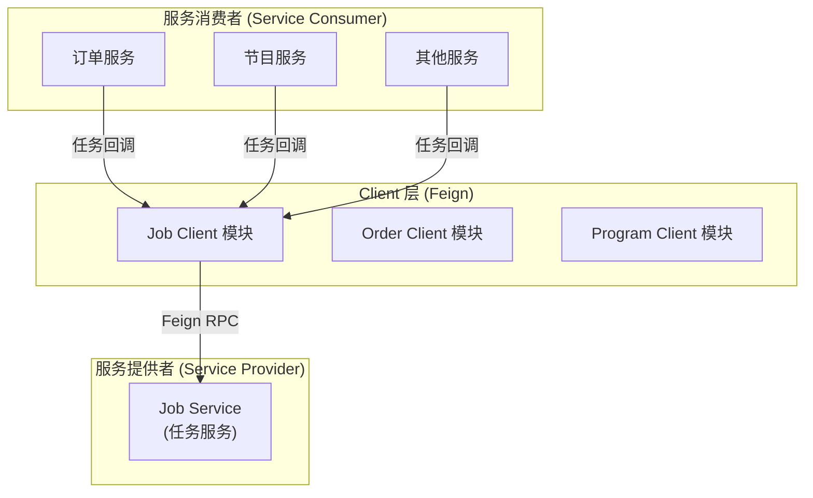
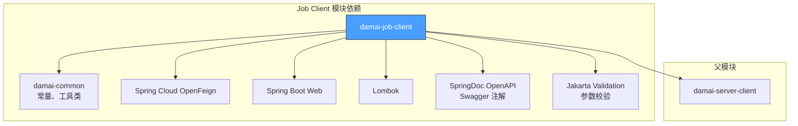
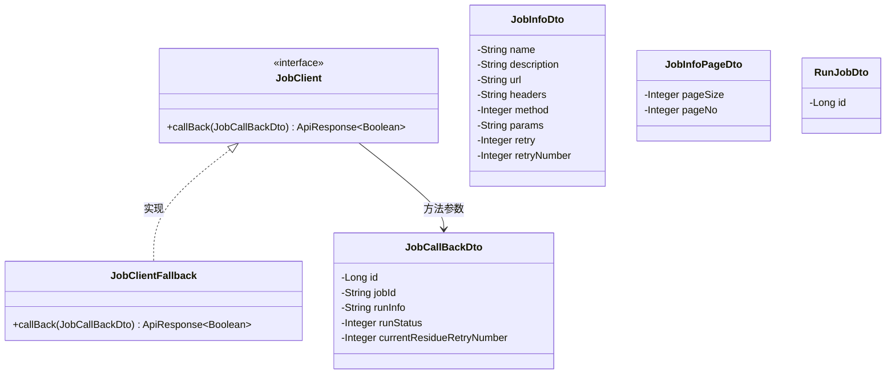
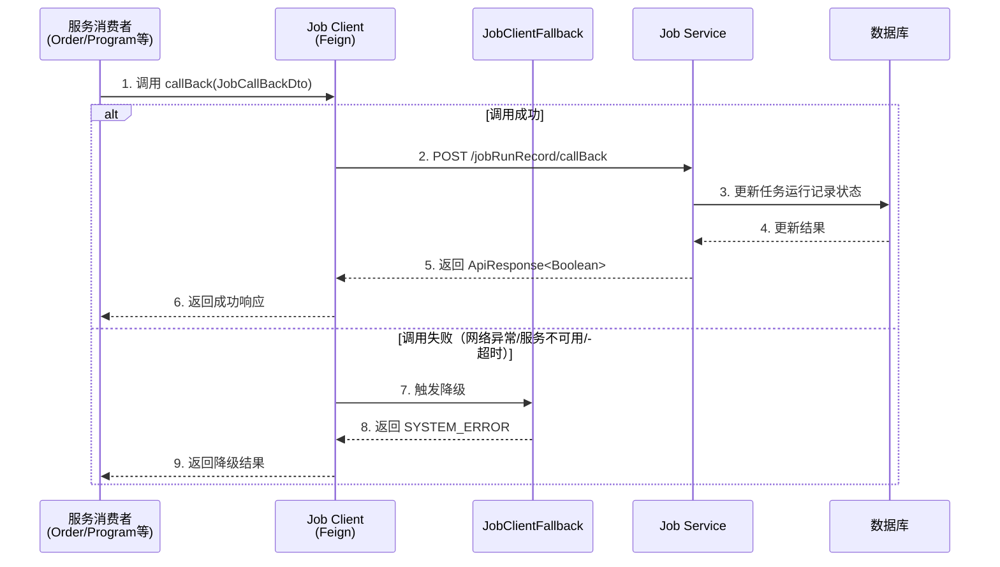
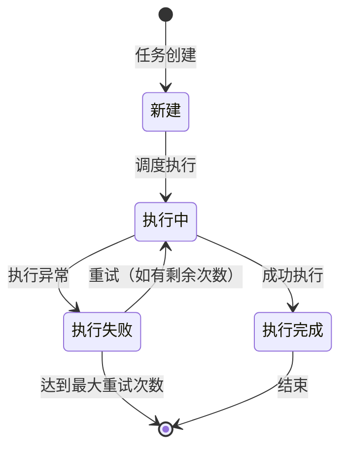

# Job Client 模块文档

## 1. 简介

Job Client 是大麦高并发项目中的一个 **Feign 客户端模块**，用于与其他服务中的 **Job Service（任务服务）** 进行远程 RPC 通信。该模块封装了任务回调上报的接口，提供声明式的服务调用方式，同时集成了服务降级（Fallback）机制。

通过 Job Client，上游服务可以方便地将任务执行结果（成功/失败）回调通知到 Job Service，实现对分布式任务的执行状态追踪与管理。

---

## 2. 模块定位与架构

### 2.1 模块在系统中的位置

Job Client 属于 `damai-server-client` 父模块下的一个子模块，与 Order Client、Pay Client、Program Client 等其他客户端模块处于同一层级。它作为服务消费者与 **Job Service**（任务服务中心）之间通信的桥梁。



### 2.2 模块依赖关系



### 2.3 与其他 Client 模块的对比

| Client 模块 | 服务端 | 核心能力 | 接口数量 |
|:---|:---|:---|:---:|
| **Job Client** | Job Service | 任务回调上报 | 1 |
| [Order Client](Order%20Client.md) | Order Service | 订单查询/支付/退款 | 多个 |
| [Pay Client](Pay%20Client.md) | Pay Service | 支付账单查询 | 多个 |
| [Program Client](Program%20Client.md) | Program Service | 节目/座位/票类管理 | 多个 |
| [User Client](User%20Client.md) | User Service | 用户注册/登录/认证 | 多个 |
| [Base Data Client](Base%20Data%20Client.md) | Base Data Service | 渠道数据/Token | 多个 |
| [Customize Client](Customize%20Client.md) | Customize Service | 规则/广播/深度规则 | 多个 |

---

## 3. 核心组件详解

### 3.1 组件总览



### 3.2 JobClient — Feign 接口

**文件位置**: `com.damai.client.JobClient`

| 属性 | 值 |
|:---|:---|
| 类型 | `@FeignClient` 接口 |
| 服务名 | `damai-job-service`（通过配置 `prefix.distinction.name` 动态注入，默认值 `damai`） |
| 降级类 | `JobClientFallback.class` |

**接口方法**:

| 方法 | HTTP 方法 | 路径 | 参数 | 返回类型 | 说明 |
|:---|:---:|:---|:---|:---:|:---|
| `callBack` | POST | `/jobRunRecord/callBack` | `JobCallBackDto` (请求体) | `ApiResponse<Boolean>` | 上报任务执行状态回调 |

> 服务名格式为 `${prefix.distinction.name:damai}-job-service`，其中 `prefix.distinction.name` 可通过配置文件自定义前缀，默认值为 `damai`。详见 [Common 模块](Common.md) 中 `Constant` 类的说明。

### 3.3 JobClientFallback — 服务降级实现

**文件位置**: `com.damai.client.JobClientFallback`

当 Feign 调用 Job Service 失败时（网络异常、服务不可用、超时等），Fallback 机制触发，返回降级结果：

| 方法 | 降级行为 |
|:---|:---|
| `callBack` | 返回 `ApiResponse.error(BaseCode.SYSTEM_ERROR)`，即系统异常错误响应 |

### 3.4 JobCallBackDto — 任务回调 DTO

**文件位置**: `com.damai.dto.JobCallBackDto`

用于将任务执行结果回调通知给 Job Service 的请求参数。

| 字段 | 类型 | 必填 | 说明 |
|:---|:---|:---:|:---|
| `id` | `Long` | ✅ | 任务运行记录 ID |
| `jobId` | `String` | ✅ | 任务 ID |
| `runInfo` | `String` | ✅ | 执行成功或失败的详细信息 |
| `runStatus` | `Integer` | ✅ | 执行结果状态：1-新建, 2-执行完成, 3-执行失败（参见 `JobRunStatus` 枚举） |
| `currentResidueRetryNumber` | `Integer` | ❌ | 当前剩余重试次数 |

### 3.5 JobInfoDto — 任务信息 DTO

**文件位置**: `com.damai.dto.JobInfoDto`

用于创建或更新任务信息的请求参数（目前由 Job Service 端使用）。

| 字段 | 类型 | 必填 | 说明 |
|:---|:---|:---:|:---|
| `name` | `String` | ✅ | 任务名称 |
| `description` | `String` | ❌ | 任务描述 |
| `url` | `String` | ✅ | 任务回调 URL 路径 |
| `headers` | `String` | ✅ | 任务请求头信息（JSON 格式字符串） |
| `method` | `Integer` | ✅ | HTTP 方法：1-GET, 2-POST, 3-PUT |
| `params` | `String` | ❌ | 任务请求参数（JSON 格式字符串） |
| `retry` | `Integer` | ❌ | 是否启用重试：1-是, 0-否 |
| `retryNumber` | `Integer` | ❌ | 重试次数 |

### 3.6 JobInfoPageDto — 任务分页查询 DTO

**文件位置**: `com.damai.dto.JobInfoPageDto`

用于分页查询任务列表的请求参数。

| 字段 | 类型 | 必填 | 说明 |
|:---|:---|:---:|:---|
| `pageSize` | `Integer` | ✅ | 每页记录数（页码） |
| `pageNo` | `Integer` | ✅ | 当前页码（页容量） |

### 3.7 RunJobDto — 执行任务 DTO

**文件位置**: `com.damai.dto.RunJobDto`

用于触发执行某个具体任务的请求参数。

| 字段 | 类型 | 必填 | 说明 |
|:---|:---|:---:|:---|
| `id` | `Long` | ✅ | 任务 ID |

---

## 4. 数据流与交互流程

### 4.1 任务回调上报流程



### 4.2 任务生命周期状态流转

任务从创建到结束经历以下状态：



> 状态码定义：1-新建, 2-执行完成, 3-执行失败（参见 `JobRunStatus` 枚举）

---

## 5. Feign 配置说明

### 5.1 服务名解析

服务名通过 Spring 表达式动态注入：
```
prefix.distinction.name = damai  (默认值)
服务名 = damai-job-service
```

可在配置文件（application.yml/properties）中自定义：
```yaml
prefix:
  distinction:
    name: my-app
```
此时服务名变为：`my-app-job-service`

### 5.2 负载均衡支持

由于基于 Spring Cloud OpenFeign 实现，Job Client 自动继承 Spring Cloud 的负载均衡能力。关于负载均衡的详细配置，请参见 [Spring Cloud Framework](Spring%20Cloud%20Framework.md) 文档中的 `GrayLoadBalanceAutoConfiguration` 灰度负载均衡配置。

### 5.3 通用常量与 API 响应

- **常量定义**: `Constant.SPRING_INJECT_PREFIX_DISTINCTION_NAME` — 服务名前缀注入表达式
- **响应封装**: `ApiResponse<T>` — 统一 API 响应对象，所有 Feign 接口均返回此类型
- **错误码**: `BaseCode.SYSTEM_ERROR` — 降级时返回的系统级错误码

关于常量类和 API 响应的详细定义，请参见 [Common 模块](Common.md) 文档。

---

## 6. 使用示例

### 6.1 在服务中注入并使用 JobClient

```java
@Service
public class OrderService {
    
    @Autowired
    private JobClient jobClient;
    
    public void reportJobResult(Long recordId, String jobId, boolean success, String info) {
        JobCallBackDto dto = new JobCallBackDto();
        dto.setId(recordId);
        dto.setJobId(jobId);
        dto.setRunInfo(info);
        dto.setRunStatus(success ? 2 : 3);  // 2-完成, 3-失败
        dto.setCurrentResidueRetryNumber(0);
        
        ApiResponse<Boolean> response = jobClient.callBack(dto);
        if (response.isSuccess()) {
            // 上报成功
        } else {
            // 上报失败，可根据业务决定是否重试
        }
    }
}
```

### 6.2 与延迟队列集成

在实际项目中，任务回调通常与延迟队列（如 Redisson DelayQueue）结合使用。当任务执行完成后，通过 Job Client 上报回调结果，Job Service 根据回调结果决定是否触发重试或完成任务的最终状态。

关于延迟队列的详细使用，请参见 [Redisson Framework](Redisson%20Framework.md) 文档中的 `DelayQueueAutoConfig`。

---

## 7. 总结

Job Client 模块作为大麦高并发项目中的核心 Feign 客户端之一，提供了以下关键能力：

1. **任务回调上报** — 通过 `callBack` 方法将任务执行结果通知到 Job Service
2. **服务降级保护** — 通过 `JobClientFallback` 在远程调用失败时返回降级响应，防止服务雪崩
3. **参数校验** — 所有 DTO 均使用 Jakarta Validation 注解进行参数校验，确保数据完整性
4. **动态服务发现** — 基于 Spring Cloud OpenFeign 和 Nacos 实现服务注册与发现
5. **灰度发布支持** — 通过配置 `prefix.distinction.name` 支持多环境灰度路由

该模块虽然功能单一（仅一个接口），但在分布式任务调度体系中扮演着至关重要的角色，是连接任务执行端与任务管理端的桥梁。
