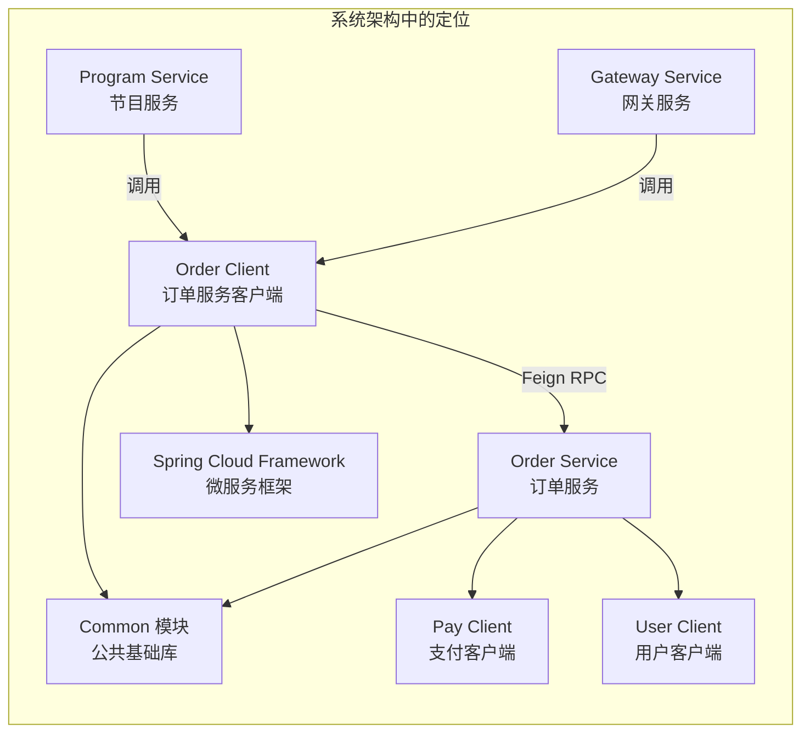
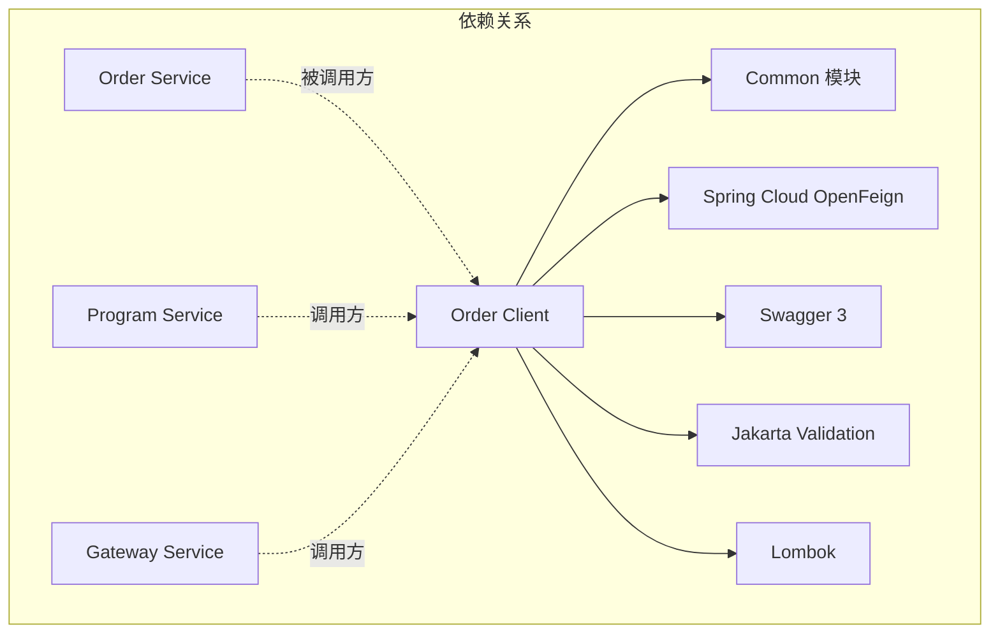
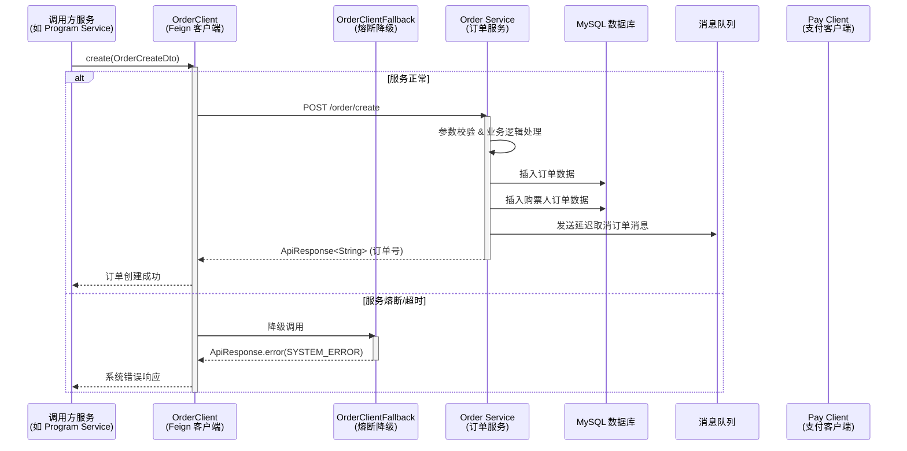
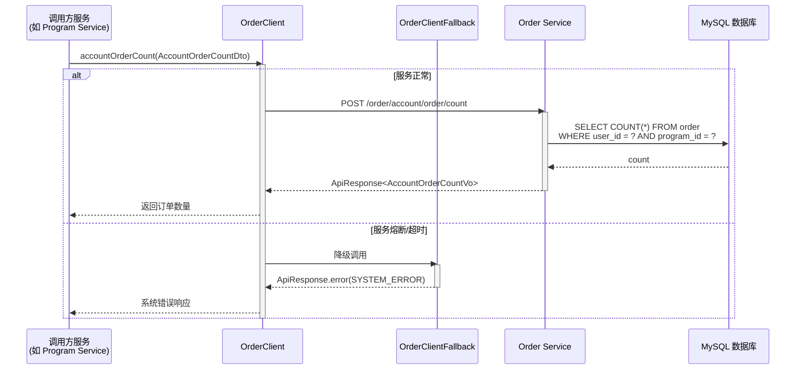
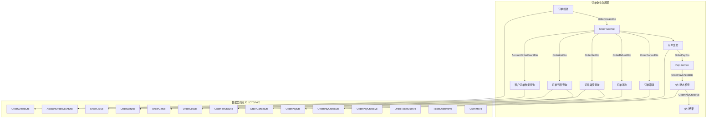
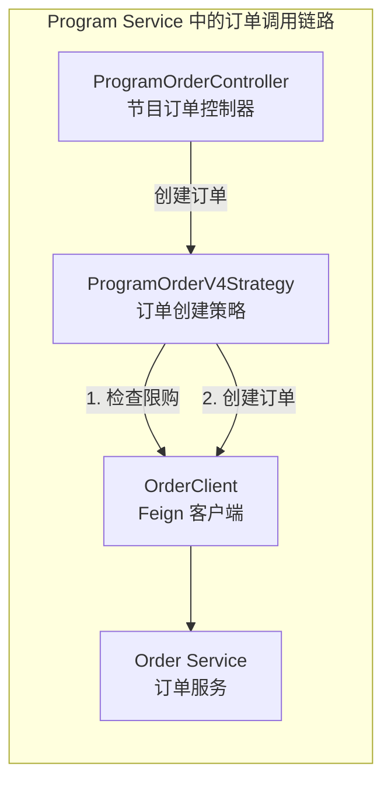

# Order Client 模块 - 订单服务客户端

## 1. 模块简介

Order Client 模块是大麦系统中**订单服务（Order Service）的 Feign 客户端模块**，位于 `damai-server-client/damai-order-client`。该模块通过声明式 Feign 接口为其他微服务提供与订单服务进行 RPC 通信的能力，涵盖**订单创建**和**账户订单数量查询**两大核心远程调用功能，并定义了完整的订单业务数据契约（DTO/VO），供整个微服务系统统一使用。

### 1.1 核心功能

| 功能分类 | 说明 |
|---------|------|
| **订单创建** | 创建订单，包含节目信息、用户信息、价格、购票人信息等 |
| **账户订单数量查询** | 查询指定用户在指定节目下的订单数量，用于限购校验 |
| **数据契约定义** | 定义订单查询、列表、支付、退款、取消等操作的数据结构，供系统各模块统一引用 |

### 1.2 模块定位



## 2. 架构设计

### 2.1 模块架构图

```mermaid
graph TB
    subgraph "Order Client 模块"
        direction TB
        
        subgraph "Feign 接口层"
            OrderClient[OrderClient<br/>Feign 声明式接口]
            OrderClientFallback[OrderClientFallback<br/>熔断降级处理]
        end
        
        subgraph "数据传输对象（DTO）"
            OrderCreateDto[OrderCreateDto<br/>订单创建]
            OrderTicketUserCreateDto[OrderTicketUserCreateDto<br/>购票人订单创建]
            OrderGetDto[OrderGetDto<br/>订单查询]
            OrderListDto[OrderListDto<br/>订单列表查询]
            OrderPayDto[OrderPayDto<br/>订单支付]
            OrderPayCheckDto[OrderPayCheckDto<br/>支付状态检查]
            OrderCancelDto[OrderCancelDto<br/>订单取消]
            OrderRefundDto[OrderRefundDto<br/>订单退款]
            AccountOrderCountDto[AccountOrderCountDto<br/>账户订单数量]
        end
        
        subgraph "返回对象（VO）"
            OrderGetVo[OrderGetVo<br/>订单详情]
            OrderListVo[OrderListVo<br/>订单列表]
            OrderPayCheckVo[OrderPayCheckVo<br/>支付状态检查]
            OrderTicketInfoVo[OrderTicketInfoVo<br/>购票订单信息]
            OrderTicketUserVo[OrderTicketUserVo<br/>购票人订单信息]
            TicketUserInfoVo[TicketUserInfoVo<br/>购票人数据]
            UserAndTicketUserInfoVo[UserAndTicketUserInfoVo<br/>用户和购票人集合]
            UserInfoVo[UserInfoVo<br/>用户数据]
            AccountOrderCountVo[AccountOrderCountVo<br/>账户订单数量]
        end
        
        OrderClient --> OrderClientFallback
        OrderClient --> OrderCreateDto
        OrderClient --> AccountOrderCountDto
        OrderClient --> OrderGetVo
        OrderClient --> AccountOrderCountVo
    end
    
    subgraph "外部依赖"
        Common[Common 模块<br/>ApiResponse / 常量]
        SpringCloud[Spring Cloud<br/>OpenFeign]
    end
    
    OrderClient --> Common
    OrderClient --> SpringCloud
```



### 2.2 模块依赖关系



### 2.3 内部依赖关系

Order Client 模块依赖的 Common 模块组件：

| 组件类 | 用途 |
|-------|------|
| `ApiResponse` | 统一响应体封装 |
| `Constant.SPRING_INJECT_PREFIX_DISTINCTION_NAME` | Feign 客户端服务名注入前缀 |
| `BaseCode` | 错误码枚举（降级时使用） |
| `OrderStatus` | 订单状态枚举（1:未支付 2:已取消 3:已支付 4:已退单） |

## 3. 核心组件详解

### 3.1 OrderClient（Feign 客户端接口）

**作用**：定义与订单服务通信的 REST API 接口，使用 Spring Cloud OpenFeign 声明式 HTTP 客户端。

```java
@Component
@FeignClient(value = SPRING_INJECT_PREFIX_DISTINCTION_NAME+"-"+"order-service", fallback = OrderClientFallback.class)
public interface OrderClient {
    // 创建订单
    @PostMapping("/order/create")
    ApiResponse<String> create(OrderCreateDto dto);
    
    // 账户下某个节目的订单数量
    @PostMapping("/order/account/order/count")
    ApiResponse<AccountOrderCountVo> accountOrderCount(AccountOrderCountDto dto);
}
```

**关键特性**：

| 属性 | 值 | 说明 |
|------|-----|------|
| `value` | `"${prefix.distinction.name:damai}-order-service"` | 服务名，默认 `damai-order-service` |
| `fallback` | `OrderClientFallback.class` | 熔断降级处理类 |
| 基础路径 | 无 | 各接口路径不同 |

**暴露的 API 端点**：

| HTTP 方法 | 路径 | 请求参数 | 响应类型 | 功能描述 |
|-----------|------|---------|---------|---------|
| POST | `/order/create` | `OrderCreateDto` | `ApiResponse<String>` | 创建订单，返回订单号 |
| POST | `/order/account/order/count` | `AccountOrderCountDto` | `ApiResponse<AccountOrderCountVo>` | 查询用户在某节目下的订单数量 |

### 3.2 OrderClientFallback（熔断降级处理）

**作用**：当 Order Service 不可用或调用超时时，提供降级响应，返回系统错误信息。

```java
@Component
public class OrderClientFallback implements OrderClient {
    @Override
    public ApiResponse<String> create(OrderCreateDto orderCreateDto) {
        return ApiResponse.error(BaseCode.SYSTEM_ERROR);
    }
    
    @Override
    public ApiResponse<AccountOrderCountVo> accountOrderCount(AccountOrderCountDto dto) {
        return ApiResponse.error(BaseCode.SYSTEM_ERROR);
    }
}
```

**降级策略**：
- 所有接口统一返回 `ApiResponse.error(BaseCode.SYSTEM_ERROR)`
- 调用方需根据 `ApiResponse` 的 `code` 判断是否成功

### 3.3 数据传输对象（DTO）

#### OrderCreateDto（订单创建参数）

订单创建的核心参数，包含节目信息、用户信息、价格及购票人列表。

| 字段 | 类型 | 约束 | 说明 |
|------|------|------|------|
| `orderNumber` | Long | `@NotNull` | 订单编号 |
| `programId` | Long | `@NotNull` | 节目表 ID |
| `programItemPicture` | String | `@NotBlank` | 节目图片介绍 |
| `userId` | Long | `@NotNull` | 用户 ID |
| `programTitle` | String | `@NotBlank` | 节目标题 |
| `programPlace` | String | `@NotBlank` | 节目地点 |
| `programShowTime` | Date | `@NotNull` | 节目演出时间 |
| `programPermitChooseSeat` | Integer | `@NotNull` | 是否允许选座：1-允许，0-不允许 |
| `distributionMode` | String | 可选 | 配送方式 |
| `takeTicketMode` | String | 可选 | 取票方式 |
| `orderPrice` | BigDecimal | `@NotNull` | 订单价格 |
| `createOrderTime` | Date | `@NotNull` | 生成订单时间 |
| `orderTicketUserCreateDtoList` | List\<OrderTicketUserCreateDto\> | `@NotNull` | 购票人订单集合 |

#### OrderTicketUserCreateDto（购票人订单创建参数）

每个购票人的订单明细信息。

| 字段 | 类型 | 约束 | 说明 |
|------|------|------|------|
| `orderNumber` | Long | `@NotNull` | 订单编号 |
| `programId` | Long | `@NotNull` | 节目表 ID |
| `userId` | Long | `@NotNull` | 用户 ID |
| `ticketUserId` | Long | `@NotNull` | 购票人 ID |
| `seatId` | Long | `@NotNull` | 座位 ID |
| `seatInfo` | String | `@NotBlank` | 座位信息（如"1排3座"） |
| `ticketCategoryId` | Long | `@NotNull` | 节目票档 ID |
| `orderPrice` | BigDecimal | `@NotNull` | 订单价格 |
| `createOrderTime` | Date | `@NotNull` | 生成订单时间 |

#### AccountOrderCountDto（账户订单数量查询参数）

| 字段 | 类型 | 约束 | 说明 |
|------|------|------|------|
| `userId` | Long | `@NotNull` | 用户 ID |
| `programId` | Long | `@NotNull` | 节目 ID |

#### OrderGetDto（订单查询参数）

| 字段 | 类型 | 约束 | 说明 |
|------|------|------|------|
| `orderNumber` | Long | `@NotNull` | 订单编号 |

#### OrderListDto（订单列表查询参数）

| 字段 | 类型 | 约束 | 说明 |
|------|------|------|------|
| `userId` | Long | `@NotNull` | 用户 ID |

#### OrderPayDto（订单支付参数）

| 字段 | 类型 | 约束 | 说明 |
|------|------|------|------|
| `platform` | Integer | `@NotNull` | 支付平台：1-小程序，2-H5，3-PC网页，4-App |
| `orderNumber` | Long | `@NotNull` | 订单编号 |
| `subject` | String | `@NotBlank` | 订单标题 |
| `price` | BigDecimal | `@NotNull` | 价格 |
| `channel` | String | `@NotBlank` | 支付渠道：alipay-支付宝，wx-微信 |
| `payBillType` | Integer | `@NotNull` | 支付种类：1-节目 |

#### OrderPayCheckDto（订单支付状态检查参数）

| 字段 | 类型 | 约束 | 说明 |
|------|------|------|------|
| `orderNumber` | Long | `@NotNull` | 订单编号 |
| `payChannelType` | Integer | `@NotNull` | 支付方式：1-支付宝，2-微信 |

#### OrderCancelDto（订单取消参数）

| 字段 | 类型 | 约束 | 说明 |
|------|------|------|------|
| `orderNumber` | Long | `@NotNull` | 订单编号 |

#### OrderRefundDto（订单退款参数）

| 字段 | 类型 | 约束 | 说明 |
|------|------|------|------|
| `orderNumber` | Long | `@NotNull` | 订单编号 |

### 3.4 返回对象（VO）

#### OrderGetVo（订单详情返回）

| 字段 | 类型 | 说明 |
|------|------|------|
| `orderNumber` | Long | 订单编号 |
| `programId` | Long | 节目表 ID |
| `programItemPicture` | String | 节目图片介绍 |
| `userId` | Long | 用户 ID |
| `programTitle` | String | 节目标题 |
| `programPlace` | String | 节目地点 |
| `programShowTime` | Date | 节目演出时间 |
| `programPermitChooseSeat` | Integer | 是否允许选座：1-允许，0-不允许 |
| `distributionMode` | String | 配送方式 |
| `takeTicketMode` | String | 取票方式 |
| `orderPrice` | BigDecimal | 订单价格 |
| `payOrderType` | Integer | 支付订单方式 |
| `orderStatus` | Integer | 订单状态：1-未支付，2-已取消，3-已支付，4-已退单 |
| `createOrderTime` | Date | 生成订单时间 |
| `cancelOrderTime` | Date | 取消订单时间 |
| `payOrderTime` | Date | 支付订单时间 |
| `orderTicketInfoVoList` | List\<OrderTicketInfoVo\> | 购票订单信息集合 |
| `userAndTicketUserInfoVo` | UserAndTicketUserInfoVo | 用户和购票人信息 |

#### OrderListVo（订单列表返回）

| 字段 | 类型 | 说明 |
|------|------|------|
| `orderNumber` | Long | 订单编号 |
| `programId` | Long | 节目表 ID |
| `programItemPicture` | String | 节目图片介绍 |
| `userId` | Long | 用户 ID |
| `programTitle` | String | 节目标题 |
| `programPlace` | String | 节目地点 |
| `programShowTime` | Date | 节目演出时间 |
| `orderPrice` | BigDecimal | 订单价格 |
| `payOrderType` | Integer | 支付订单方式 |
| `orderStatus` | Integer | 订单状态：1-未支付，2-已取消，3-已支付，4-已退单 |
| `createOrderTime` | Date | 生成订单时间 |
| `ticketCount` | Integer | 票品张数 |

#### OrderPayCheckVo（支付状态检查返回）

| 字段 | 类型 | 说明 |
|------|------|------|
| `id` | Long | 订单 ID |
| `programId` | Long | 节目表 ID |
| `userId` | Long | 用户 ID |
| `orderPrice` | BigDecimal | 订单价格 |
| `payOrderType` | Integer | 支付订单方式 |
| `orderStatus` | Integer | 订单状态：1-未支付，2-已取消，3-已支付，4-已退单 |
| `createOrderTime` | Date | 生成订单时间 |
| `cancelOrderTime` | Date | 取消订单时间 |
| `payOrderTime` | Date | 支付订单时间 |

#### OrderTicketInfoVo（购票订单信息返回）

| 字段 | 类型 | 说明 |
|------|------|------|
| `seatInfo` | String | 座位信息 |
| `price` | BigDecimal | 单价 |
| `quantity` | Integer | 数量 |
| `favourablePrice` | BigDecimal | 优惠金额 |
| `relPrice` | BigDecimal | 小计金额 |

#### OrderTicketUserVo（购票人订单信息返回）

| 字段 | 类型 | 说明 |
|------|------|------|
| `id` | Long | 购票人订单 ID |
| `orderId` | Long | 订单 ID |
| `programId` | Long | 节目表 ID |
| `userId` | Long | 用户 ID |
| `ticketUserId` | Long | 购票人 ID |
| `seatId` | Long | 座位 ID |
| `seatInfo` | String | 座位信息 |
| `orderPrice` | BigDecimal | 订单价格 |
| `payOrderPrice` | BigDecimal | 支付订单价格 |
| `payOrderType` | Integer | 支付订单方式 |
| `orderStatus` | Integer | 订单状态：1-未支付，2-已取消，3-已支付，4-已退单 |
| `createOrderTime` | Date | 生成订单时间 |
| `cancelOrderTime` | Date | 取消订单时间 |
| `payOrderTime` | Date | 支付订单时间 |

#### TicketUserInfoVo（购票人数据返回）

| 字段 | 类型 | 说明 |
|------|------|------|
| `id` | Long | 购票人 ID |
| `userId` | Long | 用户 ID |
| `relName` | String | 用户真实姓名 |
| `idType` | Integer | 证件类型：1-身份证，2-港澳台居民居住证，3-港澳居民来往内地通行证，4-台湾居民来往内地通行证，5-护照，6-外国人永久居住证 |
| `idNumber` | String | 证件号码 |

#### UserInfoVo（用户数据返回）

| 字段 | 类型 | 说明 |
|------|------|------|
| `id` | Long | 用户 ID |
| `name` | String | 用户名字 |
| `relName` | String | 用户真实姓名 |
| `gender` | Integer | 性别：1-男，2-女 |
| `mobile` | String | 用户手机号 |
| `address` | String | 收货地址 |

#### UserAndTicketUserInfoVo（用户和购票人集合返回）

| 字段 | 类型 | 说明 |
|------|------|------|
| `userInfoVo` | UserInfoVo | 用户信息 |
| `ticketUserInfoVoList` | List\<TicketUserInfoVo\> | 购票人信息集合 |

#### AccountOrderCountVo（账户订单数量返回）

| 字段 | 类型 | 说明 |
|------|------|------|
| `count` | Integer | 账户下的订单数量 |

## 4. 数据流与交互

### 4.1 订单创建流程



### 4.2 账户订单数量查询流程



### 4.3 订单全生命周期数据流



### 4.4 数据模型关系

```mermaid
classDiagram
    class OrderClient {
        <<interface>>
        +create(OrderCreateDto) ApiResponse~String~
        +accountOrderCount(AccountOrderCountDto) ApiResponse~AccountOrderCountVo~
    }
    
    class OrderClientFallback {
        +create(OrderCreateDto) ApiResponse~String~
        +accountOrderCount(AccountOrderCountDto) ApiResponse~AccountOrderCountVo~
    }
    
    class OrderCreateDto {
        +Long orderNumber
        +Long programId
        +String programItemPicture
        +Long userId
        +String programTitle
        +String programPlace
        +Date programShowTime
        +Integer programPermitChooseSeat
        +String distributionMode
        +String takeTicketMode
        +BigDecimal orderPrice
        +Date createOrderTime
        +List~OrderTicketUserCreateDto~ orderTicketUserCreateDtoList
    }
    
    class OrderTicketUserCreateDto {
        +Long orderNumber
        +Long programId
        +Long userId
        +Long ticketUserId
        +Long seatId
        +String seatInfo
        +Long ticketCategoryId
        +BigDecimal orderPrice
        +Date createOrderTime
    }
    
    class AccountOrderCountDto {
        +Long userId
        +Long programId
    }
    
    class OrderGetDto {
        +Long orderNumber
    }
    
    class OrderListDto {
        +Long userId
    }
    
    class OrderPayDto {
        +Integer platform
        +Long orderNumber
        +String subject
        +BigDecimal price
        +String channel
        +Integer payBillType
    }
    
    class OrderPayCheckDto {
        +Long orderNumber
        +Integer payChannelType
    }
    
    class OrderCancelDto {
        +Long orderNumber
    }
    
    class OrderRefundDto {
        +Long orderNumber
    }
    
    class AccountOrderCountVo {
        +Integer count
    }
    
    class OrderGetVo {
        +Long orderNumber
        +Long programId
        +String programItemPicture
        +Long userId
        +String programTitle
        +String programPlace
        +Date programShowTime
        +Integer programPermitChooseSeat
        +String distributionMode
        +String takeTicketMode
        +BigDecimal orderPrice
        +Integer payOrderType
        +Integer orderStatus
        +Date createOrderTime
        +Date cancelOrderTime
        +Date payOrderTime
    }
    
    class OrderListVo {
        +Long orderNumber
        +Long programId
        +String programItemPicture
        +Long userId
        +String programTitle
        +String programPlace
        +Date programShowTime
        +BigDecimal orderPrice
        +Integer payOrderType
        +Integer orderStatus
        +Date createOrderTime
        +Integer ticketCount
    }
    
    class OrderPayCheckVo {
        +Long id
        +Long programId
        +Long userId
        +BigDecimal orderPrice
        +Integer payOrderType
        +Integer orderStatus
        +Date createOrderTime
        +Date cancelOrderTime
        +Date payOrderTime
    }
    
    class OrderTicketInfoVo {
        +String seatInfo
        +BigDecimal price
        +Integer quantity
        +BigDecimal favourablePrice
        +BigDecimal relPrice
    }
    
    class OrderTicketUserVo {
        +Long id
        +Long orderId
        +Long programId
        +Long userId
        +Long ticketUserId
        +Long seatId
        +String seatInfo
        +BigDecimal orderPrice
        +BigDecimal payOrderPrice
        +Integer payOrderType
        +Integer orderStatus
        +Date createOrderTime
        +Date cancelOrderTime
        +Date payOrderTime
    }
    
    class TicketUserInfoVo {
        +Long id
        +Long userId
        +String relName
        +Integer idType
        +String idNumber
    }
    
    class UserInfoVo {
        +Long id
        +String name
        +String relName
        +Integer gender
        +String mobile
        +String address
    }
    
    class UserAndTicketUserInfoVo {
        +UserInfoVo userInfoVo
        +List~TicketUserInfoVo~ ticketUserInfoVoList
    }
    
    OrderClient <|.. OrderClientFallback : 实现
    OrderClient --> OrderCreateDto : 使用
    OrderClient --> AccountOrderCountDto : 使用
    OrderClient --> AccountOrderCountVo : 返回
    OrderClient --> ApiResponse : 包装响应
    
    OrderCreateDto *--> OrderTicketUserCreateDto : 包含列表
    OrderGetVo *--> OrderTicketInfoVo : 包含列表
    OrderGetVo *--> UserAndTicketUserInfoVo : 包含
    UserAndTicketUserInfoVo *--> UserInfoVo : 包含
    UserAndTicketUserInfoVo *--> TicketUserInfoVo : 包含列表
```



## 5. 与外部模块的交互

### 5.1 调用方：Program Service（节目服务）

Program Service 是 Order Client 的核心调用方之一。在用户下单购票时，Program Service 通过 `OrderClient` 调用订单服务完成订单创建，并通过 `AccountOrderCountDto` 查询用户是否已超过限购数量。



### 5.2 调用方：Gateway Service（网关服务）

Gateway Service 在特定场景下也会调用 Order Client 进行订单数据的查询和验证。

### 5.3 被调用方：Order Service（订单服务）

Order Service 提供了 Feign 客户端对应的服务端实现：

| Feign 客户端方法 | 服务端 Controller | 服务端核心逻辑 |
|-----------------|------------------|---------------|
| `create()` | `OrderController.create()` | 创建订单、插入购票人订单、发送延迟取消消息 |
| `accountOrderCount()` | `OrderController.accountOrderCount()` | 查询用户在某节目下的订单数量，用于限购校验 |

### 5.4 数据契约共享说明

Order Client 模块中定义的 DTO 和 VO 不仅供 Feign 客户端使用，还被以下模块引用为统一的数据契约：

| 数据契约 | 使用方 | 用途 |
|---------|-------|------|
| `OrderCreateDto` | Program Service | 构造订单创建请求参数 |
| `OrderGetDto` | Gateway / Program Service | 查询订单详情 |
| `OrderListDto` | Gateway / Program Service | 查询订单列表 |
| `OrderPayDto` | Pay Service | 发起支付请求 |
| `OrderPayCheckDto` | Pay Service | 校验支付状态 |
| `OrderCancelDto` | Program Service / Gateway | 取消订单 |
| `OrderRefundDto` | Program Service / Gateway | 退款操作 |
| `AccountOrderCountDto` | Program Service | 限购校验 |
| `OrderGetVo` | 各调用方 | 订单详情展示 |
| `OrderListVo` | 各调用方 | 订单列表展示 |
| `OrderTicketUserVo` | 各调用方 | 购票人订单信息 |
| `TicketUserInfoVo` | 各调用方 | 购票人证件信息 |
| `UserInfoVo` | 各调用方 | 用户基本信息 |

## 6. 项目结构

```
damai-server-client/damai-order-client/
├── pom.xml                                      # 模块配置（无额外依赖，继承 damai-server-client）
└── src/main/java/com/damai/
    ├── client/
    │   ├── OrderClient.java                     # Feign 声明式客户端接口
    │   └── OrderClientFallback.java             # Feign 熔断降级处理
    ├── dto/
    │   ├── AccountOrderCountDto.java            # 账户订单数量查询参数
    │   ├── OrderCancelDto.java                  # 订单取消参数
    │   ├── OrderCreateDto.java                  # 订单创建参数
    │   ├── OrderGetDto.java                     # 订单查询参数
    │   ├── OrderListDto.java                    # 订单列表查询参数
    │   ├── OrderPayCheckDto.java                # 订单支付状态检查参数
    │   ├── OrderPayDto.java                     # 订单支付参数
    │   ├── OrderRefundDto.java                  # 订单退款参数
    │   └── OrderTicketUserCreateDto.java        # 购票人订单创建参数
    └── vo/
        ├── AccountOrderCountVo.java            # 账户订单数量返回
        ├── OrderGetVo.java                     # 订单详情返回
        ├── OrderListVo.java                    # 订单列表返回
        ├── OrderPayCheckVo.java                # 支付状态检查返回
        ├── OrderTicketInfoVo.java              # 购票订单信息返回
        ├── OrderTicketUserVo.java              # 购票人订单信息返回
        ├── TicketUserInfoVo.java               # 购票人数据返回
        ├── UserAndTicketUserInfoVo.java         # 用户和购票人集合返回
        └── UserInfoVo.java                     # 用户数据返回
```

## 7. 配置说明

Order Client 模块的配置主要依赖父模块 `damai-server-client`，自身无额外配置项。

### 7.1 Feign 服务名配置

```yaml
# application.yml / bootstrap.yml
# 服务名前缀（可选，默认 damai）
prefix:
  distinction:
    name: damai

# 完整的服务名: damai-order-service
```

Feign 客户端通过 `Constant.SPRING_INJECT_PREFIX_DISTINCTION_NAME`（值为 `"${prefix.distinction.name:damai}"`）动态注入服务名前缀，最终服务名为 `{prefix}-order-service`。

### 7.2 相关 Nacos 配置

```yaml
# Order Service 的 Nacos 配置
spring:
  application:
    name: ${prefix.distinction.name:damai}-order-service
  cloud:
    nacos:
      discovery:
        server-addr: ${nacos.address:127.0.0.1:8848}
```

## 8. 相关模块参考

| 模块名称 | 文档链接 | 关联关系 |
|---------|---------|---------|
| Pay Client | [Pay Client.md](Pay Client.md) | 订单支付依赖支付客户端 |
| User Client | [User Client.md](User Client.md) | 订单中包含用户和购票人信息 |
| Program Client | [Program Client.md](Program Client.md) | 节目服务是订单创建的核心调用方 |
| Common 模块 | [damai-common.md](damai-common.md) | 提供 ApiResponse、常量、枚举等基础能力 |
| Spring Cloud Framework | [Spring Cloud Framework.md](Spring Cloud Framework.md) | 提供 Feign 声明式 RPC 能力 |

## 9. 订单状态枚举

订单状态定义在 Common 模块的 `OrderStatus` 枚举中：

| 状态码 | 状态名称 | 说明 |
|-------|---------|------|
| 1 | NO_PAY | 未支付 |
| 2 | CANCEL | 已取消 |
| 3 | PAY | 已支付 |
| 4 | REFUND | 已退单 |

该枚举在多个 VO 中被引用，用于标识订单的当前生命周期状态。

## 10. 常见问题

### 10.1 Feign 接口与 DTO/VO 的不对称性

当前 `OrderClient` 接口仅暴露了 `create` 和 `accountOrderCount` 两个方法，但模块中定义了大量其他操作（支付、退款、取消、查询等）的 DTO 和 VO。这是因为：

1. **数据契约先行**：DTO/VO 作为系统级的数据契约已在 Order Client 模块中统一定义，确保各模块引用同一套数据结构
2. **接口按需扩展**：Order Service 的 `OrderController` 可能已经暴露了对应的 REST 端点，其他模块可通过 HTTP 直接调用或通过扩展 Feign 接口来使用
3. **预留设计**：为后续扩展 Feign 接口预留了完整的数据结构支持

### 10.2 限购校验流程

为防止黄牛刷单，系统通过 `accountOrderCount` 接口进行限购校验：

```
用户下单 → 查询该用户在该节目下的订单数量 → 判断是否超过限购阈值 → 允许/拒绝下单
```
