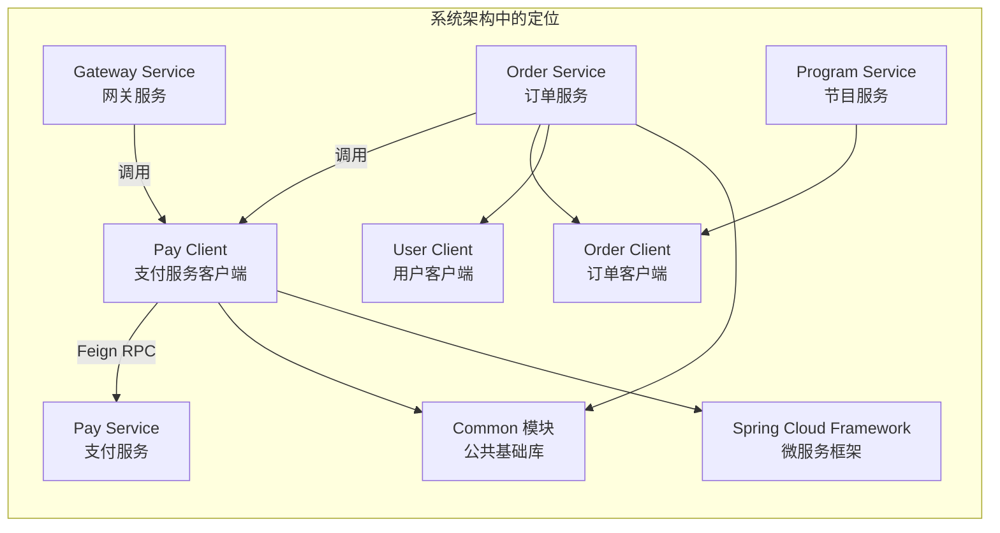
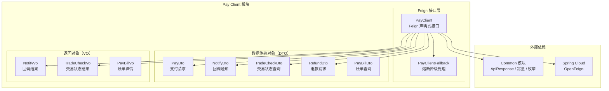
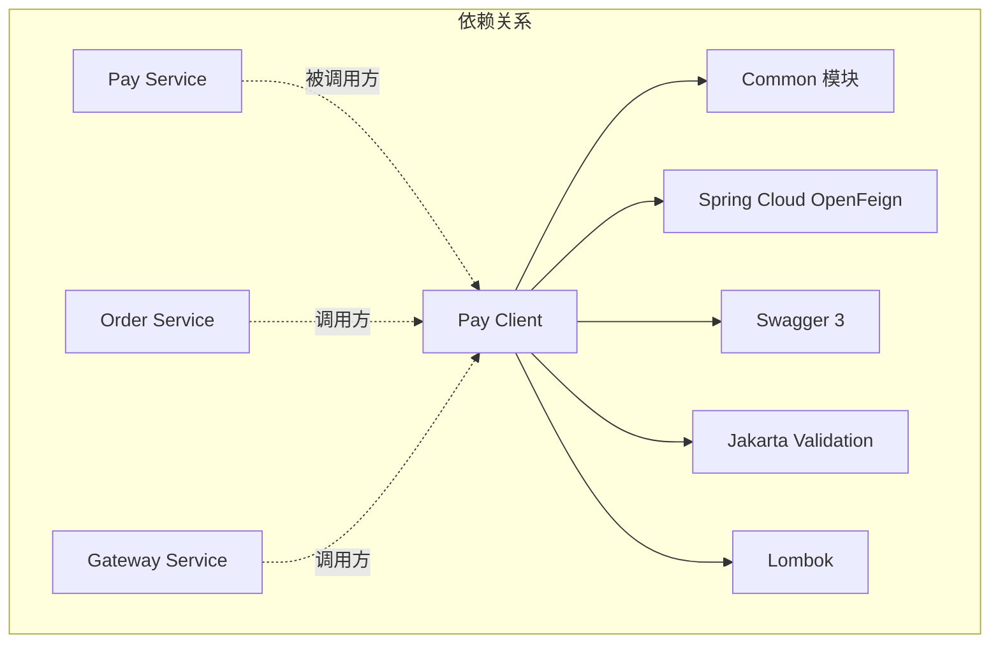
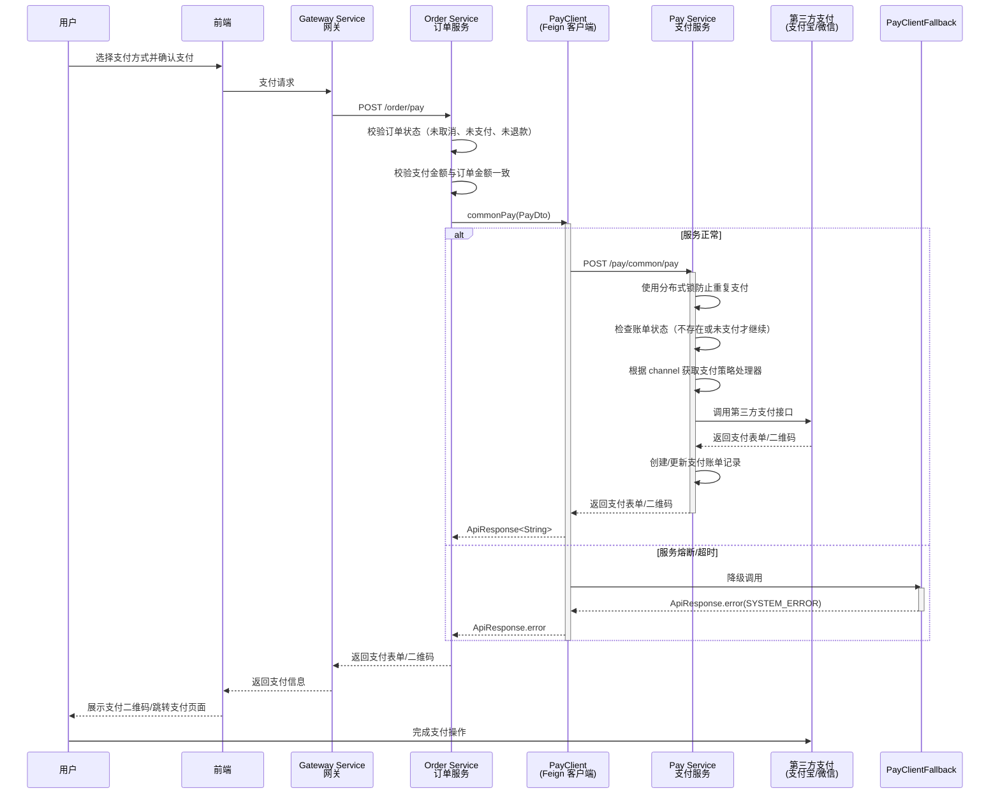
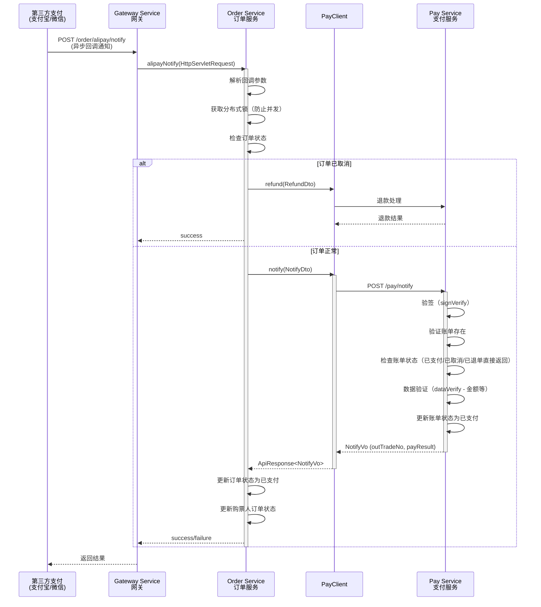
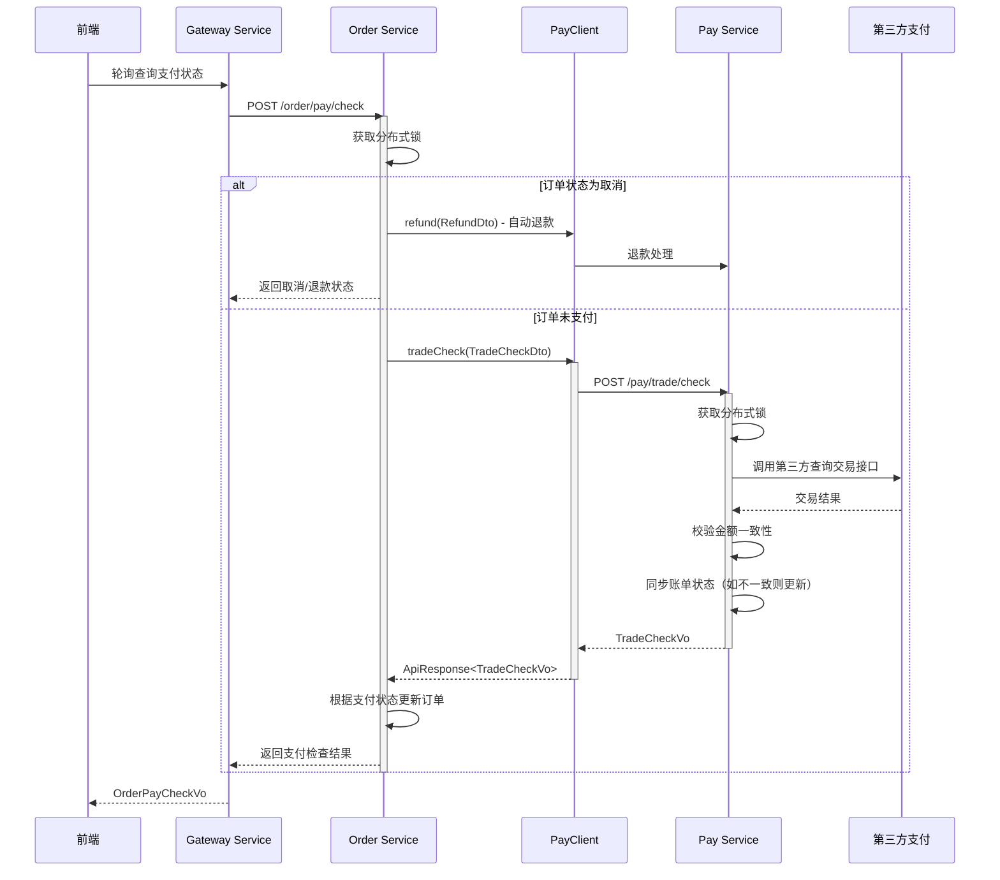
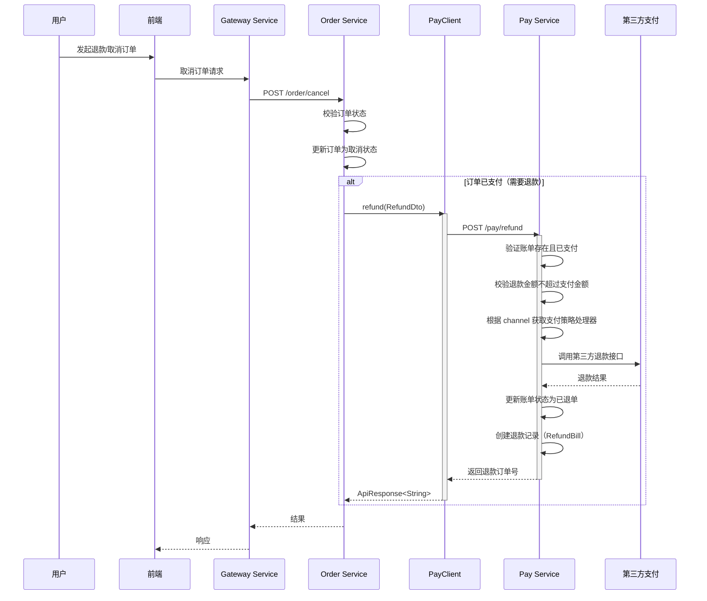
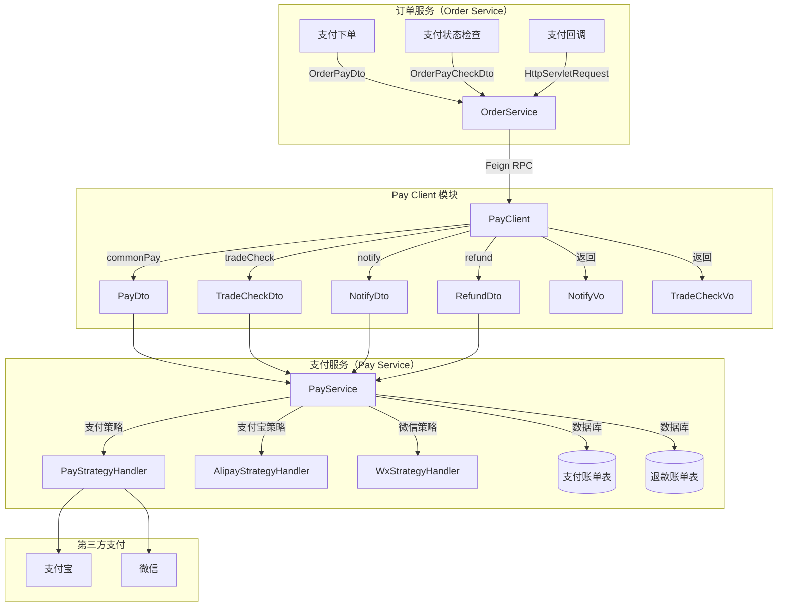
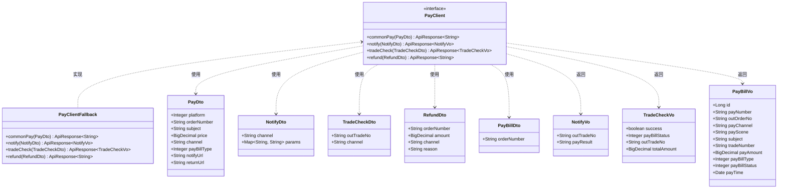

# Pay Client 模块 - 支付服务客户端

## 1. 模块简介

Pay Client 模块是大麦系统中**支付服务（Pay Service）的 Feign 客户端模块**，位于 `damai-server-client/damai-pay-client`。该模块通过声明式 Feign 接口为其他微服务提供与支付服务进行 RPC 通信的能力，涵盖**支付下单**、**支付回调通知处理**、**交易状态查询**和**退款**四大核心远程调用功能，并定义了完整的支付业务数据契约（DTO/VO），供整个微服务系统统一使用。

### 1.1 核心功能

| 功能分类 | 说明 |
|---------|------|
| **支付下单** | 发起支付请求，支持多平台（小程序、H5、PC网页、App）和多渠道（支付宝、微信） |
| **支付回调通知** | 处理第三方支付渠道的异步回调通知，验证签名并更新支付状态 |
| **交易状态查询** | 主动查询指定订单的支付状态，用于轮询确认支付结果 |
| **退款** | 发起退款请求，处理金额校验和退款记录 |
| **数据契约定义** | 定义支付、账单、回调、交易检查、退款等操作的数据结构，供系统各模块统一引用 |

### 1.2 模块定位



### 1.3 依赖的外部模块/框架

| 依赖 | 类型 | 用途 |
|------|------|------|
| [Common 模块](damai-common.md) | 项目依赖 | `ApiResponse` 统一响应体、`Constant` 常量、`BaseCode` 错误码、枚举类型 |
| [Spring Cloud Framework](Spring%20Cloud%20Framework.md) | 项目依赖 | OpenFeign 声明式 HTTP 客户端 |
| [Order Client](Order%20Client.md) | 同级模块 | 订单服务客户端，Pay Client 的调用方 |
| Swagger 3 (Knife4j) | 第三方 | API 文档注解 |
| Jakarta Validation | 第三方 | 参数校验注解 |
| Lombok | 第三方 | 数据类简化 |

## 2. 架构设计

### 2.1 模块架构图



### 2.2 模块依赖关系



### 2.3 内部依赖关系

Pay Client 模块依赖的 Common 模块组件：

| 组件类 | 用途 |
|-------|------|
| `ApiResponse` | 统一响应体封装 |
| `Constant.SPRING_INJECT_PREFIX_DISTINCTION_NAME` | Feign 客户端服务名注入前缀 |
| `BaseCode` | 错误码枚举（降级时使用） |
| `PayBillStatus` | 支付账单状态枚举（NO_PAY=1:未支付，CANCEL=2:已取消，PAY=3:已支付，REFUND=4:已退单） |
| `PayChannel` | 支付渠道枚举（ALIPAY=1:支付宝，WX=2:微信） |
| `PayBillType` | 账单类型枚举（PROGRAM=1:节目） |

## 3. 核心组件详解

### 3.1 PayClient（Feign 客户端接口）

**作用**：定义与支付服务通信的 REST API 接口，使用 Spring Cloud OpenFeign 声明式 HTTP 客户端。

```java
@Component
@FeignClient(value = SPRING_INJECT_PREFIX_DISTINCTION_NAME+"-"+"pay-service", fallback = PayClientFallback.class)
public interface PayClient {
    // 支付
    @PostMapping(value = "/pay/common/pay")
    ApiResponse<String> commonPay(PayDto dto);
    
    // 回调
    @PostMapping(value = "/pay/notify")
    ApiResponse<NotifyVo> notify(NotifyDto dto);
    
    // 查询支付状态
    @PostMapping(value = "/pay/trade/check")
    ApiResponse<TradeCheckVo> tradeCheck(TradeCheckDto dto);
    
    // 退款
    @PostMapping(value = "/pay/refund")
    ApiResponse<String> refund(RefundDto dto);
}
```

**关键特性**：

| 属性 | 值 | 说明 |
|------|-----|------|
| `value` | `"${prefix.distinction.name:damai}-pay-service"` | 服务名，默认 `damai-pay-service` |
| `fallback` | `PayClientFallback.class` | 熔断降级处理类 |
| 基础路径 | 无 | 各接口路径不同 |

**暴露的 API 端点**：

| HTTP 方法 | 路径 | 请求参数 | 响应类型 | 功能描述 |
|-----------|------|---------|---------|---------|
| POST | `/pay/common/pay` | `PayDto` | `ApiResponse<String>` | 发起支付，返回支付表单/二维码等信息 |
| POST | `/pay/notify` | `NotifyDto` | `ApiResponse<NotifyVo>` | 处理第三方支付回调通知 |
| POST | `/pay/trade/check` | `TradeCheckDto` | `ApiResponse<TradeCheckVo>` | 查询交易支付状态 |
| POST | `/pay/refund` | `RefundDto` | `ApiResponse<String>` | 发起退款，返回退款订单号 |

### 3.2 PayClientFallback（熔断降级处理）

**作用**：当 Pay Service 不可用或调用超时时，提供降级响应，返回系统错误信息。

```java
@Component
public class PayClientFallback implements PayClient {
    
    @Override
    public ApiResponse<String> commonPay(final PayDto payDto) {
        return ApiResponse.error(BaseCode.SYSTEM_ERROR);
    }
    
    @Override
    public ApiResponse<NotifyVo> notify(final NotifyDto notifyDto) {
        return ApiResponse.error(BaseCode.SYSTEM_ERROR);
    }
    
    @Override
    public ApiResponse<TradeCheckVo> tradeCheck(final TradeCheckDto tradeCheckDto) {
        return ApiResponse.error(BaseCode.SYSTEM_ERROR);
    }
    
    @Override
    public ApiResponse<String> refund(final RefundDto dto) {
        return ApiResponse.error(BaseCode.SYSTEM_ERROR);
    }
}
```

**降级策略**：
- 所有接口统一返回 `ApiResponse.error(BaseCode.SYSTEM_ERROR)`
- 调用方需根据 `ApiResponse` 的 `code` 判断是否成功
- 对于关键操作（如退款），调用方需做额外处理（如记录日志、人工介入）

### 3.3 数据传输对象（DTO）

#### PayDto（支付请求参数）

支付请求的核心参数，包含订单信息、支付渠道、金额等。

| 字段 | 类型 | 约束 | 说明 |
|------|------|------|------|
| `platform` | Integer | `@NotNull` | 支付平台：1-小程序，2-H5，3-PC网页，4-App |
| `orderNumber` | String | `@NotBlank` | 订单号（对应商户订单号 outTradeNo） |
| `subject` | String | `@NotBlank` | 订单标题 |
| `price` | BigDecimal | `@NotNull` | 支付金额 |
| `channel` | String | `@NotNull` | 支付渠道：alipay-支付宝，wx-微信 |
| `payBillType` | Integer | `@NotNull` | 支付种类：1-节目 |
| `notifyUrl` | String | `@NotBlank` | 支付成功后通知接口地址（后端回调地址） |
| `returnUrl` | String | `@NotBlank` | 支付成功后跳转页面地址（前端跳转地址） |

#### NotifyDto（支付回调通知参数）

第三方支付渠道回调通知的参数封装。

| 字段 | 类型 | 约束 | 说明 |
|------|------|------|------|
| `channel` | String | `@NotNull` | 支付渠道：alipay-支付宝，wx-微信 |
| `params` | Map\<String, String\> | `@NotNull` | 回调参数（渠道返回的键值对） |

#### TradeCheckDto（交易状态查询参数）

查询指定订单的支付状态。

| 字段 | 类型 | 约束 | 说明 |
|------|------|------|------|
| `outTradeNo` | String | `@NotBlank` | 商户订单号 |
| `channel` | String | `@NotBlank` | 支付渠道：alipay-支付宝，wx-微信 |

#### RefundDto（退款请求参数）

| 字段 | 类型 | 约束 | 说明 |
|------|------|------|------|
| `orderNumber` | String | `@NotBlank` | 订单号 |
| `amount` | BigDecimal | `@NotNull` | 退款金额 |
| `channel` | String | `@NotNull` | 退款渠道：alipay-支付宝，wx-微信 |
| `reason` | String | 可选 | 退款原因 |

#### PayBillDto（账单查询参数）

| 字段 | 类型 | 约束 | 说明 |
|------|------|------|------|
| `orderNumber` | String | `@NotNull` | 订单号 |

### 3.4 返回对象（VO）

#### NotifyVo（回调通知处理结果）

| 字段 | 类型 | 说明 |
|------|------|------|
| `outTradeNo` | String | 商户订单号 |
| `payResult` | String | 回调返回结果（"success" 或 "failure"） |

#### TradeCheckVo（交易状态查询结果）

| 字段 | 类型 | 说明 |
|------|------|------|
| `success` | boolean | 交易是否成功 |
| `payBillStatus` | Integer | 支付账单状态：1-未支付，2-已取消，3-已支付，4-已退单 |
| `outTradeNo` | String | 商户订单号 |
| `totalAmount` | BigDecimal | 支付金额 |

#### PayBillVo（支付账单详情）

| 字段 | 类型 | 说明 |
|------|------|------|
| `id` | Long | 主键 ID |
| `payNumber` | String | 支付流水号 |
| `outOrderNo` | String | 商户订单号 |
| `payChannel` | String | 支付渠道 |
| `payScene` | String | 支付环境 |
| `subject` | String | 订单标题 |
| `tradeNumber` | String | 三方交易凭证号 |
| `payAmount` | BigDecimal | 支付金额 |
| `payBillType` | Integer | 支付种类：1-节目 |
| `payBillStatus` | Integer | 支付状态：1-未支付，2-已取消，3-已支付，4-已退单 |
| `payTime` | Date | 支付时间 |

## 4. 数据流与交互

### 4.1 支付流程



### 4.2 支付回调通知流程



### 4.3 交易状态查询流程



### 4.4 退款流程



### 4.5 支付全流程数据流总览



## 5. 与 Pay Service 的对应关系

Pay Client 模块的每个 Feign 接口都对应 Pay Service 中的一个控制器方法：

| PayClient 方法 | PayController 端点 | PayService 方法 | 说明 |
|---------------|-------------------|----------------|------|
| `commonPay(PayDto)` | `POST /pay/common/pay` | `commonPay(PayDto)` | 通用支付，使用分布式锁防止重复支付，调用支付策略处理器 |
| `notify(NotifyDto)` | `POST /pay/notify` | `notify(NotifyDto)` | 处理回调通知，验签、数据验证、更新账单状态 |
| `tradeCheck(TradeCheckDto)` | `POST /pay/trade/check` | `tradeCheck(TradeCheckDto)` | 查询交易状态，同步账单与第三方状态 |
| `refund(RefundDto)` | `POST /pay/refund` | `refund(RefundDto)` | 退款处理，校验金额、调用第三方退款、记录退款单 |
| 无对应（仅 Pay Client 定义） | `POST /pay/detail` | `detail(PayBillDto)` | 账单详情查询（未被 PayClient 导出） |

> **注意**: `PayController.detail(PayBillDto)` 方法虽然返回 `PayBillVo`，但并未在 `PayClient` 中定义对应的 Feign 接口，这意味着账单详情查询仅在 Pay Service 内部使用，不暴露给其他微服务。

## 6. 并发与一致性保障

### 6.1 分布式锁应用

支付服务中使用了分布式锁来保证关键操作的幂等性和数据一致性：

| 锁名称 | 使用位置 | 作用 |
|--------|---------|------|
| `COMMON_PAY` | `PayService.commonPay()` | 以订单号加锁，防止同一订单被多次支付成功 |
| `TRADE_CHECK` | `PayService.tradeCheck()` | 以商户订单号加锁，防止并发交易状态同步导致数据不一致 |
| `UPDATE_ORDER_STATUS_LOCK` | `OrderService.payCheck()` | 订单服务中加锁，防止并发更新订单状态 |

### 6.2 事务处理

所有涉及数据库写入的方法均添加了 `@Transactional(rollbackFor = Exception.class)` 注解：

| 方法 | 事务范围 |
|------|---------|
| `PayService.commonPay()` | 支付账单创建/更新 + 分布式锁 |
| `PayService.notify()` | 回调通知处理 + 账单状态更新 |
| `PayService.tradeCheck()` | 交易状态同步 + 账单状态更新 |
| `PayService.refund()` | 账单状态更新 + 退款记录创建 |

## 7. 数据模型关系



## 8. 相关枚举

以下枚举类型在支付流程中被广泛使用：

### PayBillStatus（支付账单状态）

| 编码 | 名称 | 说明 |
|------|------|------|
| 1 | NO_PAY | 未支付 |
| 2 | CANCEL | 已取消 |
| 3 | PAY | 已支付 |
| 4 | REFUND | 已退单 |

### PayChannel（支付渠道）

| 编码 | value | 名称 | 说明 |
|------|-------|------|------|
| 1 | alipay | 支付宝 | 支付宝支付渠道 |
| 2 | wx | 微信 | 微信支付渠道 |

### PayBillType（账单类型）

| 编码 | 名称 | 说明 |
|------|------|------|
| 1 | PROGRAM | 节目账单 |

## 9. 调用方示例

以下是在 `OrderService` 中调用 `PayClient` 的典型代码示例：

### 9.1 支付下单

```java
// OrderService.pay() 方法
public String pay(OrderPayDto orderPayDto) {
    // ... 校验订单状态和金额 ...
    
    PayDto payDto = getPayDto(orderPayDto, orderNumber);
    ApiResponse<String> payResponse = payClient.commonPay(payDto);
    if (!Objects.equals(payResponse.getCode(), BaseCode.SUCCESS.getCode())) {
        throw new DaMaiFrameException(payResponse);
    }
    return payResponse.getData();
}
```

### 9.2 支付后状态检查

```java
// OrderService.payCheck() 方法
public OrderPayCheckVo payCheck(OrderPayCheckDto orderPayCheckDto) {
    // ... 校验订单状态 ...
    
    TradeCheckDto tradeCheckDto = new TradeCheckDto();
    tradeCheckDto.setOutTradeNo(String.valueOf(orderPayCheckDto.getOrderNumber()));
    tradeCheckDto.setChannel(PayChannel.ALIPAY.getValue());
    ApiResponse<TradeCheckVo> tradeCheckVoApiResponse = payClient.tradeCheck(tradeCheckDto);
    // ... 处理查询结果并更新订单状态 ...
}
```

### 9.3 退款

```java
// OrderService.payCheck() / alipayNotify() 方法
public void processRefund(Order order) {
    RefundDto refundDto = new RefundDto();
    refundDto.setOrderNumber(String.valueOf(order.getOrderNumber()));
    refundDto.setAmount(order.getOrderPrice());
    refundDto.setChannel("alipay");
    refundDto.setReason("延迟订单关闭");
    ApiResponse<String> response = payClient.refund(refundDto);
    // ... 处理退款结果 ...
}
```

## 10. 常见问题

### 10.1 支付成功后回调未触发

- **检查回调地址配置**: 确认 `PayDto.notifyUrl` 正确指向网关或订单服务的回调端点
- **检查签名验证**: 确保 Pay Service 中的支付宝/微信公钥配置正确
- **检查网络连通性**: 确保第三方支付平台可以访问到部署环境的回调地址

### 10.2 支付状态不同步

- Pay Client 的 `tradeCheck` 方法通过主动查询第三方支付接口来同步状态
- 如果第三方返回的状态与本地账单状态不一致，会以第三方为准进行同步
- 如果金额不一致，会记录错误日志并返回查询失败

### 10.3 重复支付

- `PayService.commonPay()` 方法使用 `@ServiceLock(name = COMMON_PAY, keys = {"#payDto.orderNumber"})` 分布式锁
- 同时会检查账单状态，只有 `NO_PAY`（未支付）状态的账单才允许继续支付
- 双重机制保证了不会出现重复支付成功的情况

## 11. 参考文档

| 文档 | 说明 |
|------|------|
| [Common 模块](damai-common.md) | 公共基础库（ApiResponse、枚举、常量） |
| [Order Client](Order%20Client.md) | 订单服务客户端（Pay Client 的主要调用方） |
| [Spring Cloud Framework](Spring%20Cloud%20Framework.md) | 微服务框架（Feign 客户端基础设施） |
| [Redisson Framework](Redisson%20Framework.md) | 分布式锁框架（支付防重） |
