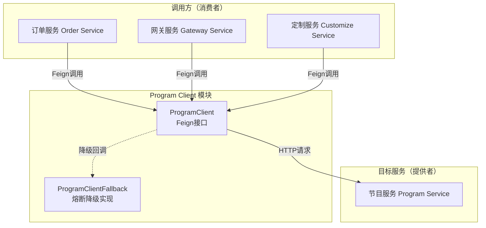
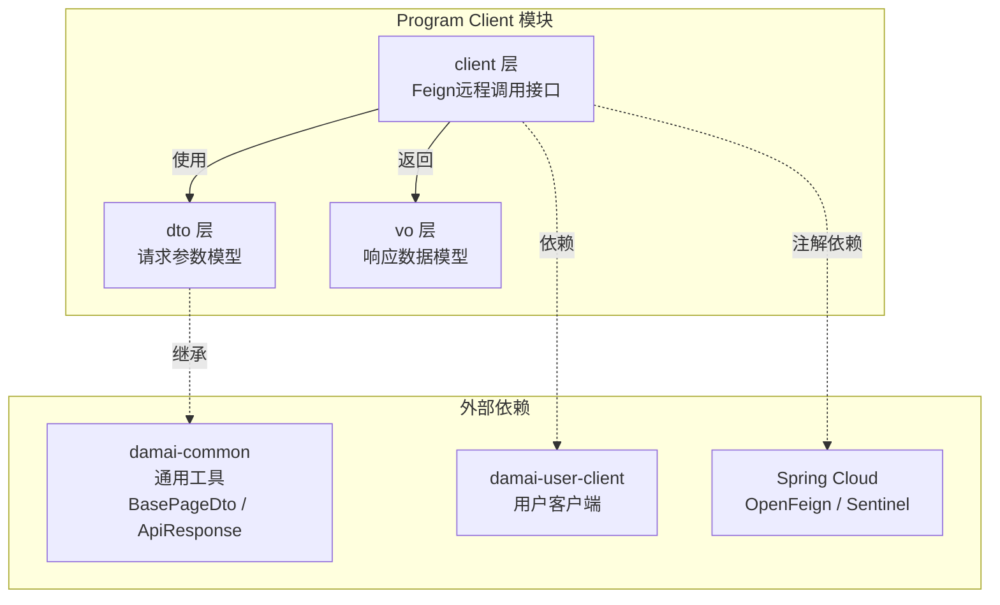
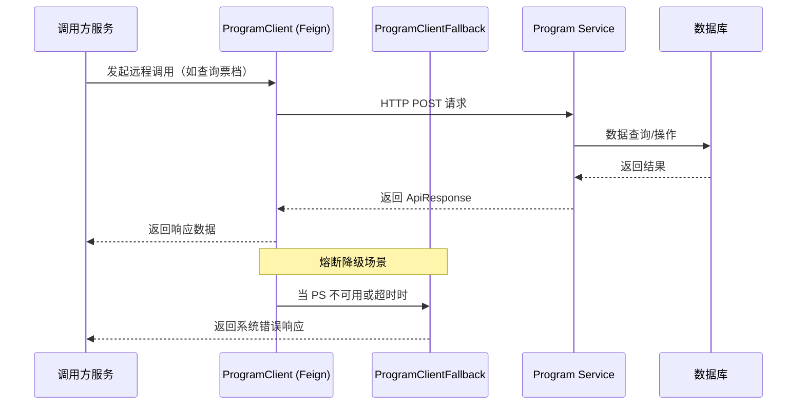
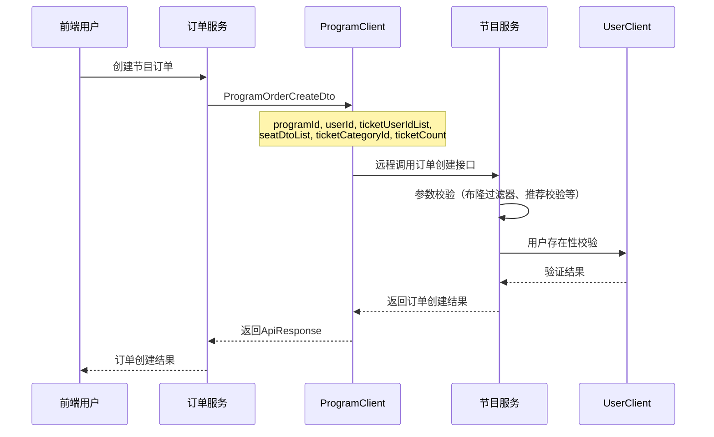
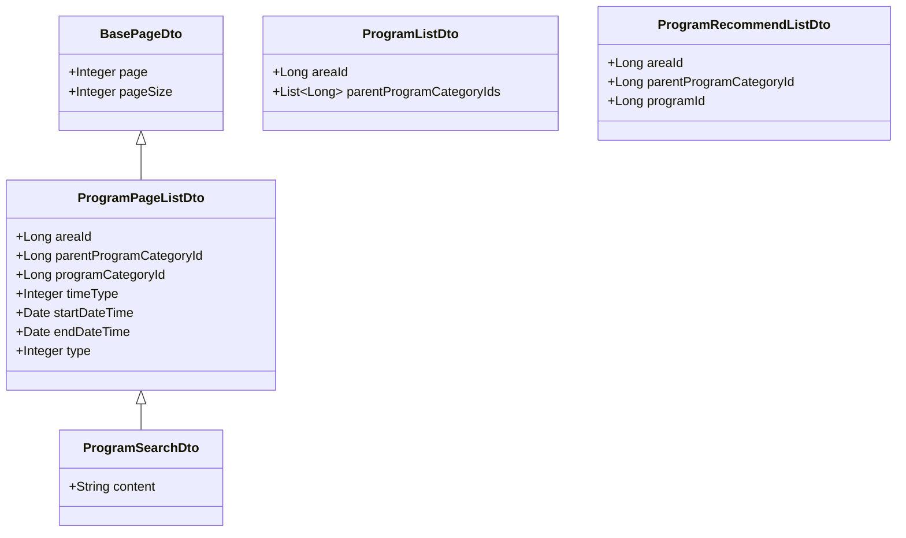
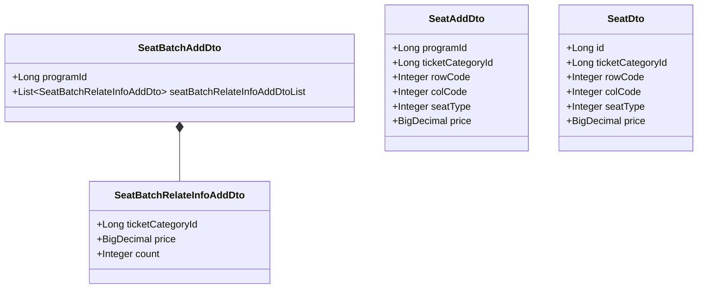
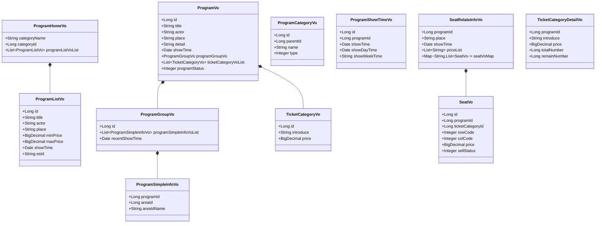
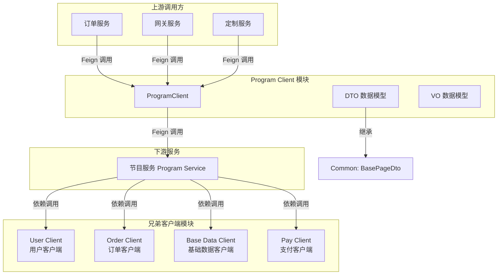

# 节目客户端模块 (Program Client)

## 1. 模块简介

**Program Client**（节目客户端）是大麦网高并发系统中的 RPC 客户端模块，基于 Spring Cloud OpenFeign 构建，用于为上游服务（如订单服务、网关服务等）提供与**节目服务（Program Service）**进行远程通信的能力。该模块封装了节目相关的全部数据交互接口和数据模型，包括节目信息查询、节目类别管理、演出时间管理、座位管理、票档管理等核心功能。

该模块是典型的 **Feign Client** 模式实现，通过声明式 HTTP 客户端简化服务间调用，同时集成了 Sentinel 熔断降级机制（通过 `ProgramClientFallback`）保障系统稳定性。

---

## 2. 架构设计

### 2.1 模块定位与依赖关系



### 2.2 模块内部结构



### 2.3 核心组件清单

| 分类 | 文件 | 说明 |
|------|------|------|
| **Feign 接口** | `ProgramClient.java` | 节目服务远程调用接口，定义 Feign 客户端 |
| **降级回调** | `ProgramClientFallback.java` | 熔断/降级时的 Fallback 实现 |
| **DTO-节目** | `ProgramAddDto.java` | 节目添加请求参数 |
| | `ProgramGetDto.java` | 节目查询请求参数 |
| | `ProgramListDto.java` | 主页节目列表查询参数 |
| | `ProgramPageListDto.java` | 节目分页查询参数 |
| | `ProgramSearchDto.java` | 节目搜索参数 |
| | `ProgramRecommendListDto.java` | 推荐节目列表查询参数 |
| | `ProgramInvalidDto.java` | 节目失效参数 |
| | `ProgramOperateDataDto.java` | 节目数据操作参数 |
| | `ProgramResetExecuteDto.java` | 节目数据重置参数 |
| **DTO-节目类别** | `ProgramCategoryDto.java` | 节目类别查询参数 |
| | `ProgramCategoryAddDto.java` | 节目类别添加参数 |
| | `ParentProgramCategoryDto.java` | 父节目类别查询参数 |
| **DTO-演出时间** | `ProgramShowTimeAddDto.java` | 演出时间添加参数 |
| **DTO-座位** | `SeatAddDto.java` | 座位添加参数 |
| | `SeatBatchAddDto.java` | 座位批量添加参数 |
| | `SeatBatchRelateInfoAddDto.java` | 座位批量添加关联信息 |
| | `SeatListDto.java` | 座位列表查询参数 |
| | `SeatDto.java` | 座位信息（订单创建时使用） |
| **DTO-票档** | `TicketCategoryAddDto.java` | 票档添加参数 |
| | `TicketCategoryDto.java` | 票档查询参数 |
| | `TicketCategoryListByProgramDto.java` | 按节目查询票档集合参数 |
| | `TicketCategoryCountDto.java` | 票档数量操作参数 |
| **DTO-订单** | `ProgramOrderCreateDto.java` | 节目订单创建参数 |
| | `DelayOrderCancelDto.java` | 延迟订单取消参数 |
| **DTO-测试** | `TestDto.java` | 测试请求参数 |
| | `TestSendDto.java` | 测试消息发送参数 |
| **VO** | `ProgramVo.java` | 节目详细信息 |
| | `ProgramListVo.java` | 节目列表信息 |
| | `ProgramHomeVo.java` | 主页节目列表（按类别分组） |
| | `ProgramSimpleInfoVo.java` | 节目简单信息 |
| | `ProgramGroupVo.java` | 节目分组信息 |
| | `ProgramCategoryVo.java` | 节目类别信息 |
| | `ProgramShowTimeVo.java` | 演出时间信息 |
| | `SeatVo.java` | 座位详细信息 |
| | `SeatRelateInfoVo.java` | 座位相关信息（含价格、场次） |
| | `TicketCategoryVo.java` | 票档基本信息 |
| | `TicketCategoryDetailVo.java` | 票档详细信息（含库存） |

---

## 3. 数据流分析

### 3.1 主数据流



### 3.2 节目订单创建数据流



---

## 4. Feign 接口详解

### 4.1 ProgramClient

```java
@Component
@FeignClient(value = "${spring.application.name}-program-service", 
             fallback = ProgramClientFallback.class)
public interface ProgramClient {
    
    @PostMapping(value = "/ticket/category/select/list/by/program")
    ApiResponse<List<TicketCategoryDetailVo>> selectListByProgram(
        TicketCategoryListByProgramDto ticketCategoryListByProgramDto);
}
```

**关键特性：**
- **服务发现**：通过 `@FeignClient` 注解中的 `value` 属性，结合 Spring Cloud 服务发现机制动态定位节目服务实例
- **负载均衡**：继承 Spring Cloud LoadBalancer 的能力，自动进行客户端负载均衡
- **熔断降级**：`fallback = ProgramClientFallback.class` 指定当远程调用失败时的处理策略
- **请求方式**：使用 `@PostMapping` 进行 POST 请求

### 4.2 ProgramClientFallback

```java
@Component
public class ProgramClientFallback implements ProgramClient {
    
    @Override
    public ApiResponse<List<TicketCategoryDetailVo>> selectListByProgram(
            TicketCategoryListByProgramDto ticketCategoryListByProgramDto) {
        return ApiResponse.error(BaseCode.SYSTEM_ERROR);
    }
}
```

当节目服务不可用、网络超时或触发 Sentinel 熔断规则时，Fallback 实现会返回一个统一的系统错误响应，避免调用方长时间阻塞。

---

## 5. DTO 数据模型详解

### 5.1 节目类 DTO 继承关系



### 5.2 节目添加 DTO（ProgramAddDto）

| 字段 | 类型 | 必填 | 说明 |
|------|------|------|------|
| areaId | Long | 是 | 所在区域 ID |
| programCategoryId | Long | 是 | 节目类型表 ID |
| parentProgramCategoryId | Long | 是 | 父节目类型表 ID |
| title | String | 是 | 标题 |
| actor | String | 否 | 艺人 |
| place | String | 否 | 地点 |
| itemPicture | String | 否 | 项目图片 |
| detail | String | 否 | 项目详情 |
| totalCount | Long | 否 | 全场可售门票总张数 |
| permitRefund | Integer | 否 | 是否允许退款（1:允许 0:不允许） |
| permitChooseSeat | Integer | 否 | 是否允许选座（1:允许选座 0:不允许选座） |
| electronicDeliveryTicket | Integer | 否 | 电子票/快递票（1:是 0:不是） |
| electronicInvoice | Integer | 否 | 电子发票（1:是 0:不是） |
| purchaseLimitRule | String | 否 | 限购规则 |
| refundTicketRule | String | 否 | 退票/换票规则 |
| deliveryInstruction | String | 否 | 配送信息说明 |
| entryRule | String | 否 | 入场规则 |
| childPurchase | String | 否 | 儿童购票 |
| invoiceSpecification | String | 否 | 发票说明 |
| realTicketPurchaseRule | String | 否 | 实名购票规则 |
| abnormalOrderDescription | String | 否 | 异常排单说明 |
| kindReminder | String | 否 | 温馨提示 |
| performanceDuration | String | 否 | 演出时长 |
| entryTime | String | 否 | 入场时间 |
| minPerformanceCount | Integer | 否 | 最低演出曲目 |
| mainActor | String | 否 | 主要演员 |
| minPerformanceDuration | String | 否 | 最低演出时长 |
| prohibitedItem | String | 否 | 禁止携带物品 |
| depositSpecification | String | 否 | 寄存说明 |

### 5.3 节目分页查询 DTO（ProgramPageListDto）

| 字段 | 类型 | 必填 | 说明 |
|------|------|------|------|
| areaId | Long | 否 | 所在区域 ID |
| parentProgramCategoryId | Long | 否 | 父节目类型 ID |
| programCategoryId | Long | 否 | 节目类型 ID |
| timeType | Integer | 是 | 时间筛选：0-全部, 1-今天, 2-明天, 3-一周内, 4-一个月内, 5-按日历 |
| startDateTime | Date | 否 | 开始时间（timeType=5 时必填） |
| endDateTime | Date | 否 | 结束时间（timeType=5 时必填） |
| type | Integer | 否 | 查询方式：1-相关度排序(默认), 2-推荐排序, 3-最近开场, 4-最新上架 |
| page | Integer | 继承 | 页码 |
| pageSize | Integer | 继承 | 每页大小 |

### 5.4 节目订单创建 DTO（ProgramOrderCreateDto）

| 字段 | 类型 | 必填 | 说明 |
|------|------|------|------|
| programId | Long | 是 | 节目 ID |
| userId | Long | 是 | 用户 ID |
| ticketUserIdList | List<Long> | 是 | 购票人 ID 集合 |
| seatDtoList | List<SeatDto> | 否 | 座位列表（选座时必填） |
| ticketCategoryId | Long | 否 | 票档 ID（不选座时必填） |
| ticketCount | Integer | 否 | 购买票数量（不选座时必填） |

### 5.5 座位添加 DTO 关系



---

## 6. VO 数据模型详解

### 6.1 VO 继承与关联关系



---

## 7. 与其他模块的交互

### 7.1 模块交互全景图



### 7.2 关键依赖关系

| 依赖模块 | 依赖类型 | 说明 |
|----------|----------|------|
| **damai-common** | Maven 编译依赖 | 提供 `BasePageDto` 基类、`ApiResponse` 统一响应模型、`Constant` 常量 |
| **damai-user-client** | Maven 编译依赖 | 在 pom.xml 中显式声明依赖，用于用户相关校验 |
| **Spring Cloud OpenFeign** | 框架依赖 | 声明式 HTTP 客户端，实现服务间远程调用 |
| **Spring Cloud Sentinel** | 框架依赖 | 提供熔断降级能力，通过 `@FeignClient(fallback=...)` 集成 |
| **Swagger/OpenAPI** | 注解依赖 | DTO/VO 中使用 `@Schema` 注解生成 API 文档 |

---

## 8. 配置说明

### 8.1 服务名称配置

Feign 客户端通过以下方式拼接服务名称：
```java
@FeignClient(value = SPRING_INJECT_PREFIX_DISTINCTION_NAME + "-" + "program-service", ...)
```

其中 `SPRING_INJECT_PREFIX_DISTINCTION_NAME` 定义在 `Constant` 类中，用于在微服务名称前添加统一前缀，防止服务名冲突。

### 8.2 熔断配置

在调用方服务的配置文件中，可以配置 Feign 和 Sentinel 的熔断参数：

```yaml
# 示例配置（在调用方服务中配置）
feign:
  sentinel:
    enabled: true  # 开启 Sentinel 对 Feign 的支持

sentinel:
  # 针对 ProgramClient 的熔断规则
  flow:
    - resource: "ProgramClient#selectListByProgram(TicketCategoryListByProgramDto)"
      count: 1000  # QPS 阈值
      grade: 1     # 1-QPS 2-线程数
      limitApp: default
```

---

## 9. API 接口汇总

目前 `ProgramClient` 暴露的 Feign 接口：

| 接口方法 | HTTP 路径 | 请求 DTO | 响应类型 | 说明 |
|----------|-----------|----------|----------|------|
| `selectListByProgram` | `/ticket/category/select/list/by/program` | `TicketCategoryListByProgramDto` | `ApiResponse<List<TicketCategoryDetailVo>>` | 根据节目 ID 查询票档集合详情 |

> **注意**：从 DTO 模型可以看出，该模块实际定义了更丰富的接口契约（如节目添加、座位管理、订单创建等），但当前 Feign 接口仅暴露了票档查询一个端点。其他接口可能通过其他方式（如直接 HTTP、消息队列等）在节目服务中暴露，或者在不同的 Feign 客户端版本中逐步添加。

---

## 10. 相关文档

- [Common 模块](Common.md) - 通用基础模型（BasePageDto、ApiResponse、Constant）
- [User Client 模块](UserClient.md) - 用户客户端模块
- [Order Client 模块](OrderClient.md) - 订单客户端模块
- [Program Service 模块](ProgramService.md) - 节目服务模块（服务端实现）
- [Spring Cloud Framework](SpringCloudFramework.md) - Spring Cloud 框架配置
