# Redis 工具框架（Redis Tool Framework）

## 概述

Redis 工具框架是大麦（DaMai）高并发实战项目中的**核心 Redis 操作基础设施模块**。该模块对 Spring Data Redis 进行了深度封装和扩展，提供了一套统一、易用、类型安全的 Redis 操作 API，同时集成了 **Redis Stream** 消息队列功能，支持可靠的消息发布与消费。

### 核心特性

- **统一缓存抽象**：通过 `RedisCache` 接口提供完整的 Redis 数据类型操作（String、Hash、List、Set、SortedSet）
- **类型安全转换**：基于 FastJSON 实现对象与 JSON 的自动序列化/反序列化，支持泛型类型推导
- **键管理规范**：通过 `RedisKeyManage` 枚举统一管理所有 Redis Key，避免硬编码和命名冲突
- **自动前缀注入**：使用 `RedisKeyBuild` 自动为 Key 添加项目前缀（如 `damai-`），支持多环境隔离
- **缓存穿透防护**：内置 `Supplier` 回调机制，缓存未命中时自动执行回填逻辑
- **Redis Stream 支持**：完整的消息队列实现，支持消费组（Group）和广播（Broadcast）两种消费模式
- **Spring Boot 自动装配**：基于条件化自动配置，开箱即用

---

## 架构总览

```mermaid
graph TB
    subgraph "Redis Tool Framework"
        subgraph "Redis 公共配置层 (damai-redis-common-framework)"
            RFAC[RedisFrameWorkAutoConfig<br/>RedisTemplate & StringRedisTemplate Bean 定义]
        end
        
        subgraph "Redis 缓存层 (damai-redis-framework)"
            RC[RedisCache 接口<br/>Redis 操作抽象]
            RCI[RedisCacheImpl<br/>Redis 操作实现]
            RKB[RedisKeyBuild<br/>Key 构建器]
            RKM[RedisKeyManage 枚举<br/>Key 统一管理]
            CU[CacheUtil<br/>缓存工具类]
            RCAC[RedisCacheAutoConfig<br/>缓存自动配置]
        end
        
        subgraph "Redis Stream 层 (damai-redis-stream-framework)"
            RSAC[RedisStreamAutoConfig<br/>Stream 自动配置]
            RSCP[RedisStreamConfigProperties<br/>Stream 配置属性]
            RSPH[RedisStreamPushHandler<br/>消息推送处理器]
            RSH[RedisStreamHandler<br/>Stream 操作处理器]
            RSL[RedisStreamListener<br/>消息监听器]
            MC[MessageConsumer<br/>消息消费接口]
            RSCONST[RedisStreamConstant<br/>Stream 常量]
        end
    end
    
    subgraph "外部依赖"
        COMMON[Common 模块<br/>SpringUtil / StringUtil]
        SPRING_REDIS[Spring Data Redis<br/>RedisTemplate / StringRedisTemplate]
        FASTJSON[FastJSON<br/>序列化/反序列化]
    end
    
    RFAC --> SPRING_REDIS
    RCAC --> RCI
    RCI --> RC
    RCI --> RKB
    RKB --> RKM
    RCI --> CU
    RCI --> RFAC
    RCI --> FASTJSON
    RKB --> COMMON
    
    RSAC --> RSCP
    RSAC --> RSPH
    RSAC --> RSH
    RSAC --> RSL
    RSL --> MC
    RSAC --> SPRING_REDIS
    RSH --> RSPH
    RSH --> SPRING_REDIS
    
    subgraph "业务服务使用者"
        PS[Program Service<br/>节目服务]
        OS[Order Service<br/>订单服务]
        US[User Service<br/>用户服务]
        BS[Base Data Service<br/>基础数据服务]
        CS[Customize Service<br/>定制化服务]
    end
    
    RC --> PS
    RC --> OS
    RC --> US
    RC --> BS
    RC --> CS
    RSL --> CS
```

---

## 模块依赖关系

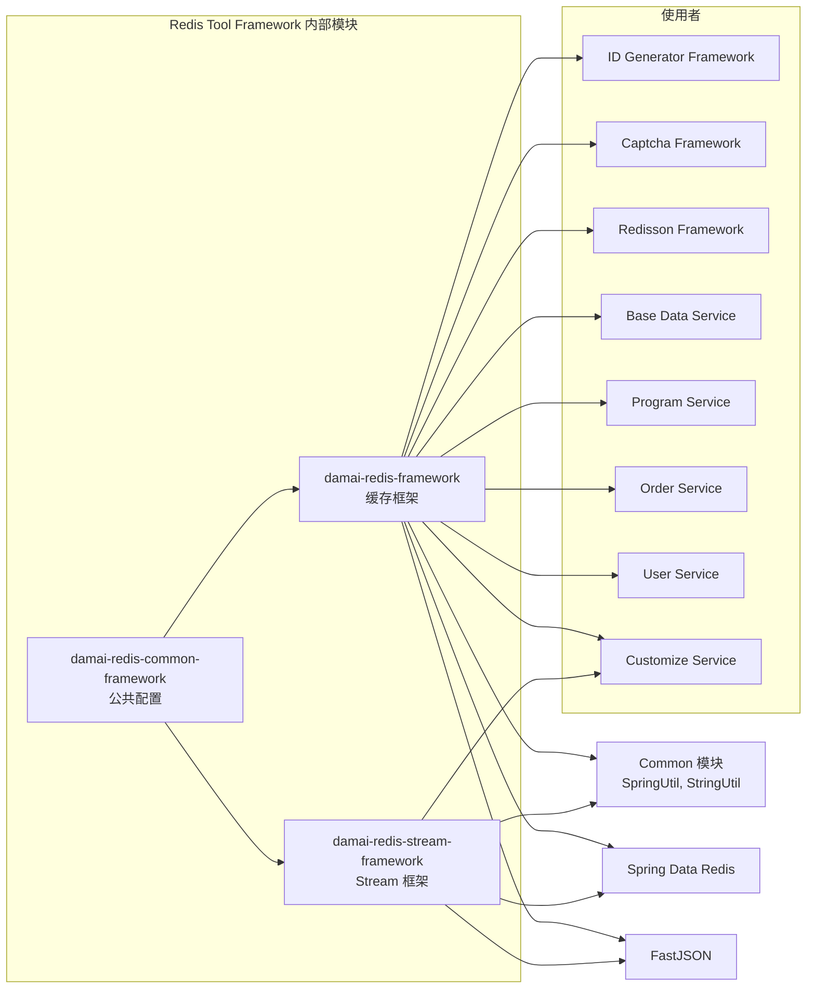

> **依赖说明**：该模块依赖 `damai-common` 公共模块（提供 `SpringUtil` 获取环境前缀、`StringUtil` 字符串判空等工具），依赖 `spring-boot-starter-data-redis` 进行底层 Redis 操作，依赖 `fastjson` 实现对象的 JSON 序列化/反序列化。

---

## 核心组件详解

### 1. Redis 公共配置层（damai-redis-common-framework）

#### 1.1 RedisFrameWorkAutoConfig

**类路径**：`com.damai.config.RedisFrameWorkAutoConfig`

这是 Redis 工具框架的基础自动配置类，负责向 Spring 容器注册两个核心的 Redis 操作模板 Bean：

| Bean 名称 | Bean 类型 | 说明 |
|-----------|----------|------|
| `redisToolRedisTemplate` | `RedisTemplate` | 使用 `StringRedisSerializer` 序列化器，存储字符串格式数据 |
| `redisToolStringRedisTemplate` | `StringRedisTemplate` | 使用 `@Primary` 注解标记为首选，简化字符串操作 |

**关键配置**：
- 所有序列化器均使用 `StringRedisSerializer`，确保 Redis 中的 Key 和 Value 均为可读的字符串格式
- 自定义 Bean 名称避免与系统默认的 `RedisTemplate` 和 `StringRedisTemplate` 冲突

---

### 2. Redis 缓存层（damai-redis-framework）

这是整个模块的核心子模块，提供了完整的 Redis 操作封装。

#### 2.1 RedisCache 接口

**类路径**：`com.damai.redis.RedisCache`

Redis 操作的核心抽象接口，定义了六大类 Redis 数据结构的操作方法，总计 **100+ 个方法**。所有方法的 Key 参数统一使用 `RedisKeyBuild` 类型替代原始 String，确保了 Key 的规范性和安全性。

**方法分类概览：**

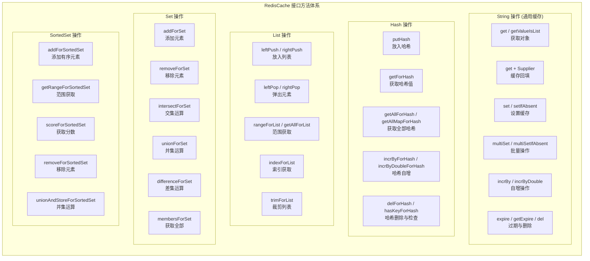

**核心方法详解：**

| 方法 | 参数 | 返回值 | 说明 |
|------|------|--------|------|
| `get(RedisKeyBuild, Class<T>)` | Key + 目标类型 | `T` | 获取字符串并反序列化为指定类型 |
| `get(RedisKeyBuild, Class<T>, Supplier<T>, long, TimeUnit)` | Key + 类型 + 回填函数 + 过期时间 | `T` | 缓存穿透保护：未命中时执行回填并写入缓存 |
| `getValueIsList(RedisKeyBuild, Class<T>)` | Key + 元素类型 | `List<T>` | 获取 JSON 数组字符串并解析为 List |
| `getValueIsList(RedisKeyBuild, Class<T>, Supplier<List<T>>, long, TimeUnit)` | Key + 类型 + 回填函数 + 过期时间 | `List<T>` | 带缓存回填的 List 获取 |
| `set(RedisKeyBuild, Object)` | Key + 对象 | `void` | 将对象序列化为 JSON 后存储 |
| `set(RedisKeyBuild, Object, long, TimeUnit)` | Key + 对象 + 过期时间 | `void` | 设置带过期时间的缓存 |
| `setIfAbsent(RedisKeyBuild, Object)` | Key + 对象 | `boolean` | 分布式锁场景：Key 不存在时才设置 |
| `incrBy(RedisKeyBuild, long)` | Key + 步长 | `Long` | 自增/自减操作，用于计数器场景 |
| `hasKey(RedisKeyBuild)` | Key | `Boolean` | 判断 Key 是否存在 |
| `del(RedisKeyBuild)` | Key | `void` | 删除指定 Key |
| `del(Collection<RedisKeyBuild>)` | Key 集合 | `void` | 批量删除 Key |
| `expire(RedisKeyBuild, long, TimeUnit)` | Key + 过期时间 | `Boolean` | 设置 Key 的过期时间 |

**Hash 操作示例：**
- `putHash(RedisKeyBuild, String, Object)` — 设置单个 Hash 字段
- `putHash(RedisKeyBuild, Map<String, ?>)` — 批量设置 Hash 字段
- `getForHash(RedisKeyBuild, String, Class<T>)` — 获取 Hash 中某个字段的值
- `getAllForHash(RedisKeyBuild, Class<T>)` — 获取 Hash 中所有值（谨慎使用）
- `incrByForHash(RedisKeyBuild, String, long)` — Hash 字段自增

**List 操作示例：**
- `leftPushForList / rightPushForList` — 从左侧/右侧压入元素
- `leftPopForList / rightPopForList` — 从左侧/右侧弹出元素
- `rangeForList(RedisKeyBuild, long, long, Class<T>)` — 获取指定范围元素
- `rightPopAndLeftPushForList` — 实现可靠的队列消息传递

**Set 操作示例：**
- `intersectForSet / unionForSet / differenceForSet` — 集合运算（交集、并集、差集）
- `intersectAndStoreForSet` — 集合运算结果存储到新 Key
- `membersForSet / sizeForSet / isMemberForSet` — 基础查询

#### 2.2 RedisCacheImpl

**类路径**：`com.damai.redis.RedisCacheImpl`

`RedisCache` 接口的唯一实现类，内部持有 `StringRedisTemplate` 实例，所有操作最终委托给 Spring Data Redis 执行。

**序列化策略：**
- 写入时：非 String 类型使用 `JSON.toJSONString()` 序列化
- 读取时：通过 `JSON.parseObject()` 或 `JSON.parseArray()` 反序列化
- Java 泛型类型通过 `ParameterizedTypeImpl` 构建，确保复杂泛型（如 `List<OrderDto>`）的正确解析

**缓存回填机制（Cache-Aside Pattern）：**

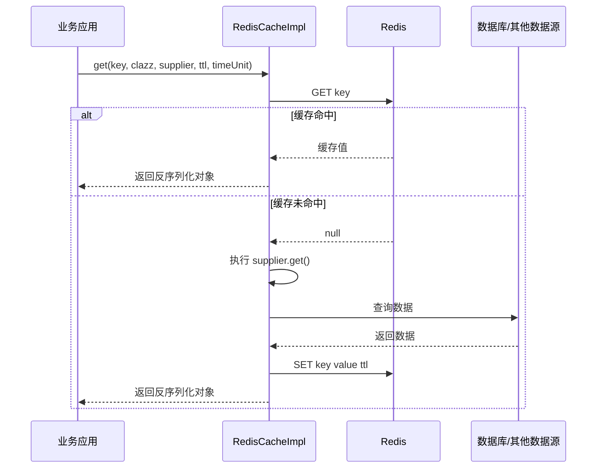

**验证机制：**
- 所有 Key 操作前调用 `CacheUtil.checkNotBlank()` 校验 Key 非空
- 批量操作时调用 `CacheUtil.checkNotEmpty()` 校验集合非空
- 空值处理：`optimizeRedisList()` 优化 Redis 返回的 List 结果（处理空列表和全 null 列表）

#### 2.3 RedisKeyBuild

**类路径**：`com.damai.redis.RedisKeyBuild`

Redis Key 的构建器，是框架中所有 Redis 操作的 Key 构造函数。采用**不可变对象**设计，通过静态工厂方法创建实例。

**核心逻辑：**
```java
public static RedisKeyBuild createRedisKey(RedisKeyManage redisKeyManage, Object... args) {
    String redisRelKey = String.format(redisKeyManage.getKey(), args);  // 格式化占位符
    return new RedisKeyBuild(SpringUtil.getPrefixDistinctionName() + "-" + redisRelKey);  // 添加前缀
}
```

**Key 结构：**
```
{项目前缀}-{Key 模板}{填充参数}
   ↓             ↓
  damai-    product_stock:1001
```

**示例：**
| 枚举项 | Key 模板 | 实际 Key 示例 |
|--------|---------|--------------|
| `PRODUCT_STOCK` | `product_stock:%s` | `damai-product_stock:1001` |
| `USER_LOGIN` | `user_login_%s_%s` | `damai-user_login_123_abc` |
| `PROGRAM` | `d_mai_program_%s` | `damai-d_mai_program_2001` |
| `AREA_PROVINCE_LIST` | `d_mai_area_province_list` | `damai-d_mai_area_province_list` |

**设计优势：**
- **自动隔离**：通过 `SpringUtil.getPrefixDistinctionName()` 获取环境配置（默认 `damai`），实现多环境 Key 隔离
- **类型安全**：使用 `RedisKeyManage` 枚举而非字符串，编译期可检查
- **统一管理**：所有 Key 定义集中管理，避免命名冲突

#### 2.4 RedisKeyManage 枚举

**类路径**：`com.damai.core.RedisKeyManage`

系统中所有 Redis Key 的统一管理枚举，涵盖了大麦项目中所有业务场景的 Key 定义。

**枚举结构：**
| 枚举常量 | Key 模板 | 用途说明 |
|---------|----------|---------|
| `USER_LOGIN` | `user_login_%s_%s` | 用户登录信息 |
| `PRODUCT_STOCK` | `product_stock:%s` | 商品库存 |
| `PROGRAM` | `d_mai_program_%s` | 节目缓存 |
| `PROGRAM_SEAT_NO_SOLD_RESOLUTION_HASH` | `d_mai_program_seat_no_sold_resolution_hash_%s_%s` | 节目座位未售卖集合 |
| `PROGRAM_SEAT_LOCK_RESOLUTION_HASH` | `d_mai_program_seat_lock_resolution_hash_%s_%s` | 节目座位锁定集合 |
| `PROGRAM_SEAT_SOLD_RESOLUTION_HASH` | `d_mai_program_seat_sold_resolution_hash_%s_%s` | 节目座位已售卖集合 |
| `PROGRAM_TICKET_REMAIN_NUMBER_HASH_RESOLUTION` | `d_mai_program_ticket_remain_number_hash_resolution_%s_%s` | 节目余票数量 |
| `PROGRAM_TICKET_CATEGORY_LIST` | `d_mai_program_ticket_category_list_%s` | 节目票档集合 |
| `PROGRAM_CATEGORY_HASH` | `d_mai_program_category_hash` | 节目类型集合 |
| `PROGRAM_SHOW_TIME` | `d_mai_program_show_time_%s` | 节目演出时间 |
| `PROGRAM_GROUP` | `d_mai_program_group_%s` | 节目分组 |
| `ORDER_MQ` | `d_mai_order_mq_%s` | MQ 创建的订单编号 |
| `ACCOUNT_ORDER_COUNT` | `d_mai_account_order_count_%s_%s` | 账户订单数量 |
| `TICKET_USER_LIST` | `d_mai_ticket_user_list_%s` | 购票人列表 |
| `VERIFY_CAPTCHA_ID` | `d_mai_verify_captcha_id_%s` | 验证码 ID |
| `COUNTER_COUNT` | `d_mai_counter_count` | 分布式计数器 |
| `DISTRIBUTED_DATACENTER_ID` | `distributed_datacenter_id:%s` | 分布式数据中心 ID |
| `CHANNEL_DATA` | `channel_data_%s` | 渠道数据 |
| `ALL_RULE_HASH` | `all_rule_hash` | 所有规则哈希 |
| `RULE` | `rule` | 调用限制规则 |
| `AREA_PROVINCE_LIST` | `d_mai_area_province_list` | 省地区集合 |

#### 2.5 CacheUtil

**类路径**：`com.damai.redis.CacheUtil`

缓存操作的工具类，提供参数验证和结果优化等辅助方法。

| 方法 | 说明 |
|------|------|
| `buildType(Type... types)` | 构建嵌套泛型类型（如 `List<OrderDto>`） |
| `checkNotBlank(String...)` | 检查字符串参数非空 |
| `checkNotBlank(RedisKeyBuild)` | 检查 Key 内容非空 |
| `checkNotBlank(Collection<String>)` | 检查字符串集合非空 |
| `checkNotEmpty(Collection<?>)` | 检查集合元素非空 |
| `checkNotEmpty(Object)` | 检查对象非空 |
| `isEmpty(Object)` | 判断对象是否为空（支持 String、Collection、普通对象） |
| `getBatchKey(Collection<RedisKeyBuild>)` | 批量获取 Key 的真实字符串 |
| `optimizeRedisList(List<T>)` | 优化 Redis 返回的 List（过滤空指针） |
| `checkRedisListIsEmpty(List<?>)` | 检查 Redis 返回的 List 是否为空 |

默认时间单位：`TimeUnit.SECONDS`

#### 2.6 RedisCacheAutoConfig

**类路径**：`com.damai.redis.config.RedisCacheAutoConfig`

缓存层的自动装配配置类，创建 `RedisCacheImpl` Bean 并注入 `redisToolStringRedisTemplate`。

```java
public class RedisCacheAutoConfig {
    @Bean
    public RedisCacheImpl redisCache(
            @Qualifier("redisToolStringRedisTemplate") StringRedisTemplate stringRedisTemplate) {
        return new RedisCacheImpl(stringRedisTemplate);
    }
}
```

---

### 3. Redis Stream 层（damai-redis-stream-framework）

该子模块提供了基于 Redis Stream 的消息队列功能，支持**消费组模式**和**广播模式**两种消费方式。

#### 3.1 架构设计

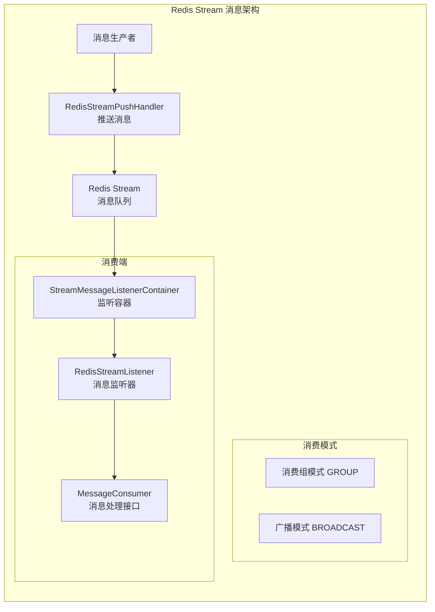

#### 3.2 RedisStreamAutoConfig

**类路径**：`com.damai.config.RedisStreamAutoConfig`

Redis Stream 功能的自动配置类，负责创建以下 Bean：

| Bean 名称 | 类型 | 说明 |
|-----------|------|------|
| `redisStreamPushHandler` | `RedisStreamPushHandler` | 消息推送处理器 |
| `redisStreamHandler` | `RedisStreamHandler` | Stream 操作处理器 |
| `streamMessageListenerContainer` | `StreamMessageListenerContainer` | 消息监听容器（`@ConditionalOnBean(MessageConsumer.class)`） |

**监听容器配置：**
| 配置项 | 值 | 说明 |
|-------|-----|------|
| `pollTimeout` | 5 秒 | 轮询超时时间 |
| `batchSize` | 10 | 每次拉取消息数量 |
| `targetType` | `String.class` | 消息体类型 |
| 线程池 | 核心线程数 = CPU 核数，最大 = 2×CPU 核数 | 消费者线程池 |

**消费模式选择：**

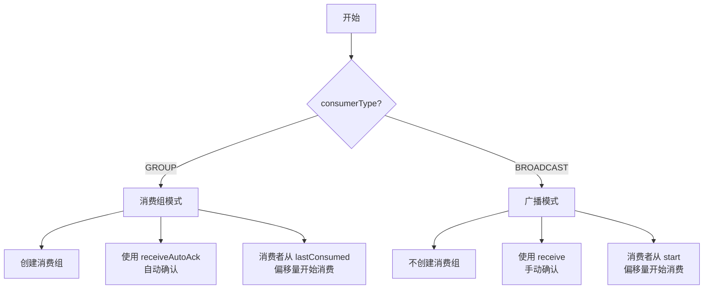

#### 3.3 RedisStreamConfigProperties

**类路径**：`com.damai.RedisStreamConfigProperties`

配置属性类，绑定 `spring.data.redis.stream.*` 前缀。

| 属性 | 类型 | 默认值 | 说明 |
|------|------|--------|------|
| `streamName` | `String` | 无 | Stream 消息队列名称 |
| `consumerGroup` | `String` | 无 | 消费组名称 |
| `consumerName` | `String` | 无 | 消费者名称 |
| `consumerType` | `String` | `group` | 消费方式：`group`（消费组）/ `broadcast`（广播） |

**配置示例：**
```yaml
spring:
  data:
    redis:
      stream:
        stream-name: "my-stream"
        consumer-group: "my-group"
        consumer-name: "consumer-1"
        consumer-type: "group"    # 或 "broadcast"
```

#### 3.4 RedisStreamPushHandler（消息生产者）

**类路径**：`com.damai.RedisStreamPushHandler`

消息推送处理器，负责向 Redis Stream 中发送消息。

**核心方法：**
| 方法 | 说明 |
|------|------|
| `push(String msg)` | 发送消息到 Stream，返回 `RecordId`（自动生成 ID） |

**消息发送流程：**
```java
ObjectRecord<String, String> record = StreamRecords.newRecord()
    .in(streamName)                     // 指定 Stream 名称
    .ofObject(msg)                      // 消息内容
    .withId(RecordId.autoGenerate());   // 自动生成消息 ID
RecordId recordId = stringRedisTemplate.opsForStream().add(record);
```

#### 3.5 RedisStreamHandler

**类路径**：`com.damai.RedisStreamHandler`

Stream 操作处理器，提供 Stream 的创建、绑定和删除等管理能力。

**核心方法：**
| 方法 | 说明 |
|------|------|
| `addGroup(streamName, groupName)` | 创建消费组 |
| `hasKey(key)` | 判断 Stream Key 是否存在 |
| `del(key, recordIds)` | 删除指定消息 |
| `streamBindingGroup(streamName, group)` | 自动绑定消费组（Stream 不存在时先初始化再创建组） |

**消费组自动绑定流程：**
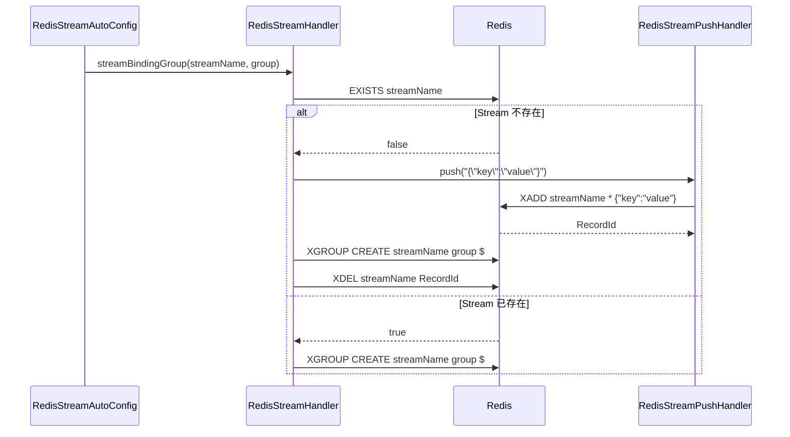

#### 3.6 RedisStreamListener（消息消费者）

**类路径**：`com.damai.RedisStreamListener`

消息监听器，实现 `StreamListener` 接口，负责接收并处理 Redis Stream 消息。

**工作流程：**
```java
public void onMessage(ObjectRecord<String, String> message) {
    RecordId messageId = message.getId();       // 消息 ID
    String value = message.getValue();           // 消息内容
    log.info("消费消息: messageId={}, streamName={}, message={}", 
             messageId, message.getStream(), value);
    messageConsumer.accept(message);             // 委托给业务处理器
}
```

#### 3.7 MessageConsumer（业务处理接口）

**类路径**：`com.damai.MessageConsumer`

函数式接口（`@FunctionalInterface`），定义了消息处理的标准契约：

```java
@FunctionalInterface
public interface MessageConsumer {
    void accept(ObjectRecord<String, String> message);
}
```

业务服务通过实现该接口并注册为 Spring Bean，`RedisStreamAutoConfig` 在 `@ConditionalOnBean(MessageConsumer.class)` 条件下自动启动监听容器。

#### 3.8 RedisStreamConstant

**类路径**：`com.damai.constant.RedisStreamConstant`

Stream 常量定义：

| 常量 | 值 | 说明 |
|------|-----|------|
| `GROUP` | `"group"` | 消费组模式（同一组内消息分发给不同消费者） |
| `BROADCAST` | `"broadcast"` | 广播模式（每个消费者都收到所有消息） |

---

## 数据流与工作流程

### 4.1 通用缓存操作流程

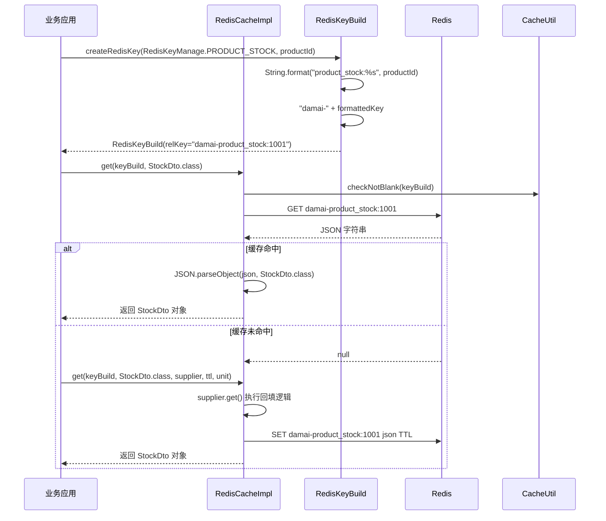

### 4.2 高并发票务缓存场景

大麦项目中的座位和余票管理大量使用了 Hash 数据结构，以下是典型的高并发缓存操作场景：

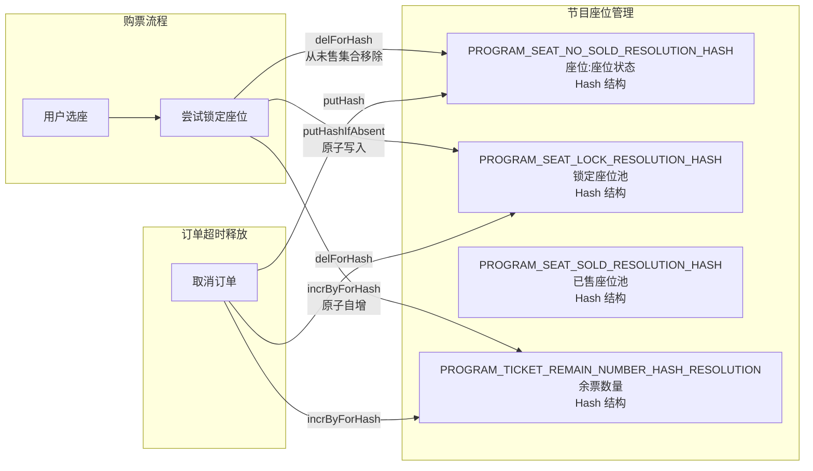

### 4.3 缓存数据一致性保障

通过 `get + Supplier` 方法实现缓存的懒加载和自动回填，保证数据最终一致性：

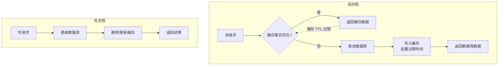

### 4.4 Redis Stream 消息收发流程

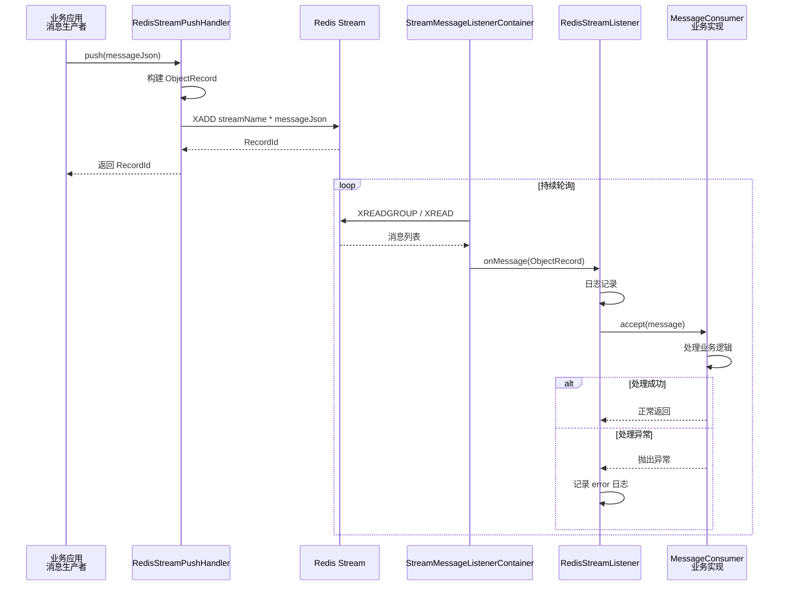

---

## 配置指南

### 5.1 Maven 依赖

**全量引入（包含所有子模块）：**
```xml
<dependency>
    <groupId>com.example</groupId>
    <artifactId>damai-redis-tool-framework</artifactId>
    <version>${revision}</version>
</dependency>
```

**按需引入子模块：**

```xml
<!-- 仅 Redis 缓存操作 -->
<dependency>
    <groupId>com.example</groupId>
    <artifactId>damai-redis-framework</artifactId>
    <version>${revision}</version>
</dependency>

<!-- Redis Stream 消息队列 -->
<dependency>
    <groupId>com.example</groupId>
    <artifactId>damai-redis-stream-framework</artifactId>
    <version>${revision}</version>
</dependency>
```

### 5.2 Redis 基础配置

```yaml
spring:
  data:
    redis:
      host: ${REDIS_HOST:localhost}
      port: ${REDIS_PORT:6379}
      password: ${REDIS_PASSWORD:}
      database: ${REDIS_DATABASE:0}
      timeout: 3000ms
      lettuce:
        pool:
          max-active: 8
          max-idle: 8
          min-idle: 0
```

### 5.3 Redis Stream 配置

```yaml
spring:
  data:
    redis:
      stream:
        stream-name: "program_order_stream"       # Stream 名称
        consumer-group: "program_order_group"      # 消费组名称
        consumer-name: "consumer-${server.port}"   # 消费者名称（通常带端口区分）
        consumer-type: "group"                     # 消费方式：group / broadcast
```

### 5.4 项目前缀配置

```yaml
# 项目前缀区分名，用于 Redis Key 隔离，默认 "damai"
prefix:
  distinction:
    name: damai
```

---

## 代码使用示例

### 6.1 基础缓存操作

```java
@Service
public class ProgramService {
    
    @Autowired
    private RedisCacheImpl redisCache;
    
    /**
     * 获取节目信息（含缓存穿透保护）
     */
    public Program getProgram(Long programId) {
        RedisKeyBuild keyBuild = RedisKeyBuild.createRedisKey(
                RedisKeyManage.PROGRAM, programId);
        
        return redisCache.get(keyBuild, Program.class, () -> {
            // 缓存未命中时查询数据库
            return programMapper.selectById(programId);
        }, 3600, TimeUnit.SECONDS);
    }
    
    /**
     * 获取节目票档列表
     */
    public List<TicketCategory> getTicketCategoryList(Long programId) {
        RedisKeyBuild keyBuild = RedisKeyBuild.createRedisKey(
                RedisKeyManage.PROGRAM_TICKET_CATEGORY_LIST, programId);
        
        return redisCache.getValueIsList(keyBuild, TicketCategory.class, () -> {
            return ticketCategoryMapper.selectByProgramId(programId);
        }, 1800, TimeUnit.SECONDS);
    }
    
    /**
     * 更新节目缓存
     */
    public void updateProgram(Program program) {
        programMapper.updateById(program);
        // 删除缓存
        RedisKeyBuild keyBuild = RedisKeyBuild.createRedisKey(
                RedisKeyManage.PROGRAM, program.getId());
        redisCache.del(keyBuild);
    }
}
```

### 6.2 Hash 结构操作（座位管理）

```java
@Service
public class SeatService {
    
    @Autowired
    private RedisCacheImpl redisCache;
    
    /**
     * 尝试锁定座位
     */
    public boolean tryLockSeat(Long programId, Long seatId, Long ticketCategoryId, 
                                Long userId, Long orderId) {
        RedisKeyBuild lockKey = RedisKeyBuild.createRedisKey(
                RedisKeyManage.PROGRAM_SEAT_LOCK_RESOLUTION_HASH, 
                programId, ticketCategoryId);
        
        RedisKeyBuild noSoldKey = RedisKeyBuild.createRedisKey(
                RedisKeyManage.PROGRAM_SEAT_NO_SOLD_RESOLUTION_HASH, 
                programId, ticketCategoryId);
        
        RedisKeyBuild remainKey = RedisKeyBuild.createRedisKey(
                RedisKeyManage.PROGRAM_TICKET_REMAIN_NUMBER_HASH_RESOLUTION, 
                programId, ticketCategoryId);
        
        // 1. 从未售集合移除
        Long removed = redisCache.delForHash(noSoldKey, String.valueOf(seatId));
        if (removed == null || removed == 0) {
            return false; // 座位已被锁定或售出
        }
        
        // 2. 加入锁定集合
        SeatLockInfo lockInfo = new SeatLockInfo(seatId, userId, orderId, System.currentTimeMillis());
        redisCache.putHash(lockKey, String.valueOf(seatId), lockInfo);
        
        // 3. 更新余票数量（原子自减）
        redisCache.incrByForHash(remainKey, String.valueOf(ticketCategoryId), -1);
        
        return true;
    }
    
    /**
     * 取消订单，释放座位
     */
    public void releaseSeat(Long programId, Long seatId, Long ticketCategoryId) {
        RedisKeyBuild lockKey = RedisKeyBuild.createRedisKey(
                RedisKeyManage.PROGRAM_SEAT_LOCK_RESOLUTION_HASH, 
                programId, ticketCategoryId);
        
        RedisKeyBuild noSoldKey = RedisKeyBuild.createRedisKey(
                RedisKeyManage.PROGRAM_SEAT_NO_SOLD_RESOLUTION_HASH, 
                programId, ticketCategoryId);
        
        RedisKeyBuild remainKey = RedisKeyBuild.createRedisKey(
                RedisKeyManage.PROGRAM_TICKET_REMAIN_NUMBER_HASH_RESOLUTION, 
                programId, ticketCategoryId);
        
        // 1. 从锁定集合移除
        redisCache.delForHash(lockKey, String.valueOf(seatId));
        
        // 2. 恢复到未售集合
        redisCache.putHash(noSoldKey, String.valueOf(seatId), String.valueOf(seatId));
        
        // 3. 余票数量原子自增
        redisCache.incrByForHash(remainKey, String.valueOf(ticketCategoryId), 1);
    }
}
```

### 6.3 Redis Stream 消息队列使用

```java
/**
 * 实现 MessageConsumer 接口，处理消息
 */
@Component
public class ProgramOrderConsumer implements MessageConsumer {
    
    @Override
    public void accept(ObjectRecord<String, String> message) {
        String orderJson = message.getValue();
        OrderDTO order = JSON.parseObject(orderJson, OrderDTO.class);
        
        // 处理订单业务逻辑
        processOrder(order);
    }
    
    private void processOrder(OrderDTO order) {
        // ...
    }
}

/**
 * 消息生产者
 */
@Component
public class OrderProducer {
    
    @Autowired
    private RedisStreamPushHandler pushHandler;
    
    public void sendOrder(OrderDTO order) {
        String orderJson = JSON.toJSONString(order);
        RecordId recordId = pushHandler.push(orderJson);
        log.info("订单消息已发送，orderId={}, recordId={}", order.getId(), recordId);
    }
}

/**
 * 手动操作 Stream（如初始化消费组）
 */
@Component
public class StreamManager {
    
    @Autowired
    private RedisStreamHandler streamHandler;
    
    public void initStream(String streamName, String groupName) {
        streamHandler.streamBindingGroup(streamName, groupName);
    }
}
```

---

## 模块集成与引用

### 7.1 与其他框架的关系

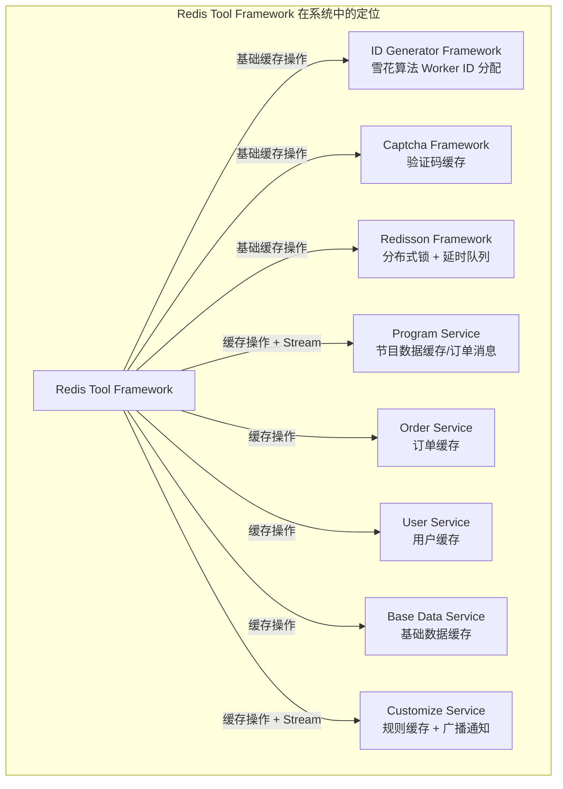

### 7.2 相关文档引用

- [Common 模块](damai-common.md) — 提供 `SpringUtil`（前缀获取）、`StringUtil`（字符串工具）等基础工具
- [ID Generator Framework](ID%20Generator%20Framework.md) — 依赖 Redis 工具框架进行 Worker ID 分配
- [Redisson Framework](Redisson%20Framework.md) — 提供更高级的分布式锁和延时队列功能
- [Captcha Framework](Captcha%20Framework.md) — 使用 Redis 缓存验证码数据

---

## 附录

### 附录 A：RedisKeyManage 完整枚举列表

| 枚举常量 | Key 模板 | 业务用途 |
|---------|----------|---------|
| `USER_LOGIN` | `user_login_%s_%s` | 用户登录 session 信息 |
| `PRODUCT_STOCK` | `product_stock:%s` | 商品库存数据 |
| `DISTRIBUTED_DATACENTER_ID` | `distributed_datacenter_id:%s` | 分布式数据中心 ID 分配 |
| `ALL_RULE_HASH` | `all_rule_hash` | 所有 API 调用规则 |
| `RULE` | `rule` | 调用限制规则 |
| `RULE_LIMIT` | `rule_limit_%s` | 调用限制时间记录 |
| `Z_SET_RULE_STAT` | `z_set_rule_stat_%s` | 规则统计（ZSet） |
| `DEPTH_RULE` | `depth_rule` | 深度调用限制规则 |
| `DEPTH_RULE_LIMIT` | `depth_rule_limit_%s_%s` | 深度调用限制时间 |
| `API_STAT_*` | `api_stat_*` | API 调用统计（Controller/Service/DAO） |
| `PLATFORM_NOTICE_FLAG` | `platform_notice_flag` | 平台通知标记 |
| `CHANNEL_DATA` | `channel_data_%s` | 渠道数据 |
| `PROGRAM` | `d_mai_program_%s` | 节目信息 |
| `PROGRAM_GROUP` | `d_mai_program_group_%s` | 节目分组 |
| `PROGRAM_SHOW_TIME` | `d_mai_program_show_time_%s` | 节目演出时间 |
| `PROGRAM_SEAT_NO_SOLD_RESOLUTION_HASH` | `d_mai_program_seat_no_sold_resolution_hash_%s_%s` | 未售座位集合 |
| `PROGRAM_SEAT_LOCK_RESOLUTION_HASH` | `d_mai_program_seat_lock_resolution_hash_%s_%s` | 锁定座位集合 |
| `PROGRAM_SEAT_SOLD_RESOLUTION_HASH` | `d_mai_program_seat_sold_resolution_hash_%s_%s` | 已售座位集合 |
| `PROGRAM_TICKET_CATEGORY_LIST` | `d_mai_program_ticket_category_list_%s` | 节目票档列表 |
| `PROGRAM_TICKET_REMAIN_NUMBER_HASH_RESOLUTION` | `d_mai_program_ticket_remain_number_hash_resolution_%s_%s` | 余票数量 |
| `PROGRAM_CATEGORY_HASH` | `d_mai_program_category_hash` | 节目类型 |
| `COUNTER_COUNT` | `d_mai_counter_count` | 计数器值 |
| `COUNTER_TIMESTAMP` | `d_mai_counter_timestamp` | 计数器时间戳 |
| `VERIFY_CAPTCHA_ID` | `d_mai_verify_captcha_id_%s` | 验证码 ID |
| `TICKET_USER_LIST` | `d_mai_ticket_user_list_%s` | 购票人列表 |
| `ACCOUNT_ORDER_COUNT` | `d_mai_account_order_count_%s_%s` | 账户订单数量 |
| `ORDER_MQ` | `d_mai_order_mq_%s` | MQ 订单编号 |
| `LOGIN_USER_MOBILE_ERROR` | `d_mai_login_user_mobile_error_%s` | 手机号登录错误次数 |
| `LOGIN_USER_EMAIL_ERROR` | `d_mai_login_user_email_error_%s` | 邮箱登录错误次数 |
| `AREA_PROVINCE_LIST` | `d_mai_area_province_list` | 省份地区列表 |

### 附录 B：RedisCache 接口方法完整列表

| 分类 | 方法 | 说明 |
|------|------|------|
| **String** | `get(RedisKeyBuild, Class)` | 获取对象 |
| | `get(RedisKeyBuild, Class, Supplier, long, TimeUnit)` | 获取对象（带回填） |
| | `getRange(RedisKeyBuild, long, long)` | 获取子字符串 |
| | `getValueIsList(RedisKeyBuild, Class)` | 获取 List |
| | `getValueIsList(RedisKeyBuild, Class, Supplier, long, TimeUnit)` | 获取 List（带回填） |
| | `getKeys(List<RedisKeyBuild>)` | 批量获取 |
| | `hasKey(RedisKeyBuild)` | 判断存在 |
| | `del(RedisKeyBuild)` / `del(Collection<RedisKeyBuild>)` | 删除 |
| | `expire(RedisKeyBuild, long, TimeUnit)` | 设置过期时间 |
| | `getExpire(RedisKeyBuild)` / `getExpire(RedisKeyBuild, TimeUnit)` | 获取过期时间 |
| | `keys(String)` | 匹配查询 |
| | `move(RedisKeyBuild, int)` | 移动数据库 |
| | `persist(RedisKeyBuild)` | 移除过期时间 |
| | `randomKey()` | 随机 Key |
| | `rename(RedisKeyBuild, RedisKeyBuild)` | 重命名 |
| | `renameIfAbsent(RedisKeyBuild, RedisKeyBuild)` | 条件重命名 |
| | `type(RedisKeyBuild)` | 获取类型 |
| | `set(RedisKeyBuild, Object)` / `set(RedisKeyBuild, Object, long)` / `set(RedisKeyBuild, Object, long, TimeUnit)` | 设置缓存 |
| | `setIfAbsent(RedisKeyBuild, Object)` | 不存在时设置 |
| | `size(RedisKeyBuild)` | 字符串长度 |
| | `multiSet(Map<RedisKeyBuild, ?>)` | 批量设置 |
| | `multiSetIfAbsent(Map<RedisKeyBuild, ?>)` | 批量条件设置 |
| | `incrBy(RedisKeyBuild, long)` / `incrByDouble(RedisKeyBuild, double)` | 自增 |
| | `append(RedisKeyBuild, String)` | 追加字符串 |
| **Hash** | `putHash(RedisKeyBuild, String, Object)` / `putHash(RedisKeyBuild, String, Object, long, TimeUnit)` | 设置 Hash 字段 |
| | `putHash(RedisKeyBuild, Map<String, ?>)` / `putHash(RedisKeyBuild, Map, long, TimeUnit)` | 批量设置 Hash |
| | `putHashIfAbsent(RedisKeyBuild, String, Object)` | 条件设置 Hash |
| | `getForHash(RedisKeyBuild, String, Class)` | 获取 Hash 字段 |
| | `getValueIsListForHash(RedisKeyBuild, String, Class)` | 获取 Hash List 字段 |
| | `multiGetForHash(RedisKeyBuild, List, Class)` | 批量获取 Hash |
| | `getAllForHash(RedisKeyBuild, Class)` | 获取所有 Hash 值 |
| | `getAllMapForHash(RedisKeyBuild, Class)` | 获取 Hash 为 Map |
| | `hasKeyForHash(RedisKeyBuild, String)` | 判断 Hash 字段存在 |
| | `delForHash(RedisKeyBuild, String)` / `delForHash(RedisKeyBuild, Collection)` | 删除 Hash 字段 |
| | `incrByForHash(RedisKeyBuild, String, long)` / `incrByDoubleForHash(RedisKeyBuild, String, double)` | Hash 自增 |
| | `hashKeysForHash(RedisKeyBuild)` | 获取所有 Hash Key |
| | `sizeForHash(RedisKeyBuild)` | Hash 字段数 |
| **List** | `indexForList(RedisKeyBuild, long, Class)` | 索引获取 |
| | `leftPushForList` / `rightPushForList` | 压入元素 |
| | `leftPushAllForList` / `rightPushAllForList` | 批量压入 |
| | `leftPushIfPresentForList` / `rightPushIfPresentForList` | 存在时压入 |
| | `leftPopForList` / `rightPopForList` | 弹出元素 |
| | `leftPopBlockForList` / `rightPopBlockForList` | 阻塞弹出 |
| | `rightPopAndLeftPushForList` | 可靠转移 |
| | `rightPopBlockAndLeftPushForList` | 阻塞转移 |
| | `getAllForList(RedisKeyBuild, Class)` | 获取全部 |
| | `rangeForList(RedisKeyBuild, long, long, Class)` | 范围获取 |
| | `removeForList(RedisKeyBuild, long, Object)` | 移除元素 |
| | `trimForList(RedisKeyBuild, long, long)` | 裁剪列表 |
| | `lenForList(RedisKeyBuild)` | 列表长度 |
| **Set** | `addForSet(RedisKeyBuild, Object)` / `addForSet(RedisKeyBuild, List)` | 添加元素 |
| | `removeForSet(RedisKeyBuild, Object)` / `removeForSet(RedisKeyBuild, List)` | 移除元素 |
| | `popForSet(RedisKeyBuild, Class)` | 弹出随机元素 |
| | `moveForSet(RedisKeyBuild, Object, RedisKeyBuild)` | 移动元素 |
| | `sizeForSet(RedisKeyBuild)` | 集合大小 |
| | `isMemberForSet(RedisKeyBuild, Object)` | 判断存在 |
| | `intersectForSet` / `unionForSet` / `differenceForSet` | 集合运算 |
| | `intersectAndStoreForSet` / `unionAndStoreForSet` / `differenceForSet(存储)` | 集合运算存储 |
| | `membersForSet(RedisKeyBuild, Class)` | 获取所有元素 |
| | `randomMemberForSet` / `randomMembersForSet` / `distinctRandomMembersForSet` | 随机获取 |
| | `scanForSet(RedisKeyBuild, ScanOptions)` | 游标遍历 |
| **SortedSet** | `addForSortedSet(RedisKeyBuild, Object, Double)` / `addForSortedSet(RedisKeyBuild, Map, Double)` | 添加元素 |
| | `addForSortedSet(RedisKeyBuild, Object, Double, long, TimeUnit)` | 添加并设置过期 |
| | `getRangeForSortedSet(RedisKeyBuild, long, long, Class)` | 范围获取 |
| | `getRangeByScoreForSortedSet(RedisKeyBuild, double, double, Class)` | 按分数范围获取 |
| | `getReverseRangeForSortedSet(RedisKeyBuild, long, long, Class)` | 反向范围获取 |
| | `getSortedSetByCursor(RedisKeyBuild, ScanOptions)` | 游标获取 |
| | `countForSortedSet(RedisKeyBuild, double, double)` | 分数范围计数 |
| | `sizeForSortedSet(RedisKeyBuild)` | 集合大小 |
| | `scoreForSortedSet(RedisKeyBuild, Object)` | 获取分数 |
| | `rankForSortedSet(RedisKeyBuild, Object)` / `reverseRankForSortedSet(RedisKeyBuild, Object)` | 获取排名 |
| | `removeForSortedSet(RedisKeyBuild, Object)` | 移除元素 |
| | `removeRangeForSortedSet(RedisKeyBuild, long, long)` | 按排名范围移除 |
| | `removeRangeByScoreForSortedSet(RedisKeyBuild, double, double)` | 按分数范围移除 |
| | `unionAndStoreForSortedSet` / `intersectAndStoreForSortedSet` | 合并/交集运算 |
