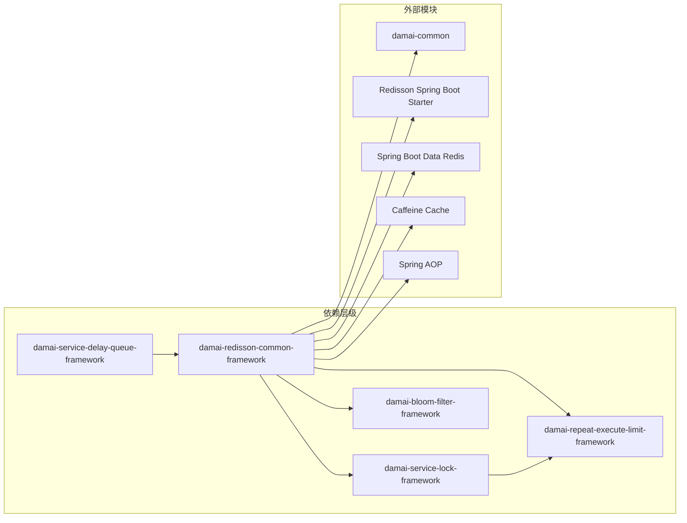
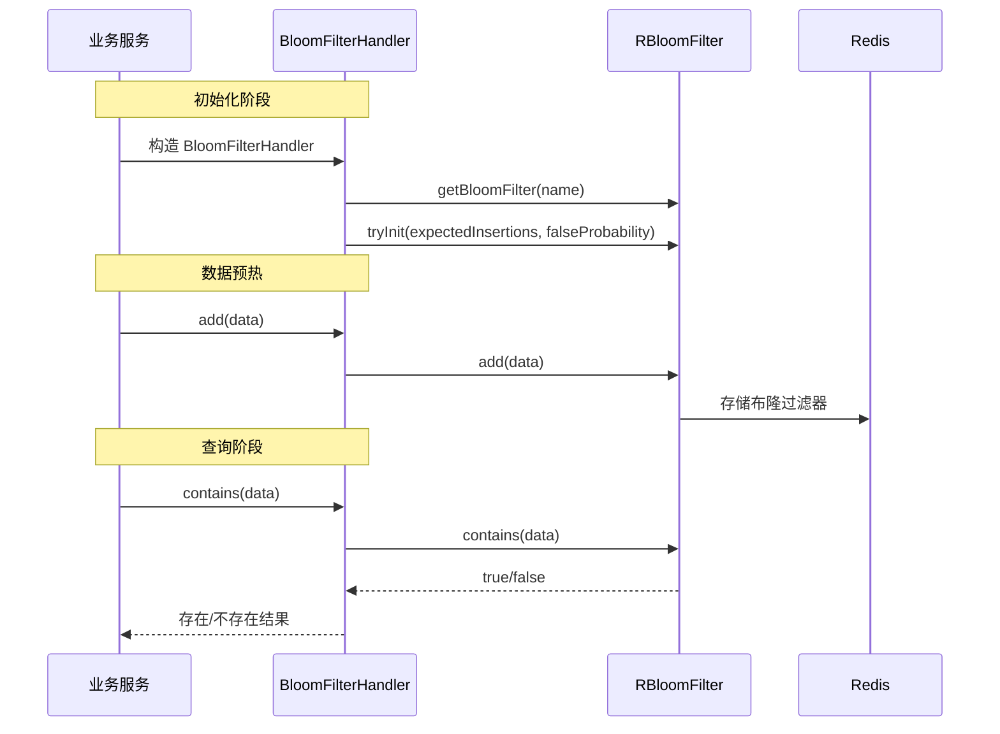
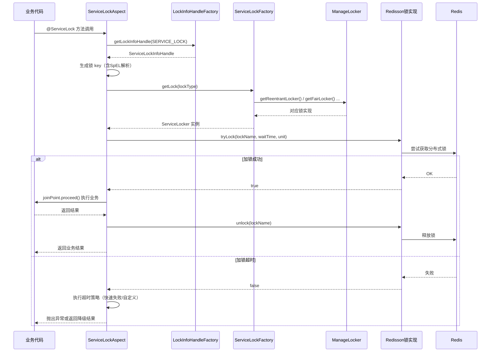
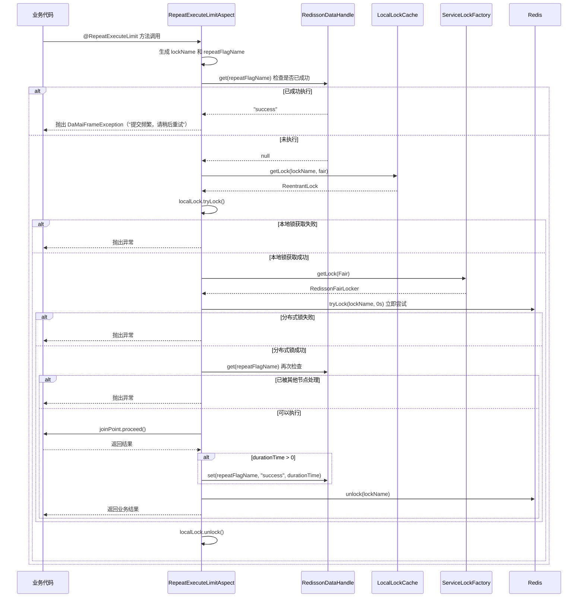
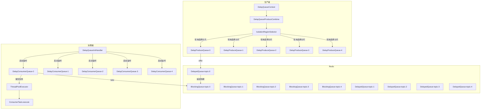
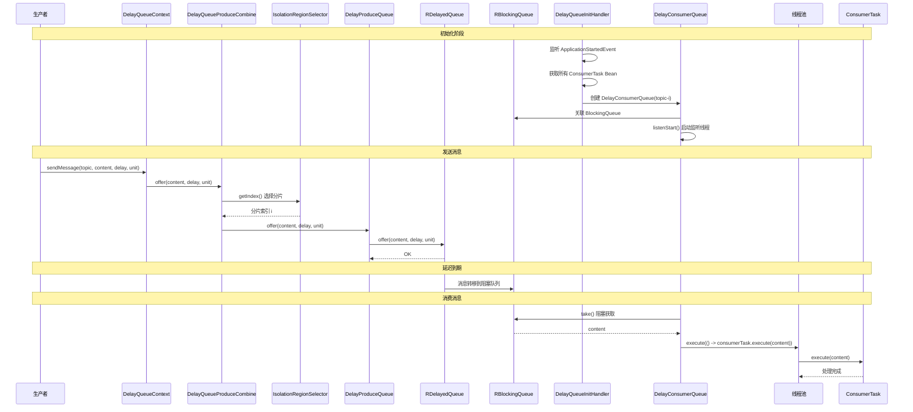
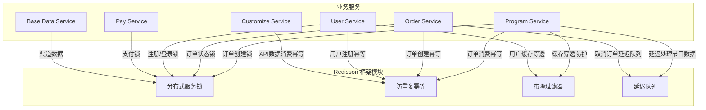
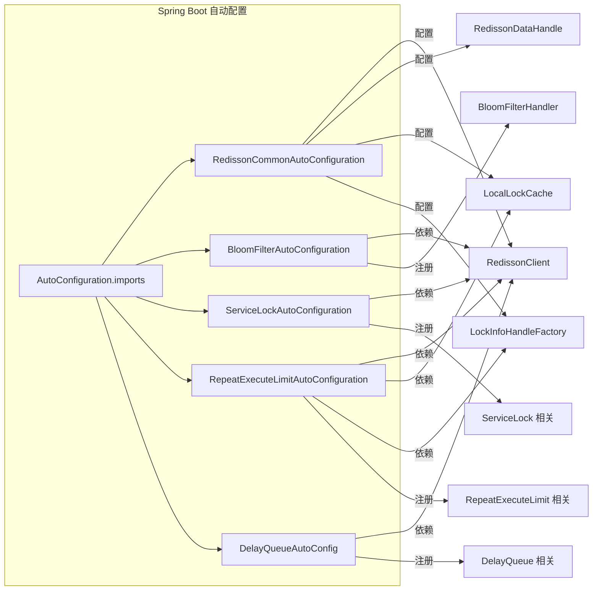

# Redisson 框架模块文档

## 简介

Redisson 框架模块是 **大麦网高并发实战项目** 的核心中间件模块，基于 Redisson 客户端库构建，为系统提供一系列高可用的分布式解决方案。该模块包含五大核心功能子模块：

| 子模块 | 功能描述 |
|-------|---------|
| **Redisson 通用框架** | Redisson 客户端配置与核心基础设施 |
| **布隆过滤器框架** | 基于 Redisson RBloomFilter 的缓存穿透防护 |
| **分布式服务锁框架** | 声明式与编程式分布式锁（可重入锁、公平锁、读写锁） |
| **防重复执行幂等框架** | 防止接口重复调用的幂等性保障 |
| **延迟队列框架** | 基于 Redis 的延迟任务调度系统 |

该模块被项目中的多个业务服务（**Program Service**、**Order Service**、**User Service**、**Pay Service** 等）广泛依赖，是保障高并发场景下数据一致性和系统稳定性的基石。

---

## 整体架构

```mermaid
graph TB
    subgraph "Redisson 框架模块"
        direction TB
        
        subgraph "redisson-common-framework（通用框架）"
            RCF[RedissonCommonAutoConfiguration]
            RP[RedissonBaseProperties]
            RDH[RedissonDataHandle]
            LLC[LocalLockCache]
            LIHF[LockInfoHandleFactory]
            ALIH[AbstractLockInfoHandle]
            LIH[LockInfoHandle]
            LIT[LockInfoType]
            CONST[Constants]
            Parser[ExtParameterNameDiscoverer]
        end
        
        subgraph "bloom-filter-framework（布隆过滤器）"
            BFA[BloomFilterAutoConfiguration]
            BFP[BloomFilterProperties]
            BFH[BloomFilterHandler]
        end
        
        subgraph "service-lock-framework（分布式服务锁）"
            SLA[ServiceLockAutoConfiguration]
            DLC[DistributedLockConstants]
            ML[ManageLocker]
            SL[ServiceLock 注解]
            SLAspect[ServiceLockAspect]
            SLF[ServiceLockFactory]
            LT[LockType]
            SLock[ServiceLocker 接口]
            SLTool[ServiceLockTool]
            TC[TaskCall]
            TR[TaskRun]
            LTOH[LockTimeOutHandler]
            LTOS[LockTimeOutStrategy]
            
            subgraph "锁实现"
                RRL[RedissonReentrantLocker]
                RFL[RedissonFairLocker]
                RWL[RedissonWriteLocker]
                RDL[RedissonReadLocker]
            end
        end
        
        subgraph "repeat-execute-limit-framework（防重复幂等）"
            RELA[RepeatExecuteLimitAutoConfiguration]
            RELC[RepeatExecuteLimitConstants]
            REL[RepeatExecuteLimit 注解]
            RELAspect[RepeatExecuteLimitAspect]
            RELConst[RepeatExecuteLimitConstant]
            RELLockHandle[RepeatExecuteLimitLockInfoHandle]
        end
        
        subgraph "delay-queue-framework（延迟队列）"
            DQAC[DelayQueueAutoConfig]
            DQP[DelayQueueProperties]
            DQBase[DelayQueueBasePart]
            DQCtx[DelayQueueContext]
            DQPart[DelayQueuePart]
            DQPC[DelayQueueProduceCombine]
            CT[ConsumerTask]
            DBQ[DelayBaseQueue]
            DCQ[DelayConsumerQueue]
            DPQ[DelayProduceQueue]
            IRS[IsolationRegionSelector]
            DQInit[DelayQueueInitHandler]
        end
    end
    
    subgraph "外部依赖"
        RC[Redisson Client]
        Redis[(Redis)]
        Common[damai-common]
        Spring[Spring Framework]
        AOP[Spring AOP]
        Caffeine[Caffeine Cache]
    end
    
    RCF --> RC
    RCF --> RP
    RCF --> Common
    RCF --> Spring
    RCF --> Caffeine
    
    BFH --> RC
    BFA --> BFH
    
    ML --> RC
    ML --> RRL & RFL & RWL & RDL
    SLF --> ML
    SLAspect --> SLF
    SLTool --> SLF
    SLTool --> TC & TR
    
    RELAspect --> SLF
    RELAspect --> RDH
    RELAspect --> LLC
    RELAspect --> LIHF
    
    DQAC --> RC
    DQCtx --> DQPC
    DQPC --> DPQ
    DQPC --> IRS
    DCQ --> DBQ
    DQInit --> DCQ
    DQInit --> CT
    
    LIHF --> ALIH
    ALIH --> Parser
    
    RC --> Redis
    
    style RC fill:#f96,stroke:#333,stroke-width:2px
    style Redis fill:#f96,stroke:#333,stroke-width:2px
```



---

## 模块依赖关系



---

## 1. Redisson 通用框架（redisson-common-framework）

### 1.1 概述

通用框架是整个 Redisson 模块的基础，提供：
- Redisson 客户端的统一配置与初始化
- Redis 数据操作封装
- 本地锁缓存（基于 Caffeine）
- 锁信息解析与 SpEL 表达式支持
- 锁信息工厂模式

### 1.2 核心组件

| 组件 | 类名 | 说明 |
|------|------|------|
| **自动配置** | `RedissonCommonAutoConfiguration` | 在 `RedissonAutoConfigurationV2` 之前加载，配置 RedissonClient、数据操作、本地锁缓存、锁信息工厂 |
| **属性配置** | `RedissonBaseProperties` | 映射 `spring.redis.redisson.*` 配置，包含线程数、Netty线程数、线程池参数 |
| **数据操作** | `RedissonDataHandle` | 封装 Redis Bucket 的 set/get 操作，支持过期时间 |
| **本地锁缓存** | `LocalLockCache` | 基于 Caffeine 的本地 `ReentrantLock` 缓存，可配置过期时间 |
| **锁信息接口** | `LockInfoHandle` | 定义锁名称生成的接口 |
| **锁信息抽象** | `AbstractLockInfoHandle` | 实现 SpEL 表达式解析、方法参数名发现，生成统一格式的锁 key |
| **锁信息工厂** | `LockInfoHandleFactory` | 根据业务类型（`LockInfoType`）从 Spring 容器获取对应的锁处理器 |
| **常量** | `Constants` | 定义分隔符 `:` |
| **类型常量** | `LockInfoType` | 定义 `REPEAT_EXECUTE_LIMIT` 和 `SERVICE_LOCK` 两种业务类型 |
| **参数解析器** | `ExtParameterNameDiscoverer` | 扩展的参数名发现器，用于 SpEL 表达式解析 |

### 1.3 锁 Key 生成规则

锁的 Key 生成遵循统一格式：

```
{SpringUtil.getPrefixDistinctionName()}-{业务类型}:{业务名称}:{SpEL解析的自定义Key}
```

例如：`damai-SERVICE_LOCK:d_program_lock:12345`

### 1.4 配置项

| 配置项 | 默认值 | 说明 |
|--------|--------|------|
| `spring.redis.redisson.threads` | 16 | Redisson 业务线程数 |
| `spring.redis.redisson.netty-threads` | 32 | Redisson Netty 线程数 |
| `spring.redis.redisson.core-pool-size` | null | 自定义线程池核心线程数 |
| `spring.redis.redisson.maximum-pool-size` | null | 自定义线程池最大线程数 |
| `spring.redis.redisson.keep-alive-time` | 30s | 线程回收时间 |
| `spring.redis.redisson.work-queue-size` | 256 | 工作队列容量 |

---

## 2. 布隆过滤器框架（bloom-filter-framework）

### 2.1 概述

基于 Redisson 的 `RBloomFilter` 实现，用于解决缓存穿透问题。在项目中被 **Program Service** 的 `ProgramBloomFilterInit` 和 `ProgramBloomFilterCheckHandler` 使用。

### 2.2 核心组件

| 组件 | 类名 | 说明 |
|------|------|------|
| **自动配置** | `BloomFilterAutoConfiguration` | 启用布隆过滤器属性配置，注册 `BloomFilterHandler` Bean |
| **属性配置** | `BloomFilterProperties` | 映射 `bloom-filter.*` 配置，包含名称、期望插入数、误判率 |
| **处理器** | `BloomFilterHandler` | 封装布隆过滤器的 `add`、`contains` 等操作 |

### 2.3 配置项

| 配置项 | 默认值 | 说明 |
|--------|--------|------|
| `bloom-filter.name` | - | 布隆过滤器名称（必须配置） |
| `bloom-filter.expected-insertions` | 20000 | 预期插入数量 |
| `bloom-filter.false-probability` | 0.01 | 误判率 |



---

## 3. 分布式服务锁框架（service-lock-framework）

### 3.1 概述

提供声明式（注解）和编程式（工具类）两种方式的分布式锁支持，包含四种锁类型：

| 锁类型 | 枚举值 | Redisson 实现 | 说明 |
|--------|--------|---------------|------|
| 可重入锁 | `Reentrant` | `RedissonReentrantLocker` | 默认，支持线程重入 |
| 公平锁 | `Fair` | `RedissonFairLocker` | 先来先服务，按请求顺序获取锁 |
| 写锁 | `Write` | `RedissonWriteLocker` | 读写锁中的写锁，互斥 |
| 读锁 | `Read` | `RedissonReadLocker` | 读写锁中的读锁，共享 |

### 3.2 核心组件

| 组件 | 类名 | 说明 |
|------|------|------|
| **自动配置** | `ServiceLockAutoConfiguration` | 注册锁处理器、锁管理器、锁工厂、切面、工具类 |
| **锁业务常量** | `DistributedLockConstants` | 定义系统中所有锁的业务名称（16+ 个） |
| **锁管理器** | `ManageLocker` | 缓存四种锁类型的实例，提供获取方法 |
| **锁工厂** | `ServiceLockFactory` | 根据 `LockType` 从 `ManageLocker` 获取对应锁实例 |
| **锁接口** | `ServiceLocker` | 定义 `getLock`、`lock`、`tryLock`、`unlock` 方法 |
| **注解** | `@ServiceLock` | 声明式分布式锁注解 |
| **切面** | `ServiceLockAspect` | 处理 `@ServiceLock` 注解的 AOP 实现 |
| **工具类** | `ServiceLockTool` | 编程式分布式锁工具，支持有/无返回值的加锁执行 |
| **函数接口** | `TaskCall<V>` | 有返回值的任务接口 |
| **函数接口** | `TaskRun` | 无返回值的任务接口 |
| **超时处理器** | `LockTimeOutHandler` | 锁超时处理抽象 |
| **超时策略** | `LockTimeOutStrategy` | 枚举实现，当前仅支持快速失败（`FAIL`） |

### 3.3 @ServiceLock 注解详解

```java
@Target({ElementType.TYPE, ElementType.METHOD})
@Retention(RetentionPolicy.RUNTIME)
public @interface ServiceLock {
    LockType lockType() default LockType.Reentrant;  // 锁类型
    String name() default "";                         // 业务名称
    String[] keys();                                  // 自定义Key（支持SpEL）
    long waitTime() default 10;                       // 等待时间
    TimeUnit timeUnit() default TimeUnit.SECONDS;     // 时间单位
    LockTimeOutStrategy lockTimeoutStrategy() default LockTimeOutStrategy.FAIL;  // 超时策略
    String customLockTimeoutStrategy() default "";    // 自定义超时策略方法名
}
```

### 3.4 系统锁业务常量

框架预定义了项目中所有需要分布式锁的业务场景：

| 常量名 | 值 | 用途 |
|--------|-----|------|
| `REGISTER_USER_LOCK` | `d_register_user_lock` | 用户注册 |
| `LOGIN_USER_LOCK` | `d_login_user_lock` | 用户登录 |
| `PROGRAM_LOCK` | `d_program_lock` | 节目操作 |
| `PROGRAM_GROUP_LOCK` | `d_program_group_lock` | 节目分组 |
| `SEAT_LOCK` | `d_seat_lock` | 座位操作 |
| `TICKET_CATEGORY_LOCK` | `d_ticket_category_lock` | 票档类型 |
| `REMAIN_NUMBER_LOCK` | `d_remain_number_lock` | 余票数量 |
| `UPDATE_ORDER_STATUS_LOCK` | `update_order_status_lock` | 订单状态更新 |
| `TRADE_CHECK` | `d_trade_check_lock` | 交易检查 |
| `PROGRAM_ORDER_CREATE_V1~V4` | `d_program_order_create_v1~v4_lock` | 订单创建（4种策略） |
| `COMMON_PAY` | `d_common_pay_lock` | 通用支付 |

### 3.5 使用方式

#### 声明式（注解）

```java
@ServiceLock(name = DistributedLockConstants.PROGRAM_ORDER_CREATE_V1, 
             keys = {"#programOrderCreateDto"}, 
             lockType = LockType.Fair)
public void createOrder(ProgramOrderCreateDto dto) {
    // 业务逻辑
}
```

#### 编程式（工具类）

```java
// 无返回值
serviceLockTool.execute(LockType.Reentrant, () -> {
    // 业务逻辑
}, "businessName", new String[]{"key1", "key2"});

// 有返回值
String result = serviceLockTool.submit(() -> {
    // 业务逻辑
    return "result";
}, "businessName", new String[]{"key1"});

// 获取锁对象手动控制
RLock lock = serviceLockTool.getLock(LockType.Fair, "lockName", new String[]{"key"});
```

### 3.6 执行流程



---

## 4. 防重复执行幂等框架（repeat-execute-limit-framework）

### 4.1 概述

基于双重锁机制（本地锁 + 分布式锁）实现的高性能防重复执行幂等框架，防止同一请求在短时间内被重复处理。框架使用 **本地 Caffeine 缓存锁** 进行第一层快速过滤，再使用 **分布式公平锁** 在集群层面保证最终一致性。

### 4.2 核心组件

| 组件 | 类名 | 说明 |
|------|------|------|
| **自动配置** | `RepeatExecuteLimitAutoConfiguration` | 注册锁信息处理器和切面 |
| **注解** | `@RepeatExecuteLimit` | 防重复幂等注解 |
| **切面** | `RepeatExecuteLimitAspect` | AOP 实现，双重锁检测 |
| **常量（业务）** | `RepeatExecuteLimitConstants` | 定义业务幂等名称 |
| **常量（标记）** | `RepeatExecuteLimitConstant` | 定义前缀标记和成功标记 |
| **锁信息实现** | `RepeatExecuteLimitLockInfoHandle` | 生成防重复幂等的锁 key |

### 4.3 @RepeatExecuteLimit 注解详解

```java
@Target({ElementType.TYPE, ElementType.METHOD})
@Retention(RetentionPolicy.RUNTIME)
public @interface RepeatExecuteLimit {
    String name() default "";           // 业务名称
    String[] keys();                    // 自定义Key（支持SpEL）
    long durationTime() default 0L;     // 幂等保持时间（秒），0则以执行方法为准
    String message() default "提交频繁，请稍后重试";  // 提示信息
}
```

### 4.4 业务幂等常量

| 常量名 | 值 | 用途 |
|--------|-----|------|
| `CONSUMER_API_DATA_MESSAGE` | `consumer_api_data_message` | 消费API数据消息 |
| `CREATE_PROGRAM_ORDER` | `create_program_order` | 创建节目订单 |
| `CANCEL_PROGRAM_ORDER` | `cancel_program_order` | 取消节目订单 |
| `CREATE_PROGRAM_ORDER_MQ` | `create_program_order_mq` | MQ创建节目订单 |
| `PROGRAM_CACHE_REVERSE_MQ` | `program_cache_reverse_mq` | 节目缓存回滚MQ |

### 4.5 执行流程



### 4.6 双重锁机制详解

1. **第一层 - 本地锁（Caffeine ReentrantLock 缓存）**：
   - 基于 Caffeine 缓存的 `ReentrantLock`，提供本地进程内的锁竞争
   - 防止同一 JVM 内大量线程同时请求分布式锁
   - 锁对象有 48 小时的过期时间，避免内存泄漏

2. **第二层 - 分布式公平锁（Redisson）**：
   - 使用 Redisson 的公平锁，确保集群环境下的请求按顺序处理
   - 等待时间为 0，立即失败，快速返回结果

3. **双重检查**：
   - 在获取分布式锁后，再次检查 Redis 中的成功标记
   - 防止并发场景下的重复执行

---

## 5. 延迟队列框架（delay-queue-framework）

### 5.1 概述

基于 Redisson 的 `RBlockingQueue` 和 `RDelayedQueue` 实现的延迟任务调度框架，支持：

- 消息分片（隔离分区），提升并发性能
- 生产者-消费者模式
- 应用启动时自动监听消费队列
- 可配置的线程池参数

### 5.2 核心组件

| 组件 | 类名 | 说明 |
|------|------|------|
| **自动配置** | `DelayQueueAutoConfig` | 注册初始化处理器、基础组件、上下文 |
| **属性配置** | `DelayQueueProperties` | 映射 `delay.queue.*` 配置 |
| **基础组件** | `DelayQueueBasePart` | 封装 RedissonClient 和配置 |
| **发送上下文** | `DelayQueueContext` | 生产者上下文，按 topic 管理发送器 |
| **消息主题** | `DelayQueuePart` | 封装基础组件和消费者任务 |
| **分片发送器** | `DelayQueueProduceCombine` | 按隔离分区选择器发送到不同分片 |
| **消费者接口** | `ConsumerTask` | 定义 `execute(content)` 和 `topic()` 方法 |
| **基础队列** | `DelayBaseQueue` | 封装 Redisson 的 `RBlockingQueue` |
| **生产者队列** | `DelayProduceQueue` | 封装 Redisson 的 `RDelayedQueue`，提供 `offer` 方法 |
| **消费者队列** | `DelayConsumerQueue` | 监听 `RBlockingQueue`，消费消息 |
| **分片选择器** | `IsolationRegionSelector` | 原子递增计数器，轮询选择分片 |
| **初始化监听器** | `DelayQueueInitHandler` | 监听 `ApplicationStartedEvent`，启动所有消费者队列 |

### 5.3 配置项

| 配置项 | 默认值 | 说明 |
|--------|--------|------|
| `delay.queue.core-pool-size` | 4 | 消费线程池核心线程数 |
| `delay.queue.maximum-pool-size` | 4 | 消费线程池最大线程数 |
| `delay.queue.keep-alive-time` | 30 | 线程回收时间 |
| `delay.queue.unit` | SECONDS | 时间单位 |
| `delay.queue.work-queue-size` | 256 | 工作队列容量 |
| `delay.queue.isolation-region-count` | 5 | 隔离分区数 |

### 5.4 架构设计



### 5.5 使用方式

#### 生产者

```java
@Autowired
private DelayQueueContext delayQueueContext;

public void send() {
    delayQueueContext.sendMessage(
        "order_cancel_topic",    // 主题
        "{\"orderId\": 123}",    // 消息内容
        30,                      // 延迟时间
        TimeUnit.MINUTES         // 时间单位
    );
}
```

#### 消费者

```java
@Component
public class OrderCancelConsumer implements ConsumerTask {
    
    @Override
    public void execute(String content) {
        // 处理消费逻辑
        System.out.println("消费消息: " + content);
    }
    
    @Override
    public String topic() {
        return "order_cancel_topic";
    }
}
```

### 5.6 消息生命周期



---

## 6. 与其他模块的关系



### 6.1 业务服务使用示例

| 业务服务 | 使用场景 | 使用的 Redisson 功能 |
|---------|---------|-------------------|
| **Program Service** | 节目数据预热 | 布隆过滤器 `BloomFilterHandler` |
| **Program Service** | 订单创建（V1~V4 策略） | 分布式锁 `@ServiceLock` |
| **Program Service** | MQ 消费幂等 | 防重复幂等 `@RepeatExecuteLimit` |
| **Program Service** | 节目数据延迟处理 | 延迟队列 `DelayQueueContext` + `ConsumerTask` |
| **Order Service** | 订单状态更新 | 分布式锁 `ServiceLockTool` |
| **Order Service** | 延迟取消订单 | 延迟队列 |
| **User Service** | 用户注册/登录 | 分布式锁 |
| **User Service** | 注册防重复提交 | 防重复幂等 |
| **Pay Service** | 支付操作 | 分布式锁 |

---

## 7. 自动配置加载机制

所有子模块都通过 Spring Boot 的自动配置机制注册，通过 `META-INF/spring/org.springframework.boot.autoconfigure.AutoConfiguration.imports` 文件导入：

| 子模块 | 自动配置类 | 加载顺序 |
|--------|-----------|---------|
| redisson-common-framework | `RedissonCommonAutoConfiguration` | 在 `RedissonAutoConfigurationV2` 之前加载 |
| bloom-filter-framework | `BloomFilterAutoConfiguration` | - |
| service-lock-framework | `ServiceLockAutoConfiguration` | - |
| repeat-execute-limit-framework | `RepeatExecuteLimitAutoConfiguration` | - |
| delay-queue-framework | `DelayQueueAutoConfig` | - |



---

## 8. 配置汇总

```yaml
# application.yml 配置示例

# Redisson 客户端配置
spring:
  redis:
    host: 127.0.0.1
    port: 6379
    database: 0
    password: 
    redisson:
      threads: 16              # 业务线程数
      netty-threads: 32        # Netty线程数
      core-pool-size: 8        # 自定义线程池核心线程数
      maximum-pool-size: 16    # 自定义线程池最大线程数
      keep-alive-time: 30      # 线程回收时间（秒）
      work-queue-size: 256     # 工作队列大小

# 布隆过滤器配置
bloom-filter:
  name: my-bloom-filter        # 布隆过滤器名称
  expected-insertions: 20000   # 预期插入数
  false-probability: 0.01      # 误判率

# 延迟队列配置
delay:
  queue:
    core-pool-size: 4          # 消费线程池核心线程数
    maximum-pool-size: 4       # 消费线程池最大线程数
    keep-alive-time: 30        # 线程回收时间
    unit: SECONDS              # 时间单位
    work-queue-size: 256       # 工作队列大小
    isolation-region-count: 5  # 隔离分区数

# 本地锁缓存配置
durationTime: 48               # 本地锁缓存过期时间（小时）
```

---

## 9. 常见问题与注意事项

1. **分布式锁超时策略**：当前仅支持 `FAIL` 快速失败策略，可根据业务需求扩展 `LockTimeOutStrategy` 枚举。

2. **防重复幂等的 durationTime**：如果设置为 0，则仅在方法执行期间保持幂等（依靠分布式锁保证）。设置正数则表示在该时间段内不允许重复执行。

3. **延迟队列隔离分区数**：同一 topic 的生产者和消费者的 `isolation-region-count` 必须相同，否则消息无法被正确消费。

4. **布隆过滤器误判**：布隆过滤器存在一定误判率（默认 0.01），业务使用 `contains()` 判断时需考虑误判情况，建议在布隆过滤器判断存在后，再查询实际数据确认。

5. **本地锁缓存**：基于 Caffeine 实现，默认 48 小时过期，可通过 `durationTime` 配置调整，避免内存泄漏。
