# Spring Cloud Framework 模块 - 微服务核心基础设施

## 1. 模块简介

Spring Cloud Framework 模块是大麦系统的**微服务核心基础设施**层，提供了构建分布式微服务架构所需的关键组件。该模块基于 Spring Cloud 生态体系，对服务治理、负载均衡、灰度发布、服务间调用、数据持久化、API 文档、系统初始化等核心能力进行了统一封装和增强。

### 1.1 核心功能

| 功能分类 | 子模块 | 说明 |
|---------|--------|------|
| **服务通用组件** | damai-service-component | Servlet 过滤器、Feign 请求拦截器、请求包装器 |
| **服务公共基础** | damai-service-common | MybatisPlus 配置、分页工具、ShardingSphere 分片策略、Swagger 文档、全局异常处理、消息回调 |
| **灰度发布框架** | damai-service-gray-transition-framework | 灰度发布路由、负载均衡增强、上下文处理（Gateway + WebMvc 双模式） |
| **系统初始化** | damai-service-initialize | 应用启动初始化框架（CommandLineRunner、InitializingBean、PostConstruct、事件监听） |

### 1.2 模块架构图

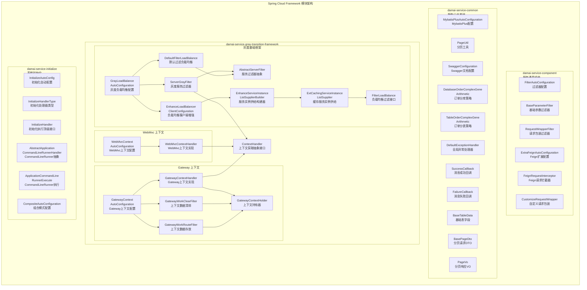

### 1.3 模块依赖关系

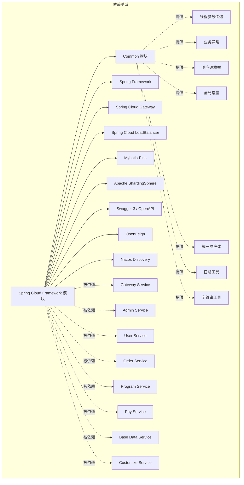

## 2. 子模块详解

### 2.1 damai-service-component（服务通用组件）

#### 2.1.1 架构设计

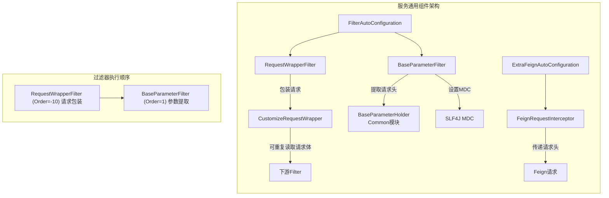

#### 2.1.2 核心组件

##### FilterAutoConfiguration（过滤器自动配置）

**作用**：注册服务层的核心过滤器链。

**注册的过滤器**：

| Bean | Order | 说明 |
|------|-------|------|
| `RequestWrapperFilter` | -10 | 请求体包装，解决请求体只能读取一次的问题 |
| `BaseParameterFilter` | 1 | 从请求头提取链路追踪、灰度标识等参数 |

##### RequestWrapperFilter（请求包装过滤器）

**作用**：将原始的 `HttpServletRequest` 包装为 `CustomizeRequestWrapper`，解决 Servlet 请求体 InputStream 只能读取一次的问题。

**执行流程**：
1. 拦截所有进入服务的 HTTP 请求
2. 将请求包装为 `CustomizeRequestWrapper`
3. 包装器缓存请求体内容，允许后续过滤器/控制器重复读取
4. 传递包装后的请求给下一个过滤器

##### CustomizeRequestWrapper（自定义请求包装器）

**作用**：继承 `HttpServletRequestWrapper`，缓存请求体数据，提供可重复读取的能力。

**核心行为**：
- 构造时读取原始 InputStream 并缓存为字符串
- 重写 `getInputStream()` 方法，每次返回新的 ByteArrayInputStream
- 提供 `getRequestBody()` 方法供其他组件直接获取请求体内容

##### BaseParameterFilter（基础参数过滤器）

**作用**：从 HTTP 请求头中提取关键参数，存入 `BaseParameterHolder`（线程上下文）和 SLF4J MDC，用于链路追踪和灰度路由。

**提取的参数**：

| 请求头 | 说明 | 存储位置 |
|--------|------|---------|
| `traceId` | 链路追踪 ID | BaseParameterHolder + MDC |
| `gray` | 灰度标识 | BaseParameterHolder + MDC |
| `userId` | 用户 ID | BaseParameterHolder + MDC |
| `code` | 响应码 | BaseParameterHolder + MDC |

**生命周期管理**：使用 `try-finally` 模式，在请求处理完成后自动清理 ThreadLocal 和 MDC，防止内存泄漏。

##### ExtraFeignAutoConfiguration（Feign扩展自动配置）

**作用**：配置 Feign 请求拦截器，实现服务间调用的上下文参数传递。

##### FeignRequestInterceptor（Feign请求拦截器）

**作用**：实现 `feign.RequestInterceptor` 接口，在微服务间发起 Feign 调用时，自动将当前请求的上下文参数传递到下游服务。

**传递的参数**：

| 参数 | 来源 |
|------|------|
| `traceId` | 当前请求头 |
| `code` | 当前请求头 |
| `gray` | 当前请求头（如果为空，使用服务的默认灰度配置 `serverGray`） |

**数据流**：
```
服务A 接收请求 → BaseParameterFilter 提取参数 → 服务A 调用 服务B(Feign) → 
FeignRequestInterceptor 自动传递请求头 → 服务B 的 BaseParameterFilter 接收参数
```

### 2.2 damai-service-common（服务公共基础）

#### 2.2.1 架构设计

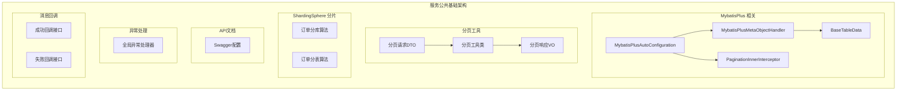

#### 2.2.2 核心组件

##### MybatisPlusAutoConfiguration（MybatisPlus自动配置）

**作用**：注册 Mybatis-Plus 的核心插件，提供字段自动填充和分页能力。

**注册的 Bean**：

| Bean | 说明 |
|------|------|
| `MetaObjectHandler` | 自动填充 `createTime`、`editTime` 字段 |
| `MybatisPlusInterceptor` | 注册 MySQL 分页拦截器 |

##### MybatisPlusMetaObjectHandler（元对象字段填充器）

**作用**：实现 `MetaObjectHandler` 接口，自动为实体类的审计字段赋值。

**填充规则**：

| 操作 | 填充字段 | 值 |
|------|---------|-----|
| INSERT | `createTime` | 当前时间 |
| INSERT | `editTime` | 当前时间 |
| UPDATE | `editTime` | 当前时间 |

##### BaseTableData（基础表字段）

**作用**：所有数据库实体类的基类，定义了通用的审计字段。

**字段定义**：

| 字段名 | 类型 | 说明 |
|--------|------|------|
| `createTime` | Date | 创建时间（自动填充） |
| `editTime` | Date | 编辑时间（自动填充） |
| `status` | Integer | 状态（1:正常, 0:删除） |

##### PageUtil（分页工具类）

**作用**：统一的分页查询工具，支持 Mybatis-Plus 和 PageHelper 两种分页模式。

**核心方法**：

| 方法 | 说明 |
|------|------|
| `getPageParams(BasePageDto)` | 从 DTO 创建 Mybatis-Plus 分页对象 |
| `getPageParams(pageNumber, pageSize)` | 直接创建分页对象 |
| `convertPage(PageInfo, Function)` | 将 PageHelper 结果转换为统一 PageVo |
| `convertPage(IPage, Function)` | 将 Mybatis-Plus 结果转换为统一 PageVo |

##### BasePageDto（分页请求DTO）

**作用**：分页查询请求的统一参数结构。

**字段**：

| 字段名 | 类型 | 验证 | 说明 |
|--------|------|------|------|
| `pageNumber` | Integer | `@NotNull` | 页码 |
| `pageSize` | Integer | `@NotNull` | 每页条数 |

##### PageVo（分页响应VO）

**作用**：分页查询结果的统一响应结构。

**字段**：

| 字段名 | 类型 | 说明 |
|--------|------|------|
| `pageNum` | long | 当前页码 |
| `pageSize` | long | 每页条数 |
| `totalSize` | long | 总记录数 |
| `list` | List<T> | 数据列表 |

##### SwaggerConfiguration（Swagger文档配置）

**作用**：配置 SpringDoc OpenAPI 文档信息。

**配置内容**：
- 标题：前端使用
- 版本：1.0
- 描述：项目学习
- 联系人：阿星不是程序员

##### DefaultExceptionHandler（全局异常处理器）

**作用**：基于 `@RestControllerAdvice` 的全局异常处理，统一异常响应格式。

**异常处理策略**：

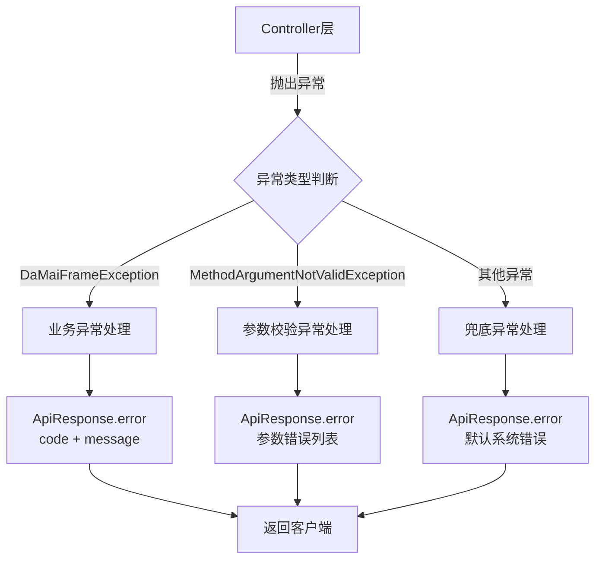

**处理类型**：

| 异常类型 | 响应格式 | 说明 |
|---------|---------|------|
| `DaMaiFrameException` | `ApiResponse.error(code, message)` | 业务异常，包含具体的错误码和消息 |
| `MethodArgumentNotValidException` | `ApiResponse.error(code, ArgumentError[])` | 参数校验异常，返回字段级错误列表 |
| `Throwable` | `ApiResponse.error()` | 未捕获的未知异常，返回默认系统错误 |

##### SuccessCallback（成功回调接口）

**作用**：函数式接口，用于异步操作成功后的回调处理。

```java
@FunctionalInterface
public interface SuccessCallback<T> {
    void onSuccess(T result);
}
```

**使用场景**：消息队列消费成功后执行后续逻辑。

##### FailureCallback（失败回调接口）

**作用**：函数式接口，用于异步操作失败后的回调处理。

```java
@FunctionalInterface
public interface FailureCallback {
    void onFailure(Throwable ex);
}
```

**使用场景**：消息队列消费失败后执行补偿或日志记录。

##### DatabaseOrderComplexGeneArithmetic（订单分库算法）

**作用**：基于 Apache ShardingSphere 的复合分片算法，实现订单表的分库策略。

**分片键**：
- `order_number`（订单号）
- `user_id`（用户 ID）

**算法特点**：
- 优先使用订单号分片，无订单号时使用用户 ID
- 采用基因算法（Gene Algorithm）确保数据均匀分布
- 通过二进制位运算计算库索引

**配置参数**：

| 参数 | 说明 |
|------|------|
| `sharding-count` | 数据库数量 |
| `table-sharding-count` | 表数量 |

##### TableOrderComplexGeneArithmetic（订单分表算法）

**作用**：基于 Apache ShardingSphere 的复合分片算法，实现订单表的分表策略。

**分片键**：
- `order_number`（订单号）
- `user_id`（用户 ID）

**算法特点**：
- 使用 `表索引 = (shardingCount - 1) & value` 计算表名后缀
- 确保相同用户/订单的数据落在同一张表中

### 2.3 damai-service-gray-transition-framework（灰度发布框架）

#### 2.3.1 架构设计

```mermaid
graph TB
    subgraph "灰度发布框架整体架构"
        direction TB
        
        subgraph "灰度基础模块"
            GrayLoadBalanceAutoConfiguration --> DefaultFilterLoadBalance
            GrayLoadBalanceAutoConfiguration --> ServerGrayFilter
            GrayLoadBalanceAutoConfiguration --> EnhanceLoadBalancerClientConfiguration
            EnhanceLoadBalancerClientConfiguration --> EnhanceServiceInstanceListSupplierBuilder
            EnhanceServiceInstanceListSupplierBuilder --> ExtCachingServiceInstanceListSupplier
            ExtCachingServiceInstanceListSupplier --> FilterLoadBalance
            DefaultFilterLoadBalance -.->|调用| AbstractServerFilter
        end
        
        subgraph "上下文模块"
            ContextHandler[ContextHandler<br>接口定义]
            GatewayContextHandler -->|实现| ContextHandler
            WebMvcContextHandler -->|实现| ContextHandler
            GatewayContextAutoConfiguration --> GatewayContextHandler
            GatewayContextAutoConfiguration --> GatewayWorkRouteFilter
            GatewayContextAutoConfiguration --> GatewayWorkClearFilter
            WebMvcContextAutoConfiguration --> WebMvcContextHandler
        end
        
        subgraph "灰度部署场景"
            direction LR
            V1[服务V1<br>gray=false] --> LB[负载均衡器]
            V2[服务V2<br>gray=true] --> LB
            灰度请求 -.->|路由到| V2
            普通请求 -->|路由到| V1
        end
    end
```

#### 2.3.2 灰度发布流程

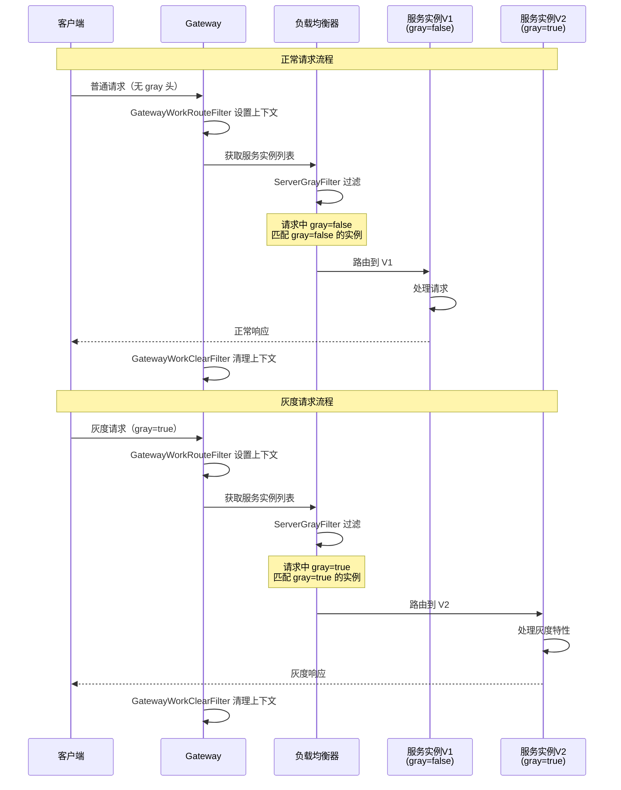

#### 2.3.3 核心组件

##### GrayLoadBalanceAutoConfiguration（灰度负载均衡配置）

**作用**：灰度发布框架的自动配置入口，注册负载均衡过滤器链。

**注册的 Bean**：

| Bean | 说明 |
|------|------|
| `DefaultFilterLoadBalance` | 默认的负载均衡服务过滤实现 |
| `ServerGrayFilter` | 灰度服务实例过滤器 |

**注解**：使用 `@LoadBalancerClients` 启用自定义负载均衡客户端配置。

##### FilterLoadBalance（负载均衡过滤接口）

**作用**：定义服务实例过滤的标准接口。

```java
public interface FilterLoadBalance {
    void selectServer(List<ServiceInstance> servers);
}
```

**入参**：`servers` 是可变列表，过滤操作通过删除不匹配的实例来实现。

##### DefaultFilterLoadBalance（默认过滤负载均衡实现）

**作用**：实现 `FilterLoadBalance` 接口，按照注册的过滤器链依次过滤服务实例。

**执行逻辑**：
1. 遍历所有已注册的 `AbstractServerFilter` 实现
2. 依次对服务实例列表执行过滤
3. 每个过滤器通过 `iterator.remove()` 移除不匹配的实例

##### AbstractServerFilter（服务过滤器抽象类）

**作用**：服务实例过滤器的基类，定义过滤模板方法。

**核心方法**：

| 方法 | 说明 |
|------|------|
| `filter(List<ServiceInstance>)` | 模板方法，遍历实例列表并调用 doFilter |
| `doFilter(List, ServiceInstance)` | 抽象方法，由子类实现具体过滤逻辑 |
| `getOrder()` | 排序方法，定义过滤器执行顺序 |

##### ServerGrayFilter（灰度服务过滤器）

**作用**：灰度发布的核心过滤器，根据灰度标识匹配服务实例。

**过滤逻辑**：

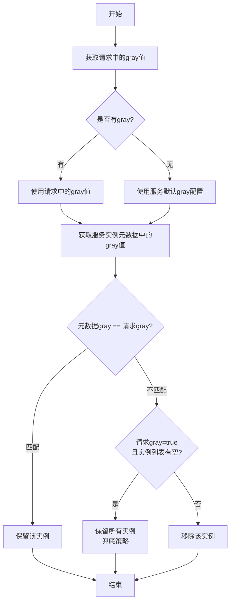

**关键行为详解**：

1. **灰度标识获取**：优先从请求头获取 `gray` 参数，若不存在则使用服务配置的 `serverGray` 默认值
2. **实例匹配**：比较服务实例 Nacos 元数据中的 `gray` 标识与请求灰度值
3. **兜底策略**：当请求是灰度请求（`gray=true`）但没有任何灰度实例时，自动降级为调用所有可用实例，防止灰度请求失败
4. **元数据支持**：通过 Nacos 的服务实例元数据机制（`metadata`）来标记实例的灰度属性

##### ExtCachingServiceInstanceListSupplier（缓存服务实例供给增强）

**作用**：在 Spring Cloud LoadBalancer 的缓存机制基础上，增加负载均衡过滤能力。

**功能特点**：
- 继承 `CachingServiceInstanceListSupplier`
- 在返回缓存的服务实例列表前，执行 `filterLoadBalance.selectServer()` 进行过滤
- 确保每次负载均衡获取的实例列表都经过灰度过滤

##### EnhanceServiceInstanceListSupplierBuilder（服务实例供给构建器增强）

**作用**：对 Spring Cloud LoadBalancer 的 `ServiceInstanceListSupplierBuilder` 进行增强，在缓存层集成灰度过滤。

**构建流程**：
1. 设置基础 Supplier（DiscoveryClient 或 ReactiveDiscoveryClient）
2. 链式添加装饰器（缓存、健康检查、区域偏好等）
3. 在缓存层注入 `ExtCachingServiceInstanceListSupplier`

##### EnhanceLoadBalancerClientConfiguration（负载均衡客户端配置增强）

**作用**：覆盖 Spring Cloud LoadBalancer 的默认客户端配置，集成灰度过滤能力。

**配置模式**：

| 模式 | 说明 |
|------|------|
| `ReactiveSupportConfiguration` | 响应式 DiscoveryClient 支持 |
| `BlockingSupportConfiguration` | 阻塞式 DiscoveryClient 支持 |
| `BlockingRetryConfiguration` | 阻塞重试配置 |
| `ReactiveRetryConfiguration` | 响应式重试配置 |

**条件化配置**：每种模式都支持可选的负载均衡策略：

| 策略 | 条件值 | 说明 |
|------|--------|------|
| 默认 | default | 基础轮询策略 |
| 区域偏好 | zone-preference | 基于可用区的亲和性路由 |
| 健康检查 | health-check | 定期健康检查 |
| 请求粘性会话 | request-based-sticky-session | 基于请求的会话保持 |
| 同实例偏好 | same-instance-preference | 优先使用同一实例 |
| 加权 | weighted | 基于权重的负载均衡 |
| 子集 | subset | 子集负载均衡 |

##### ContextHandler（上下文获取抽象接口）

**作用**：定义从请求上下文中获取值的标准接口，屏蔽 Gateway 和 WebMvc 的差异。

```java
public interface ContextHandler {
    String getValueFromHeader(String name);
}
```

**实现类**：

| 实现类 | 适用环境 | 实现方式 |
|--------|---------|---------|
| `GatewayContextHandler` | Spring Cloud Gateway（响应式） | 通过 `GatewayContextHolder` 获取 `ServerWebExchange`，再获取请求头 |
| `WebMvcContextHandler` | Spring WebMvc（阻塞式） | 通过 `RequestContextHolder` 获取 `HttpServletRequest`，再获取请求头 |

##### GatewayContextAutoConfiguration（Gateway上下文自动配置）

**作用**：在 Gateway 环境中注册上下文相关组件。

**注册的 Bean**：

| Bean | Order | 说明 |
|------|-------|------|
| `GatewayWorkRouteFilter` | `HIGHEST_PRECEDENCE` | 最高优先级，将 `ServerWebExchange` 存入 ThreadLocal |
| `GatewayWorkClearFilter` | `LOWEST_PRECEDENCE - 1` | 最低优先级，清理 ThreadLocal |
| `WebMvcContext` (ContextHandler) | - | 注册 Gateway 上下文处理器 |

**Gateway 过滤器链**：

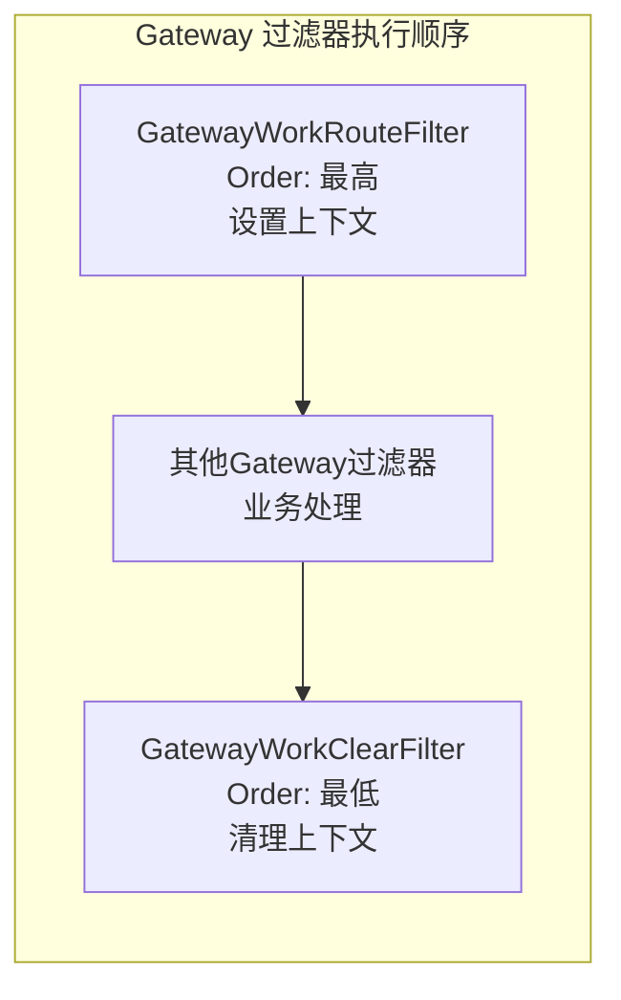

##### GatewayContextHolder（Gateway上下文持有器）

**作用**：基于 `ThreadLocal` 存储当前请求的 `ServerWebExchange` 对象。

**核心方法**：

| 方法 | 说明 |
|------|------|
| `getCurrentGatewayContext()` | 获取当前线程的上下文持有器 |
| `removeCurrentGatewayContext()` | 移除当前线程的上下文（防止内存泄漏） |

##### WebMvcContextAutoConfiguration（WebMvc上下文自动配置）

**作用**：在 WebMvc 环境中注册上下文处理器。

**注册的 Bean**：

| Bean | 说明 |
|------|------|
| `WebMvcContext` (ContextHandler) | 注册 WebMvc 上下文处理器 |

### 2.4 damai-service-initialize（系统初始化）

#### 2.4.1 架构设计

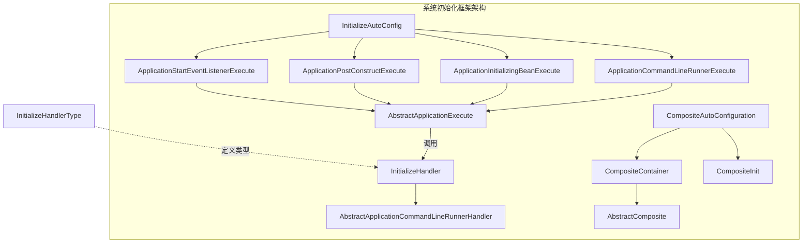

#### 2.4.2 初始化执行类型

**初始化类型常量**（定义在 `InitializeHandlerType`）：

| 常量 | 值 | 说明 | 触发时机 |
|------|-----|------|---------|
| `APPLICATION_EVENT_LISTENER` | `application_event_listener` | 应用事件监听器 | 容器刷新完成后 |
| `APPLICATION_POST_CONSTRUCT` | `application_post_construct` | @PostConstruct 方式 | Bean 初始化完成后 |
| `APPLICATION_INITIALIZING_BEAN` | `application_initializing_bean` | InitializingBean 方式 | Bean 属性设置完成后 |
| `APPLICATION_COMMAND_LINE_RUNNER` | `application_command_line_runner` | CommandLineRunner 方式 | 应用启动完成后 |

#### 2.4.3 核心组件

##### InitializeHandler（初始化执行顶级接口）

**作用**：所有初始化处理器的顶级抽象接口，定义了统一的生命周期方法。

```java
public interface InitializeHandler {
    String type();                    // 初始化类型
    Integer executeOrder();           // 执行顺序
    void executeInit(ConfigurableApplicationContext context);  // 执行逻辑
}
```

**方法说明**：

| 方法 | 说明 |
|------|------|
| `type()` | 返回初始化类型，匹配对应的执行器 |
| `executeOrder()` | 返回执行优先级，数值越小越先执行 |
| `executeInit()` | 具体的初始化业务逻辑 |

##### AbstractApplicationCommandLineRunnerHandler（CommandLineRunner抽象基类）

**作用**：`CommandLineRunner` 类型初始化处理器的抽象基类。

**类型绑定**：固定返回 `type() = "application_command_line_runner"`

##### InitializeAutoConfig（初始化自动配置）

**作用**：注册四种类型的初始化执行器到 Spring 容器。

**注册的执行器**：

| Bean | 类型 | 说明 |
|------|------|------|
| `ApplicationInitializingBeanExecute` | `INITIALIZING_BEAN` | 处理 InitializingBean 类型的初始化 |
| `ApplicationPostConstructExecute` | `POST_CONSTRUCT` | 处理 @PostConstruct 类型的初始化 |
| `ApplicationStartEventListenerExecute` | `EVENT_LISTENER` | 处理事件监听类型的初始化 |
| `ApplicationCommandLineRunnerExecute` | `COMMAND_LINE_RUNNER` | 处理 CommandLineRunner 类型的初始化 |

##### ApplicationCommandLineRunnerExecute（CommandLineRunner执行器）

**作用**：实现 `CommandLineRunner` 接口，在 Spring Boot 应用启动完成后，执行所有类型匹配的初始化处理器。

**执行流程**：
1. 实现 `CommandLineRunner.run()` 方法
2. 调用父类 `AbstractApplicationExecute.execute()` 方法
3. `execute()` 从容器中获取所有 `InitializeHandler` 实现
4. 筛选 `type() = APPLICATION_COMMAND_LINE_RUNNER` 的处理器
5. 按 `executeOrder()` 排序后依次调用 `executeInit()`

##### CompositeAutoConfiguration（组合模式配置）

**作用**：注册复合模式相关的组件，用于组合多个初始化任务。

**注册的 Bean**：

| Bean | 说明 |
|------|------|
| `CompositeContainer` | 复合容器，管理多个子任务 |
| `CompositeInit` | 复合初始化执行器 |

## 3. 数据流与交互

### 3.1 完整请求链路

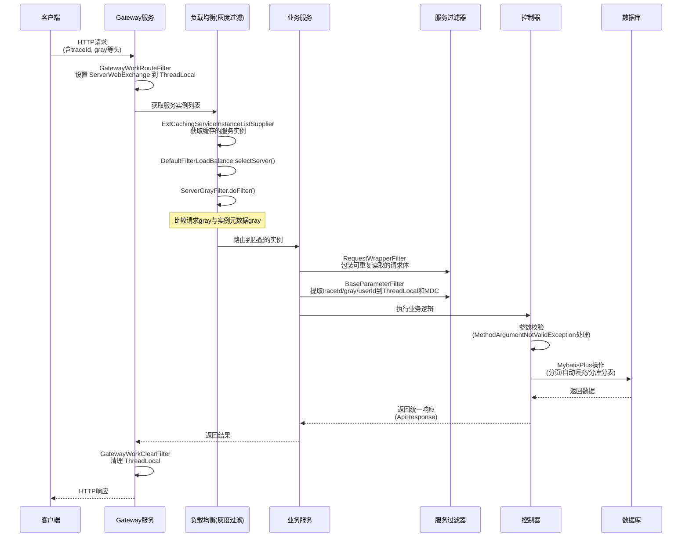

### 3.2 服务间调用参数传递

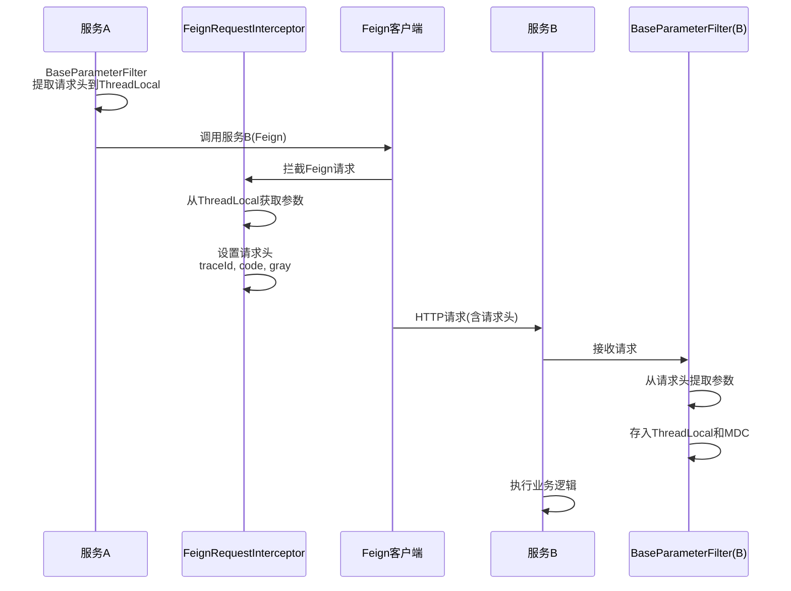

### 3.3 分库分表数据流

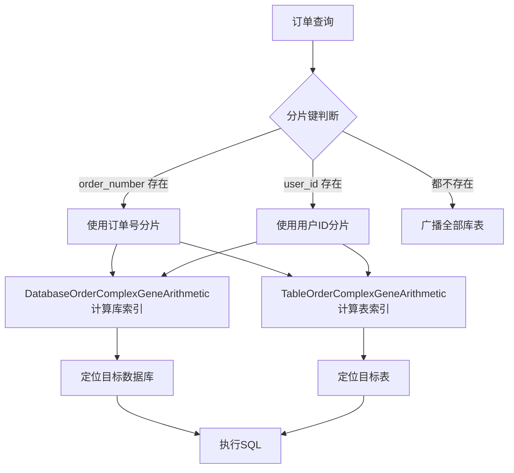

## 4. 配置说明

### 4.1 灰度发布配置

| 配置项 | 说明 | 默认值 |
|--------|------|--------|
| `server.gray` | 服务灰度标识 | `false` |
| `spring.cloud.loadbalancer.retry.enabled` | 负载均衡重试开关 | `true` |
| `spring.cloud.loadbalancer.configurations` | 负载均衡策略 | `default` |

### 4.2 ShardingSphere 分片配置

| 配置项 | 说明 |
|--------|------|
| `sharding-count` | 数据库数量 |
| `table-sharding-count` | 表数量 |

### 4.3 过滤器配置

| 配置项 | 说明 | 默认值 |
|--------|------|--------|
| `server.gray` | 服务灰度标识（Feign传递） | `false` |

## 5. 项目结构

```
damai-spring-cloud-framework/
├── pom.xml
├── damai-service-common/                    # 服务公共基础
│   └── src/main/java/com/damai/
│       ├── data/
│       │   └── BaseTableData.java           # 基础表字段实体
│       ├── dto/
│       │   └── BasePageDto.java             # 分页请求DTO
│       ├── exception/
│       │   └── DefaultExceptionHandler.java # 全局异常处理器
│       ├── mq/
│       │   └── callback/
│       │       ├── FailureCallback.java     # 失败回调接口
│       │       └── SuccessCallback.java     # 成功回调接口
│       ├── mybatisplus/
│       │   ├── MybatisPlusAutoConfiguration.java # MybatisPlus自动配置
│       │   └── MybatisPlusMetaObjectHandler.java # 字段自动填充
│       ├── page/
│       │   ├── PageUtil.java               # 分页工具类
│       │   └── PageVo.java                 # 分页响应VO
│       ├── shardingsphere/
│       │   ├── DatabaseOrderComplexGeneArithmetic.java # 订单分库算法
│       │   └── TableOrderComplexGeneArithmetic.java    # 订单分表算法
│       └── swagger/
│           └── SwaggerConfiguration.java    # Swagger文档配置
│
├── damai-service-component/                 # 服务通用组件
│   └── src/main/java/com/damai/
│       ├── feign/
│       │   ├── ExtraFeignAutoConfiguration.java # Feign扩展自动配置
│       │   └── FeignRequestInterceptor.java     # Feign请求拦截器
│       ├── filter/
│       │   ├── FilterAutoConfiguration.java     # 过滤器自动配置
│       │   ├── BaseParameterFilter.java         # 基础参数过滤器
│       │   └── RequestWrapperFilter.java        # 请求包装过滤器
│       └── request/
│           └── CustomizeRequestWrapper.java     # 自定义请求包装器
│
├── damai-service-gray-transition-framework/ # 灰度发布框架
│   ├── pom.xml
│   ├── damai-service-gray-transition-base-framework/    # 灰度基础模块
│   │   └── src/main/java/com/damai/
│   │       ├── balance/
│   │       │   ├── config/
│   │       │   │   └── GrayLoadBalanceAutoConfiguration.java # 灰度负载均衡配置
│   │       │   ├── ExtCachingServiceInstanceListSupplier.java # 缓存实例供给
│   │       │   └── FilterLoadBalance.java                    # 负载均衡过滤接口
│   │       ├── context/
│   │       │   └── ContextHandler.java        # 上下文获取接口
│   │       ├── enhance/
│   │       │   ├── config/
│   │       │   │   └── EnhanceLoadBalancerClientConfiguration.java # 负载均衡客户端增强
│   │       │   └── EnhanceServiceInstanceListSupplierBuilder.java # 实例供给构建器
│   │       ├── filter/
│   │       │   ├── AbstractServerFilter.java  # 服务过滤器抽象
│   │       │   └── impl/
│   │       │       └── ServerGrayFilter.java  # 灰度服务过滤器
│   │       └── fiterbalance/
│   │           └── DefaultFilterLoadBalance.java # 默认过滤负载均衡
│   │
│   ├── damai-service-gray-transition-gateway-framework/   # Gateway上下文模块
│   │   └── src/main/java/com/damai/context/
│   │       ├── config/
│   │       │   └── GatewayContextAutoConfiguration.java   # Gateway上下文配置
│   │       ├── filter/
│   │       │   ├── GatewayWorkRouteFilter.java  # 上下文存放过滤器
│   │       │   └── GatewayWorkClearFilter.java  # 上下文清理过滤器
│   │       └── impl/
│   │           ├── GatewayContextHandler.java   # Gateway上下文实现
│   │           └── GatewayContextHolder.java    # Gateway上下文持有器
│   │
│   └── damai-service-gray-transition-webmvc-framework/    # WebMvc上下文模块
│       └── src/main/java/com/damai/context/
│           ├── config/
│           │   └── WebMvcContextAutoConfiguration.java    # WebMvc上下文配置
│           └── impl/
│               └── WebMvcContextHandler.java   # WebMvc上下文实现
│
└── damai-service-initialize/                  # 系统初始化模块
    └── src/main/java/com/damai/initialize/
        ├── base/
        │   ├── AbstractApplicationCommandLineRunnerHandler.java # CommandLineRunner抽象
        │   ├── AbstractApplicationInitializingBeanHandler.java   # InitializingBean抽象
        │   ├── AbstractApplicationPostConstructHandler.java      # PostConstruct抽象
        │   ├── AbstractApplicationStartEventListenerHandler.java # 事件监听抽象
        │   └── InitializeHandler.java          # 初始化处理接口
        ├── config/
        │   └── InitializeAutoConfig.java       # 初始化自动配置
        ├── constant/
        │   └── InitializeHandlerType.java      # 初始化类型常量
        ├── execute/
        │   ├── ApplicationCommandLineRunnerExecute.java  # CommandLineRunner执行
        │   ├── ApplicationInitializingBeanExecute.java   # InitializingBean执行
        │   ├── ApplicationPostConstructExecute.java      # PostConstruct执行
        │   ├── ApplicationStartEventListenerExecute.java # 事件监听执行
        │   └── base/
        │       └── AbstractApplicationExecute.java       # 执行器抽象基类
        └── impl/
            └── composite/
                ├── AbstractComposite.java      # 复合抽象类
                ├── CompositeAutoConfiguration.java # 组合模式配置
                ├── CompositeContainer.java     # 复合容器
                └── init/
                    └── CompositeInit.java      # 复合初始化
```

## 6. 与外部模块的集成

### 6.1 依赖的模块

| 模块 | 依赖关系 | 说明 |
|------|---------|------|
| [Common 模块](damai-common.md) | 编译依赖 | 提供 `BaseParameterHolder`、`DaMaiFrameException`、`BaseCode`、`Constant`、`ApiResponse`、`DateUtils`、`StringUtil` 等基础工具 |
| [Redis Tool Framework](Redis%20Tool%20Framework.md) | 可选依赖 | 缓存服务实例列表缓存能力 |
| [Redisson Framework](Redisson%20Framework.md) | 可选依赖 | 延迟队列等高级分布式能力 |

### 6.2 被依赖的模块

| 模块 | 说明 |
|------|------|
| Gateway Service | 使用灰度发布框架的 Gateway 上下文模块 |
| User Service | 使用服务通用组件和初始化框架 |
| Order Service | 使用 ShardingSphere 分片策略和 MybatisPlus 配置 |
| Program Service | 使用服务通用组件和初始化框架 |
| Pay Service | 使用服务通用组件 |
| Admin Service | 使用初始化框架 |
| Base Data Service | 使用服务通用组件 |
| Customize Service | 使用服务通用组件 |

## 7. 核心设计模式

### 7.1 策略模式 - 初始化框架

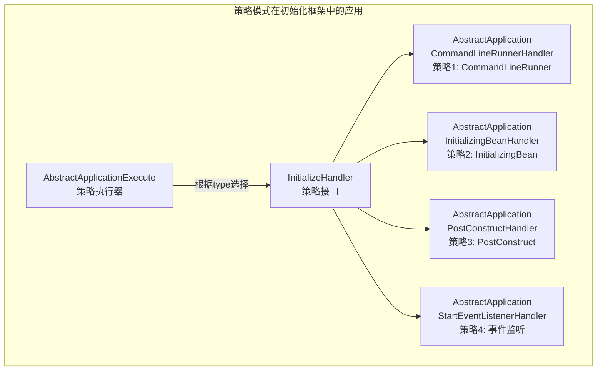

### 7.2 模板方法模式 - 服务过滤

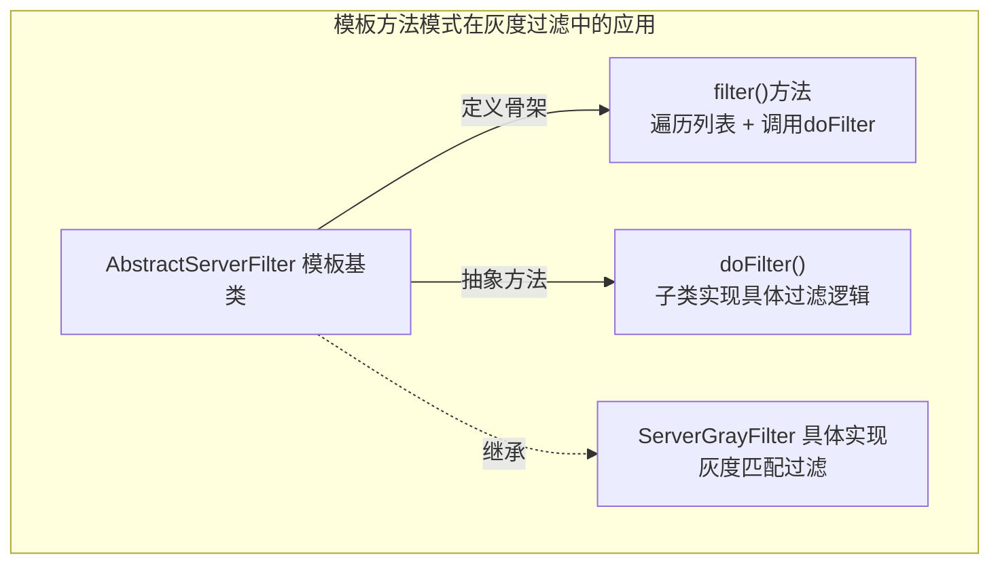

### 7.3 适配器模式 - 上下文处理

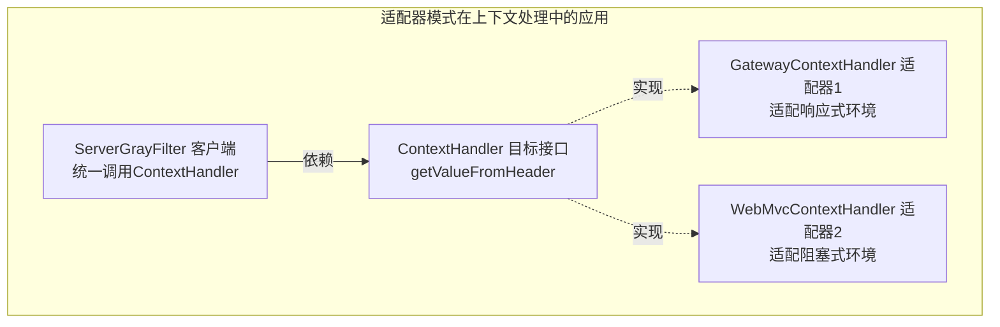

### 7.4 装饰器模式 - 服务实例供给

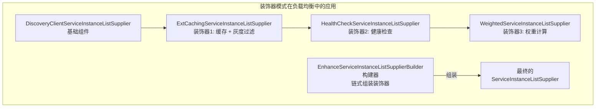

## 8. 灰度发布最佳实践

### 8.1 灰度部署配置

1. **服务实例配置**：在 Nacos 注册中心的服务元数据中设置 `gray=true/false`
2. **网关配置**：Gateway 服务启用 `damai-service-gray-transition-gateway-framework`
3. **内部服务配置**：业务服务启用 `damai-service-gray-transition-webmvc-framework`

### 8.2 灰度请求示例

```bash
# 灰度请求 - 携带 gray=true 请求头
curl -H "gray: true" https://api.damai.com/program/list

# 普通请求 - 不携带灰度头
curl https://api.damai.com/program/list
```

### 8.3 灰度验证流程

1. 部署灰度实例（元数据 `gray=true`）和金丝雀实例
2. 内部测试人员/特定用户携带 `gray=true` 请求头访问
3. 灰度请求流量路由到灰度实例，验证新功能
4. 验证通过后，将灰度标识逐步扩大到全量实例
