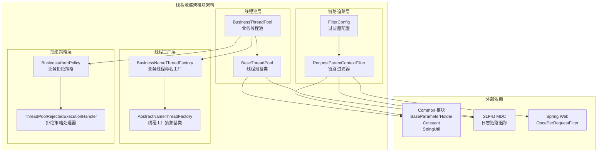
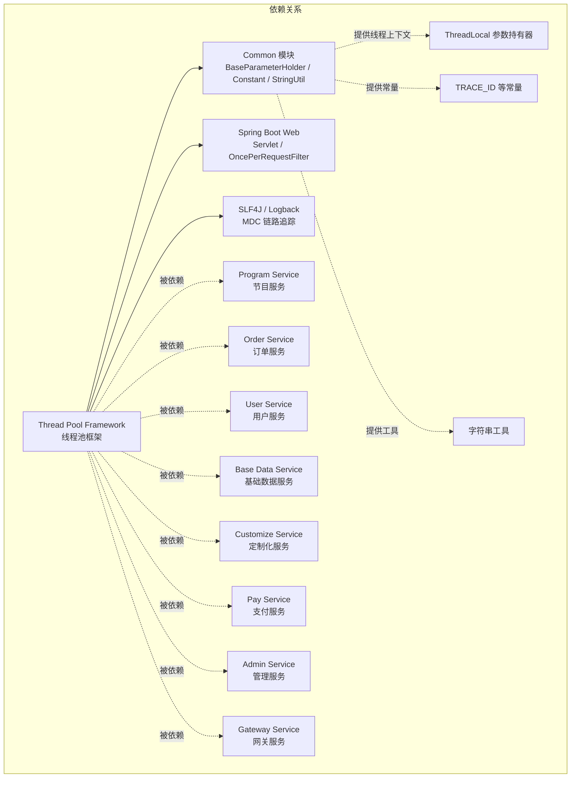
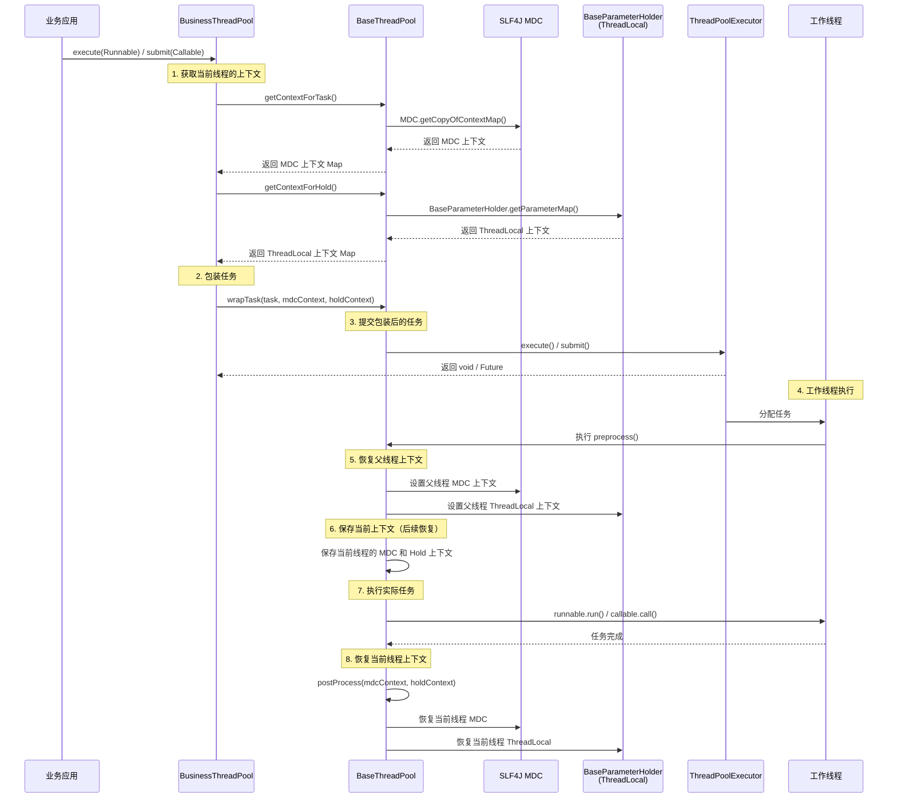
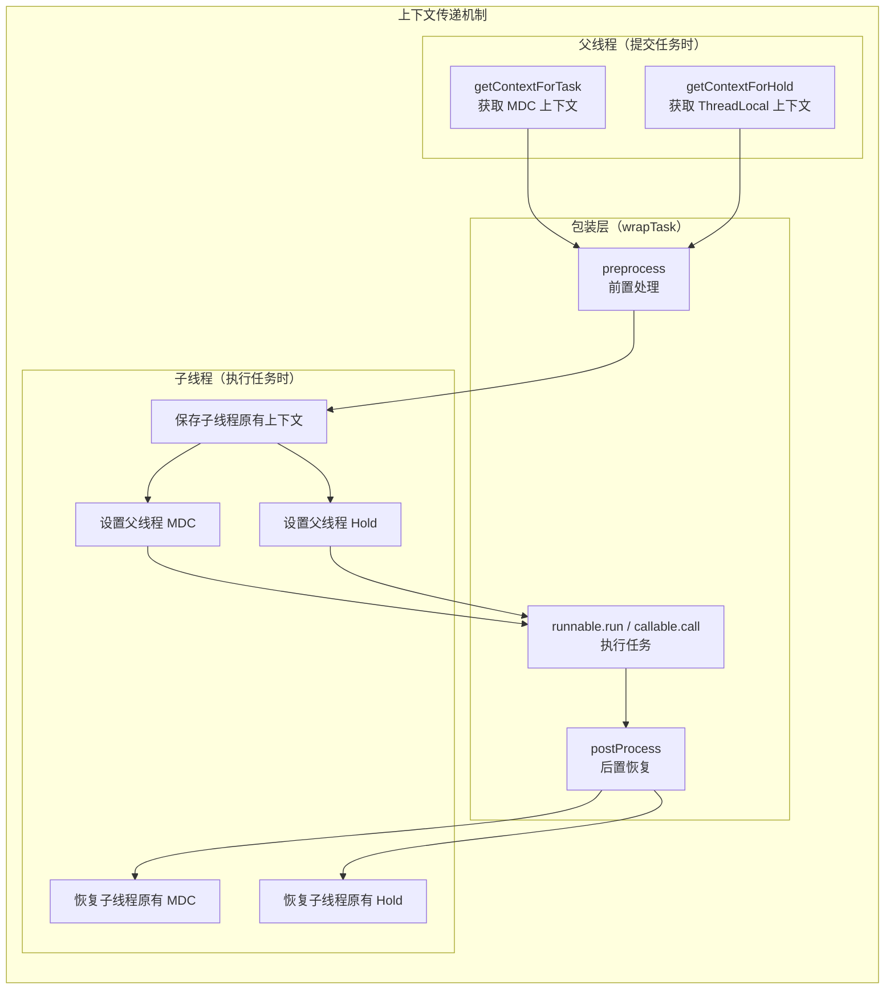
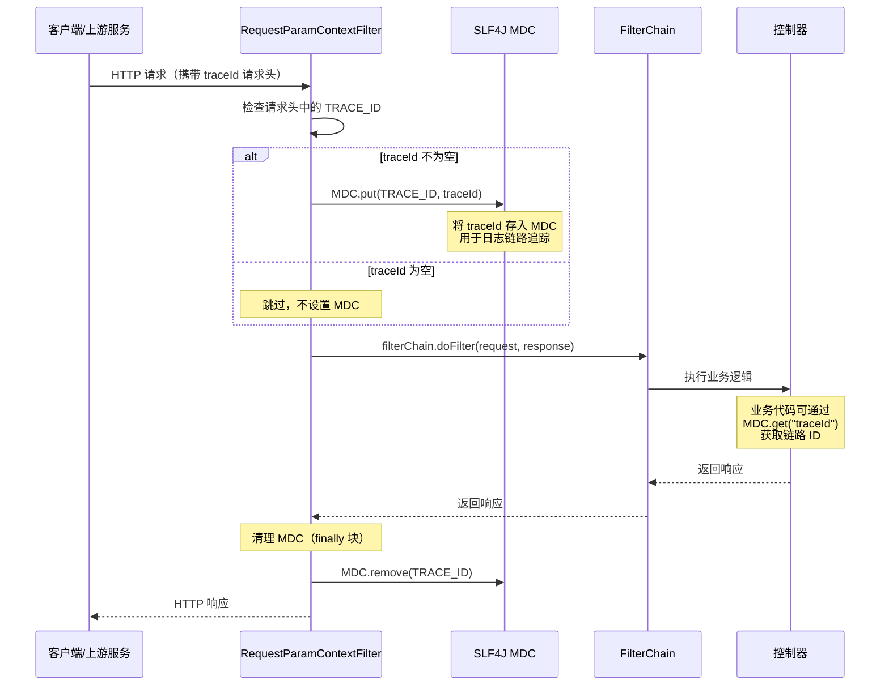
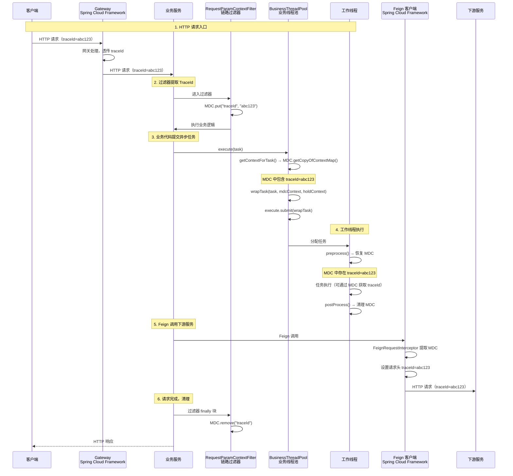
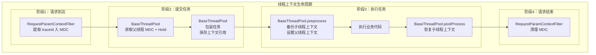

# 线程池框架（Thread Pool Framework）

## 1. 模块简介

线程池框架是大麦（DaMai）高并发实战项目中的**核心线程池基础设施模块**。该模块对 Java 原生 `ThreadPoolExecutor` 进行了深度封装和增强，提供了一套具备**链路追踪（TraceId）传递**、**上下文（Context）传播**、**自定义线程命名**和**业务友好拒绝策略**的完整线程池解决方案。

### 1.1 核心功能

| 功能分类 | 组件 | 说明 |
|---------|------|------|
| **线程池核心** | `BusinessThreadPool` | 业务线程池，封装了线程池的创建、任务提交和上下文传递 |
| **线程池基类** | `BaseThreadPool` | 线程池基类，实现 MDC 和自定义上下文的父子线程传递与恢复 |
| **线程命名工厂** | `BusinessNameThreadFactory` | 业务线程命名工厂，支持线程池编号和线程编号 |
| **线程工厂基类** | `AbstractNameThreadFactory` | 线程工厂抽象基类，统一线程创建逻辑 |
| **拒绝策略** | `BusinessAbortPolicy` | 业务拒绝策略，友好提示被拒绝的任务信息 |
| **链路追踪** | `RequestParamContextFilter` | 链路过滤器，从请求头提取 TraceId 并注入 MDC |
| **过滤器配置** | `FilterConfig` | Spring 过滤器注册配置 |

### 1.2 模块架构图



### 1.3 模块依赖关系



---

## 2. 核心组件详解

### 2.1 BusinessThreadPool（业务线程池）

**类路径**：`com.damai.BusinessThreadPool`

这是模块的核心入口类，继承自 `BaseThreadPool`，提供了对外统一的线程池操作 API。采用**静态方法**设计，全局只有一个线程池实例，通过 `static` 代码块初始化。

#### 2.1.1 线程池配置

```java
static {
    execute = new ThreadPoolExecutor(
        Runtime.getRuntime().availableProcessors() + 1,  // 核心线程数
        maximumPoolSize(),                                 // 最大线程数
        60,                                                // 空闲线程存活时间
        TimeUnit.SECONDS,                                  // 时间单位
        new ArrayBlockingQueue<>(600),                     // 工作队列
        new BusinessNameThreadFactory(),                   // 线程工厂
        new ThreadPoolRejectedExecutionHandler.BusinessAbortPolicy()  // 拒绝策略
    );
}
```

| 参数 | 值 | 说明 |
|------|-----|------|
| **corePoolSize** | `CPU核数 + 1` | 核心线程数，确保充分利用 CPU 资源 |
| **maximumPoolSize** | `CPU核数 / 0.2` (向上取整) | 最大线程数，约为 CPU 核数的 5 倍 |
| **keepAliveTime** | 60 秒 | 非核心线程空闲回收时间 |
| **workQueue** | `ArrayBlockingQueue(600)` | 有界阻塞队列，容量 600 |
| **threadFactory** | `BusinessNameThreadFactory` | 自定义线程命名工厂 |
| **handler** | `BusinessAbortPolicy` | 自定义拒绝策略 |

> **最大线程数计算**：`maximumPoolSize()` 方法通过 `CPU核数 / 0.2` 并向上取整计算，例如 4 核 CPU 的最大线程数为 `4 / 0.2 = 20`。

#### 2.1.2 核心方法

| 方法 | 参数 | 返回值 | 说明 |
|------|------|--------|------|
| `execute(Runnable)` | 无返回任务 | `void` | 提交不需要返回结果的任务，自动包装上下文 |
| `submit(Callable<T>)` | 有返回任务 | `Future<T>` | 提交需要返回结果的任务，自动包装上下文 |

#### 2.1.3 任务提交流程



---

### 2.2 BaseThreadPool（线程池基类）

**类路径**：`com.damai.base.BaseThreadPool`

这是线程池框架的核心基类，负责实现**父子线程之间的上下文传递与恢复**机制。它解决了多线程环境下 MDC 和自定义 ThreadLocal 上下文丢失的问题。

#### 2.2.1 上下文传递机制



#### 2.2.2 核心方法

| 方法 | 可见性 | 说明 |
|------|--------|------|
| `getContextForTask()` | `protected static` | 获取当前线程的 **MDC 上下文**（用于日志链路追踪） |
| `getContextForHold()` | `protected static` | 获取当前线程的 **BaseParameterHolder 上下文**（用于业务参数传递） |
| `wrapTask(Runnable, Map, Map)` | `protected static` | 包装 Runnable 任务，注入上下文传递逻辑 |
| `wrapTask(Callable, Map, Map)` | `protected static` | 包装 Callable 任务，注入上下文传递逻辑 |
| `preprocess(Map, Map)` | `private static` | **前置处理**：保存当前子线程上下文，设置父线程上下文 |
| `postProcess(Map, Map)` | `private static` | **后置处理**：恢复子线程原有的上下文 |

#### 2.2.3 上下文传递详细流程

**preprocess（前置处理）**：

1. 保存当前线程（子线程）的 **MDC 上下文** 和 **BaseParameterHolder 上下文**
2. 如果父线程 **MDC 上下文为空**，清空子线程 MDC；否则**覆盖**子线程 MDC 为父线程 MDC
3. 如果父线程 **Hold 上下文为空**，清空子线程 Hold；否则**覆盖**子线程 Hold 为父线程 Hold
4. 返回保存的旧上下文（用于后续恢复）

**postProcess（后置处理）**：

1. 如果前置处理时保存的 **MDC 上下文为空**，清空当前线程 MDC；否则恢复
2. 如果前置处理时保存的 **Hold 上下文为空**，清空当前线程 Hold；否则恢复

> **设计目的**：确保线程池中的工作线程在被复用时不产生上下文污染。当线程完成一个任务后，恢复其原有的上下文状态，确保下一个使用该线程的任务不会受到前一个任务的影响。

---

### 2.3 AbstractNameThreadFactory（线程工厂抽象基类）

**类路径**：`com.damai.namefactory.AbstractNameThreadFactory`

实现了 `ThreadFactory` 接口，提供了线程创建的通用逻辑，支持自定义线程名称前缀。

#### 2.3.1 核心属性

| 属性 | 类型 | 说明 |
|------|------|------|
| `POOL_NUM` | `AtomicLong` | 线程池编号（类级别，全局共享，从 1 开始递增） |
| `group` | `ThreadGroup` | 线程组 |
| `threadNum` | `AtomicLong` | 线程编号（实例级别，每个线程池从 1 开始递增） |
| `namePrefix` | `String` | 线程名称前缀 |

#### 2.3.2 线程命名规则

```
{子类 getNamePrefix 返回值}--thread--{线程编号}
```

**示例**：`task-pool--1--thread--1`

#### 2.3.3 抽象方法

| 方法 | 说明 |
|------|------|
| `getNamePrefix()` | 子类实现，返回线程池名称的前缀 |

#### 2.3.4 线程创建行为

- 非守护线程（如果创建的是守护线程，自动设置为非守护）
- 优先级设置为 `Thread.NORM_PRIORITY`（5）

---

### 2.4 BusinessNameThreadFactory（业务线程命名工厂）

**类路径**：`com.damai.namefactory.BusinessNameThreadFactory`

继承 `AbstractNameThreadFactory`，为业务线程池提供具体的线程命名。

#### 2.4.1 命名规则

```
task-pool--{线程池编号}--thread--{线程编号}
```

| 部分 | 说明 |
|------|------|
| `task-pool` | 固定前缀，表示业务任务线程池 |
| `线程池编号` | 全局递增，从 1 开始，如 `1`、`2`、`3` |
| `thread` | 固定分隔符 |
| `线程编号` | 每个线程池内自增，从 1 开始 |

**完整示例**：
- 第一个线程池的第一个线程：`task-pool--1--thread--1`
- 第一个线程池的第二个线程：`task-pool--1--thread--2`
- 第二个线程池的第一个线程：`task-pool--2--thread--1`

---

### 2.5 ThreadPoolRejectedExecutionHandler（拒绝策略处理器）

**类路径**：`com.damai.rejectedexecutionhandler.ThreadPoolRejectedExecutionHandler`

拒绝策略的容器类，内部定义具体的拒绝策略实现。

#### 2.5.1 BusinessAbortPolicy（业务拒绝策略）

**类路径**：`com.damai.rejectedexecutionhandler.ThreadPoolRejectedExecutionHandler.BusinessAbortPolicy`

实现了 `RejectedExecutionHandler` 接口，当线程池无法接受新任务时触发。

**行为**：
- 抛出 `RejectedExecutionException` 异常
- 异常信息包含：被拒绝的任务信息（`toString()`）和线程池状态（`toString()`）

**异常信息示例**：
```
threadPoolApplicationName business task com.damai.SomeTask@1234 rejected from java.util.concurrent.ThreadPoolExecutor@5678[Running, pool size = 20, active threads = 20, queued tasks = 600, completed tasks = 1000]
```

> **设计目的**：相比默认的 `AbortPolicy`，提供了更详细的任务和执行器信息，便于定位问题。其他拒绝策略（如 `DiscardPolicy`、`DiscardOldestPolicy`）在大麦高并发场景下可能导致数据丢失，因此不推荐使用。

---

### 2.6 RequestParamContextFilter（链路过滤器）

**类路径**：`com.damai.filter.RequestParamContextFilter`

继承 `OncePerRequestFilter`，确保每个请求只执行一次过滤，用于从 HTTP 请求头中提取 **TraceId** 并注入 SLF4J MDC。

#### 2.6.1 执行流程



#### 2.6.2 关键设计

| 设计要素 | 说明 |
|---------|------|
| **继承自 `OncePerRequestFilter`** | 确保每个请求只执行一次过滤器逻辑，即使请求被多次转发 |
| **MDC 生命周期管理** | 使用 `try-finally` 模式，请求处理完成后**必须清理** MDC，防止内存泄漏 |
| **TraceId 来源** | 从 HTTP 请求头中读取，字段名为常量 `Constant.TRACE_ID`（值为 `"traceId"`）|

---

### 2.7 FilterConfig（过滤器配置）

**类路径**：`com.damai.filter.FilterConfig`

Spring 配置类，负责将 `RequestParamContextFilter` 注册为 Spring Bean。

```java
public class FilterConfig {
    @Bean
    public OncePerRequestFilter requestParamContextFilter(){
        return new RequestParamContextFilter();
    }
}
```

---

## 3. 数据流分析

### 3.1 完整请求链路 TraceId 传递



### 3.2 上下文传递生命周期



---

## 4. 与其他模块的协作

### 4.1 与 Spring Cloud Framework 的协作

线程池框架与 [Spring Cloud Framework](Spring%20Cloud%20Framework.md) 模块紧密配合，共同实现全链路的 TraceId 传递：

1. **请求入口**：`Spring Cloud Framework` 的 `BaseParameterFilter` 从 HTTP 请求头提取 `traceId`，存入 `BaseParameterHolder` 和 MDC
2. **线程池执行**：线程池框架通过 `BaseThreadPool` 将 MDC 和 `BaseParameterHolder` 中的上下文自动传递到工作线程
3. **Feign 调用**：`Spring Cloud Framework` 的 `FeignRequestInterceptor` 从 MDC 和请求头中提取 `traceId`，传递到下游服务
4. **下游服务**：下游服务的 `RequestParamContextFilter` 接收 `traceId` 并注入 MDC

### 4.2 与 Common 模块的协作

线程池框架依赖 [Common 模块](damai-common.md) 的以下组件：

| 组件 | 用途 |
|------|------|
| `BaseParameterHolder` | 提供线程级参数持有（ThreadLocal），用于传递 `traceId`、`userId`、`gray` 等业务参数 |
| `Constant` | 提供 `TRACE_ID` 等常量定义 |
| `StringUtil` | 提供 `isNotEmpty()` 字符串判空方法 |

---

## 5. 性能考量与最佳实践

### 5.1 线程池配置建议

| 配置项 | 当前值 | 建议 |
|-------|--------|------|
| 核心线程数 | `CPU核数 + 1` | **CPU 密集型任务**建议 `CPU核数 + 1`；**IO 密集型任务**可适当增加至 `2 * CPU核数` |
| 最大线程数 | `CPU核数 / 0.2` | 根据实际压测结果调整，避免线程过多导致上下文切换开销 |
| 阻塞队列 | `ArrayBlockingQueue(600)` | 根据任务处理速度和峰值 QPS 调整 |
| 拒绝策略 | `BusinessAbortPolicy` | 抛出异常，适合对数据一致性要求高的场景 |

### 5.2 上下文传递性能影响

- `BaseThreadPool` 的 `preprocess` 和 `postProcess` 涉及 `HashMap` 的创建和复制操作
- 在高并发场景下，建议关注 GC 压力
- 如果不需要上下文传递，可考虑使用简化版本避免开销

### 5.3 使用示例

```java
// 提交无返回值的任务
BusinessThreadPool.execute(() -> {
    // 在此线程中可以通过 MDC.get("traceId") 获取链路 ID
    // 通过 BaseParameterHolder.getParameter("traceId") 获取参数
    log.info("执行异步任务，traceId: {}", MDC.get("traceId"));
});

// 提交有返回值的任务
Future<String> future = BusinessThreadPool.submit(() -> {
    // 业务逻辑
    return "结果";
});
String result = future.get(); // 同步等待结果
```

---

## 6. 总结

线程池框架是大麦高并发系统的**关键基础设施模块**，它解决了多线程环境下最为棘手的**上下文传递问题**：

| 能力 | 实现方式 | 解决的问题 |
|------|---------|-----------|
| **MDC 上下文传递** | `BaseThreadPool.wrapTask()` + `preprocess/postProcess` | 日志链路追踪 ID 在线程池中丢失 |
| **业务上下文传递** | `BaseParameterHolder` 的备份与恢复 | `threadId`、`userId`、灰度标识等参数在线程池中丢失 |
| **线程命名规范** | `BusinessNameThreadFactory` | 方便问题排查和性能监控 |
| **友好拒绝策略** | `BusinessAbortPolicy` | 提供详细的异常信息便于定位 |
| **TraceId 注入** | `RequestParamContextFilter` | HTTP 请求入口自动提取并注入 MDC |

> **参考文档**：[Spring Cloud Framework](Spring%20Cloud%20Framework.md) | [Common 模块](damai-common.md) | [Redisson Framework](Redisson%20Framework.md)
