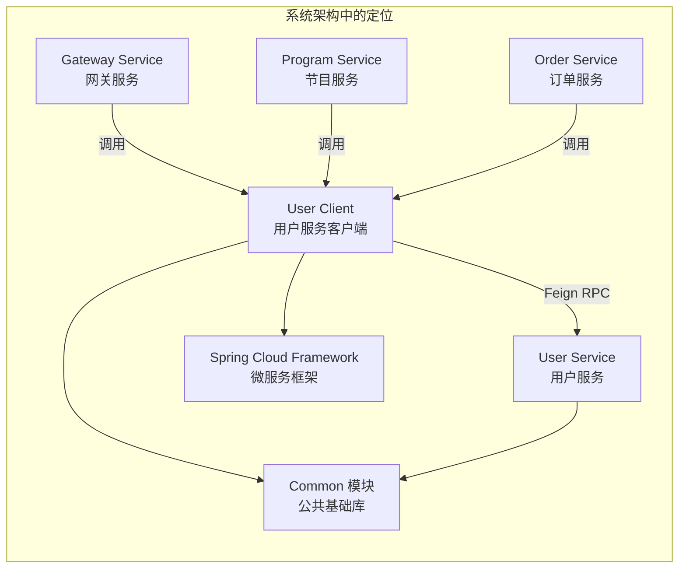
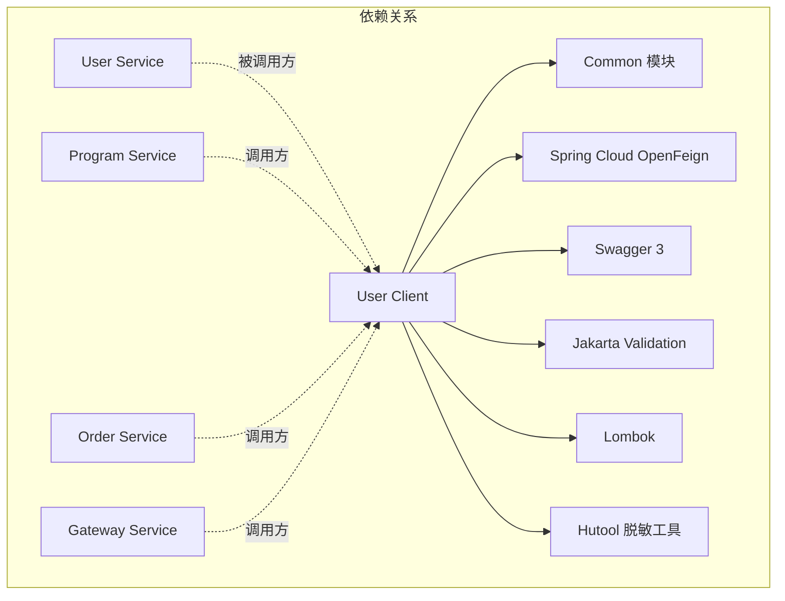
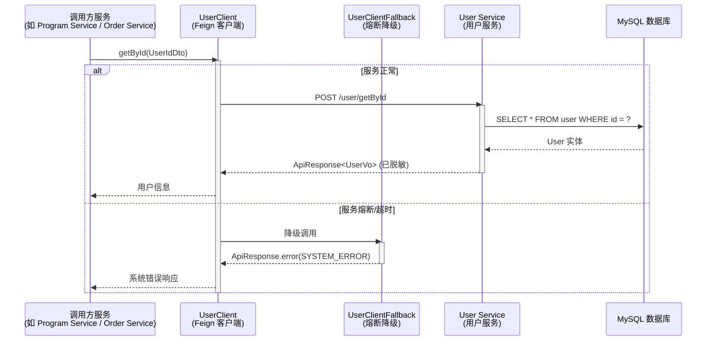
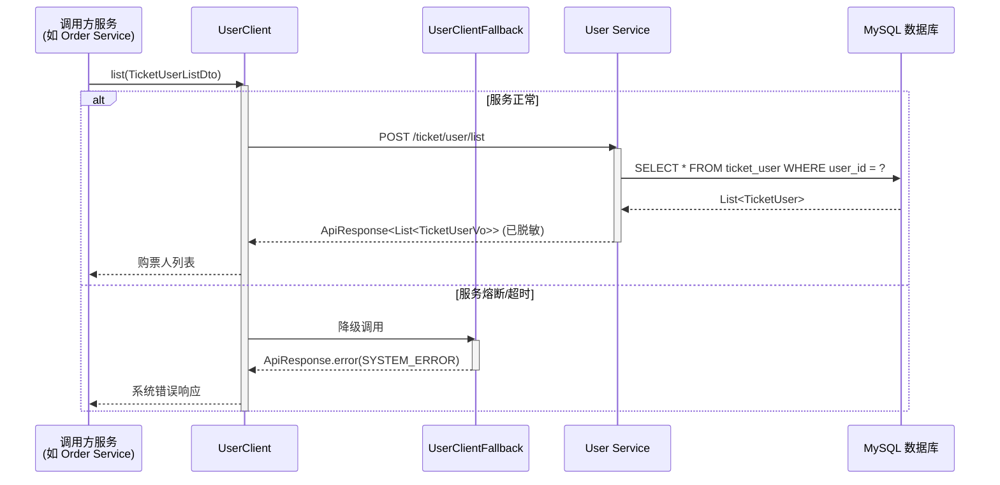
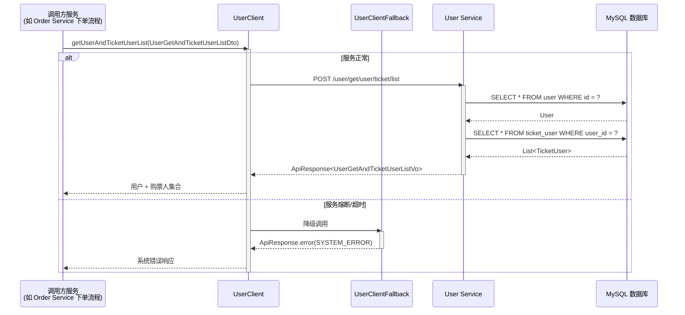
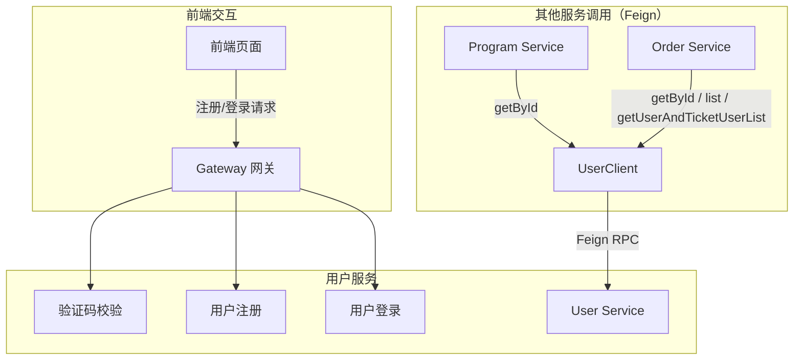
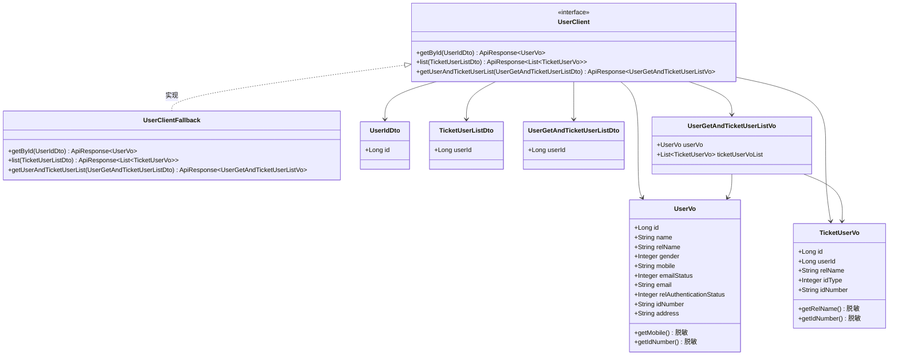

# User Client 模块 - 用户服务客户端

## 1. 模块简介

User Client 模块是大麦系统中**用户服务（User Service）的 Feign 客户端模块**，位于 `damai-server-client/damai-user-client`。该模块通过声明式 Feign 接口为其他微服务提供与用户服务进行 RPC 通信的能力，涵盖**用户查询、购票人列表查询、用户及购票人联合查询**等核心远程调用功能，并定义了完整的用户业务数据契约（DTO/VO），供整个微服务系统统一使用。

### 1.1 核心功能

| 功能分类 | 说明 |
|---------|------|
| **用户查询** | 通过用户ID查询用户信息，以及查询用户的同时获取其关联的购票人列表 |
| **购票人列表查询** | 查询指定用户下的所有购票人（常用观影人/观演人）信息 |
| **数据契约定义** | 定义用户注册、登录、退出、信息更新、密码修改、邮箱修改、手机号修改、实名认证、购票人管理等操作的数据结构，供系统各模块统一引用 |

### 1.2 模块定位



## 2. 架构设计

### 2.1 模块架构图

```mermaid
graph TB
    subgraph "User Client 模块"
        direction TB
        
        subgraph "Feign 接口层"
            UserClient[UserClient<br/>Feign 声明式接口]
            UserClientFallback[UserClientFallback<br/>熔断降级处理]
        end
        
        subgraph "数据传输对象（DTO）"
            UserIdDto[UserIdDto<br/>用户ID查询]
            UserRegisterDto[UserRegisterDto<br/>用户注册]
            UserLoginDto[UserLoginDto<br/>用户登录]
            UserLogoutDto[UserLogoutDto<br/>用户退出登录]
            UserExistDto[UserExistDto<br/>用户是否存在]
            UserMobileDto[UserMobileDto<br/>手机号查询]
            UserAuthenticationDto[UserAuthenticationDto<br/>实名认证]
            UserUpdateDto[UserUpdateDto<br/>用户信息更新]
            UserUpdateEmailDto[UserUpdateEmailDto<br/>邮箱更新]
            UserUpdateMobileDto[UserUpdateMobileDto<br/>手机号更新]
            UserUpdatePasswordDto[UserUpdatePasswordDto<br/>密码更新]
            TicketUserDto[TicketUserDto<br/>添加购票人]
            TicketUserIdDto[TicketUserIdDto<br/>购票人ID]
            TicketUserListDto[TicketUserListDto<br/>购票人列表查询]
            UserGetAndTicketUserListDto[UserGetAndTicketUserListDto<br/>用户+购票人查询]
            ProgramOrderTicketUserDto[ProgramOrderTicketUserDto<br/>订单关联购票人]
        end
        
        subgraph "返回对象（VO）"
            UserVo[UserVo<br/>用户数据]
            UserLoginVo[UserLoginVo<br/>登录返回]
            TicketUserVo[TicketUserVo<br/>购票人数据]
            UserGetAndTicketUserListVo[UserGetAndTicketUserListVo<br/>用户+购票人集合]
            CheckNeedCaptchaDataVo[CheckNeedCaptchaDataVo<br/>验证码校验状态]
        end
        
        UserClient --> UserClientFallback
        UserClient --> UserIdDto
        UserClient --> UserGetAndTicketUserListDto
        UserClient --> TicketUserListDto
        UserClient --> UserGetAndTicketUserListVo
        UserClient --> UserVo
        UserClient --> TicketUserVo
    end
    
    subgraph "外部依赖"
        Common[Common 模块<br/>ApiResponse / 常量]
        SpringCloud[Spring Cloud<br/>OpenFeign]
    end
    
    UserClient --> Common
    UserClient --> SpringCloud
```



### 2.2 模块依赖关系



### 2.3 内部依赖关系

User Client 模块依赖的 Common 模块组件：

| 组件类 | 用途 |
|-------|------|
| `ApiResponse` | 统一响应体封装 |
| `Constant.SPRING_INJECT_PREFIX_DISTINCTION_NAME` | Feign 客户端服务名注入前缀 |
| `BaseCode` | 错误码枚举（降级时使用） |
| `StringUtil` | 字符串工具（VO 脱敏处理使用） |

## 3. 核心组件详解

### 3.1 UserClient（Feign 客户端接口）

**作用**：定义与用户服务通信的 REST API 接口，使用 Spring Cloud OpenFeign 声明式 HTTP 客户端。

```java
@Component
@FeignClient(value = SPRING_INJECT_PREFIX_DISTINCTION_NAME+"-"+"user-service", fallback = UserClientFallback.class)
public interface UserClient {
    // 通过ID查询用户
    @PostMapping("/user/getById")
    ApiResponse<UserVo> getById(UserIdDto dto);
    
    // 查询购票人列表
    @PostMapping("/ticket/user/list")
    ApiResponse<List<TicketUserVo>> list(TicketUserListDto dto);
    
    // 查询用户和购票人集合
    @PostMapping("/user/get/user/ticket/list")
    ApiResponse<UserGetAndTicketUserListVo> getUserAndTicketUserList(UserGetAndTicketUserListDto dto);
}
```

**关键特性**：

| 属性 | 值 | 说明 |
|------|-----|------|
| `value` | `"${prefix.distinction.name:damai}-user-service"` | 服务名，默认 `damai-user-service` |
| `fallback` | `UserClientFallback.class` | 熔断降级处理类 |
| 基础路径 | 无 | 各接口路径不同 |

**暴露的 API 端点**：

| HTTP 方法 | 路径 | 请求参数 | 响应类型 | 功能描述 |
|-----------|------|---------|---------|---------|
| POST | `/user/getById` | `UserIdDto` | `ApiResponse<UserVo>` | 通过用户ID查询用户信息 |
| POST | `/ticket/user/list` | `TicketUserListDto` | `ApiResponse<List<TicketUserVo>>` | 查询用户下的购票人列表 |
| POST | `/user/get/user/ticket/list` | `UserGetAndTicketUserListDto` | `ApiResponse<UserGetAndTicketUserListVo>` | 查询用户及其购票人集合 |

> **注意**：UserClient 暴露的接口仅包含**其他服务需要调用的**远程接口。完整用户服务接口（如注册、登录、退出、更新等）仅由 Gateway 网关层直接调用 User Service，不通过 Feign 客户端暴露给其他微服务。

### 3.2 UserClientFallback（熔断降级处理）

**作用**：当 User Service 不可用或调用超时时，提供降级响应，返回系统错误信息。

```java
@Component
public class UserClientFallback implements UserClient {
    @Override
    public ApiResponse<UserVo> getById(UserIdDto userIdDto) {
        return ApiResponse.error(BaseCode.SYSTEM_ERROR);
    }
    
    @Override
    public ApiResponse<List<TicketUserVo>> list(TicketUserListDto dto) {
        return ApiResponse.error(BaseCode.SYSTEM_ERROR);
    }
    
    @Override
    public ApiResponse<UserGetAndTicketUserListVo> getUserAndTicketUserList(UserGetAndTicketUserListDto dto) {
        return ApiResponse.error(BaseCode.SYSTEM_ERROR);
    }
}
```

**降级策略**：
- 所有接口统一返回 `ApiResponse.error(BaseCode.SYSTEM_ERROR)`
- 调用方需根据 `ApiResponse` 的 `code` 判断是否成功

### 3.3 数据传输对象（DTO）

#### UserIdDto（用户ID查询参数）

| 字段 | 类型 | 约束 | 说明 |
|------|------|------|------|
| `id` | Long | `@NotNull` | 用户ID |

#### UserRegisterDto（用户注册参数）

用户注册的核心参数，包含基本信息、密码、手机号、验证码等信息。

| 字段 | 类型 | 约束 | 说明 |
|------|------|------|------|
| `name` | String | 可选 | 用户名字 |
| `relName` | String | 可选 | 用户真实名字 |
| `gender` | Integer | 可选 | 性别：1-男，2-女 |
| `password` | String | `@NotBlank` | 密码 |
| `confirmPassword` | String | `@NotBlank` | 二次确认密码 |
| `mobile` | String | `@NotBlank` | 手机号 |
| `mailStatus` | Integer | 可选 | 是否邮箱认证：1-已验证，0-未验证 |
| `mail` | String | 可选 | 邮箱地址 |
| `relAuthenticationStatus` | Integer | 可选 | 是否实名认证：1-已验证，0-未验证 |
| `idNumber` | String | 可选 | 身份证号码 |
| `captchaId` | String | `@NotBlank` | 验证码ID（调用是否需要校验验证码接口返回） |
| `captchaVerification` | String | 可选 | 二次校验验证码（前端将token---pointJson拼接后使用AES加密） |

#### UserLoginDto（用户登录参数）

| 字段 | 类型 | 约束 | 说明 |
|------|------|------|------|
| `code` | String | `@NotBlank` | 渠道code（0001: PC网站） |
| `mobile` | String | 可选 | 用户手机号 |
| `email` | String | 可选 | 用户邮箱 |
| `password` | String | `@NotBlank` | 密码 |

#### UserLogoutDto（用户退出登录参数）

| 字段 | 类型 | 约束 | 说明 |
|------|------|------|------|
| `code` | String | `@NotBlank` | 渠道code（0001: PC网站） |
| `token` | String | `@NotBlank` | 用户token |

#### UserExistDto（用户是否存在查询参数）

| 字段 | 类型 | 约束 | 说明 |
|------|------|------|------|
| `mobile` | String | `@NotBlank` | 手机号 |

#### UserMobileDto（通过手机号查询用户参数）

| 字段 | 类型 | 约束 | 说明 |
|------|------|------|------|
| `mobile` | String | `@NotBlank` | 用户手机号 |

#### UserAuthenticationDto（用户实名认证参数）

| 字段 | 类型 | 约束 | 说明 |
|------|------|------|------|
| `id` | Long | `@NotNull` | 用户ID |
| `relName` | String | `@NotBlank` | 用户真实名字 |
| `idNumber` | String | `@NotBlank` | 身份证号码 |

#### UserUpdateDto（用户信息更新参数）

| 字段 | 类型 | 约束 | 说明 |
|------|------|------|------|
| `id` | Long | `@NotNull` | 用户ID |
| `name` | String | 可选 | 用户名字 |
| `relName` | String | 可选 | 用户真实名字 |
| `gender` | Integer | 可选 | 性别：1-男，2-女 |
| `mobile` | String | 可选 | 手机号 |
| `idNumber` | String | 可选 | 身份证号码 |

#### UserUpdateEmailDto（邮箱更新参数）

| 字段 | 类型 | 约束 | 说明 |
|------|------|------|------|
| `id` | Long | `@NotNull` | 用户ID |
| `email` | String | `@NotBlank` | 邮箱地址 |

#### UserUpdateMobileDto（手机号更新参数）

| 字段 | 类型 | 约束 | 说明 |
|------|------|------|------|
| `id` | Long | `@NotNull` | 用户ID |
| `mobile` | String | `@NotBlank` | 手机号 |

#### UserUpdatePasswordDto（密码更新参数）

| 字段 | 类型 | 约束 | 说明 |
|------|------|------|------|
| `id` | Long | `@NotNull` | 用户ID |
| `password` | String | `@NotBlank` | 新密码 |

#### TicketUserDto（添加购票人参数）

| 字段 | 类型 | 约束 | 说明 |
|------|------|------|------|
| `userId` | Long | `@NotNull` | 用户ID |
| `relName` | String | `@NotBlank` | 用户真实名字 |
| `idType` | Integer | `@NotNull` | 证件类型：1-身份证，2-港澳台居民居住证，3-港澳居民来往内地通行证，4-台湾居民来往内地通行证，5-护照，6-外国人永久居住证 |
| `idNumber` | String | `@NotBlank` | 证件号码 |

#### TicketUserIdDto（购票人ID参数）

| 字段 | 类型 | 约束 | 说明 |
|------|------|------|------|
| `id` | Long | `@NotNull` | 购票人ID |

#### TicketUserListDto（购票人列表查询参数）

| 字段 | 类型 | 约束 | 说明 |
|------|------|------|------|
| `userId` | Long | `@NotNull` | 用户ID |

#### ProgramOrderTicketUserDto（订单关联购票人参数）

| 字段 | 类型 | 约束 | 说明 |
|------|------|------|------|
| `id` | Long | `@NotNull` | 购票人ID |
| `userId` | Long | `@NotNull` | 用户ID |
| `relName` | String | `@NotBlank` | 用户真实名字 |
| `idType` | Integer | `@NotNull` | 证件类型 |
| `idNumber` | String | `@NotBlank` | 证件号码 |

#### UserGetAndTicketUserListDto（用户+购票人联合查询参数）

| 字段 | 类型 | 约束 | 说明 |
|------|------|------|------|
| `userId` | Long | `@NotNull` | 用户ID |

### 3.4 返回对象（VO）

#### UserVo（用户数据返回）

| 字段 | 类型 | 说明 |
|------|------|------|
| `id` | Long | 用户ID |
| `name` | String | 用户名字 |
| `relName` | String | 用户真实名字 |
| `gender` | Integer | 性别：1-男，2-女 |
| `mobile` | String | 手机号（已脱敏处理） |
| `emailStatus` | Integer | 邮箱认证状态：1-已验证，0-未验证 |
| `email` | String | 邮箱地址 |
| `relAuthenticationStatus` | Integer | 实名认证状态：1-已验证，0-未验证 |
| `idNumber` | String | 身份证号码（已脱敏处理，仅显示前4位和后4位） |
| `address` | String | 收货地址 |

**脱敏处理**：
- `mobile`：通过 `DesensitizedUtil.mobilePhone()` 对手机号中间四位进行脱敏（如 `138****1234`）
- `idNumber`：通过 `DesensitizedUtil.idCardNum()` 对身份证号进行脱敏，保留前4位和后4位

#### UserLoginVo（登录返回数据）

| 字段 | 类型 | 说明 |
|------|------|------|
| `userId` | Long | 用户ID |
| `token` | String | 登录token |

#### TicketUserVo（购票人数据返回）

| 字段 | 类型 | 说明 |
|------|------|------|
| `id` | Long | 购票人ID |
| `userId` | Long | 用户ID |
| `relName` | String | 用户真实名字（已脱敏，隐藏第一个字） |
| `idType` | Integer | 证件类型：1-身份证，2-港澳台居民居住证，3-港澳居民来往内地通行证，4-台湾居民来往内地通行证，5-护照，6-外国人永久居住证 |
| `idNumber` | String | 证件号码（已脱敏处理，仅显示前4位和后4位） |

**脱敏处理**：
- `relName`：通过 `StrUtil.hide(relName, 0, 1)` 隐藏姓氏，如 `*三`
- `idNumber`：通过 `DesensitizedUtil.idCardNum()` 保留前4位和后4位

#### UserGetAndTicketUserListVo（用户和购票人集合返回）

| 字段 | 类型 | 说明 |
|------|------|------|
| `userVo` | UserVo | 用户信息 |
| `ticketUserVoList` | List\<TicketUserVo\> | 购票人信息集合 |

#### CheckNeedCaptchaDataVo（验证码校验状态返回）

| 字段 | 类型 | 说明 |
|------|------|------|
| `verifyCaptcha` | Boolean | 是否需要验证码：true-是，false-否 |
| `captchaId` | Long | 验证码唯一标识ID（用户注册接口需要传入此ID） |

## 4. 与用户服务（User Service）的完整接口映射

User Client 模块仅暴露了部分接口给其他微服务。完整用户服务API通过 Gateway 暴露给前端，其映射关系如下：

### 4.1 用户相关接口（UserController）

| 客户端接口 | 用户服务端点 | 描述 |
|-----------|-------------|------|
| `UserClient.getById()` | `POST /user/getById` | 通过ID查询用户（Feign 暴露） |
| `UserClient.getUserAndTicketUserList()` | `POST /user/get/user/ticket/list` | 查询用户和购票人集合（Feign 暴露，仅内部调用） |
| 无 Feign 接口 | `POST /user/get/id` | 通过ID查询用户（前端调用） |
| 无 Feign 接口 | `POST /user/get/mobile` | 通过手机号查询用户（前端调用） |
| 无 Feign 接口 | `POST /user/register` | 用户注册 |
| 无 Feign 接口 | `POST /user/exist` | 检查用户是否存在 |
| 无 Feign 接口 | `POST /user/login` | 用户登录 |
| 无 Feign 接口 | `POST /user/logout` | 用户退出登录 |
| 无 Feign 接口 | `POST /user/update` | 修改个人信息 |
| 无 Feign 接口 | `POST /user/update/password` | 修改密码 |
| 无 Feign 接口 | `POST /user/update/email` | 修改邮箱 |
| 无 Feign 接口 | `POST /user/update/mobile` | 修改手机号 |
| 无 Feign 接口 | `POST /user/authentication` | 实名认证 |

### 4.2 购票人相关接口（TicketUserController）

| 客户端接口 | 用户服务端点 | 描述 |
|-----------|-------------|------|
| `UserClient.list()` | `POST /ticket/user/list` | 查询购票人列表（Feign 暴露） |
| 无 Feign 接口 | `POST /ticket/user/add` | 添加购票人 |
| 无 Feign 接口 | `POST /ticket/user/delete` | 删除购票人 |

## 5. 数据流与交互

### 5.1 用户查询流程



### 5.2 购票人列表查询流程



### 5.3 用户和购票人联合查询流程



### 5.4 完整用户注册/登录流程



### 5.5 数据模型关系



## 6. 安全与隐私保护

### 6.1 数据脱敏

User Client 模块在返回敏感数据时，自动进行脱敏处理，保障用户隐私安全：

| VO 类 | 字段 | 脱敏方式 | 示例 |
|-------|------|---------|------|
| `UserVo` | `mobile` | 中间四位隐藏 | `138****1234` |
| `UserVo` | `idNumber` | 保留前4后4 | `1101**********1234` |
| `TicketUserVo` | `relName` | 隐藏姓氏 | `*三` |
| `TicketUserVo` | `idNumber` | 保留前4后4 | `1101**********1234` |

### 6.2 验证码安全

- 用户注册时需要传入 `captchaId` 和 `captchaVerification`
- `captchaVerification` 采用 AES 加密传输，密钥从验证码接口返回的 `secretKey` 获取
- 有效防止机器注册和恶意攻击

## 7. 项目结构

```
damai-user-client/
├── pom.xml
└── src/main/java/com/damai/
    ├── client/
    │   ├── UserClient.java              # Feign 声明式客户端接口
    │   └── UserClientFallback.java       # Feign 熔断降级处理
    ├── dto/
    │   ├── ProgramOrderTicketUserDto.java # 订单关联购票人 DTO
    │   ├── TicketUserDto.java            # 添加购票人 DTO
    │   ├── TicketUserIdDto.java          # 购票人ID DTO
    │   ├── TicketUserListDto.java        # 购票人列表查询 DTO
    │   ├── UserAuthenticationDto.java    # 实名认证 DTO
    │   ├── UserExistDto.java             # 用户是否存在 DTO
    │   ├── UserGetAndTicketUserListDto.java # 用户+购票人联合查询 DTO
    │   ├── UserIdDto.java                # 用户ID DTO
    │   ├── UserLoginDto.java             # 用户登录 DTO
    │   ├── UserLogoutDto.java            # 用户退出登录 DTO
    │   ├── UserMobileDto.java            # 手机号查询 DTO
    │   ├── UserRegisterDto.java          # 用户注册 DTO
    │   ├── UserUpdateDto.java            # 用户信息更新 DTO
    │   ├── UserUpdateEmailDto.java       # 邮箱更新 DTO
    │   ├── UserUpdateMobileDto.java      # 手机号更新 DTO
    │   └── UserUpdatePasswordDto.java    # 密码更新 DTO
    └── vo/
        ├── CheckNeedCaptchaDataVo.java   # 验证码校验状态 VO
        ├── TicketUserVo.java             # 购票人数据 VO
        ├── UserGetAndTicketUserListVo.java # 用户+购票人集合 VO
        ├── UserLoginVo.java              # 登录返回 VO
        └── UserVo.java                   # 用户数据 VO
```

## 8. 相关文档

| 文档 | 说明 |
|------|------|
| [Common 模块](damai-common.md) | 公共基础框架，提供 ApiResponse、BaseCode、常量等核心依赖 |
| [Spring Cloud Framework](Spring%20Cloud%20Framework.md) | 微服务框架，提供 OpenFeign 声明式 HTTP 客户端能力 |
| [Program Client](ProgramClient.md) | 节目服务客户端，调用 UserClient 获取用户信息用于下单 |
| [Order Client](Order%20Client.md) | 订单服务客户端，调用 UserClient 获取购票人信息 |
