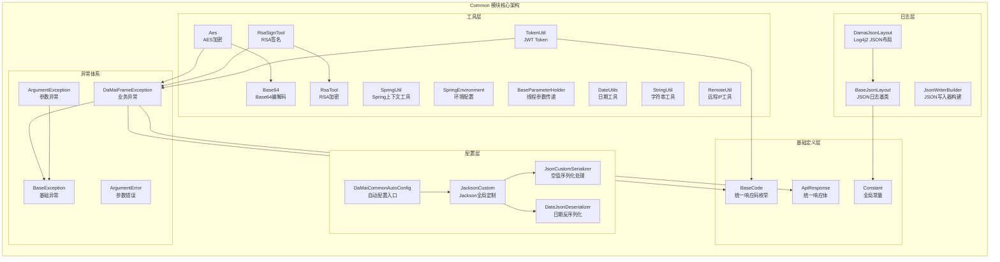
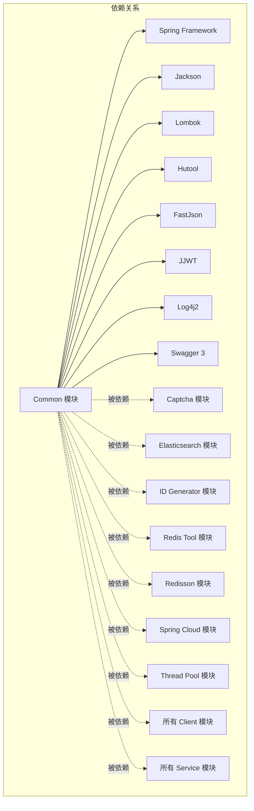
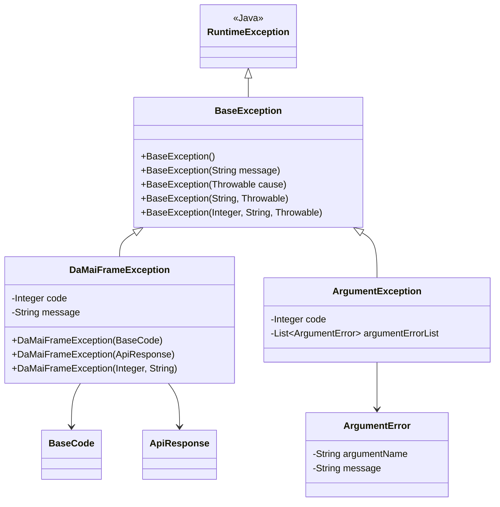
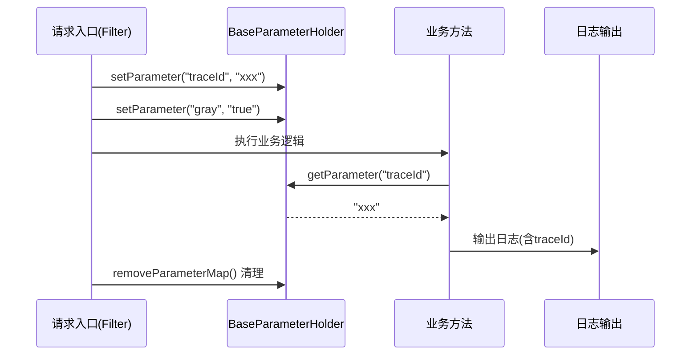
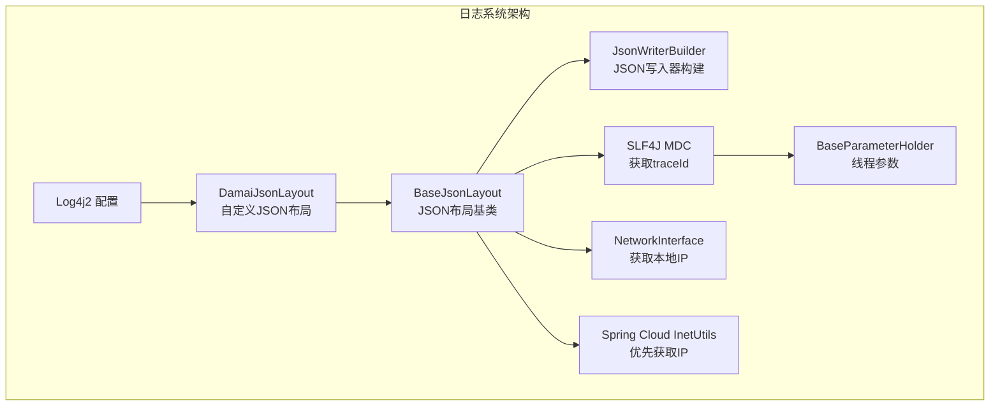
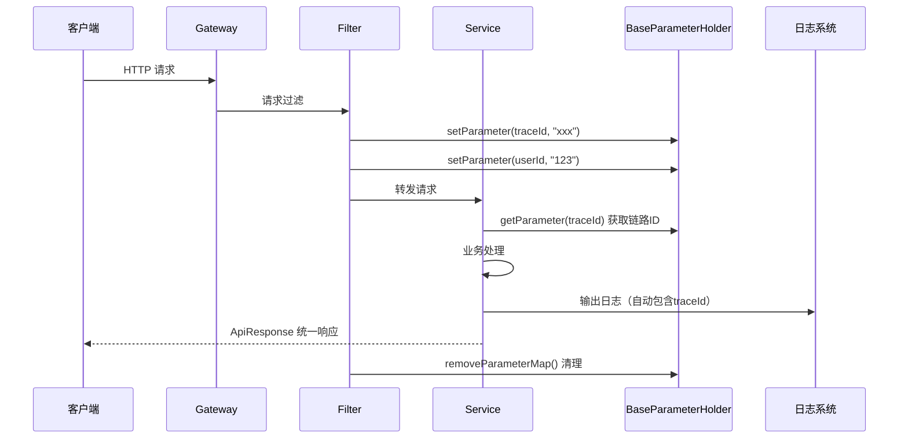
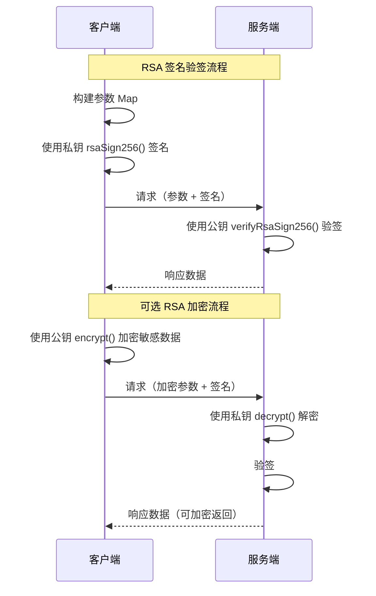
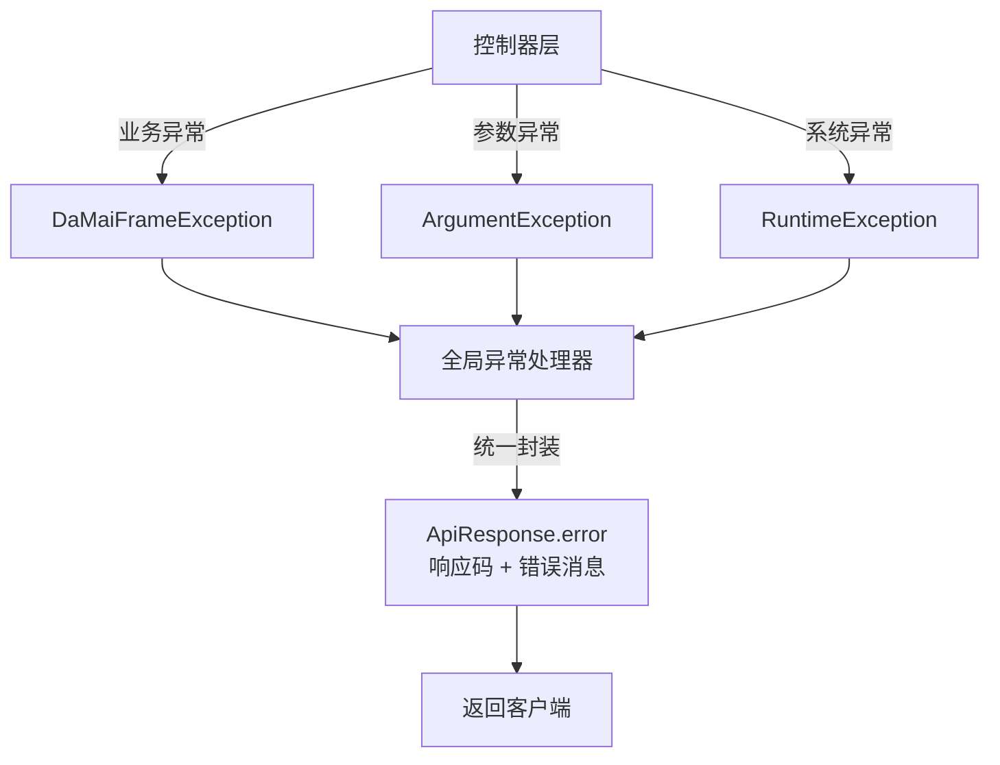
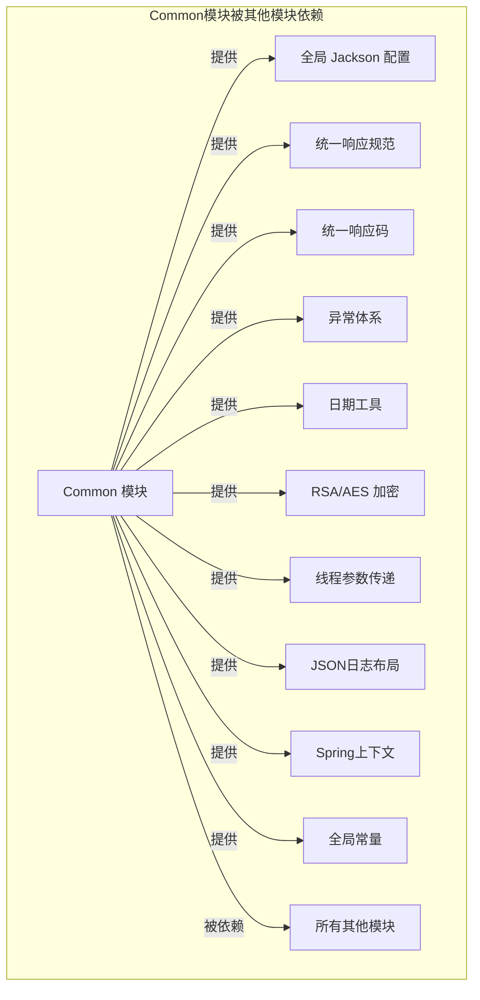

# Common 模块 - 基础公共框架

## 1. 模块简介

Common 模块是整个大麦系统的**基础公共框架**，提供了全局通用的基础能力支撑。该模块是所有其他模块（包括各个 Service 模块、Framework 模块和 Client 模块）的基石，为整个系统提供统一的配置、工具、异常处理、数据响应规范等基础设施。

### 1.1 核心功能

| 功能分类 | 说明 |
|---------|------|
| **统一配置** | Jackson JSON 序列化/反序列化全局配置、日志格式配置 |
| **常量定义** | 系统全局常量（链路追踪 ID、灰度标识等） |
| **工具类库** | 日期处理、加密解密（AES/RSA）、Base64 编解码、JWT Token、字符串处理、远程IP获取 |
| **线程上下文** | 基于 ThreadLocal 的参数传递工具，支持链路追踪 |
| **异常体系** | 统一的基础异常类和业务异常类 |
| **响应规范** | 统一的 API 响应数据结构 |
| **日志增强** | Log4j2 自定义 JSON 日志布局，注入链路追踪 ID 和服务器 IP |
| **枚举定义** | 全局统一的业务枚举（状态码、支付渠道、订单状态等） |
| **环境配置** | Spring 环境覆盖配置 |

## 2. 架构设计

### 2.1 模块架构图



### 2.2 模块依赖关系



## 3. 核心组件详解

### 3.1 配置层

#### DaMaiCommonAutoConfig（自动配置入口）

**作用**：Common 模块的自动配置入口，负责注册全局 Jackson 定制器。

```java
public class DaMaiCommonAutoConfig {
    @Bean
    public Jackson2ObjectMapperBuilderCustomizer jacksonCustom(){
        return new JacksonCustom();
    }
}
```

**关键行为**：
- 向 Spring 容器注册 `JacksonCustom` Bean
- 所有使用 Jackson 的模块（包括 Spring MVC）都会应用此配置

#### JacksonCustom（Jackson 全局定制）

**作用**：全局统一配置 Jackson ObjectMapper 的行为。

**配置项**：

| 配置 | 值/行为 | 说明 |
|------|---------|------|
| 序列化包含策略 | `Include.ALWAYS` | 所有字段都参与序列化 |
| 单引号解析 | 允许 | 支持 JSON 中使用单引号 |
| 未加引号字段名 | 允许 | 支持字段名不加引号 |
| 日期格式 | `yyyy-MM-dd HH:mm:ss` | Date/LocalDateTime 统一格式 |
| 未知属性 | 忽略 | 反序列化时忽略未知字段 |
| 数字转字符串 | 启用 | 防止精度丢失 |

**日期序列化覆盖**：
- `Date` → `yyyy-MM-dd HH:mm:ss`
- `LocalDateTime` → `yyyy-MM-dd HH:mm:ss`
- `LocalDate` → `yyyy-MM-dd`
- `LocalTime` → `HH:mm:ss`

#### JsonCustomSerializer（空值序列化处理器）

**作用**：当对象属性值为 `null` 时，使用自定义默认值替代，而不是忽略该字段。

**空值默认值映射**：

| 字段类型 | null 时的默认值 |
|---------|---------------|
| `String` | `""`（空字符串） |
| `Number` | `""`（空字符串） |
| `Boolean` | `false` |
| `Date` | `""`（空字符串） |
| `DateTime` (Hutool) | `""`（空字符串） |
| 数组/List/Set | `[]`（空数组） |

#### DateJsonDeserializer（日期反序列化）

**作用**：支持多种格式的日期字符串反序列化为 `java.util.Date`。

**支持的格式**：
- 纯数字字符串（时间戳）
- `yyyy-MM`
- `yyyy-MM-dd`
- `yyyy-MM-dd HH:mm`
- `yyyy-MM-dd HH:mm:ss`
- `yyyy/MM/dd HH:mm:ss`

### 3.2 基础定义层

#### Constant（全局常量）

**作用**：定义系统级别的全局常量，减少硬编码。

| 常量名 | 值 | 用途 |
|-------|-----|------|
| `TRACE_ID` | `"traceId"` | 链路追踪 ID 的 Key |
| `GRAY_FLAG_TRUE` | `"true"` | 灰度标识开启 |
| `GRAY_FLAG_FALSE` | `"false"` | 灰度标识关闭 |
| `GRAY_PARAMETER` | `"gray"` | 灰度参数名 |
| `USER_ID` | `"userId"` | 用户 ID 参数名 |
| `CODE` | `"code"` | 响应码参数名 |
| `PREFIX_DISTINCTION_NAME` | `"prefix.distinction.name"` | 项目前缀区分名配置 |
| `DEFAULT_PREFIX_DISTINCTION_NAME` | `"damai"` | 默认项目前缀 |
| `SPRING_INJECT_PREFIX_DISTINCTION_NAME` | SpEL 表达式 | 用于 Spring 注入前缀 |
| `SERVER_GRAY` | SpEL 表达式 | Nacos 灰度元数据配置 |

#### ApiResponse（统一响应体）

**作用**：定义所有 API 接口的统一返回数据结构。

```json
{
  "code": 0,
  "message": "OK",
  "data": {}
}
```

**静态工厂方法**：

| 方法 | 说明 |
|------|------|
| `ok()` | 成功响应（code=0） |
| `ok(T data)` | 成功响应带数据 |
| `error(Integer code, String message)` | 错误响应 |
| `error(BaseCode baseCode)` | 基于枚举创建错误响应 |
| `error()` | 默认系统错误（code=-100） |

#### BaseCode（统一响应码枚举）

**作用**：定义全系统统一的响应码和错误信息枚举。详见 [枚举体系](#6-枚举体系)。

### 3.3 异常体系



**异常关系说明**：

- **BaseException**：所有自定义异常的基类，继承自 `RuntimeException`
- **DaMaiFrameException**：业务异常，携带 `code` 和 `message`，可通过 `BaseCode` 或 `ApiResponse` 构造
- **ArgumentException**：参数校验异常，可携带多个 `ArgumentError` 错误列表
- **ArgumentError**：单个参数错误描述，包含参数名和错误信息

### 3.4 工具层

#### SpringUtil（Spring 上下文工具）

**作用**：实现 `ApplicationContextInitializer`，在 Spring 应用启动时保存 `ConfigurableApplicationContext` 引用，提供静态方法获取配置信息。

**核心方法**：

| 方法 | 说明 |
|------|------|
| `getPrefixDistinctionName()` | 获取项目前缀区分名（默认：`damai`） |
| `initialize(ConfigurableApplicationContext)` | 初始化回调，保存上下文引用 |

#### SpringEnvironment（环境配置）

**作用**：实现 `EnvironmentPostProcessor`，在 Spring 环境准备阶段配置允许 Bean 覆盖定义。

**配置**：`application.setAllowBeanDefinitionOverriding(true)`

#### BaseParameterHolder（线程参数传递）

**作用**：基于 `ThreadLocal<Map<String, String>>` 实现线程级别的参数传递工具，用于链路追踪 ID、灰度标记等上下文信息传递。



**核心方法**：

| 方法 | 说明 |
|------|------|
| `setParameter(name, value)` | 设置线程参数 |
| `getParameter(name)` | 获取线程参数 |
| `removeParameter(name)` | 移除指定参数 |
| `getParameterMap()` | 获取参数 Map |
| `setParameterMap(map)` | 批量设置参数 |
| `removeParameterMap()` | 清除所有参数 |
| `getThreadLocal()` | 获取 ThreadLocal 实例 |

#### DateUtils（日期工具类）

**作用**：提供全面的日期处理能力，包括格式化、解析、时区转换、日期加减、星期计算等。

**内置日期格式**：

| 常量 | 格式 | 示例 |
|------|------|------|
| `FORMAT_DATE` | `yyyy-MM-dd` | 2024-01-15 |
| `FORMAT_HOUR` | `yyyy-MM-dd HH` | 2024-01-15 14 |
| `FORMAT_MINUTE` | `yyyy-MM-dd HH:mm` | 2024-01-15 14:30 |
| `FORMAT_SECOND` | `yyyy-MM-dd HH:mm:ss` | 2024-01-15 14:30:25 |
| `FORMAT_MILLISECOND` | `yyyy-MM-dd HH:mm:ss:SSS` | 2024-01-15 14:30:25:123 |
| `FORMAT_UTC` | `yyyy-MM-dd'T'HH:mm:ss.SSS'Z'` | 2024-01-15T14:30:25.123Z |
| `FORMAT_NO_DATE` | `yyyyMMdd` | 20240115 |
| `FORMAT_NO_SECOND` | `yyyyMMddHHmmss` | 20240115143025 |

**核心方法分类**：

| 分类 | 方法 | 说明 |
|------|------|------|
| **当前时间** | `now()`, `nowStr()` | 获取北京时间当前时间 |
| **格式化** | `format(Date, pattern)`, `formatDate()`, `formatDateTime()` | 日期转字符串 |
| **解析** | `parseDate()`, `parseDateTime()`, `parse(Long)` | 字符串/时间戳转日期 |
| **日期计算** | `addDay()`, `addMonth()`, `addYear()`, `addWeek()`, `addHour()` | 日期加减 |
| **日期范围** | `getDateStart()`, `getDateEnd()` | 获取当天起止时间 |
| **星期** | `getWeek()`, `getWeekStr()`, `getWeekOfYear()` | 星期/周数计算 |
| **数字格式** | `getDateNo()`, `getDateTimeNo()`, `getDateTimeStampNo()` | 获取日期数字表示 |
| **时间节点** | `getDateNode(Date)` | 获取完整时间分解对象 |

#### Aes（AES 加密）

**作用**：提供 AES/CBC/PKCS5Padding 对称加解密能力，兼容 iOS 端。

**核心方法**：

| 方法 | 说明 |
|------|------|
| `encrypt(key, initVector, data)` | 使用密钥和偏移量加密字符串 |
| `decrypt(key, initVector, data)` | 使用密钥和偏移量解密字符串 |
| `getAesByKey(key)` | 根据字符串生成 16 位 AES 密钥 |

**加密流程**：
```
原始数据 → AES/CBC/PKCS5Padding 加密 → Base64 编码 → 密文字符串
```

#### Base64（Base64 编解码）

**作用**：提供符合 RFC 标准的 Base64 编解码实现，支持 MIME 格式。

**核心方法**：

| 方法 | 说明 |
|------|------|
| `encode(byte[] binaryData)` | 字节数组编码为 Base64 字符串 |
| 内部私有方法 | 去除空白字符等 |

#### RsaTool（RSA 加解密）

**作用**：提供 RSA 非对称加密/解密能力，支持密钥对生成。

**核心方法**：

| 方法 | 说明 |
|------|------|
| `getKey()` | 生成 RSA 2048 位密钥对 |
| `encrypt(data, publicKey)` | 使用公钥加密（支持分段加密） |
| `decrypt(data, privateKey)` | 使用私钥解密（支持分段解密） |
| `getPublicKey(keyStr)` | 从字符串解析公钥 |
| `getPrivateKey(keyStr)` | 从字符串解析私钥 |

**分段加密**：RSA 最大加密 117 字节，最大解密 256 字节，超过部分自动分段处理。

#### RsaSignTool（RSA 签名验签）

**作用**：提供 RSA SHA256withRSA 签名和验签能力，支持请求参数签名校验。

**核心方法**：

| 方法 | 说明 |
|------|------|
| `rsaSign256(params, privateKey)` | 对参数 Map 进行签名（参数排序后签名） |
| `verifyRsaSign256(params, publicKey)` | 验证参数 Map 的签名 |

**签名流程**：
```
参数 Map → 按 Key 排序 → 拼接 key=value 字符串 → RSA SHA256 签名 → Base64 编码 → 签名字符串
```

#### TokenUtil（JWT Token 工具）

**作用**：基于 JJWT 库提供 JWT Token 的创建和解析能力。

**核心方法**：

| 方法 | 说明 |
|------|------|
| `createToken(id, info, ttlMillis, secret)` | 创建 JWT Token（HS256） |
| `parseToken(token, secret)` | 解析 JWT Token，返回 Subject |

**Token 结构**：
- Header：`{"alg": "HS256"}`
- Payload：`{jti: id, iat: 签发时间, sub: info, exp: 过期时间}`
- 签名：使用 HMAC-SHA256

#### StringUtil（字符串工具）

**作用**：提供字符串常用处理。

**核心方法**：

| 方法 | 说明 |
|------|------|
| `isEmpty(str)` | 判断字符串是否为空（包含 null、空字符串、空白、"null"、"undefined"） |
| `isNotEmpty(str)` | 判断字符串是否非空 |
| `inputStreamConvertString(is)` | 将 InputStream 转换为字符串 |
| `convertQueryStringToMap(query)` | 将 URL 查询参数转换为 Map |

#### RemoteUtil（远程 IP 工具）

**作用**：从 HTTP 请求中获取客户端真实 IP 地址。

**核心方法**：

| 方法 | 说明 |
|------|------|
| `getRemoteId(request)` | 获取客户端标识（IP + User-Agent） |

**IP 获取逻辑**：
1. 优先读取 `X-Forwarded-For` 请求头中的第一个 IP
2. 如果没有代理头，则使用 `request.getRemoteAddr()`

### 3.5 日志层



**日志输出结构**（增强后的 JSON 日志）：

```json
{
  "projectName": "damai",
  "env": "prod",
  "traceId": "a1b2c3d4...",
  "localIp": "192.168.1.100",
  "level": "INFO",
  "loggerName": "com.damai.controller.XxxController",
  "message": "...",
  ...
}
```

**日志增强特性**：
- 自动注入 `projectName`（项目名称）
- 自动注入 `env`（环境标识）
- 自动注入 `traceId`（链路追踪 ID，从 MDC 获取）
- 自动注入 `localIp`（本机 IP 地址，优先通过 Spring Cloud InetUtils 获取）

## 4. 数据流与交互

### 4.1 请求处理流程



### 4.2 加密通信流程



### 4.3 全局异常处理流程



## 5. 与各模块的集成关系



## 6. 枚举体系

Common 模块定义了大量全局枚举，供全系统使用：

| 枚举类 | 说明 | 关键值示例 |
|--------|------|-----------|
| `BaseCode` | 统一响应码 | SUCCESS(0), SYSTEM_ERROR(-1) |
| `AlipayTradeStatus` | 支付宝交易状态 | - |
| `ApiRuleType` | API 规则类型 | - |
| `AreaType` | 区域类型 | - |
| `BusinessStatus` | 业务状态 | - |
| `CodeType` | 编码类型 | - |
| `CompositeCheckType` | 复合校验类型 | - |
| `IdType` | ID 类型 | - |
| `JobInfoMethodCode` | 任务方法码 | - |
| `JobRunStatus` | 任务运行状态 | - |
| `JobRunType` | 任务运行类型 | - |
| `OrderStatus` | 订单状态 | - |
| `PayBillStatus` | 支付账单状态 | - |
| `PayBillType` | 支付账单类型 | - |
| `PayChannel` | 支付渠道 | - |
| `PermitRefund` | 是否允许退款 | - |
| `ProgramOrderVersion` | 节目订单版本 | - |
| `ProgramPageType` | 节目页面类型 | - |
| `RuleStatus` | 规则状态 | - |
| `RuleTimeUnit` | 规则时间单位 | - |
| `SeatType` | 座位类型 | - |
| `SellStatus` | 售卖状态 | - |
| `Status` | 通用状态 | - |
| `TimeType` | 时间类型 | - |
| `UserLogStatus` | 用户登录状态 | - |
| `VerifyCaptcha` | 验证码校验状态 | - |

## 7. 项目结构

```
damai-common/
├── pom.xml
└── src/main/java/com/damai/
    ├── common/
    │   └── ApiResponse.java          # 统一响应体
    ├── config/
    │   ├── DaMaiCommonAutoConfig.java # 自动配置入口
    │   ├── DateJsonDeserializer.java  # 日期反序列化
    │   ├── JacksonCustom.java         # Jackson全局定制
    │   └── JsonCustomSerializer.java  # 空值序列化
    ├── constant/
    │   └── Constant.java              # 全局常量
    ├── core/
    │   └── SpringUtil.java            # Spring上下文工具
    ├── enums/                         # 全局枚举（共27个）
    │   ├── BaseCode.java
    │   ├── AlipayTradeStatus.java
    │   ├── OrderStatus.java
    │   ├── PayChannel.java
    │   └── ... (其他枚举)
    ├── environment/
    │   └── SpringEnvironment.java     # 环境配置
    ├── exception/
    │   ├── ArgumentError.java         # 参数错误
    │   ├── ArgumentException.java     # 参数异常
    │   ├── BaseException.java         # 基础异常
    │   └── DaMaiFrameException.java   # 业务异常
    ├── jwt/
    │   └── TokenUtil.java             # JWT Token 工具
    ├── log4j/
    │   ├── BaseJsonLayout.java        # JSON日志基类
    │   ├── DamaiJsonLayout.java       # Log4j2 JSON布局
    │   └── JsonWriterBuilder.java     # JSON写入器构建
    ├── test/
    │   └── Test.java                  # 测试示例
    ├── threadlocal/
    │   └── BaseParameterHolder.java   # 线程参数传递
    └── util/
        ├── Aes.java                   # AES 加密
        ├── Base64.java                # Base64 编解码
        ├── DateUtils.java             # 日期工具
        ├── RemoteUtil.java            # 远程IP工具
        ├── RsaSignTool.java           # RSA 签名验签
        ├── RsaTool.java               # RSA 加解密
        └── StringUtil.java            # 字符串工具
```

## 8. 参考文档

| 文档 | 说明 |
|------|------|
| [Captcha Framework](damai-captcha-manage-framework.md) | 验证码框架，使用 Common 的 ApiResponse 和 BaseCode |
| [Redis Tool Framework](damai-redis-tool-framework.md) | Redis 工具框架，使用 Common 的 SpringUtil |
| [Redisson Framework](damai-redisson-framework.md) | Redisson 框架，使用 Common 的异常体系 |
| [Spring Cloud Framework](damai-spring-cloud-framework.md) | Spring Cloud 框架，使用 Common 的 BaseParameterHolder |
| [Thread Pool Framework](damai-thread-pool-framework.md) | 线程池框架，使用 Common 的常量 |
